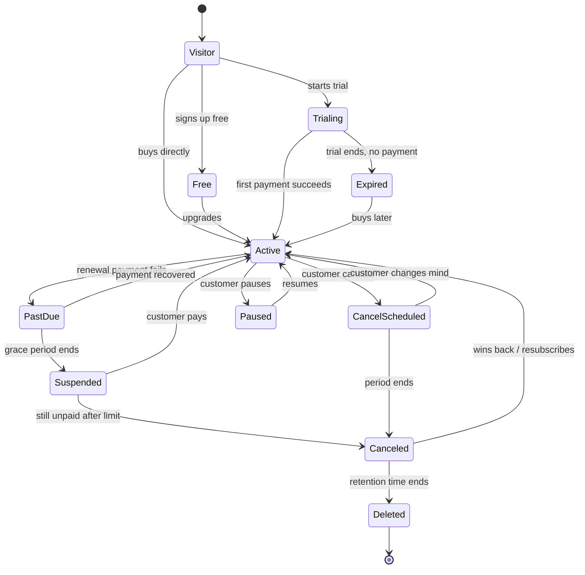

# How to Fill This Document

Read this whole box once. It takes 3 minutes and saves hours.

## What this file is
This is the **single source of truth** for how customers pay you, from the first time they see a price until they cancel, come back, or leave for good. Humans fill it in. AI agents then read it and build, test, and launch from it. **If it is not written here, the AI is not allowed to guess it.**

## How to fill it in (6 simple rules)
1. **Answer every question in order.** Each question has *Why we ask*, an *Example*, and a *Your answer* line. Type on the `Your answer:` line.
2. **Copy the shape of the example, not the words.** Examples use a made-up product called "PlantPal".
3. **Use real numbers with units.** Write `$12 per month`, not "cheap". Write `14 days`, not "a couple weeks". Do not use vague words alone (see the "Vague words" table below).
4. **Never leave a blank.** Pick ONE of these tags at the start of your answer:
   - `DECIDED:` you are sure. (Example: `DECIDED: 14-day free trial, no card needed`)
   - `TBD(owner, date):` you are not sure yet. (Example: `TBD(Sam, 2026-11-05): need to ask accountant`)
   - `N/A(reason):` does not apply. (Example: `N/A(we have no mobile app)`)
5. **Tags in the question title tell you how important it is:** `[R]` = Required, the AI will stop without it. `[O]` = Optional, can be answered later.
6. **The Kid Test.** After each section, ask: "Could a 10-year-old read my answers and explain what happens to a customer?" If not, make it simpler.

## Words you will see
| Word | Plain meaning |
|---|---|
| Subscription | A customer pays again and again (monthly or yearly) to keep using your product |
| Plan / Tier | A package, such as Free, Pro, Team |
| Trial | Free use for a short time before paying |
| Renewal | The next automatic charge |
| Churn | Customers who leave |
| Dunning | Politely chasing a payment that failed |
| Grace period | Extra days after a failed payment where the customer can still use the product |
| Proration | Charging a fair part-price when someone changes plans in the middle of a month |
| Entitlement | "What this customer is allowed to use right now" |
| MRR | Monthly Recurring Revenue: all monthly subscription money added up |
| Webhook | A message the billing tool sends your app saying "something happened" |
| Source of truth | The one place that is always right. Everything else copies from it |
| Idempotent | Doing the same thing twice gives the same result (no double charges) |
| MoR | Merchant of Record: a company that legally sells for you and handles tax |

## Vague words you may NOT use alone
If you catch yourself writing one of these words, replace it with a number, a unit, and an owner.

| Vague word | Write this instead | Example |
|---|---|---|
| soon / quickly / fast | A time limit | "within 10 seconds" |
| a few / several / some / many | An exact count | "3 retries" |
| cheap / affordable / expensive | A price | "$12 per month" |
| easy / simple / clear | A measurable test | "cancel takes 2 clicks" |
| normal / usual / standard | The exact value | "the 1st of each month" |
| big / small / large customer | A size threshold | "50 or more seats" |
| often / regularly | A schedule | "every Monday at 09:00" |
| manageable / healthy / good | A target number | "below 5 tickets per 100 customers" |
| the team / someone / we | A named person or role | "Sam (Billing admin)" |
| later / eventually | A date | "by 2026-12-01" |
| and so on / etc. | The full list | List every item |

## Status key used in every section
`☐` not started  |  `◐` in progress  |  `☑` done and checked

## Who does what
| Role | What they do in this file |
|---|---|
| **Owner** (founder / product lead) | Answers business and money questions |
| **Builder** (engineer or AI agent) | Answers technical questions, builds from the file |
| **Checker** (QA person or AI agent) | Fills Section M tests, signs off |
| **Advisor** (lawyer / accountant) | Reviews Sections E and F before launch |

## What "finished" means
This file is ready when: (a) every `[R]` question is `DECIDED` or `N/A`, (b) the Readiness Score in Section O is 100% for the phase you are in, and (c) Owner and Checker have signed Section P.

## Warning about laws and app-store rules
Rules about cancelling, renewals, and app-store payments **change often**. Section F lists what was true on the template date (2026-10-19). Always re-check the "Last verified" date and ask a lawyer. This template is not legal or tax advice.

---

# Section 0. Document Control

| Field | Your answer |
|---|---|
| Project name | |
| Project code (short, no spaces) | |
| Document owner (name + contact) | |
| Version of THIS file | 0.1 |
| Date started | |
| Last updated | |
| Current phase (see Section L) | ☐ 0 Plan ☐ 1 Build ☐ 2 Test ☐ 3 Soft launch ☐ 4 Public launch ☐ 5 Growth |
| Template version used | 1.2.0 |

**Change log** (add a line every time you change an answer)
| Date | Who | What changed | Why |
|---|---|---|---|
| | | | |

---

# Section A. The Product and the Business

> **Goal:** The AI must know what you sell and to whom before it builds a single billing screen.

**A1. [R] In one sentence, what does your product do?**
*Why we ask:* Every later decision (pricing, trial length, support) depends on this.
*Example:* "PlantPal reminds people when to water their houseplants."
**Your answer:**

**A2. [R] Who pays: a person, a team, or a company?**
*Example:* "Mostly individuals; teams of 2 to 10 later."
**Your answer:**

**A3. [R] Where can customers use the product?** (tick all)
- ☐ Website / web app
- ☐ iPhone / iPad app
- ☐ Android app
- ☐ Desktop app
- ☐ API (other programs use it)
**Your answer / notes:**

**A4. [R] Where do customers pay?** (This decides which rules apply. See Section D.)
- ☐ Only on our website
- ☐ Inside the iPhone app (Apple In-App Purchase)
- ☐ Inside the Android app (Google Play Billing)
- ☐ In the app, but sent to our website to pay (external link)
- ☐ Mix of the above. Describe:
**Your answer:**

**A5. [R] Which countries will you sell to at launch?** (Name them or write "worldwide")
*Why we ask:* Tax, cancel laws, and currency change by country.
If you name any country, fill one block for each in **Appendix 7**.
**Your answer:**

**A6. [R] Are your customers consumers (regular people) or businesses?**
*Why we ask:* Consumer protection laws are much stricter for consumers.
- ☐ Consumers (B2C)  ☐ Businesses (B2B)  ☐ Both
**Your answer:**

**A7. [R] Your business goal for this document:** reach **500 paying customers** by what date?
**Your answer:**

**A8. [O] Your target for monthly revenue (MRR) at 500 customers?**
*Example:* "500 x $12 = $6,000 MRR."
**Your answer:**

**A9. [R] Who is your billing provider (the tool that charges cards)?**
*Examples:* Stripe, Paddle, Lemon Squeezy, Chargebee, Recurly, Apple, Google Play, other.
**Your answer:**

**A10. [R] Is your provider a Merchant of Record (MoR)?** (MoR = they sell on your behalf and handle sales tax/VAT for you.)
- ☐ Yes  ☐ No  ☐ Not sure -> write `TBD`
**Your answer:**

**A11. [R] Which optional modules do you need?** (Each one adds a full section. Skip what you do not need; write `N/A(reason)` in the skipped section's first line.)
- ☐ **Module R: Teams and Organizations** (several people share one subscription, roles, seats)
- ☐ **Module S: Enterprise and Invoiced Billing** (quotes, contracts, pay-by-invoice, purchase orders)
- ☐ **Module T: Affiliates, Referrals, and Partner Payouts** (you pay people who bring customers)
- ☐ None of these
**Your answer:**

> **AI-agent instructions for Section A**
> - Read A1 to A10 first. If any `[R]` answer starts with `TBD`, **stop and ask the Owner**.
> - Create a `project_context` config/file from these answers. Do not hard-code provider names in business logic; wrap the provider behind one interface (`BillingProvider`).
> - **Acceptance check:** A teammate can state the product, buyer, payment places, countries, and provider after reading only this section.

---

# Section B. Plans, Prices, and Packaging

> **Goal:** One clear table of everything a customer can buy. This is what the AI will turn into products and prices in your billing tool.

**B1. [R] List every plan.** Fill one row per plan. Add one row for every extra plan; there is no limit.

| Plan name (public) | Internal ID (no spaces, e.g. `pro_monthly`) | Who it is for | Monthly price | Yearly price | Currency | Free trial? (days) | Visible on pricing page? |
|---|---|---|---|---|---|---|---|
| Example: Free | `free` | Hobby users | $0 | $0 | USD | N/A | Yes |
| Example: Pro | `pro_monthly` | Power users | $12 | $120 | USD | 14 | Yes |
| | | | | | | | |
| | | | | | | | |

**B2. [R] What does each plan include?** (features and limits)

| Feature / limit | Free | Plan 2 | Plan 3 |
|---|---|---|---|
| Example: Plants tracked | 5 | 100 | Unlimited |
| Example: Reminders per day | 3 | 50 | Unlimited |
| | | | |

**B3. [R] Which pricing styles do you use?** (tick all; fill the matching block)
- ☐ **Flat tiers** (fixed price per plan) -> fill B1 and B2 only
- ☐ **Per seat** (price per user) -> fill B4
- ☐ **Usage-based** (pay for what is used) -> fill B5
- ☐ **Free trial** -> fill B6
- ☐ **Freemium** (free plan forever) -> fill B7

### B4. Per-seat pricing (skip if not used)
| Question | Your answer |
|---|---|
| Price per seat per month | |
| Minimum seats | |
| Maximum seats | |
| Who counts as a "seat"? (active user? invited user?) | |
| When a seat is added mid-month: charge now (prorated) or next bill? | |
| When a seat is removed: refund/credit now, or keep until the end of the period? | |
| Volume discount tiers? (e.g., 1 to 10 seats = $10, 11+ = $8) | |

### B5. Usage-based pricing (skip if not used)
| Question | Your answer |
|---|---|
| What exactly is counted? (API calls, credits, tokens, GB...) | |
| Included free amount per period | |
| Price per extra unit | |
| Is usage billed **in advance** (prepaid credits) or **after** (pay-as-you-go)? | |
| Does unused usage roll over? For how long? | |
| What happens at the limit? ☐ Block ☐ Charge overage ☐ Slow down ☐ Ask customer first | |
| Spending cap or alert (e.g. warn at 80%)? | |
| How often do you total up usage? (real time / hourly / daily) | |
| How do you prevent counting the same event twice? | |
| Who can see the usage numbers? | |

### B6. Free trial rules (skip if no trial)
| Question | Your answer |
|---|---|
| Trial length (days) | |
| Is a card required to start? ☐ Yes ☐ No | |
| What happens at the end if no card? ☐ Downgrade to Free ☐ Lock account ☐ Delete data after ___ days | |
| What happens at the end if card on file? (auto-charge) | |
| Reminder email before the trial ends? How many days before? | |
| One trial per person? How do you check? (email, device, card) | |
| Can the trial be cancelled in one step? | |

### B7. Freemium rules (skip if no free forever plan)
| Question | Your answer |
|---|---|
| What is limited on Free? | |
| What nudges people to upgrade? | |
| Is there a paywall? Where does it appear? | |
| Can Free accounts be deleted for inactivity? After how long? | |

**B8. [R] Discounts, coupons, and promos.**
| Question | Your answer |
|---|---|
| Do you offer coupons? (% off, $ off, free months) | |
| How long does a discount last? (once / N months / forever) | |
| Can discounts stack? | |
| Student/non-profit/regional pricing? | |
| Annual-plan discount (e.g., "2 months free")? | |

**B9. [R] Price changes.** What is your rule when you raise prices for existing customers? (notice period, grandfathering?)
*Example:* "Give 30 days written notice; existing customers keep the old price for 12 months."
**Your answer:**

**B10. [O] Add-ons or one-time purchases?** (extra storage, setup fee...)
**Your answer:**

> **AI-agent instructions for Section B**
> - Create one billing **product + price** for every row in B1. Use the **Internal ID** as the provider's lookup key. Never rely on display names.
> - Build ONE **entitlements table** from B2 (plan -> features/limits). Code must check entitlements, **never plan names**.
> - Money is stored in the **smallest currency unit** (cents) as integers, never floats.
> - **Acceptance checks:** (1) Every plan in B1 exists in the billing provider test mode with the correct price. (2) A test customer on each plan gets exactly the B2 features. (3) Changing a limit in B2 changes behavior without a code change.

---

# Section C. The Customer Journey (Lifecycle Stages)

> **Goal:** Describe every state a customer can be in, what they can do, what they are charged, and how they move between states. **This is the heart of the document.**

## C0. The lifecycle map


*Edit this map if your product has different states. The AI builds the state machine from this picture and C1.*

## C1. [R] State table
Fill each row. The examples show typical answers.

| State | Plain meaning | Can use product? | Being charged? | Moves to (and when) |
|---|---|---|---|---|
| Visitor | Not signed up yet | Public pages only | No | Trialing / Free / Active |
| Free | Free plan | Free features | No | Active on upgrade |
| Trialing | In free trial | Example: Everything in Pro | No | Active on payment; Expired at day ___ |
| Active | Paying, all good | Plan features | Yes, every period | PastDue, CancelScheduled, Paused |
| PastDue | Last payment failed | Example: Yes (grace) | Retrying | Active or Suspended |
| Suspended | Not paid after grace | Example: Read-only | No | Active or Canceled |
| Paused | Customer paused | Example: No | No | Active on resume |
| CancelScheduled | Cancelled, still paid until period end | Yes until end date | No new charges | Canceled / Active |
| Canceled | Subscription over | Free features only | No | Active (win-back), Deleted |
| Expired | Trial ended without paying | Free features only | No | Active |
| Deleted | Data removed | No | No | End |

**Your changes or extra states:**

## C2. Sign-up and checkout

**C2.1 [R] What does a customer do, step by step, to buy?** (Write numbered steps.)
*Example:* 1) Click "Start trial". 2) Create account with email. 3) Pick plan. 4) Enter card. 5) See "Trial started" page. 6) Get welcome email.
**Your answer:**

**C2.2 [R] Which payment methods?** ☐ Credit/debit card ☐ Apple Pay ☐ Google Pay ☐ PayPal ☐ Bank debit ☐ Invoice/bank transfer ☐ Other:
**Your answer:**

**C2.3 [R] Before they pay, what do you show clearly?** (Many laws require this.) Tick all you show:
- ☐ Price and currency
- ☐ How often they are charged
- ☐ That it renews automatically
- ☐ Trial end date and the price after the trial
- ☐ How to cancel
- ☐ Tax included or added
**Your answer / where shown:**

**C2.4 [R] How do customers prove they agreed to renew automatically?** (checkbox, button text, saved timestamp)
**Your answer:**

**C2.5 [R] What happens if the card is declined at sign-up?**
**Your answer:**

**C2.6 [R] Is there a guest checkout (pay before making an account)?**
**Your answer:**

## C3. First access (activation)

**C3.1 [R] What is the "aha moment"?** (The first thing that makes a customer say "this is useful.")
*Example:* "They add their first plant and get their first reminder."
**Your answer:**

**C3.2 [R] How soon after paying must access turn on?** (Example: within 10 seconds.)
**Your answer:**

**C3.3 [O] What onboarding emails/screens help them reach the aha moment?**
**Your answer:**

## C4. Renewals

**C4.1 [R] When is the customer charged?**
- ☐ Same day of the month they signed up
- ☐ First of every month (calendar billing)
- ☐ Other:
**Your answer:**

**C4.2 [R] What if the renewal date does not exist (e.g., the 31st)?**
*Example:* "Charge on the last day of the month."
**Your answer:**

**C4.3 [R] Do you send a reminder before renewal?** How many days before? (Yearly plans especially.)
**Your answer:**

**C4.4 [R] What receipt/invoice does the customer get after each charge, and where can they find old ones?**
**Your answer:**

## C5. Upgrades, downgrades, and plan changes

**C5.1 [R] Upgrade (to a more expensive plan): when does it start and how is it charged?**
- ☐ Immediately, charge the difference for the rest of the period (proration)
- ☐ Immediately, charge full new price, restart the period
- ☐ At next renewal
**Your answer:**

**C5.2 [R] Downgrade: when does it start, and is any money returned?**
- ☐ At next renewal, no refund (common)
- ☐ Immediately with credit
- ☐ Immediately, no credit
**Your answer:**

**C5.3 [R] Monthly <-> Yearly switch rules?**
**Your answer:**

**C5.4 [R] If a downgrade would break their data (e.g., they have 80 plants but the new plan allows 5), what happens?**
*Example:* "Keep the data, make it read-only, ask them to delete down to 5 within 30 days."
**Your answer:**

**C5.5 [R] Show the math with ONE example.** (Customer on $12/month Pro moves to $30/month Team after 10 of 30 days. What do they pay today?)
**Your answer:**

## C6. Pause and resume (skip if you do not allow pausing)

| Question | Your answer |
|---|---|
| Can customers pause? | |
| Maximum pause length | |
| What can they access while paused? | |
| What happens to the billing date when they resume? | |
| What happens when the pause maximum is reached? | |

## C7. Cancelling

**C7.1 [R] Where exactly does a customer click to cancel?** (Write the page name and the number of clicks from the home screen. The target is 2 clicks or fewer from Settings. See Section F.)
**Your answer:**

**C7.2 [R] How many clicks/steps does cancelling take, compared with signing up?** (They should be equal or fewer.)
**Your answer:**

**C7.3 [R] When does access end after cancelling?**
- ☐ At the end of the paid period (recommended)
- ☐ Immediately
**Your answer:**

**C7.4 [R] Do you ask "why are you leaving?"** (Must be optional and not block cancelling.)
**Your answer:**

**C7.5 [O] Do you show a save offer (discount/pause) before cancelling?** (Allowed only if the customer can still finish cancelling easily.)
**Your answer:**

**C7.6 [R] What confirmation does the customer receive?** (On screen + email, with the end date.)
**Your answer:**

**C7.7 [R] What if cancelling inside a mobile app but they paid on the website (or the reverse)?** Where do they go?
**Your answer:**

## C8. Refunds and money-back

| Question | Your answer |
|---|---|
| Do you offer a money-back guarantee? How many days? | |
| Who can approve a refund? | |
| Refund full, partial, or credit? | |
| Are yearly plans refunded differently from monthly? | |
| What is NOT refundable? (usage already consumed, add-ons) | |
| How long does a refund take to reach the customer? | |
| What happens to access after a refund? | |
| How do you handle a **chargeback** (customer disputes with their bank)? Who answers? Deadline? | |
| Refunds for mobile app purchases (store handles them) | |

## C9. Failed payments (dunning)

> Most failed payments are not angry customers. They are expired cards, empty accounts, or bank hiccups. Recovering them is the cheapest growth you will ever do.

**C9.1 [R] Retry schedule.** *Typical industry starting point:* retry around day 1, 3, 7, and 14 after failure; do **not** retry every day; only retry "soft" declines (temporary, such as insufficient funds), not "hard" declines (stolen card, closed account). If your provider has "smart retries", use them.

| Retry # | Days after first failure | Notes |
|---|---|---|
| 1 | | |
| 2 | | |
| 3 | | |
| 4 | | |

**C9.2 [R] Grace period** (customer keeps access while you chase).
| Question | Your answer |
|---|---|
| Grace length (days) | |
| Same for every plan, or longer for big customers? | |
| What can the customer do during grace? | |
| What do they see in the app? (banner text) | |

**C9.3 [R] Dunning emails.** *Typical:* 3 to 4 emails over about 15 days.
| # | When | Tone | What it says | Link goes to |
|---|---|---|---|---|
| 1 | Right after failure | Friendly | "Payment didn't go through. Update card here." | Card update page |
| 2 | | | | |
| 3 | | | | |
| Final | | Plain words, no threats, no capital-letter shouting | "Access will pause on ___." | |

**C9.4 [R] After grace ends:** ☐ Pause (read-only) ☐ Cancel ☐ Mark unpaid and keep trying. Which and why?
**Your answer:**

**C9.5 [R] Automatic card updating / expiring card warnings?** (Ask your provider.) Used? ☐ Yes ☐ No
**Your answer:**

**C9.6 [R] Can the customer fix payment themselves without logging in?** (A secure payment-update link.)
**Your answer:**

## C10. Win-back (coming back after leaving)

| Question | Your answer |
|---|---|
| Do you send win-back emails? When (e.g., 7, 30, 90 days)? | |
| Any win-back offer? | |
| When they return, do they get their old data and settings back? | |
| Do they keep old pricing or get today's price? | |
| Can a trial be used again? | |

## C11. Leaving for good (data exit)

| Question | Your answer |
|---|---|
| Can the customer export their data? In what format? | |
| How long after cancelling do you keep their data? (days) | |
| When and how is data deleted? | |
| Do you keep invoices/billing records? How long? (Laws often require years.) | |
| What is deleted instantly if they ask (privacy request)? | |
| Does the customer get a "we deleted your data" confirmation? | |

> **AI-agent instructions for Section C**
> - Build a **finite state machine** from C0/C1. Every state change must be: (1) allowed by C1, (2) logged with timestamp + reason + who/what triggered it, (3) driven by **provider webhooks**, not by the front-end.
> - **Access is computed from the subscription state + entitlements.** Never store "is_paid = true" by hand.
> - Handle webhooks **idempotently** (same event twice = same result) and **out of order** (an old event must not overwrite a newer state).
> - Dunning timings, grace days, and emails come from C9 as **configuration**, not constants in code.
> - Cancelling must be reachable in the product with equal or fewer steps than signing up (C7.2).
> - **Acceptance checks:** every arrow in C0 has a passing test (Section M); no state exists in code that is not in C1; no illegal transition is possible.

---

# Section D. Where the Money Is Collected (Web vs. Mobile Stores)

> **Goal:** If you sell inside iPhone/Android apps, the app stores have their own rules and fees. Rules differ by country and **are changing right now.**

**D1. [R] Payment path for each platform.**
| Platform | How customers pay | Provider | Who handles refunds | Who handles cancel |
|---|---|---|---|---|
| Web | | | | |
| iOS app | | | | |
| Android app | | | | |

**D2. [R] If you use app stores, which of these will you use?** (tick all)
- ☐ Store billing only (Apple IAP / Google Play Billing). Store takes a commission and handles payment/refunds.
- ☐ Store billing + link to our website checkout (external link). Rules and fees vary by country; Apple's US rules and fees were still being decided in courts as of this template date.
- ☐ Sell only on the web; app just logs in ("web2app").
**Your answer / countries:**

**D3. [R] Do you offer the same subscription on web and mobile?** If yes, how does the app know someone already paid on the web?
**Your answer:**

**D4. [R] Source of truth for "is this customer subscribed?"**
*Example:* "Our own database, updated by Stripe webhooks and by App Store / Play server notifications."
**Your answer:**

**D5. [R] Store fees budget.** What commission % do you assume per store and region? (Write the date you checked.)
**Your answer:**

**D6. [R] Does the app follow store review rules for subscriptions?** (clear price, trial info, restore purchases button, link to terms and privacy, cancellation info)
- ☐ Yes, checklist below completed
- ☐ Not yet
- [ ] "Restore purchases" button exists
- [ ] Price and period shown before purchase
- [ ] Terms of Use and Privacy links shown
- [ ] Trial end and post-trial price shown
- [ ] How to manage/cancel explained

**D7. [O] Kids/minors?** Are any customers under 18? (Stores add extra rules, such as parental gates.)
**Your answer:**

> **AI-agent instructions for Section D**
> - Keep **one internal subscription record** per customer with a `source` field (`web`, `apple`, `google`). Map all three sources into the same state machine from Section C.
> - Verify store receipts/notifications **on the server**, never trust the app.
> - Make payment paths and fee percentages **configurable per country**.
> - **Acceptance checks:** a purchase made on each source unlocks the correct entitlements; a cancel/refund made on each source locks them correctly; "Restore purchases" works on a fresh install.

---

# Section E. Money Rules: Tax, Invoices, Currency, Accounting

> **Goal:** Make sure money is collected legally, reported correctly, and matches your bank.

**E1. [R] Who collects and pays sales tax / VAT / GST?** ☐ Our MoR provider ☐ We do (with a tax tool) ☐ Not sure -> `TBD`
**Your answer:**

**E2. [R] Where are you registered for tax?** (country/state list, or "not yet, advisor is checking")
**Your answer:**

**E3. [R] Are prices shown tax-included or tax-added?** (Many countries require tax-included for consumers.)
**Your answer:**

**E4. [R] What goes on an invoice/receipt?** Tick all:
- ☐ Business name and address
- ☐ Customer name/email (business customers: company name and tax ID)
- ☐ Invoice number (unique, in order)
- ☐ Date, plan, period covered
- ☐ Price, tax amount, total, currency
- ☐ Payment method (last 4 digits only)
**Your answer:**

**E5. [R] Currencies:** which do you charge in? Do you show local prices? Who handles currency conversion?
**Your answer:**

**E6. [R] How do you match provider payouts to your bank deposits?** (monthly check, tool, accountant)
**Your answer:**

**E7. [O] How do you count revenue for accounting?** (A yearly plan paid upfront is usually recognized month by month. Ask your accountant.)
**Your answer:**

**E8. [R] Who gets the weekly money report and what is in it?**
**Your answer:**

**E9. [R] Payment-card safety (PCI).** Confirm: card numbers are entered **only** on the provider's hosted fields/pages and **never** touch our servers or logs.
- ☐ Confirmed  ☐ Not yet
**Your answer:**

> **AI-agent instructions for Section E**
> - **Never** store, log, print, or email full card numbers, CVC, or provider secret keys.
> - Generate invoice numbers sequentially and never reuse them.
> - Build a daily **reconciliation job** comparing provider charges/refunds with internal records; send a mismatch alert.
> - **Acceptance checks:** sample invoice contains every item ticked in E4; tax on test purchases for 3 sample countries matches the advisor's expected numbers.

---

# Section F. Laws, Rules, and Compliance

> **Goal:** Do not get fined, sued, or removed from an app store. **Ask a qualified lawyer to review this section before launch.**

**Status of key rules on 2026-10-19 (Last verified: 2026-10-19. Re-check every 3 months.)**

| Region | Rule in plain words | Status (as of date above) | Do this |
|---|---|---|---|
| **USA (federal)** | A rule requiring cancellation to be as easy as sign-up was finalized in 2024 but was struck down by a federal appeals court in July 2025 for procedural reasons. The FTC started a new rulemaking in March 2026. The older ROSCA law is still used for enforcement. | Changing. Not a settled new rule yet. | Follow "easy in, easy out" anyway. Clear disclosure, clear consent, simple cancel. |
| **USA (states)** | Many states (e.g., California) have their own auto-renewal laws: clear terms, consent, easy online cancel, renewal reminders. | In force; varies by state. | Ask your lawyer which states you sell to. |
| **European Union** | Online sellers must offer a prominent "withdrawal" function (a clearly labelled button plus a confirmation step) under Directive (EU) 2023/2673. | Mandatory from **19 June 2026**. Further EU subscription rules (Digital Fairness Act) are planned. | Add the EU-compliant cancel/withdraw flow for EU customers. |
| **United Kingdom** | New subscription rules under the DMCC Act (renewal reminders, easier cancellation) were delayed to no earlier than autumn 2026. | Details pending. | Design for renewal reminders and easy cancel now. |
| **Privacy (EU/UK GDPR, California CCPA/CPRA, others)** | People can ask to see, export, and delete their data. | In force. | Fill Section C11 and H. |
| **App stores (Apple/Google)** | Store rules for subscriptions, external links, and commissions differ by country and are being changed by courts and regulators. | Changing. | Re-check store guidelines before every release. |

**F1. [R] Which laws apply to you?** (Based on A5 countries and A6 consumer/business.) Write the list and who confirmed it. Fill an Appendix 7 block for each country.
**Your answer:**

**F2. [R] Cancel-flow checklist** (tick when true)
- [ ] Cancel link is easy to find (account settings, 1 to 2 clicks)
- [ ] Not harder than signing up
- [ ] No forced phone call, chat, or email to cancel (for products sold online)
- [ ] Customer sees the end date and price before confirming
- [ ] Confirmation screen + email after cancelling
- [ ] No fake "last chance" countdowns, guilt text, or hidden buttons (dark patterns)
- [ ] EU-compliant withdrawal button for EU customers

**F3. [R] Sign-up disclosure checklist**
- [ ] Price, billing period, and auto-renewal shown before payment
- [ ] Trial length and what it converts to shown clearly
- [ ] Customer actively agrees (not pre-ticked)
- [ ] Record of consent saved (time, text shown, IP/device)
- [ ] Renewal reminder emails sent when required

**F4. [R] Privacy**
| Question | Your answer |
|---|---|
| Privacy policy URL | |
| Terms of service URL (includes billing, refund, and cancel terms) | |
| Who handles data requests? Email? | |
| Reply deadline (e.g., within 30 days) | |
| Where is billing data stored (country)? | |

**F5. [R] Legal reviewer**
| Reviewer name | Date | Verdict |
|---|---|---|
| | | |

> **AI-agent instructions for Section F**
> - Do not claim legal compliance. Build the **flows** in F2/F3 and expose a **compliance checklist report** for the lawyer.
> - Save consent records and cancel events in an **append-only log**.
> - Region-specific behavior (EU withdrawal button, state rules) must be **feature-flagged by country**.
> - **Acceptance checks:** F2 and F3 are all ticked by the Checker with screenshots; consent record exists for every test purchase.

---

# Section G. Messages to Customers

> **Goal:** Every important moment sends a clear message. Fill the table; the AI writes drafts you approve.

**G1. [R] Message list.** Channel: E = email, A = in-app, P = push, S = SMS.

| # | Moment | Channel | Send when | Must include | Owner approves? |
|---|---|---|---|---|---|
| 1 | Welcome | E | Right after sign-up | Login link, next step | ☐ |
| 2 | Trial started | E | Start | End date and price after trial | ☐ |
| 3 | Trial ending soon | E | ___ days before | Date, price, how to cancel | ☐ |
| 4 | Payment receipt | E | Each charge | Amount, period, invoice link | ☐ |
| 5 | Upcoming renewal | E | ___ days before | Date, amount, how to cancel | ☐ |
| 6 | Payment failed (dunning 1 to 4) | E, A | See C9 | How to fix | ☐ |
| 7 | Plan changed | E | Right after | Old/new plan, charge, date | ☐ |
| 8 | Cancel confirmed | E | Right after | End date, what happens to data | ☐ |
| 9 | Refund issued | E | Right after | Amount, time to arrive | ☐ |
| 10 | Card expiring | E | ___ days before | Update link | ☐ |
| 11 | Usage warning (80%, 100%) | E, A | When reached | Usage, next step | ☐ |
| 12 | Win-back | E | ___ days after cancel | Offer, return link | ☐ |
| 13 | Data deletion warning | E | ___ days before | Date, export link | ☐ |

**G2. [R] "From" name and reply-to address; who answers replies?**
**Your answer:**

**G3. [R] Tone of voice** (3 words) and a sample sentence.
**Your answer:**

**G4. [R] Languages supported at launch?**
**Your answer:**

> **AI-agent instructions for Section G**
> - Draft every message from G1 in the G3 tone and put them in `/emails/` as templates with placeholders (`{{plan}}`, `{{amount}}`).
> - **Never send from the AI unattended.** Messages go live only after the Owner ticks "Owner approves".
> - Every billing email must include a working "manage subscription" link.
> - **Acceptance checks:** each moment in G1 triggers exactly one message (no duplicates) in test mode; all placeholders render with real test data.

---

# Section H. Data, Security, and Reliability

**H1. [R] What customer data do you store about billing?** (email, plan, status, provider customer ID, last 4 digits...)
**Your answer:**

**H2. [R] Security checklist**
- [ ] Provider API keys only in a secrets manager (never in code or chat)
- [ ] Test keys and live keys are separate; live keys not available in development
- [ ] Webhook signatures verified
- [ ] Webhook handler is idempotent
- [ ] Failed webhooks retried and alerted
- [ ] Billing pages require login (except secure payment-update links)
- [ ] Admin actions (refund, comp, cancel) are logged with who and why
- [ ] Two-person approval or limits for large refunds
- [ ] Rate limits on checkout and card-update endpoints (anti card-testing fraud)
- [ ] Backups tested

**H3. [R] Fraud and abuse**
| Question | Your answer |
|---|---|
| How do you stop fake sign-ups / repeat free trials? | |
| How do you stop card-testing attacks? | |
| What triggers a manual review? | |
| What do you do on a high number of chargebacks? | |

**H4. [R] Uptime promise and what happens if billing is down** (customers must not be locked out by a billing outage)
**Your answer:**

**H5. [R] How long do you keep logs and billing records?**
**Your answer:**

> **AI-agent instructions for Section H**
> - Run a secret scan before every commit; fail the build on any key-like string.
> - Use **test mode only** unless the Owner writes "GO LIVE" in Section L.
> - **Never hard-delete** billing records. Use soft delete + retention timers from C11/H5.
> - **Acceptance checks:** every H2 box is ticked with evidence (link to test, screenshot, or config).

---

# Section I. Support and Daily Operations

**I1. [R] Where do customers get billing help?** (email, chat, help center) and what hours?
**Your answer:**

**I2. [R] Reply-time promise** (e.g., first reply within 24 hours; billing issues within 4 hours).
**Your answer:**

**I3. [R] Staff tools needed (admin panel)** tick all:
- [ ] Look up a customer's subscription and invoices
- [ ] See state history (from Section C)
- [ ] Issue refund / credit
- [ ] Extend trial / give free time
- [ ] Cancel or pause on behalf of customer
- [ ] Resend receipt/invoice
- [ ] Change email/billing details
- [ ] Merge duplicate accounts
- [ ] Export customer data (privacy request)

**I4. [R] Support answers (FAQ).** Write the official answer for each.
| Question | Official answer |
|---|---|
| "Why was I charged?" | |
| "How do I cancel?" | |
| "I cancelled but was charged." | |
| "Can I get a refund?" | |
| "My card was declined." | |
| "Can I change plan?" | |
| "I want my invoice." | |
| "I bought in the app, where do I cancel?" | |

**I5. [R] Who is on call when billing breaks, and how are they alerted?**
**Your answer:**

**I6. [R] Runbooks (steps to follow when something goes wrong).** Fill a line for each.
| Problem | First action | Who | Done when |
|---|---|---|---|
| Customers charged twice | | | |
| Webhooks stopped arriving | | | |
| Provider outage | | | |
| Wrong price live | | | |
| Many failed payments at once | | | |
| Chargeback spike | | | |

> **AI-agent instructions for Section I**
> - Build the admin tools in I3 with permission levels; every action is logged.
> - Turn I4 into a help-center article draft set; Owner approves before publishing.
> - Turn I6 into step-by-step runbooks in `/runbooks/` with no assumptions (include exact dashboards/links).
> - **Acceptance checks:** a new support person can complete each I4 and I6 scenario using only this file and the runbooks.

---

# Section J. Numbers That Tell You If It Is Working

**J1. [R] Choose your target for each number.** Write the *Today* column as `N/A` before launch.

| Metric | Plain meaning | Target at 100 customers | Target at 500 customers | Alert if worse than |
|---|---|---|---|---|
| Visitor to trial/sign-up % | How many visitors sign up | | | |
| Trial to paid % | How many trials become customers | | | |
| Activation rate | New users who reach the "aha moment" (C3.1) | | | |
| MRR | Monthly recurring revenue | | | |
| New MRR / Churned MRR | Money gained vs lost | | | |
| Customer churn % (monthly) | Customers who left | | | |
| Revenue churn % | Money lost from leaving or downgrades | | | |
| Failed payment rate | Charges that fail | | | |
| Recovery rate | Failed payments later paid | | | |
| Involuntary churn % | Lost only because payment failed | | | |
| Refund rate | % of revenue refunded | | | |
| Dispute (chargeback) rate | Bank disputes | | | |
| ARPA | Average revenue per account | | | |
| CAC | Cost to win one customer | | | |
| CAC payback (months) | Time to earn back CAC | | | |
| LTV | Total money from a typical customer | | | |
| Net revenue retention | Revenue kept and grown from existing customers | | | |
| Support tickets about billing | Confusion measure | | | |

**J2. [R] Where do you look at these numbers?** (dashboard link/tool)
**Your answer:**

**J3. [R] How often do you review them, and who?**
**Your answer:**

**J4. [R] Tracking events.** Confirm each event is tracked with the customer ID, plan, date, and source:
- [ ] `signup_completed`  [ ] `trial_started`  [ ] `trial_converted`  [ ] `trial_expired`
- [ ] `subscription_started`  [ ] `payment_succeeded`  [ ] `payment_failed`  [ ] `payment_recovered`
- [ ] `plan_upgraded`  [ ] `plan_downgraded`  [ ] `subscription_paused`  [ ] `subscription_resumed`
- [ ] `cancel_started`  [ ] `cancel_completed`  [ ] `refund_issued`  [ ] `chargeback_opened`
- [ ] `winback_started`  [ ] `account_deleted`

> **AI-agent instructions for Section J**
> - Build the dashboard from J1. Define every metric in a **metric dictionary** (formula, source, time window). If the formula is unclear, **ask**.
> - Create alerts using the "Alert if worse than" thresholds.
> - **Acceptance checks:** dashboard numbers for a seeded test dataset match hand-calculated values.

---

# Section K. AI-Driven Development Rules

> **Goal:** Let AI agents build fast without breaking money. These rules apply to every AI agent working from this file.

**K1. [R] Which AI tools/agents will work on this project?** (names, what each may do)
**Your answer:**

**K2. [R] Permissions.** Mark what AI agents may do:
| Action | Allowed without asking | Needs human OK | Never |
|---|---|---|---|
| Read code and this file | ☑ | | |
| Write code in a branch | | | |
| Change prices or plans in provider **test mode** | | | |
| Change prices or plans in provider **live mode** | | | ☑ |
| Charge a real card | | | ☑ |
| Issue real refunds | | | ☑ |
| Send emails to real customers | | | ☑ |
| Delete data | | | ☑ |
| Deploy to production | | ☑ | |
| Change this document's `[R]` answers | | ☑ | |

*Adjust the checkboxes above to fit your risk comfort. The pre-filled marks are safe defaults.*

**K3. The Golden Rules for AI agents** (these are fixed, do not delete)
1. **Do not guess.** If an `[R]` answer is `TBD`, blank, or unclear, stop and ask a human. Record the question in Section N.
2. **This file is the boss.** If code and this file disagree, tell the human; do not silently pick one.
3. **Test mode first.** Live mode only after the Section L gate says GO LIVE.
4. **Money is sacred.** Integers for money, idempotent operations, no double charges, no silent failures.
5. **Webhooks decide state.** The provider's confirmed events change subscription state, never the front-end.
6. **Explain changes.** Every pull request lists which question IDs (e.g., C9.1) it implements.
7. **Small steps.** One section per pull request; each one includes tests.
8. **No secrets in text.** Never paste keys, card data, or customer personal data into code, logs, chats, or prompts.
9. **Be honest about gaps.** Write "Not done" rather than pretending.

**K4. [R] Build order for AI agents** (follow in order)
| Step | What to build | Based on | Done when |
|---|---|---|---|
| 1 | Config + project context | A | A1 to A10 loaded, no `TBD` in `[R]` |
| 2 | Plans, prices, entitlements | B | Test-mode products exist, entitlements table passes |
| 3 | State machine + webhook handler | C0, C1, H2 | All transitions covered by tests |
| 4 | Checkout + trial flow | C2, C3, B6 | Test customer can buy and gets access |
| 5 | Renewals, upgrades/downgrades, proration | C4, C5 | Money math tests pass |
| 6 | Cancel, pause, refund | C6 to C8, F2 | Cancel flow passes Section F checklist |
| 7 | Dunning | C9, G | Simulated failures follow the schedule |
| 8 | Mobile store billing (if used) | D | Receipts verified on the server |
| 9 | Tax, invoices, reconciliation | E | Sample invoices and reports correct |
| 10 | Emails and messages | G | All G1 rows trigger once |
| 11 | Admin tools + runbooks | I | I3 and I6 complete |
| 12 | Metrics and alerts | J | Dashboard matches test data |
| 13 | Teams module (only if A11 ticked R) | R | Section R acceptance checks pass |
| 14 | Enterprise module (only if A11 ticked S) | S | Section S acceptance checks pass |
| 15 | Partners module (only if A11 ticked T) | T | Section T acceptance checks pass |
| 16 | Full test pass + review | M | Section M all green |
| 17 | Launch gates | L, O, P | Signed off |

*Use the ready-made prompt cards in K8 for each step.*

**K5. [R] Definition of Done (for each piece of work)**
- [ ] Matches the referenced question IDs
- [ ] Automated tests written and passing
- [ ] Works in test mode with a test customer end to end
- [ ] Logs and alerts added for failures
- [ ] No secrets or personal data in code or logs
- [ ] Documentation/runbook updated
- [ ] Human reviewer approved

**K6. [O] Prompt starter you can paste to any AI agent**
> "Read `Subscription_Lifecycle.md` completely. List every `[R]` question that is `TBD` or blank. Do not write code until I answer them. Then build Step ___ from Section K4, using test mode only. After each change, show which question IDs you implemented and which tests prove it."

**K7. [R] Project folder layout the AI must follow** (change names to match your stack, keep the shape)
```text
project-root/
├── docs/
│   ├── Subscription_Lifecycle.md      <- this file (source of truth)
│   ├── decisions/                     <- one short note per decision (matches Section N2)
│   └── runbooks/                      <- from Section I6
├── billing/
│   ├── config/                        <- plans, prices, entitlements, dunning timings (from B, C9)
│   ├── provider/                      <- the ONLY place that talks to the billing provider
│   ├── state-machine/                 <- states and allowed moves (from C0, C1)
│   ├── webhooks/                      <- verify signature, dedupe, order, then apply
│   ├── entitlements/                  <- "what may this customer use right now"
│   ├── invoicing-tax/                 <- from E, S5
│   ├── dunning/                       <- from C9
│   ├── stores/                        <- Apple / Google receipt checks (from D)
│   ├── teams/                         <- Module R, only if used
│   ├── enterprise/                    <- Module S, only if used
│   └── partners/                      <- Module T, only if used
├── emails/                            <- templates from G1
├── admin/                             <- support tools from I3
├── analytics/                         <- events (J4) and metric definitions (J1)
├── tests/
│   ├── unit/                          <- money math, state rules
│   ├── integration/                   <- webhooks + database
│   ├── end-to-end/                    <- customer journeys (M2)
│   ├── fixtures/                      <- one seeded test customer per state in C1
│   └── test-matrix.md                 <- copy of M1 with live Pass/Fail
└── STATUS.md                          <- AI writes progress here (format in K10)
```
**Your changes to the layout:**

**K8. [R] Prompt cards.** One card per build step. A human pastes the card to an AI agent, replacing `___`. Each card ends with the same safety line.

| Step | Prompt to paste | Reads | Produces | Stop and ask if... |
|---|---|---|---|---|
| 1. Config | "Read `Subscription_Lifecycle.md` Sections A and K. List every `[R]` question that is `TBD` or blank. Build the project config from A1 to A11. Test mode only." | A, K | Config file, list of open questions | Any A `[R]` is `TBD` |
| 2. Plans | "Create products, prices, and the entitlements table from B1 to B10 in provider test mode. Use Internal IDs. Store money as integer cents. Show me a table of what you created." | B | Test-mode catalog, entitlements table | A plan has no Internal ID; prices or currencies are unclear |
| 3. State machine | "Build the subscription state machine from C0 and C1 and the webhook handler. Every move must be logged. Events must be safe to receive twice and out of order." | C0, C1, H2 | State machine, webhook handler, unit tests | A state has no rule for access or billing |
| 4. Checkout | "Implement sign-up, trial, and first payment from C2, C3 and B6. Use the provider's hosted payment fields. Never touch raw card data." | C2, C3, B6, E9 | Checkout flow | Trial rules conflict with C1 |
| 5. Renewals/changes | "Implement renewals, upgrades, downgrades, and proration from C4 and C5. Reproduce the C5.5 example exactly and show the arithmetic." | C4, C5, B4 | Billing change logic, math tests | The C5.5 example is missing or the math does not match |
| 6. Cancel/pause/refund | "Implement cancel, pause, resume, and refunds from C6 to C8. Check the cancel flow against the F2 checklist and list anything that fails." | C6 to C8, F2 | Cancel flow, refund tools | Cancel takes more steps than sign-up |
| 7. Dunning | "Implement dunning from C9 as configuration. Simulate 4 failed payments with test clocks and show that retries, emails, grace, and the end action follow C9." | C9, G | Dunning engine | Grace or end action is `TBD` |
| 8. Stores | "Implement store purchases from Section D. Verify receipts on the server and map them into the same state machine. Make fees configurable per country." | D | Store integration | Any D answer is `TBD` for a store you ship in |
| 9. Tax/invoices | "Implement invoices, tax handling, and the daily reconciliation job from E. Mismatches raise an alert." | E, S5 | Invoices, reconciliation | E1 or E3 is `TBD` |
| 10. Messages | "Draft every message in G1 as a template with placeholders in `/emails/`. Do not send anything." | G | Email templates | Tone (G3) missing |
| 11. Admin/runbooks | "Build the admin tools in I3 with logging and permission levels. Write one runbook per row in I6." | I, H2 | Admin tools, runbooks | Permission levels not defined |
| 12. Metrics | "Create the metric dictionary and dashboard from J1 and J4. Check totals against a seeded test dataset." | J | Dashboard, alerts | A metric formula is unclear |
| 13. Teams (if used) | "Implement Section R: organizations, roles from R2, seats from R4, and tenant isolation tests." | R, B4 | Teams module | Any R2 cell blank |
| 14. Enterprise (if used) | "Implement Section S: invoice mode, overrides, overdue steps in simulated time." | S, C | Enterprise module | S4 to S6 have `TBD` |
| 15. Partners (if used) | "Implement Section T as a ledger with hold periods and reversals. Payout runs are drafts only." | T | Partners module | T2, T4, or T5 `TBD` |
| 16. Full test | "Run every test in M1. Report each as Pass or Fail with evidence. Fix Critical and High issues. Do not mark Pass without evidence." | M | Test report | Any evidence missing |
| 17. Launch prep | "Complete Appendix 4. List every unchecked item and who must finish it." | L, O, P | Launch checklist | Anything unchecked |

**Safety line added to every prompt:** "Use provider test mode only. Do not guess missing answers; ask me. Never place secrets or customer data in code, logs, or this chat. Show which question IDs you implemented."

**K9. [R] Test scaffolding the AI must create.**
| Test type | What it proves | Rule |
|---|---|---|
| Unit tests | Money math (proration, tax, discounts, usage), state rules | Every formula has at least 5 cases, including zero, one cent, and leap day |
| Property tests | Totals never go negative; charge + credit adds up; rounding never loses a cent | Run with random plans, dates, and seat counts |
| Integration tests | Webhooks change the right records | Include duplicates, missing events, and out-of-order events |
| Contract tests | Our code understands the provider's real messages | Save real sample payloads from test mode in `tests/fixtures/` |
| End-to-end tests | Whole customer journeys (M2) | Use test cards and test clocks; one test per journey |
| Security tests | No secrets in code; webhook signatures verified; tenant isolation (Module R) | Fail the build on any finding |
| Simulated-time tests | Trials, renewals, dunning, overdue invoices, hold periods | Never wait in real time |
| Seed data | One customer in each C1 state, on every plan | Rebuilt by one command |
| Test naming | `T##_short_description` so tests match M1 and the test matrix | Add new IDs at the end |

**K10. [R] Status report format.** After every step, the AI updates `STATUS.md` with exactly this shape:

```text
STEP: (number and name from K4)
DATE:
QUESTION IDs IMPLEMENTED: (e.g., C9.1, C9.2, C9.4)
FILES CHANGED: (list)
TESTS: X written, Y passing, Z failing (list failing IDs)
EVIDENCE: (links or logs proving each acceptance check)
NOT DONE / KNOWN GAPS: (write "none" only if true)
QUESTIONS FOR A HUMAN: (list, with the question ID each one blocks)
RISKS NOTICED: (money, privacy, legal)
NEXT STEP:
```

**K11. [R] Stop-and-ask triggers.** The AI must stop immediately and ask a human when any of these happen:
1. An `[R]` answer is `TBD`, blank, or contradicts another answer.
2. The code would handle real money, real customer emails, or live provider keys.
3. A formula is unclear (tax, proration, commission, usage totals).
4. A legal rule is involved that Section F does not already answer.
5. The provider cannot do what this file says (write exactly what is missing).
6. A test fails twice in a row after fixes. Do not weaken or delete the test.
7. The AI wants to change an answer in this file.
8. An action cannot be undone (deleting data, mass refunds, mass emails).
9. Anything that looks like a secret or personal data appears in code, logs, or a message.

**K12. [O] Using more than one AI agent.** Give each a single job. A reviewer must not be the same agent that wrote the code.
| Role | Job | May change code? | Reads | Hands over |
|---|---|---|---|---|
| Builder | Builds one step from K8 | Yes | The relevant sections | Code, tests, K10 report |
| Reviewer | Checks the Builder's work against this file and K5 | No | This file, the code diff | List of mismatches by question ID |
| Tester | Runs M1 and journeys, reports evidence | Only test code | M, K9 | Pass/Fail table with evidence |
| Docs agent | Updates runbooks and help articles | Docs only | I, G | Drafts for human approval |
| Compliance checker | Walks F2 and F3 with screenshots | No | F | Checklist with evidence |

**Hand-off rule:** An agent starts from this file and `STATUS.md`, not from another agent's memory or conversation.

**K13. [R] Changing this document while building.**
| Situation | What to do |
|---|---|
| An answer needs to change | A human edits it, adds a row to the Section 0 change log and the Section N2 decision log, then tells all agents to re-read |
| The AI finds a hole in the questions | Add it to Section N1; the human decides |
| Two sections disagree | The earlier-listed question wins until a human decides; note it in N1 |
| A new law or store rule appears | Update the Section F status table and its "Last verified" date first, then re-run the F2 and F3 checks |

---

# Optional Modules (R, S, T)

> These modules sit here so Sections A to K keep their letters. **Only fill a module if you ticked it in A11.** If you skipped it, write `N/A(reason)` on the first line and move on.

---

# Section R. Teams, Organizations, and Admin Roles (Optional Module)

> **Goal:** When more than one person uses one account, you must decide who pays, who decides, and who can see what. Most billing bugs in team products come from unclear answers here.

**Module status:** ☐ Used ☐ N/A(reason): ______

**R1. [R] Who owns the subscription?**
- ☐ A person (their own account)
- ☐ An organization / workspace that people join
- ☐ Both (a person can start alone, then convert to a team)
**Your answer:**

**R2. [R] Roles and what each can do.** Put ✔ or ✘ in each cell. Rename roles to fit your product.

| Action | Owner | Billing admin | Admin | Member | Viewer | Guest |
|---|---|---|---|---|---|---|
| See plan and invoices | | | | | | |
| Change plan | | | | | | |
| Add/remove seats | | | | | | |
| Update card / payment method | | | | | | |
| Cancel subscription | | | | | | |
| Delete organization | | | | | | |
| Invite people | | | | | | |
| Remove people | | | | | | |
| See usage numbers | | | | | | |
| Export organization data | | | | | | |

**R3. [R] Billing contact details.**
| Question | Your answer |
|---|---|
| Can the billing contact be a different person from the Owner? | |
| Can invoices go to several emails? (e.g., finance@company.com) | |
| Fields on an organization's invoice (company name, address, tax ID, PO number) | |
| Who gets payment-failed emails? (Billing admins only? Everyone?) | |

**R4. [R] Seats and invitations.**
| Question | Your answer |
|---|---|
| When does a person use up a seat? (invited, accepted, first login, active in last 30 days) | |
| Do pending invitations count? For how long do they last? | |
| Can seats be re-assigned to another person? How often? | |
| What happens if the organization has more members than seats? | |
| Is there automatic seat adding when someone joins? Needs approval? | |
| Does an email domain auto-join (e.g., anyone @company.com)? | |
| Single sign-on (SSO) or automatic user provisioning (SCIM)? Which plans? | |

**R5. [R] Ownership changes.**
| Situation | Your rule |
|---|---|
| Owner wants to hand over ownership | |
| Owner leaves the company / deletes their own account | |
| Nobody can be reached (orphaned organization) | |
| Customer says "we lost access to the owner email" (how do you verify who they are?) | |
| Two people claim to own the account | |

**R6. [R] What happens to members when billing goes wrong?**
| State of the organization | What regular members see and can do | What billing admins see and can do |
|---|---|---|
| PastDue (grace) | | |
| Suspended | | |
| CancelScheduled | | |
| Canceled | | |

*Tip:* Regular members should not see money warnings they cannot fix. Send them "ask your admin" messages instead.

**R7. [R] Workspaces and structure.**
| Question | Your answer |
|---|---|
| Can one organization have many workspaces/projects? | |
| One bill for all, or one bill per workspace? | |
| Can a workspace move to another organization? What happens to its billing history? | |
| Can a personal account be converted into a team account? What happens to its data and trial? | |
| Can two organizations merge or split? | |

**R8. [R] Limits and usage in a team.**
| Question | Your answer |
|---|---|
| Are limits per person or shared across the team (pooled)? | |
| Who can see each person's usage? | |
| Can an admin set a spending limit per person or per workspace? | |
| What happens to unused seat credits when seats go down? | |

**R9. [R] Data separation (tenant isolation).**
| Question | Your answer |
|---|---|
| Is every record tagged with an organization ID? | |
| How do we prove one customer can never see another's data? | |
| What happens to a person who belongs to two organizations? | |
| Can an organization export or delete all of its data? Who may ask? | |

**R10. [R] Audit log.** Which billing and admin actions are written to a log customers can see?
(Plan changes, seat changes, role changes, invoice downloads, cancel attempts.) Retention in days:
**Your answer:**

> **AI-agent instructions for Section R**
> - Add an **Organization** record that owns the subscription (if R1 says so) and a **Membership** record (user + org + role). Permission checks use R2, loaded from configuration, never hard-coded in screens.
> - Every database query for tenant data must be scoped by organization ID. Add a test that tries to read another organization's data and **must fail**.
> - Build dunning messages (Section C9, G) with separate audiences from R3 and R6.
> - Seat math must use the exact definition in R4 and the proration rule in B4.
> - **Acceptance checks:** (1) every ✔/✘ cell in R2 has a test; (2) ownership-transfer scenarios in R5 pass; (3) the cross-tenant read test fails as expected; (4) seat counts on the invoice match the member list on a seeded test org.

---

# Section S. Enterprise and Invoiced Billing (Optional Module)

> **Goal:** Big customers do not use a credit card form. They want a quote, a contract, an invoice, a purchase order, and a way to pay by bank transfer. Decide all of it here.

**Module status:** ☐ Used ☐ N/A(reason): ______

**S1. [R] When does a customer become an "enterprise" customer?**
*Example:* "50+ seats or $20,000+ per year, or anyone asking for a contract."
**Your answer:**

**S2. [R] How do enterprise customers buy?** ☐ Self-serve checkout ☐ Talk to sales ☐ Both. Describe the steps from first contact to first payment:
**Your answer:**

**S3. [R] Discount approval limits.**
| Discount size | Who may approve | Needs written reason? |
|---|---|---|
| Up to ___ % | Sales rep | |
| ___ % to ___ % | Sales lead | |
| Above ___ % | Owner / finance | |

**S4. [R] Contract terms you offer.**
| Term | Your rule |
|---|---|
| Contract lengths (1, 2, 3 years) | |
| Auto-renew or manual renew? | |
| Notice needed to not renew (days) | |
| Price increase at renewal (maximum %) | |
| Ramp deals (start small, grow) | |
| Minimum commitments / pre-paid credits | |
| What if they use more than they bought (overage / true-up)? | |
| Termination for convenience? Early termination fee? | |
| Service level promise (uptime %) and credits if missed | |
| Legal documents needed (MSA, order form, data processing agreement) | |
| Who signs for us? | |
| Where is the signed contract stored? | |

**S5. [R] Invoicing rules.**
| Question | Your answer |
|---|---|
| Payment terms (due in 15 / 30 / 45 / 60 days) | |
| Billing frequency (monthly, quarterly, annually, upfront) | |
| Invoice delivery (email, customer portal, procurement system) | |
| Purchase order (PO) number required on invoices? | |
| Accepted payment methods (bank transfer, card, direct debit, check) | |
| Where are our bank details published? (Do **not** paste bank numbers in this file. Write the secure location.) | |
| Currency options and exchange-rate rule | |
| Late fee or interest? Allowed by law in the customer's country? | |
| Credit notes: when and who may issue? | |
| Customer tax IDs and reverse-charge rules (ask accountant) | |
| Local e-invoicing laws in your top countries | |

**S6. [R] Overdue invoice steps (collections).**
| Day | Action | Who |
|---|---|---|
| Day -7 (before due) | Friendly reminder | |
| Day 0 (due date) | | |
| Day +7 | | |
| Day +14 | | |
| Day +30 | Pause service? Final notice? | |
| Day +60 | Escalate / collections / write-off? | |

*Rule to decide:* Do enterprise customers lose access automatically, or does a human call first?
**Your answer:**

**S7. [R] Buying process paperwork (procurement).**
| Question | Your answer |
|---|---|
| Do you give tax forms (W-9, W-8) or VAT certificates? | |
| Security questionnaire / SOC 2 / ISO answers: who owns them? | |
| Do you use their procurement portals (e.g., Coupa, Ariba)? | |
| Pilot / proof-of-concept rules (length, price, conversion to paid) | |

**S8. [R] Renewals.**
| Question | Your answer |
|---|---|
| Renewal calendar owner | |
| Who contacts the customer at 120 / 90 / 60 / 30 days? | |
| Auto-renewal notices required by law or contract? | |
| How do you record "at risk" renewals? | |

**S9. [R] Changes during the contract.**
| Question | Your answer |
|---|---|
| Adding seats mid-contract (co-terminate with the existing end date?) | |
| Upgrading to a bigger plan mid-contract | |
| Downgrading (allowed only at renewal?) | |
| Merging two contracts | |

**S10. [R] How does a custom deal show up in the product?**
| Question | Your answer |
|---|---|
| Can one customer have a custom price different from the public price? | |
| Can one customer have custom limits/features (custom entitlements)? | |
| Who sets this up and where is it recorded? | |
| Where is the source of truth for deals: billing tool, CRM, or spreadsheet? | |

**S11. [R] Accounting for big deals.**
| Question | Your answer |
|---|---|
| Bookings vs billings vs revenue: which do you report? | |
| Multi-year deals billed yearly: how counted? | |
| Who approves non-standard terms? (accountant review) | |

> **AI-agent instructions for Section S**
> - Add **invoice-collection mode** to the subscription record (`card_auto` or `invoice`), separate from the plan. Invoice mode must not break the card state machine in Section C; add the extra states `InvoiceDue` and `InvoiceOverdue` with the S6 timings as configuration.
> - Support **per-customer price and entitlement overrides** (S10) with an audit record: who set it, when, why, expiry date.
> - Generate quotes and order forms from templates; **a human must approve** before anything is sent (K2).
> - Never store bank account numbers or tax documents in the code repository; store only a link to the secure location.
> - **Acceptance checks:** (1) a test enterprise customer receives an invoice with PO number and correct payment terms; (2) overdue reminders fire on the S6 days in simulated time; (3) a mid-contract seat addition co-terminates exactly as S9 says; (4) price override expires on its end date and falls back correctly.

---

# Section T. Affiliates, Referrals, and Partner Payouts (Optional Module)

> **Goal:** Paying people who bring customers is paying out real money. Decide who is paid, how much, when, and how you stop cheating.

**Module status:** ☐ Used ☐ N/A(reason): ______

**T1. [R] Which programs do you run?**
- ☐ Customer referral (existing customer gets a credit or reward)
- ☐ Affiliate (creators/websites earn a commission)
- ☐ Reseller / agency (they buy from you and sell to their own customers)
- ☐ App-store or marketplace partner
**Your answer:**

**T2. [R] Reward rules.** Fill one row per program.
| Program | Who earns | What they earn (% / $ / credit) | When earned (signup / first payment / every payment) | For how long (first 12 months / forever) | Calculated on (price before tax? after refunds and fees?) | Cap per month/person |
|---|---|---|---|---|---|---|
| Example: Affiliate | Approved creators | 20% | Every payment | First 12 months | Net of tax and refunds | None |
| | | | | | | |

**T3. [R] Attribution (who gets credit for a sale).**
| Question | Your answer |
|---|---|
| How do we know who referred the customer? (link, code, coupon) | |
| How long does the link stay valid? (cookie/window in days) | |
| If two partners claim the same customer: first click, last click, or manual review? | |
| Can people refer themselves? How do we block it? | |
| Do coupon codes also give attribution? | |
| What if the customer was already a customer or already in a trial? | |

**T4. [R] Hold period and clawbacks.**
| Question | Your answer |
|---|---|
| How many days do we hold a reward before it becomes payable? (Should cover your refund window.) | |
| What if the customer gets a refund or chargeback? (Reward reversed?) | |
| What if the customer cancels in the first month? | |
| If we already paid and need the money back, how? (deduct from next payout?) | |

**T5. [R] Payouts.**
| Question | Your answer |
|---|---|
| Payout method (bank, PayPal, Wise, store credit, other) | |
| Payout schedule (e.g., monthly, 30 days after month end) | |
| Minimum payout amount | |
| Currency; who pays transfer fees? | |
| Who approves each payout run? | |
| What if bank details are wrong or the payout bounces? | |
| Where does the record of each payout live? | |

**T6. [R] Tax and legal for payouts and promotion.** (Ask your lawyer and accountant.)
| Question | Your answer |
|---|---|
| Which tax forms do we collect before paying? (e.g., W-9 / W-8BEN) | |
| Tax withholding or yearly tax reports required in our country? | |
| VAT/GST on commissions? | |
| Partner agreement / terms of program (link) | |
| Do partners have to clearly say they earn money when they promote us (advertising disclosure rules)? Where is that stated? | |
| Rules about spam, fake reviews, brand-name ads | |
| Rules for partners in other countries | |

**T7. [R] Fraud and abuse.**
| Question | Your answer |
|---|---|
| Fake referrals, self-referrals, same card or device used | |
| Coupon codes leaked to coupon websites | |
| Cookie stuffing / fake clicks | |
| Partners who bid on our brand name in ads | |
| Who investigates, and how is a partner suspended or banned? | |
| Does a suspected fraud freeze payouts? | |

**T8. [R] Customer referral credit (if used).**
| Question | Your answer |
|---|---|
| Reward for the referrer (credit amount) | |
| Reward for the new customer | |
| Is credit applied to the next invoice automatically? | |
| Does credit expire? | |
| Can credit be turned into cash? | |
| What if credit is bigger than the invoice? | |
| Does credit stack with coupons? | |
| What happens to unused credit when the customer cancels? | |

**T9. [R] Reseller / agency billing (if used).**
| Question | Your answer |
|---|---|
| Who bills the end customer: us or the reseller? | |
| Reseller price or margin | |
| Who gives support? | |
| How are licenses/seats tracked per end customer? | |
| What happens if the reseller stops paying? | |

**T10. [R] Reporting for partners.**
| Question | Your answer |
|---|---|
| What do partners see? (clicks, signups, earnings, pending, paid) | |
| Monthly statement format | |
| How do partners dispute a missing reward? Answer within how many days? | |

> **AI-agent instructions for Section T**
> - Model rewards as a **ledger**: every earning, reversal, and payout is a separate immutable line. Balances are calculated from lines, never edited by hand.
> - A reward becomes `payable` only after the T4 hold period and only if the sale was not refunded or disputed.
> - Payout runs are **drafts**; a human approves each run (K2). The AI never sends money.
> - Do not store partner bank details or tax IDs in plain text; use the provider's/secure vault's tokens.
> - **Acceptance checks:** (1) a refunded sale reverses its reward; (2) a self-referral test is blocked; (3) the ledger balance always equals earnings minus reversals minus payouts; (4) the same event processed twice creates the reward once.

---

# Section L. Roadmap: Development to 500 Customers

> **Goal:** Move through phases. You may only go to the next phase when **every box in the gate** is ticked. Fill the dates and owners.

## L0. Overview
| Phase | Customers | Goal | Start | Target end | Owner | Status |
|---|---|---|---|---|---|---|
| 0. Plan | 0 | This file complete | | | | ☐ |
| 1. Build | 0 | Billing built in test mode | | | | ☐ |
| 2. Test | 0 | Everything verified | | | | ☐ |
| 3. Soft launch | 1 to 50 | Learn with friendly users | | | | ☐ |
| 4. Public launch | 51 to 200 | Open to everyone | | | | ☐ |
| 5. Growth | 201 to 500 | Fix leaks, scale | | | | ☐ |

## Phase 0. Plan (this file)
**Gate 0: ticked before Build**
- [ ] All `[R]` in Sections A to K are `DECIDED` or `N/A`
- [ ] Lawyer and accountant looked at Sections E and F (dates recorded)
- [ ] Billing provider account created (test mode)
- [ ] One Appendix 7 country block filled and confirmed for every country in A5
- [ ] Optional modules (A11) decided: R ☐ yes ☐ no, S ☐ yes ☐ no, T ☐ yes ☐ no, and filled if yes
- [ ] AI folder layout (K7) and permissions (K2) agreed
- [ ] Owner signed Section P (Plan sign-off)

## Phase 1. Build
**Work:** follow K4 steps 1 to 12, plus steps 13 to 15 for any optional module you turned on in A11. Use the prompt cards in K8.
**Gate 1: ticked before Test**
- [ ] All K4 steps 1 to 12 done (and 13 to 15 for modules in use)
- [ ] `STATUS.md` (K10) is up to date and has no unanswered "Questions for a human"
- [ ] Definition of Done (K5) met on every pull request
- [ ] Security checklist H2 ticked
- [ ] Staging environment mirrors production

## Phase 2. Test
**Work:** run every test in Section M. Fix. Run again.
**Gate 2: ticked before Soft launch**
- [ ] 100% of "Must pass" tests in M pass
- [ ] Two full "customer journeys" (Section M, Journeys) done by a human who did not build it
- [ ] Emails reviewed in a real inbox (mobile + desktop)
- [ ] Mobile store review passed (if applicable)
- [ ] Runbooks (I6) rehearsed once
- [ ] Rollback plan written: how to turn billing off safely
- [ ] **Owner writes "GO LIVE" and the date here:** ______

## Phase 3. Soft launch (customers 1 to 50)
**Who:** friends, early fans, a small list. Invite-only or hidden pricing.
**Work:**
- Charge real money in live mode with **real small amounts** first.
- Check every single payment, invoice, and email by hand for the first 10 customers.
- Talk to every customer who cancels.
**Gate 3: ticked before Public launch**
- [ ] 0 double charges, 0 wrong charges
- [ ] Reconciliation (E6) matches to the cent for 2 weeks
- [ ] At least one failed payment recovered through dunning
- [ ] At least one cancel + one refund done correctly end to end
- [ ] Trial-to-paid and churn numbers recorded in J1
- [ ] All support questions answered from I4 (or I4 updated)
- [ ] No open "critical" or "high" bugs

## Phase 4. Public launch (customers 51 to 200)
**Work:** open signups, start marketing, publish pricing.
**Gate 4: ticked before Growth**
- [ ] Billing support tickets are at or below ___ per 100 customers
- [ ] Payment failure rate below ___ %
- [ ] Recovery rate above ___ %
- [ ] Dispute rate below ___ %
- [ ] First price/plan experiment designed (not yet shipped)
- [ ] Legal rules re-checked (Section F "Last verified" updated)
- [ ] Load test passed for 5x current traffic

## Phase 5. Growth (customers 201 to 500)
**Work:** improve conversion, cut churn, test pricing, add annual plans or add-ons if wanted.
**Gate 5: "500 customers reached and every box below ticked"**
- [ ] 500 paying customers (date: ______)
- [ ] Churn at or below target (J1)
- [ ] Monthly reconciliation clean for 3 months in a row
- [ ] Runbooks updated after every incident
- [ ] Retrospective written (what to change in this template; add it to Section Q)

## L1. Customer milestones
| Milestone | What must be true | Date reached | Notes / lessons |
|---|---|---|---|
| **1st paying customer** | Real payment, receipt, and access verified by hand | | |
| **10 customers** | Every payment checked manually; at least 1 interview done | | |
| **50 customers** | First dunning case recovered; first cancel handled | | |
| **100 customers** | Dashboard trustworthy; support runbook used at least once | | |
| **250 customers** | Churn reasons grouped into top 3; pricing review done | | |
| **500 customers** | Gate 5 complete; retrospective filed | | |

## L2. Rollback and emergency stop
| Question | Your answer |
|---|---|
| How do we stop new charges immediately? | |
| How do we stop emails? | |
| Who can press the stop button? | |
| How do we tell customers? | |
| How do we refund affected customers in bulk? | |

---

# Section M. Quality Assurance: Test Plan

> **Goal:** Prove the money logic works. Every row must be tested in the provider's **test mode**. Fill **Result** as ☑ Pass / ☒ Fail, add date and tester.

## M1. Must-pass test table
| ID | Scenario | Expected result | Based on | Result | Date / Tester |
|---|---|---|---|---|---|
| T01 | Buy plan monthly with valid test card | State = Active; access matches plan; receipt sent | C2 | | |
| T02 | Buy plan yearly | Charged yearly price; renewal date 1 year out | C2, C4 | | |
| T03 | Start trial with card | Not charged; state = Trialing; trial-end date correct | B6 | | |
| T04 | Start trial without card (if allowed) | State = Trialing; end behavior as in B6 | B6 | | |
| T05 | Trial ends with card on file | Charged once; state = Active | B6, C1 | | |
| T06 | Trial ends with no payment | State = Expired; access per C1 | B6, C1 | | |
| T07 | Card declined at sign-up | Clear message; no access given; no duplicate account | C2.5 | | |
| T08 | Renewal succeeds | Charged correct amount once; receipt sent | C4 | | |
| T09 | Renewal fails (soft decline) | State = PastDue; retries follow C9.1 | C9 | | |
| T10 | Retry succeeds | State = Active; recovery email sent; no double charge | C9 | | |
| T11 | All retries fail | After grace, state follows C9.4 | C9 | | |
| T12 | Customer updates card while PastDue | Charge attempted immediately; state = Active | C9.6 | | |
| T13 | Upgrade mid-period | Charge/credit equals the C5.5 example math | C5 | | |
| T14 | Downgrade | Happens at the time defined in C5.2; limits enforced per C5.4 | C5 | | |
| T15 | Monthly -> Yearly switch | Follows C5.3 | C5 | | |
| T16 | Add seat mid-period | Prorated per B4 | B4 | | |
| T17 | Remove seat | Per B4 | B4 | | |
| T18 | Usage under included amount | No extra charge | B5 | | |
| T19 | Usage over included amount | Overage charged per B5; alert sent | B5 | | |
| T20 | Same usage event sent twice | Counted once | B5, H2 | | |
| T21 | Pause and resume | Per C6 | C6 | | |
| T22 | Cancel (scheduled) | State = CancelScheduled; access until period end; confirmation sent | C7 | | |
| T23 | Change mind after cancel scheduled | State = Active; no charge issue | C7 | | |
| T24 | Cancel completes at period end | State = Canceled; access per C1 | C7 | | |
| T25 | Full refund | Money returned; access per C8; email sent | C8 | | |
| T26 | Partial refund | Correct amount; records match | C8 | | |
| T27 | Chargeback (test dispute) | Alert fired; runbook followed | C8, I6 | | |
| T28 | Win-back resubscribe | State = Active; data restored per C10 | C10 | | |
| T29 | Data export and deletion | Per C11; confirmation sent | C11 | | |
| T30 | Duplicate webhook | Processed once; no state change error | H2 | | |
| T31 | Webhooks arrive out of order | Final state is correct | H2 | | |
| T32 | Webhook endpoint down for 1 hour | Missed events recovered | H2 | | |
| T33 | Coupon applied | Discount per B8 for correct duration | B8 | | |
| T34 | Tax on 3 sample countries | Matches advisor numbers | E | | |
| T35 | Invoice contains all E4 items | Complete | E4 | | |
| T36 | EU customer sees compliant withdrawal/cancel flow | Matches F2 | F2 | | |
| T37 | Customer on iOS pays, opens web | Entitlements match | D | | |
| T38 | Customer on Android pays, cancels in store | State updates correctly | D | | |
| T39 | "Restore purchases" on a fresh install | Access restored | D6 | | |
| T40 | Two browser tabs click "Buy" at once | Only one subscription created | H2 | | |
| T41 | Billing provider API times out during checkout | No charge without access; no access without charge | H4 | | |
| T42 | Customer changes email | Billing records still linked | I3 | | |
| T43 | Admin refund is logged | Who/why/when recorded | H2 | | |
| T44 | Leap day / month-end renewal | Follows C4.2 | C4 | | |
| T45 | Time zone edge (renewal at midnight) | Correct date for customer | C4 | | |
| T46 | *(Module R)* Each role performs every action in R2 | Allowed cells succeed; ✘ cells are blocked | R2 | | |
| T47 | *(Module R)* Add member beyond purchased seats | Follows R4 rule | R4 | | |
| T48 | *(Module R)* Owner transfers ownership | Billing and permissions move correctly | R5 | | |
| T49 | *(Module R)* Org goes PastDue | Admins and members see the right messages | R6 | | |
| T50 | *(Module R)* User from Org A requests Org B's data | Denied and logged | R9 | | |
| T51 | *(Module S)* Enterprise invoice with PO number | Invoice has PO, terms, tax per S5 | S5 | | |
| T52 | *(Module S)* Invoice unpaid past due date | Reminders and actions follow S6 on simulated days | S6 | | |
| T53 | *(Module S)* Mid-contract seat addition | Co-terminates per S9 | S9 | | |
| T54 | *(Module S)* Custom price override expires | Falls back to the correct price | S10 | | |
| T55 | *(Module T)* Referred customer pays | Reward created once, status = held | T2, T4 | | |
| T56 | *(Module T)* Referred customer refunds | Reward reversed | T4 | | |
| T57 | *(Module T)* Self-referral attempt | Blocked or flagged | T3, T7 | | |
| T58 | *(Module T)* Hold period ends | Reward becomes payable | T4 | | |
| T59 | *(Module T)* Payout run | Draft created; ledger balance matches; needs human approval | T5 | | |
| T60 | *(Module T)* Same event delivered twice | One reward only | T3, H2 | | |

## M2. Customer journeys (done by a human who did not build it)
| Journey | Steps | Passed? | Tester |
|---|---|---|---|
| New customer: trial -> pay -> use -> cancel | | | |
| Payment fails -> fixes card -> stays | | | |
| Upgrade -> downgrade -> cancel -> come back | | | |
| Mobile purchase -> web login | | | |

## M3. Bug rules
| Severity | Meaning | Rule |
|---|---|---|
| Critical | Wrong money taken, access wrong for paying customer, security hole | Fix before anything else; blocks all gates |
| High | Flow broken with no workaround | Must fix before launch gate |
| Medium | Flow works but confusing | Fix within 2 weeks |
| Low | Cosmetic | Backlog |

> **AI-agent instructions for Section M**
> - Write automated tests for every row where possible; list manual-only rows separately.
> - Use the provider's **test clocks / simulated time** (if available) to test renewals, trials, and dunning without waiting.
> - Report results as a table with Pass/Fail and evidence (log or screenshot). **Never mark Pass without evidence.**
> - **Acceptance check:** the Checker can rerun all tests from a README without asking the builder.

---

# Section N. Open Questions and Decisions

## N1. Open questions (things still `TBD`)
| # | Question ID | What is unknown | Who decides | Due | Status |
|---|---|---|---|---|---|
| 1 | | | | | ☐ |
| 2 | | | | | ☐ |

## N2. Decision log (why we chose what we chose)
| Date | Decision | Options considered | Reason | Decided by |
|---|---|---|---|---|
| | | | | |

---

# Section O. Readiness Score

Count only `[R]` questions. Fill the counts, then divide.

| Section | Total `[R]` | Answered `DECIDED` or `N/A` | % |
|---|---|---|---|
| A. Product and business | | | |
| B. Plans and pricing | | | |
| C. Customer journey | | | |
| D. Mobile and stores | | | |
| E. Money rules | | | |
| F. Laws and compliance | | | |
| G. Messages | | | |
| H. Data and security | | | |
| I. Support and operations | | | |
| J. Metrics | | | |
| K. AI rules | | | |
| R. Teams (if used) | | | |
| S. Enterprise (if used) | | | |
| T. Partners (if used) | | | |
| **Total** | | | |

**Rule of thumb:** below 80% = do not start building. 100% = ready for the next gate.

---

# Section P. Sign-Off

| Gate | Owner signature + date | Checker signature + date | Advisor (if needed) |
|---|---|---|---|
| Gate 0 (Plan -> Build) | | | |
| Gate 1 (Build -> Test) | | | |
| Gate 2 (Test -> Soft launch) | | | |
| Gate 3 (Soft launch -> Public) | | | |
| Gate 4 (Public -> Growth) | | | |
| Gate 5 (500 customers) | | | |

---

# Section Q. Lessons Learned (fill after each project to improve this template)

| What was confusing in this template? | What was missing? | What should be removed? | Suggested change |
|---|---|---|---|
| | | | |

---

# Appendix 1. Edge-Case Checklist

Tick each one you have decided how to handle. If you do not know, add it to Section N.

- [ ] Customer signs up twice with different emails
- [ ] Customer pays but the webhook is late
- [ ] Customer's card expires mid-trial
- [ ] Customer disputes with their bank after cancelling
- [ ] Customer buys a second subscription by mistake
- [ ] Customer moves country (tax changes)
- [ ] Customer changes currency
- [ ] Team owner leaves the company (who owns the subscription?)
- [ ] Seat count goes to 0
- [ ] Price changes while a customer is in a trial
- [ ] Discount ends on the same day as a plan change
- [ ] Refund after a plan upgrade
- [ ] Usage arrives late after the billing period closed
- [ ] Customer deletes the account but still has an active subscription (must cancel first or auto-cancel)
- [ ] Account suspended for abuse but paid (refund?)
- [ ] Provider account itself is frozen or limited
- [ ] Provider migrates or you switch providers (how do you move customers without asking for cards again?)
- [ ] Customer is a minor
- [ ] Customer's access is needed for legal or safety reasons while unpaid

# Appendix 2. Filled Example (PlantPal), so you see a good answer

*A second example (usage-based credits, seats, and teams) is in Appendix 8.*

**A1.** DECIDED: PlantPal reminds people when to water their houseplants.
**B1 (row).** Pro | `pro_monthly` | Power users | $12/month | $120/year | USD | 14-day trial | Visible: Yes
**C9.1.** DECIDED: retry on day 1, 3, 7, and 14 after the first failure; soft declines only.
**C9.2.** DECIDED: 14-day grace; during grace the customer keeps full access and sees a yellow banner "Your payment didn't go through. Update your card."
**C9.4.** DECIDED: After 14 days of grace, the account becomes read-only. After 30 more days unpaid, it is cancelled.
**C7.2.** DECIDED: Sign-up takes 3 clicks; cancel takes 2 clicks from Settings -> Subscription -> Cancel.
**D1.** DECIDED: Web = Stripe; iOS = Apple In-App Purchase; Android = Google Play Billing.
**Bad answer to avoid:** "We will retry a few times and then deal with it." (No numbers, no owner, no outcome.)

# Appendix 3. Billing Events Your System Should Understand

Provider-agnostic names; map them to your provider's event names in the table.

| Our event | Meaning | Your provider's event name |
|---|---|---|
| `customer.created` | New billing customer | |
| `subscription.created` | New subscription | |
| `subscription.trial_will_end` | Trial ends in the number of days set in B6 | |
| `subscription.updated` | Plan/seat/status changed | |
| `subscription.canceled` | Subscription ended | |
| `subscription.paused` / `resumed` | Pause / resume | |
| `invoice.created` / `finalized` | Bill prepared | |
| `payment.succeeded` | Money collected | |
| `payment.failed` | Charge failed | |
| `refund.created` | Refund issued | |
| `dispute.opened` / `closed` | Chargeback | |
| `payment_method.expiring` | Card about to expire | |
| `invoice.overdue` | Invoice past due date (Module S) | |
| `credit_note.created` | Credit issued against an invoice (Module S) | |
| `seat.added` / `seat.removed` | Seat count changed (Module R) | |
| `membership.role_changed` | A person's role changed (Module R) | |
| `referral.attributed` | A sale was linked to a partner (Module T) | |
| `reward.earned` / `reversed` / `paid` | Partner ledger lines (Module T) | |

# Appendix 4. Pre-Launch Final Checklist (one page)

- [ ] Section O score = 100%
- [ ] Lawyer reviewed E and F (date: ____)
- [ ] All Must-pass tests (M1) green
- [ ] Cancel flow checked on web, mobile, and EU
- [ ] Emails approved and verified in real inboxes
- [ ] Live keys stored safely; test keys removed from production
- [ ] Reconciliation job running
- [ ] Alerts reach a human who is awake
- [ ] Rollback plan rehearsed
- [ ] "GO LIVE" written by the Owner (Section L Gate 2)

# Appendix 5. Sources Used to Build This Template (checked 2026-10-19)

Rules change; always check the original source.

- FTC "click-to-cancel" rule history and 2026 re-start: [BCLP summary](https://www.bclplaw.com/en-US/events-insights-news/im-not-dead-yet-is-the-demise-of-the-ftcs-click-to-cancel-exaggerated.html), [Wiggin summary of the 2025 court decision](https://www.wiggin.com/?p=23759), [EPIC, April 2026](https://epic.org/epic-joins-coalition-comment-to-ftc-supporting-swift-restoration-of-click-to-cancel-protections/)
- EU withdrawal/cancel button (Directive 2023/2673, from 19 June 2026) and UK subscription rules timing: [Baker McKenzie regulatory watch](https://connectontech.bakermckenzie.com/2026-regulatory-watch-upcoming-uk-eu-consumer-law-developments/), [Lewis Silkin](https://www.lewissilkin.com/en/insights/2025/11/11/uk-subscriptions-rules-set-to-be-delayed-to-autumn-2026-and-new-eu-rules-for-can-102lu5c)
- EU subscription traps and planned Digital Fairness Act: [A&L Goodbody](https://www.algoodbody.com/insights-publications/digital-fairness-act-a-necessary-safeguard-or-unnecessary-duplication), [ECC-Net](https://www.eccnet.eu/media/990/download)
- App store external payments: [Mondaq / FKKS, Aug 2026](https://www.mondaq.com/unitedstates/it-and-internet/1825852/update-your-app-external-purchase-developments-for-apple-google), [RevenueCat guide](https://www.revenuecat.com/blog/engineering/app-to-web-purchase-guidelines), [FunnelFox compliance guide](https://blog.funnelfox.com/subscription-app-compliance-2026/)
- Failed-payment recovery (dunning, retries, grace periods): [Cleeng](https://blog.cleeng.com/dunning-best-practices), [Kinde](https://kinde.com/learn/billing/churn/dunning-strategies-for-saas-email-flows-and-retry-logic/), [Stripe docs](https://docs.stripe.com/invoicing/automatic-collection), [Chargebee docs](https://www.chargebee.com/docs/payments/1.0/dunning-v2.html)

# Appendix 6. Quick Reference: Where Things Go Wrong (Top 10)

1. Access is decided by the front-end, not by webhooks.
2. Prices stored as decimals instead of integer cents.
3. Cancel flow is harder than sign-up.
4. No grace period, so good customers get locked out over one failed charge.
5. Retrying hard declines or retrying every day.
6. No renewal/trial-end reminder emails.
7. Webhook events are not idempotent.
8. Tax is assumed, not confirmed by an advisor.
9. Mobile purchases and web purchases do not share one subscription record.
10. Nobody owns the runbooks, and nobody is on call.

# Appendix 7. Country Add-Ons

> **When to use:** Section A5 lists your countries. Copy **one block** (7.1) for every country or region where you will have paying customers in Phases 3 to 5. Fill the blocks **before Gate 0**. A country with no block is a country you do not sell to yet.
>
> **Honest limit:** The prompt list in 7.2 tells you **what to check**, not the final law or tax rate. Rates, thresholds, and deadlines change. Every block needs a local accountant or lawyer to confirm it. Write the date and name in "Confirmed by".

## 7.1 Copy-and-fill country block

### Country / region: ______________________  (copy this block once per country)

| # | Question | Your answer |
|---|---|---|
| 1 | Do we sell to **people** (B2C), **businesses** (B2B), or both here? | |
| 2 | Currency we charge in here (and do we show the local currency?) | |
| 3 | Is sales tax / VAT / GST charged here? Tax name and rate (write the source and the date you checked) | |
| 4 | Who collects and pays it: our Merchant of Record, our own registration, or the customer (reverse charge)? | |
| 5 | Registration needed? Number of the registration, or `TBD(owner, date)` | |
| 6 | Sales amount (per year) at which registration becomes required here, as confirmed by the advisor | |
| 7 | Tax ID of a business customer: do we collect it, validate it, and print it on the invoice? | |
| 8 | Invoice rules here (format, language, numbering, e-invoice, mandatory fields) | |
| 9 | Local payment methods customers expect here (cards, bank debit, wallets, bank transfer, cash vouchers) | |
| 10 | Rules for recurring card charges here (advance notice, extra customer authentication, limits) | |
| 11 | Cancellation and auto-renewal rules here (see Section F; write the rule and the source) | |
| 12 | Refund or cooling-off rights here (days, what is covered, how the customer asks) | |
| 13 | Language of the checkout, emails, terms, and support here | |
| 14 | Privacy law here and where data may be stored | |
| 15 | Rules for under-18 customers here | |
| 16 | App-store rules here (store fee %, external-link rules; write the date checked) | |
| 17 | Anything that stops us selling here (sanctions, licenses, banned content, import rules) | |
| 18 | Support hours and time zone for this country | |
| 19 | Our launch phase for this country (3, 4, or 5) and the date | |
| 20 | **Confirmed by** (name, role) and **date** | |

**Status of this block:** ☐ Draft ☐ Confirmed by advisor ☐ Needs re-check (re-check at least every 6 months)

> **AI-agent instructions for Appendix 7**
> - Load each confirmed block into a per-country configuration (`billing/config/countries/<ISO code>`). Tax, currency, language, and cancel-flow differences must come from this configuration, not from `if country == ...` scattered in code.
> - Block any checkout for a country whose block is not `Confirmed by advisor`. Show the customer a "not available in your country yet" message.
> - **Acceptance checks:** (1) a test customer from each confirmed country sees the right currency, tax line, language, and cancel flow; (2) a test customer from an unconfirmed country cannot buy; (3) changing a value in a country block changes behavior without a code change.

## 7.2 What to check first in common places (prompts, not answers)

Use this table to find the right questions for 7.1. **Every row is "verify", not "assume".** Last checked as a prompt list: 2026-10-19.

| Country / region | Check these topics first | Why it matters |
|---|---|---|
| **United States** | State-by-state sales tax on digital products and the point where you must register in each state; state auto-renewal laws; federal consumer rules (Section F) | Rules differ by state, and some states tax software or digital services while others do not |
| **European Union** | VAT on digital services to consumers, the one-stop registration system for sellers in several member states, the business-customer reverse charge with a valid VAT ID, the cancellation/withdrawal function (Section F), the cooling-off rules for digital services | One seller can owe VAT in many countries, and EU cancel rules are strict |
| **United Kingdom** | VAT registration rules for overseas sellers, the new subscription rules timing (Section F), consumer rights on digital content | The UK is outside the EU system and has its own subscription rules |
| **India** | Goods and Services Tax (GST) on online services supplied from abroad, the registration route for foreign sellers, invoice rules, and the Reserve Bank of India rules for recurring card payments (advance notice before each debit and extra authentication above a limit); also UPI and local wallets | Recurring card payments in India have extra rules that can make renewals fail if not built for |
| **Canada** | GST/HST for digital services, extra provincial taxes (Quebec has its own), bilingual (English/French) requirements in Quebec | Tax is split between federal and provincial layers |
| **Australia / New Zealand** | GST on digital services sold by overseas sellers, registration rules, local consumer-guarantee rules | GST on cross-border digital services applies and must be registered for |
| **Japan** | Consumption tax and the qualified-invoice registration number, store rules for external payments (Section D), local payment habits (convenience-store payment, local cards) | Business customers often need a qualified invoice to claim tax back |
| **Singapore / Southeast Asia** | GST or VAT on digital services by country, local wallets and bank transfer, data-protection law | Each country has its own tax and payment mix |
| **Brazil** | Local payment methods (instant bank transfer, bank slips, installments), local tax invoices, language (Portuguese) | Cards alone convert poorly, and invoices follow local rules |
| **Middle East / Gulf** | VAT in countries that have it, Arabic language and right-to-left screens, local payment methods | Layout and payment methods differ from Western defaults |
| **Africa** | Mobile-money and local bank payments, country-by-country tax on digital services, currency volatility | Card payment alone reaches few customers in many markets |
| **Latin America (other)** | Local payment methods, local tax rules on foreign digital services, currency volatility | Same pattern: payment mix and tax vary per country |

**7.3 Currency rule (answer once per project)**
| Question | Your answer |
|---|---|
| When a customer pays in a currency different from ours, who converts and which rate do we use? | |
| Do we set a **fixed local price** in each currency (recommended for clarity) or convert from one base price each day? | |
| What happens to a customer's price when exchange rates move? (Fixed until the next renewal? Changed with notice?) | |
| Are refunds returned in the original currency at the original rate or the current rate? | |

---

# Appendix 8. Second Filled Example: "SummarizeIt" (usage-based AI product with teams)

> **Why this example exists:** PlantPal (Appendix 2) is a flat-tier app. SummarizeIt shows **usage-based credits, seats, a spending cap, and a team**. Copy the *shape* of each answer, not the numbers. All names and numbers are made up.

**A1.** DECIDED: SummarizeIt turns long documents into short summaries using AI.
**A2.** DECIDED: Individuals and small teams of 2 to 20 people.
**A3.** DECIDED: Website only at launch. No mobile app.
**A4.** DECIDED: Customers pay only on our website through the billing provider's hosted checkout.
**A5.** DECIDED: United States, United Kingdom, and the EU at launch. All other countries: `N/A(not yet)`.
**A6.** DECIDED: Both consumers and businesses.
**A7.** DECIDED: 500 paying customers by 2027-09-30.
**A10.** DECIDED: Provider is a Merchant of Record; it handles sales tax and VAT for us.
**A11.** DECIDED: Module R (Teams) = yes. Module S (Enterprise) = no. Module T (Partners) = no.

## B. Plans and usage
**B1.**
| Plan | Internal ID | Who | Monthly | Yearly | Currency | Trial | On pricing page |
|---|---|---|---|---|---|---|---|
| Free | `free` | Testers | $0 | $0 | USD | N/A | Yes |
| Pro | `pro_monthly` | Individuals | $20 | $200 | USD | 7 days, no card needed | Yes |
| Team | `team_monthly` | Small teams | $50 base + $8 per extra seat after 3 seats | $500 base | USD | 7 days, no card needed | Yes |

**B2 (credits per month).** Free 20 credits; Pro 1,000 credits; Team 5,000 pooled credits.
**B3.** DECIDED: Flat tiers + per seat (Team only) + usage-based (credits) + free trial + freemium.
**B4 (seats).** DECIDED: Price per extra seat $8/month after 3 included seats; maximum 20 seats; a seat counts when an invitation is **accepted**, not when sent; adding a seat mid-month is charged prorated immediately; removing a seat gives a credit on the next invoice.
**B5 (usage).**
| Question | Answer |
|---|---|
| What is counted | One credit per 10,000 characters summarized, rounded up |
| Included amount | See B2 |
| Price per extra credit | $0.03 |
| Billed in advance or after | Plan fee in advance; overage after, on the next invoice |
| Rollover | Unused credits do **not** roll over |
| At the limit | Free: block with an upgrade message. Pro and Team: charge overage up to the cap |
| Spending cap | Pro default $50 overage per month; Team default $200; the owner can change it |
| Alerts | Email and in-app at 80% and 100% of included credits, and at 80% of the cap |
| Totaling usage | Hourly |
| No double counting | Every summary request has a unique request ID; the same ID counts once |
| Who sees usage | Team: billing admins see everyone; members see their own |

**B6 (trial).** DECIDED: 7 days; no card; at the end without a card the account goes to Free; one trial per email and per company domain; reminder email 2 days before the end.
**B9 (price changes).** DECIDED: 30 days written notice; existing customers keep the old price for 12 months.

## C. Lifecycle highlights
**C4.1.** DECIDED: Charged on the same day of the month as sign-up.
**C4.2.** DECIDED: If the day does not exist, charge on the last day of the month.
**C5.1 (upgrade).** DECIDED: Starts immediately; the customer pays the difference for the rest of the period (proration).
**C5.2 (downgrade).** DECIDED: Starts at the next renewal; no refund; limits switch at that time.
**C5.4.** DECIDED: If a Team has 8 members and moves to Pro (1 seat), the 7 extra members become read-only for 30 days, then are removed from the team.
**C5.5 (the math, shown).** DECIDED: A customer on Pro ($20 per month, 30-day period) upgrades to Team ($50 per month) after 10 days, with 20 days left.
- Unused Pro credit = $20 x 20/30 = **$13.33**
- Team price for the remaining 20 days = $50 x 20/30 = **$33.33**
- Charge today = $33.33 - $13.33 = **$20.00**
- New period renews on the same date at $50.

**C7.2.** DECIDED: Sign-up takes 3 clicks; cancel takes 2 clicks (Settings -> Billing -> Cancel plan) plus 1 confirm click.
**C7.3.** DECIDED: Access stays until the end of the paid period.
**C8.** DECIDED: 14-day money-back on the first payment of a plan; credits already used are deducted from the refund at the overage price; refunds reach the customer within 5 to 10 business days; chargebacks are answered by the Owner within 5 days.
**C9.1 (retries).** DECIDED: Retry on day 1, 3, 7, and 12 after the failure; soft declines only.
**C9.2 (grace).** DECIDED: 12 days for all plans. During grace the customer keeps full access, but new overage is blocked.
**C9.3 (emails).** DECIDED: 4 emails: day 0, day 3, day 8, day 11 (final notice).
**C9.4.** DECIDED: After the grace period the account becomes read-only; after 30 more days unpaid it is cancelled and data is kept 60 days.
**C11.** DECIDED: Export all summaries as a ZIP any time; data kept 60 days after cancel; billing records kept 7 years (confirm with the accountant).

## D to F highlights
**D1.** DECIDED: Web only, billing provider hosted checkout.
**E1.** DECIDED: The Merchant of Record collects and pays tax. **E3.** DECIDED: Prices shown tax-included for UK and EU consumers; tax added for US customers.
**F2.** DECIDED: EU customers see the compliant withdrawal/cancel flow; checklist F2 ticked with screenshots on 2027-01-15.

## R. Team module highlights
**R1.** DECIDED: The organization owns the subscription.
**R2.** DECIDED: Owner and Billing admin can change plan, seats, card, and cancel; Admin can invite and remove people; Member can use the product only.
**R5.** DECIDED: If the Owner leaves, a Billing admin becomes Owner automatically; if there is no Billing admin, support verifies the company domain and manager email before transferring.
**R6.** DECIDED: When the organization is PastDue, only Billing admins see the payment warning; members see "Ask your admin about billing" if credits are blocked.

## J. Targets (examples)
| Metric | At 100 customers | At 500 customers | Alert if worse than |
|---|---|---|---|
| Trial to paid | 12% | 15% | 8% |
| Monthly customer churn | 6% | 4% | 8% |
| Failed payment recovery rate | 50% | 65% | 40% |
| Refund rate | 3% | 2% | 5% |

## K2. Permissions (example)
AI agents may write code in branches and change test-mode prices without asking. They need a human OK to deploy. They may never charge real cards, send real emails, issue real refunds, delete data, or touch live prices.

**Bad answer to avoid:** "Usage is billed fairly and teams can add people when needed." (No unit, no price, no cap, no rule for adding a person.)

---
*End of template. Save a copy of this file per project, rename the top `project` fields, and start at Section 0.*
