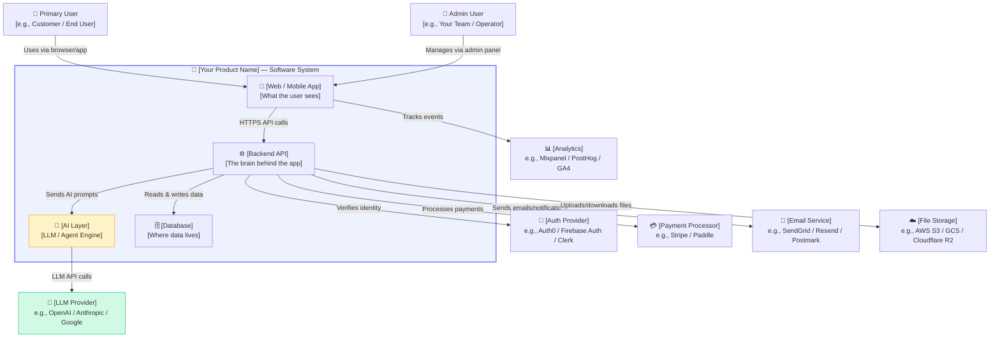
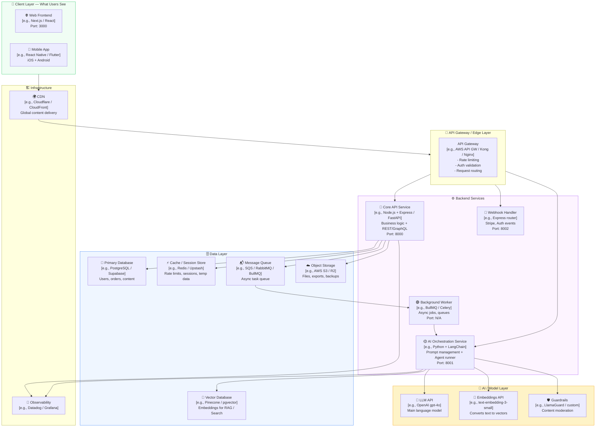
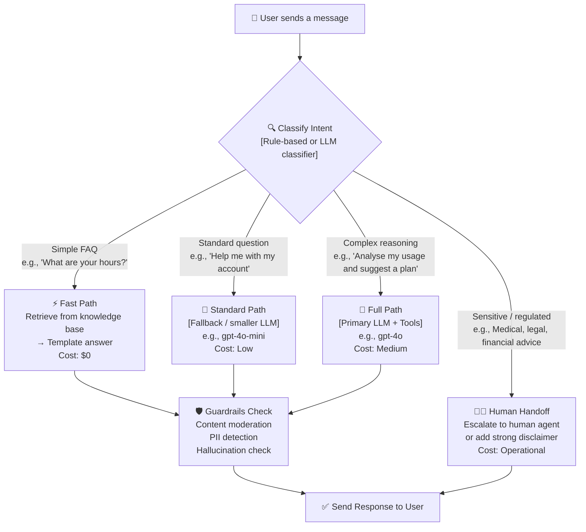
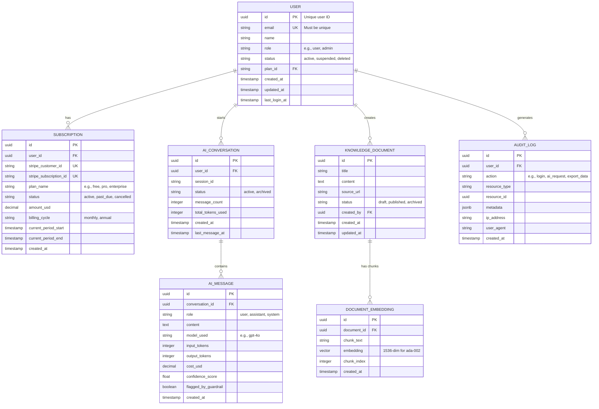
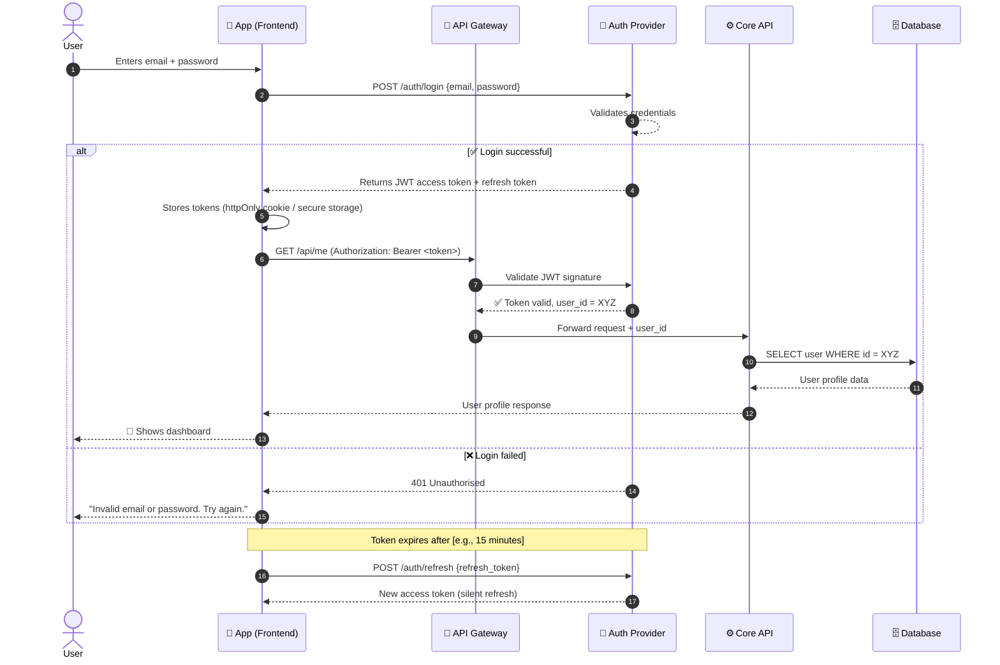
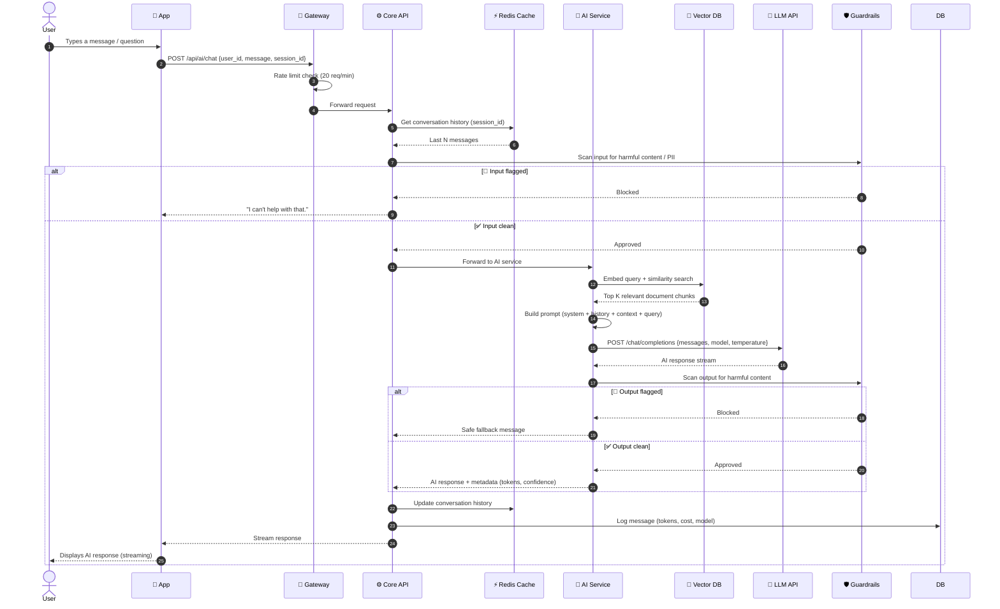
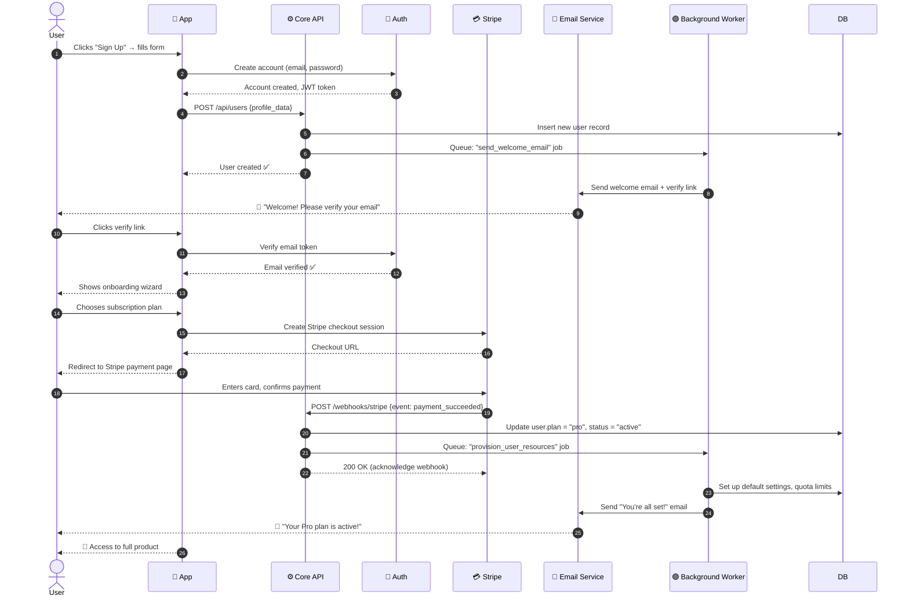
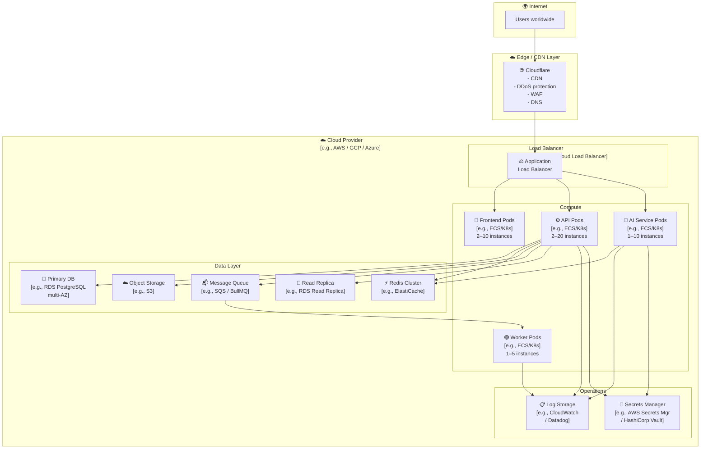

<!--
╔══════════════════════════════════════════════════════════════════════════════╗
║              HOW TO USE THIS TEMPLATE — READ BEFORE YOU START               ║
╚══════════════════════════════════════════════════════════════════════════════╝

# INSTRUCTIONS FOR FILLING THIS DOCUMENT

## What is ARCHITECTURE.md?
Think of it like a **blueprint for a building**. Before a builder constructs a
house, they draw a plan showing where every room, door, and pipe goes.
ARCHITECTURE.md is the same thing — but for your software product.

## Who Should Fill This?
Anyone! Solo founders, engineers, designers, or product managers. If you can
describe your idea, you can fill this document.

## How to Fill It — 5 Simple Rules

1. 🔍 **Replace every `[PLACEHOLDER]`** — anything inside square brackets
   is YOUR job to fill in. Think of them like blank lines on a form.

2. ✅ **Look for 🟡 REQUIRED and 🟢 OPTIONAL** — red means you MUST fill it
   before sharing. Green means fill it if you have the answer, skip it if not.

3. 📝 **Write in plain English** — pretend you are explaining to a 10-year-old
   friend. Simple language is always better than fancy jargon.

4. 🗑️ **Delete sections you don't need** — this is a template, not a law.
   Remove any section that doesn't apply to your project.

5. 🔄 **Update it as your project grows** — architecture changes! Update this
   document every time you make a big technical decision.

## Symbols Used in This Document
| Symbol | Meaning |
|--------|---------|
| 🟡 REQUIRED | You MUST fill this section |
| 🟢 OPTIONAL | Fill if you can, skip if not sure yet |
| 💡 TIP | A hint to help you fill the section |
| ⚠️ WARNING | Something important to be careful about |
| 📌 EXAMPLE | A real example to copy and adapt |

## Time to Complete
- First draft: 2–4 hours
- Thorough version: 1–2 days
- It gets easier with every project!

---
-->

# 🏗️ [PROJECT NAME] — Architecture Document

> 💡 **TIP:** Replace `[PROJECT NAME]` above with the actual name of your product.
> Example: "HealthBot AI — Architecture Document"

---

## 📋 Document Header

| Field | Value |
|-------|-------|
| **Project Name** | 🟡 `[Your product name]` |
| **Document Version** | 🟡 `v1.0.0` |
| **Status** | 🟡 `Draft` / `In Review` / `Approved` / `Archived` |
| **Author(s)** | 🟡 `[Your name and/or team names]` |
| **Last Updated** | 🟡 `[Date — e.g., October 14, 2026]` |
| **Reviewed By** | 🟢 `[Name of the person who reviewed this]` |
| **Approved By** | 🟢 `[Name of the person who approved this]` |
| **Classification** | 🟡 `Internal Only` / `Confidential` / `Public` |
| **Next Review Date** | 🟢 `[Date — e.g., every 3 months]` |

> 📌 **EXAMPLE:**
> | Project Name | HealthBot AI |
> | Version | v1.2.0 |
> | Status | Approved |
> | Author | Jane Doe |

---

## 📚 Table of Contents

1. [Project Snapshot](#1-project-snapshot)
2. [Architecture Philosophy & Principles](#2-architecture-philosophy--principles)
3. [System Context Diagram — The Big Picture](#3-system-context-diagram--the-big-picture)
4. [Container & Service Architecture](#4-container--service-architecture)
5. [AI Agent Workflow — Full Specification](#5-ai-agent-workflow--full-specification)
6. [Data Architecture & Entity Relationships](#6-data-architecture--entity-relationships)
7. [Sequence & Flow Diagrams](#7-sequence--flow-diagrams)
8. [Technology Stack](#8-technology-stack)
9. [Infrastructure & Deployment](#9-infrastructure--deployment)
10. [API Design](#10-api-design)
11. [Security & Compliance](#11-security--compliance)
12. [Monitoring, Observability & Alerting](#12-monitoring-observability--alerting)
13. [Performance & Scalability](#13-performance--scalability)
14. [Testing Strategy](#14-testing-strategy)
15. [Path to First 500 Customers](#15-path-to-first-500-customers)
16. [Architecture Decision Records (ADRs)](#16-architecture-decision-records-adrs)
17. [Known Limitations & Future Roadmap](#17-known-limitations--future-roadmap)
18. [Glossary](#18-glossary)
19. [Changelog](#19-changelog)

---

## 1. Project Snapshot

> 💡 **TIP:** Imagine someone has never heard of your product. Write 5–10
> sentences that make them say, "Oh! I get it now." No technical words here.

### 1.1 What Is This Product?

🟡 **One-sentence description (the elevator pitch):**

```
[Write ONE sentence that explains what your product does.]
```

> 📌 **EXAMPLE:** "HealthBot AI is a mobile app that uses artificial intelligence
> to answer patients' medical questions 24/7 and help them book doctor appointments."

🟡 **Full description (3–5 sentences):**

```
[Describe the product in simple language. What does it do? Who uses it?
What problem does it solve? How is it different from other tools?]
```

---

### 1.2 The Problem We Are Solving

🟡 Fill in the blanks:

- **Who has this problem?** `[Describe the user — e.g., "Small business owners who don't have time to..."]`
- **What is the problem?** `[Describe the pain point — e.g., "They spend 3 hours every day manually answering the same customer questions"]`
- **What happens today (without our product)?** `[e.g., "They use email, WhatsApp, or hire support staff"]`
- **Why is that bad?** `[e.g., "It costs money, takes time, and leads to slow responses that frustrate customers"]`

---

### 1.3 Who Uses This Product?

🟡 List ALL types of users:

| User Type | Description | Example |
|-----------|-------------|---------|
| 🟡 Primary User | `[Main person who uses the product every day]` | `e.g., A customer looking for answers` |
| 🟡 Admin / Operator | `[Person who manages the system]` | `e.g., Company employee who sets it up` |
| 🟢 External System | `[Other software that connects to this product]` | `e.g., Stripe for payments` |

---

### 1.4 Key Success Metrics

> 💡 **TIP:** How will you know the product is working? Pick 3–5 numbers you
> will track. These are called KPIs (Key Performance Indicators).

| Metric | 🟡 Target | How to Measure |
|--------|----------|----------------|
| `[e.g., User sign-ups]` | `[e.g., 500 users in 6 months]` | `[e.g., Check dashboard daily]` |
| `[e.g., AI response accuracy]` | `[e.g., > 90% correct answers]` | `[e.g., Weekly human review of 50 AI responses]` |
| `[e.g., App load time]` | `[e.g., < 2 seconds]` | `[e.g., Use Lighthouse / Datadog]` |
| `[e.g., Monthly revenue]` | `[e.g., $10,000 MRR by month 6]` | `[e.g., Stripe dashboard]` |
| `[e.g., Customer support tickets]` | `[e.g., < 5% of users need help]` | `[e.g., Track in Intercom]` |

---

## 2. Architecture Philosophy & Principles

> 💡 **TIP:** These are the "rules" your team follows when building the product.
> Think of them like your team's coding constitution.

### 2.1 Core Principles

🟡 Check ALL that apply and add a note explaining what it means for YOUR project:

| # | Principle | What This Means for Us |
|---|-----------|------------------------|
| 1 | **Simple before Smart** | `[e.g., We try the simplest solution first before adding AI complexity]` |
| 2 | **AI-Assisted, Human-Approved** | `[e.g., AI drafts answers, but humans review high-risk decisions]` |
| 3 | **Privacy by Design** | `[e.g., We collect only the data we absolutely need]` |
| 4 | **Build for Scale from Day 1** | `[e.g., We design so the system can handle 10x more users without rewriting it]` |
| 5 | **Fail Gracefully** | `[e.g., If the AI is down, users get a helpful error, not a crash]` |
| 6 | **Observable by Default** | `[e.g., Every action is logged so we can diagnose problems fast]` |
| 7 | **Security is Not Optional** | `[e.g., Security checks are part of every code review]` |
| 🟢 | `[Add your own principle]` | `[Explain it]` |

---

### 2.2 What This Architecture Is NOT

> ⚠️ **WARNING:** Being clear about what you're NOT building prevents confusion
> and "scope creep" (when the project gets bigger and bigger without a plan).

🟡 List things your architecture deliberately avoids:

- `[e.g., "This is NOT a real-time chat system — responses may take 2–5 seconds"]`
- `[e.g., "This is NOT an on-premise solution — all data lives in the cloud"]`
- `[e.g., "This is NOT designed to train custom AI models — we use third-party LLM APIs"]`
- `[Add more as needed]`

---

## 3. System Context Diagram — The Big Picture

> 💡 **TIP:** A System Context Diagram answers: "What is our product and who
> does it talk to?" It's the 10,000-foot view. Your product is a box in the
> middle. Everything else (users, other apps) is around it.
>
> 🎨 The diagram below is written in **Mermaid** — a simple text format that
> automatically draws a diagram. Replace the labels with your own names.
> You can preview it on https://mermaid.live

### 3.1 Diagram



---

### 3.2 External Systems Description

🟡 Fill in one row per external system:

| External System | Provider (Example) | 🟡 Your Choice | What It Does for Us |
|-----------------|-------------------|----------------|---------------------|
| LLM / AI Provider | OpenAI, Anthropic, Google Gemini | `[Your choice]` | `[e.g., Powers the AI assistant responses]` |
| Authentication | Auth0, Clerk, Firebase, Supabase Auth | `[Your choice]` | `[e.g., Handles user login and permissions]` |
| Payment | Stripe, Paddle, Lemon Squeezy | `[Your choice]` | `[e.g., Processes subscriptions and one-time payments]` |
| Email / Notifications | SendGrid, Resend, Postmark | `[Your choice]` | `[e.g., Sends welcome emails and alerts]` |
| Analytics | Mixpanel, PostHog, Amplitude | `[Your choice]` | `[e.g., Tracks user behaviour and feature usage]` |
| File Storage | AWS S3, GCS, Cloudflare R2 | `[Your choice]` | `[e.g., Stores user-uploaded documents]` |
| 🟢 SMS / Push | Twilio, OneSignal, Firebase FCM | `[Your choice]` | `[e.g., Sends mobile push notifications]` |
| 🟢 Error Tracking | Sentry, Bugsnag, Rollbar | `[Your choice]` | `[e.g., Catches and reports app crashes]` |
| 🟢 CRM | HubSpot, Salesforce | `[Your choice]` | `[e.g., Manages customer relationships]` |

---

## 4. Container & Service Architecture

> 💡 **TIP:** Now we zoom IN. Instead of showing the whole product as one box,
> we split it into its major parts (called "containers" or "services").
> Think of it like showing the rooms inside a house.

### 4.1 Diagram



---

### 4.2 Service Descriptions

🟡 Fill in one row per service/container:

| Service Name | Technology | Responsibility | Talks To | Scales By |
|---|---|---|---|---|
| Web Frontend | `[e.g., Next.js 15]` | `[e.g., User interface, routing, forms]` | `[e.g., API Gateway]` | `[e.g., CDN + Vercel auto-scale]` |
| Mobile App | `[e.g., React Native / Flutter]` | `[e.g., iOS & Android client]` | `[e.g., API Gateway]` | `[e.g., N/A — client-side]` |
| Core API | `[e.g., FastAPI / Node.js]` | `[e.g., Business logic, CRUD, auth]` | `[e.g., DB, Redis, AI Service]` | `[e.g., Horizontal — add more pods]` |
| AI Service | `[e.g., Python + LangChain]` | `[e.g., LLM calls, agent runs, RAG]` | `[e.g., LLM API, Vector DB]` | `[e.g., Horizontal + GPU if fine-tuning]` |
| Background Worker | `[e.g., BullMQ / Celery]` | `[e.g., Emails, reports, async AI jobs]` | `[e.g., Queue, DB]` | `[e.g., Add more worker instances]` |
| Primary Database | `[e.g., PostgreSQL 16]` | `[e.g., All structured data]` | `[e.g., Core API, Worker]` | `[e.g., Read replicas + vertical scaling]` |
| Cache | `[e.g., Redis 7]` | `[e.g., Sessions, rate limits, temp cache]` | `[e.g., All backend services]` | `[e.g., Redis Cluster]` |

---

## 5. AI Agent Workflow — Full Specification

> 💡 **TIP:** This section is the "brain" of your AI features. Fill in every
> part carefully — this is what makes your product different from a simple
> chatbot. Think of the AI Agent like a very smart helper who has tools,
> a memory, and a set of rules it must follow.

### 5.1 AI Overview

| Field | 🟡 Your Answer |
|-------|----------------|
| **Primary AI Use Case** | `[e.g., Customer support Q&A / Content generation / Code review]` |
| **Primary LLM Model** | `[e.g., gpt-4o / claude-3-7-sonnet / gemini-2.0-flash]` |
| **Fallback LLM Model** | `[e.g., gpt-4o-mini — cheaper, used if primary is slow or expensive]` |
| **Embedding Model** | `[e.g., text-embedding-3-small — for search and memory]` |
| **Agent Framework** | `[e.g., LangChain / LlamaIndex / Vercel AI SDK / Custom / None]` |
| **Average Tokens per Request** | `[e.g., ~2,000 input + ~500 output]` |
| **Expected Monthly AI Cost** | `[e.g., ~$200/month at 500 users]` |

---

### 5.2 Prompt Architecture

> 💡 **TIP:** A "prompt" is the message your app sends to the AI. Good prompts
> = good AI responses. There are usually 3 layers.

#### System Prompt (The AI's "Personality")
> This is set once and tells the AI WHO it is and what rules it must follow.

```
🟡 Paste or summarise your system prompt here:

[e.g., "You are a helpful customer support assistant for [COMPANY NAME].
Your job is to help users with [TOPIC]. Always be polite, concise, and
accurate. If you do not know the answer, say so honestly. Never make up
information. Never discuss competitors."]
```

#### User Prompt Template
> This is what gets sent for each user request, with their actual question filled in.

```
🟡 Show your prompt template here:

[e.g.,
CONTEXT: {retrieved_documents}
USER QUESTION: {user_input}
CONVERSATION HISTORY: {last_5_messages}
Respond in {user_language}.
]
```

#### Assistant Response Format
> Should the AI respond in structured JSON? Markdown? Plain text?

```
🟡 Describe the expected output format:

[e.g., "Plain conversational text, 2–4 sentences max. If listing steps,
use numbered list. Never use code blocks unless the user asked for code."]
```

---

### 5.3 Agent Tools & Capabilities

> 💡 **TIP:** "Tools" are like superpowers you give the AI. Instead of just
> generating text, the AI can also SEARCH the internet, READ a file, or
> WRITE to your database.

🟡 List every tool your AI agent can use:

| Tool Name | What It Does | Input | Output | Risk Level |
|-----------|--------------|-------|--------|------------|
| `search_knowledge_base` | `[Searches your internal docs / FAQ]` | `user query` | `top 3 matching documents` | 🟢 Low |
| `get_user_profile` | `[Fetches user's account details]` | `user_id` | `name, plan, history` | 🟡 Medium |
| `create_support_ticket` | `[Creates a ticket in your CRM]` | `issue description` | `ticket ID` | 🟡 Medium |
| `book_appointment` | `[Schedules a meeting/call]` | `time, topic` | `calendar invite` | 🔴 High |
| `send_email` | `[Sends email to user]` | `subject, body` | `sent confirmation` | 🔴 High |
| 🟢 `web_search` | `[Searches the web for recent info]` | `search query` | `top results` | 🟡 Medium |
| 🟢 `[Add your own]` | `[Describe it]` | `[Input]` | `[Output]` | `[Risk]` |

> ⚠️ **WARNING:** High-risk tools (those that SEND data or SPEND money)
> should require human approval or a secondary confirmation step.

---

### 5.4 Memory System

> 💡 **TIP:** "Memory" decides how much the AI can remember about past
> conversations. Short memory = cheaper but forgetful. Long memory = better
> experience but more expensive.

| Memory Type | 🟡 Are You Using It? | How It Works |
|---|---|---|
| **In-context (conversation history)** | `Yes / No` | `Last N messages included in every prompt. N = [e.g., 10 messages / 4,000 tokens]` |
| **Short-term (session cache)** | `Yes / No` | `[e.g., Stored in Redis. Lasts [X] hours. Cleared when user logs out.]` |
| **Long-term (user profile / RAG)** | `Yes / No` | `[e.g., Key facts about user stored in database and retrieved by embedding search]` |
| **Shared knowledge base (RAG)** | `Yes / No` | `[e.g., Company docs, FAQs, product manuals stored as embeddings in Pinecone]` |

---

### 5.5 Routing Logic

> 💡 **TIP:** Not every user request needs the most powerful (expensive) AI.
> Routing decides which AI model to use for each type of request.



🟡 Describe your routing rules here:

```
[e.g.,
- If message matches FAQ keyword list → fast path (template answer)
- If message < 50 words and no tool calls needed → gpt-4o-mini
- If message requires tools or is > 50 words → gpt-4o
- If message contains: "diagnosis", "legal advice", "investment" → add disclaimer + flag for human review
]
```

---

### 5.6 Fallback Strategy

> 💡 **TIP:** What happens when the AI breaks, is slow, or gives a bad answer?
> Always have a Plan B.

| Failure Scenario | What Happens | User Sees |
|---|---|---|
| LLM API is down | `[e.g., Retry 3x, then switch to fallback model]` | `[e.g., "Our AI is taking a short break, try again in 60 seconds"]` |
| Response too slow (> 10s) | `[e.g., Return partial response or timeout gracefully]` | `[e.g., Typing indicator with "Still thinking..." after 5s]` |
| AI gives low-confidence answer | `[e.g., Add disclaimer + offer human escalation]` | `[e.g., "I'm not fully certain — would you like to speak to a human?"]` |
| Guardrail triggers (unsafe content) | `[e.g., Block response, log incident, alert admin]` | `[e.g., "I can't help with that, but here's what I can do..."]` |
| Cost budget exceeded | `[e.g., Switch all users to fallback model until next billing cycle]` | `[e.g., No visible change — transparent degradation]` |
| Token limit exceeded | `[e.g., Summarise conversation history and retry]` | `[e.g., Seamless — user sees normal response]` |

---

### 5.7 Guardrails & Safety

> ⚠️ **WARNING:** This section is critical for enterprise-grade products.
> AI without guardrails can say harmful, incorrect, or illegal things.

🟡 Fill in what safety checks you have:

| Guardrail | Tool / Method | What It Blocks |
|---|---|---|
| **Input filtering** | `[e.g., LlamaGuard / custom regex]` | `[e.g., Prompt injection, jailbreak attempts, hate speech]` |
| **Output filtering** | `[e.g., OpenAI moderation API / custom]` | `[e.g., Harmful content, PII leakage in responses]` |
| **PII detection** | `[e.g., Microsoft Presidio / AWS Comprehend]` | `[e.g., Blocks SSN, credit card numbers from entering prompts]` |
| **Hallucination reduction** | `[e.g., RAG with source citations / temperature = 0]` | `[e.g., AI can only answer from retrieved documents]` |
| **Toxic content** | `[e.g., Perspective API / OpenAI moderation]` | `[e.g., Offensive or abusive language]` |
| **Rate limiting** | `[e.g., 20 requests/min per user]` | `[e.g., Prevents abuse and runaway AI costs]` |
| **Audit logging** | `[e.g., All AI inputs & outputs logged to DB]` | `[Enables compliance review and incident investigation]` |

---

## 6. Data Architecture & Entity Relationships

> 💡 **TIP:** This section shows WHAT data your product stores and HOW it is
> connected. Think of it like a filing system with folders that link to each other.

### 6.1 Data Stores Overview

🟡 Fill in every database or storage system:

| Data Store | Type | Technology | What It Stores | Who Reads It | Who Writes It |
|---|---|---|---|---|---|
| Primary DB | Relational | `[e.g., PostgreSQL]` | `[e.g., Users, subscriptions, usage logs]` | `[e.g., Core API]` | `[e.g., Core API, Worker]` |
| Vector DB | Vector | `[e.g., Pinecone / pgvector]` | `[e.g., Document embeddings for AI search]` | `[e.g., AI Service]` | `[e.g., Ingestion Worker]` |
| Cache | Key-Value | `[e.g., Redis]` | `[e.g., Sessions, rate limit counters, temp AI results]` | `[e.g., All services]` | `[e.g., All services]` |
| Object Storage | File | `[e.g., AWS S3]` | `[e.g., User uploads, exports, AI-generated files]` | `[e.g., Core API, Frontend]` | `[e.g., Core API]` |
| Logs | Time-series | `[e.g., Datadog / CloudWatch]` | `[e.g., Application logs, AI audit trail]` | `[e.g., Dev team]` | `[e.g., All services]` |
| Analytics Events | Columnar | `[e.g., PostHog / BigQuery]` | `[e.g., User events, feature usage]` | `[e.g., Product team]` | `[e.g., Frontend SDK]` |

---

### 6.2 Core Entity Relationship Diagram (ERD)

> 💡 **TIP:** An ERD shows the "shapes" of your data and how they connect.
> Add every database table that is important. Replace the example tables
> with YOUR tables.



---

### 6.3 Data Sensitivity Classification

> ⚠️ **WARNING:** Knowing which data is sensitive helps you protect it properly.
> This classification is required for HIPAA and GDPR compliance.

| Data Type | Example | Sensitivity | Encrypted at Rest? | Encrypted in Transit? | Retention Policy |
|---|---|---|---|---|---|
| User PII | Name, email, phone | 🔴 High | ✅ Yes | ✅ Yes | `[e.g., Delete 30 days after account closure]` |
| Health Data (PHI) | Medical history, diagnoses | 🔴 Critical | ✅ Yes (AES-256) | ✅ Yes (TLS 1.3) | `[e.g., 7 years per HIPAA]` |
| Payment Info | Card details | 🔴 Critical | ✅ Never stored (Stripe holds it) | ✅ Yes | `[e.g., Never stored on our servers]` |
| AI Conversations | User chat messages | 🟡 Medium | ✅ Yes | ✅ Yes | `[e.g., 90 days, then anonymised]` |
| Usage Analytics | Page views, button clicks | 🟢 Low | 🟢 Optional | ✅ Yes | `[e.g., 2 years]` |
| Audit Logs | Who did what and when | 🟡 Medium | ✅ Yes | ✅ Yes | `[e.g., 1 year]` |

---

## 7. Sequence & Flow Diagrams

> 💡 **TIP:** Sequence diagrams show the ORDER of steps in a process. Read
> them top to bottom — each arrow is one step. These are invaluable for
> debugging and onboarding new team members.

### 7.1 User Authentication Flow



---

### 7.2 AI Request Flow



---

### 7.3 New User Onboarding Flow



---

### 7.4 🟢 Payment & Subscription Flow

> 💡 **TIP:** Add more sequence diagrams below as needed. Common ones:
> password reset, file upload, AI document processing, admin actions.

```
🟢 Add your own sequence diagram here using the same format.

Suggested additional flows:
- Password reset flow
- File upload → AI processing flow  
- Admin: suspend user flow
- Data export / GDPR deletion request
```

---

## 8. Technology Stack

> 💡 **TIP:** List EVERY technology your product uses. For each one, write
> WHY you chose it — this helps future team members (and you, 6 months later!)
> understand the decisions.

### 8.1 Full Stack Table

| Layer | 🟡 Technology | Version | Why Chosen | Alternatives Considered |
|---|---|---|---|---|
| **Frontend Web** | `[e.g., Next.js]` | `[e.g., 15.x]` | `[e.g., SSR for SEO, huge ecosystem, Vercel deploy]` | `[e.g., Nuxt.js, Remix]` |
| **Mobile** | `[e.g., React Native]` | `[e.g., 0.76]` | `[e.g., Single codebase for iOS + Android]` | `[e.g., Flutter, native Swift/Kotlin]` |
| **UI Component Library** | `[e.g., shadcn/ui]` | `[e.g., latest]` | `[e.g., Accessible, customisable, no lock-in]` | `[e.g., Material UI, Ant Design]` |
| **Backend API** | `[e.g., FastAPI]` | `[e.g., 0.115]` | `[e.g., Fast, Python-native for AI integration, auto docs]` | `[e.g., Express, Django, Rails]` |
| **AI / LLM** | `[e.g., OpenAI gpt-4o]` | `[e.g., gpt-4o-2024-11-20]` | `[e.g., Best accuracy for our use case, function calling support]` | `[e.g., Anthropic Claude, Gemini]` |
| **AI Framework** | `[e.g., LangChain]` | `[e.g., 0.3.x]` | `[e.g., Mature ecosystem, chains + agents + RAG built-in]` | `[e.g., LlamaIndex, Vercel AI SDK]` |
| **Database (Primary)** | `[e.g., PostgreSQL]` | `[e.g., 16]` | `[e.g., ACID-compliant, supports pgvector, battle-tested]` | `[e.g., MySQL, MongoDB]` |
| **Vector DB** | `[e.g., pgvector / Pinecone]` | `[e.g., latest]` | `[e.g., pgvector avoids another service; Pinecone for scale]` | `[e.g., Weaviate, Qdrant]` |
| **Cache** | `[e.g., Redis]` | `[e.g., 7.x]` | `[e.g., Industry standard, pub/sub, streams support]` | `[e.g., Memcached, DragonflyDB]` |
| **Message Queue** | `[e.g., BullMQ / SQS]` | `[e.g., latest]` | `[e.g., BullMQ + Redis for simplicity; SQS for reliability at scale]` | `[e.g., RabbitMQ, Kafka]` |
| **Authentication** | `[e.g., Clerk / Auth0]` | `[e.g., latest]` | `[e.g., MFA, social login, JWT, low maintenance]` | `[e.g., NextAuth, Supabase Auth]` |
| **Payments** | `[e.g., Stripe]` | `[e.g., API v2024-11-20]` | `[e.g., Best docs, subscription management, PCI compliant]` | `[e.g., Paddle, Lemon Squeezy]` |
| **Email** | `[e.g., Resend]` | `[e.g., latest]` | `[e.g., Developer-friendly, React Email templates]` | `[e.g., SendGrid, Postmark]` |
| **Object Storage** | `[e.g., AWS S3]` | `[e.g., N/A]` | `[e.g., Industry standard, cheap, reliable]` | `[e.g., Cloudflare R2, GCS]` |
| **Containerisation** | `[e.g., Docker]` | `[e.g., 27.x]` | `[e.g., Consistent environments, easy deployment]` | `[e.g., Podman]` |
| **Container Orchestration** | `[e.g., Kubernetes / ECS]` | `[e.g., 1.30]` | `[e.g., Auto-scaling, health checks, rolling deploys]` | `[e.g., Docker Swarm, Nomad]` |
| **CI/CD** | `[e.g., GitHub Actions]` | `[e.g., N/A]` | `[e.g., Native GitHub integration, free for open source]` | `[e.g., GitLab CI, CircleCI]` |
| **IaC** | `[e.g., Terraform / Pulumi]` | `[e.g., 1.9]` | `[e.g., Declarative infra, reproducible environments]` | `[e.g., AWS CDK, Ansible]` |
| **Monitoring** | `[e.g., Datadog]` | `[e.g., N/A]` | `[e.g., Full-stack observability, APM + logs + metrics]` | `[e.g., Grafana + Prometheus, New Relic]` |
| **Error Tracking** | `[e.g., Sentry]` | `[e.g., latest]` | `[e.g., Best error grouping, source maps, performance]` | `[e.g., Bugsnag, Rollbar]` |
| **CDN** | `[e.g., Cloudflare]` | `[e.g., N/A]` | `[e.g., Global edge, DDoS protection, WAF built-in]` | `[e.g., CloudFront, Fastly]` |
| **Analytics** | `[e.g., PostHog]` | `[e.g., latest]` | `[e.g., Open-source, session replay, feature flags, self-hostable]` | `[e.g., Mixpanel, Amplitude]` |

---

## 9. Infrastructure & Deployment

> 💡 **TIP:** This section describes WHERE and HOW your product runs.
> Think of it like a floor plan — where is each room (service) located?

### 9.1 Environments

> 💡 **TIP:** Most products have 3 separate environments so that bugs
> don't reach real users. Think of them as test kitchen → staff meal → restaurant.

| Environment | 🟡 URL / Domain | Purpose | Who Has Access | Data |
|---|---|---|---|---|
| **Development (Local)** | `localhost:3000` | Developers build & test features | `Dev team only` | `Fake/seed data` |
| **Staging** | `[e.g., staging.yourproduct.com]` | Test before releasing to users | `Dev + QA + PMs` | `Copy of prod structure, fake data` |
| **Production** | `[e.g., app.yourproduct.com]` | Real users, real data | `DevOps + Senior devs only` | `Real user data — treat carefully!` |
| 🟢 Preview | `[e.g., pr-123.yourproduct.vercel.app]` | Per-PR preview for review | `Dev + Design team` | `None — mocked data` |

---

### 9.2 CI/CD Pipeline

> 💡 **TIP:** CI/CD means "Continuous Integration / Continuous Deployment."
> Every time a developer pushes code, a series of automatic checks run
> to make sure nothing broke. If all checks pass, the code ships automatically.

```mermaid
flowchart LR
    DEV["👩‍💻 Developer\nPushes code to Git"] -->|"Pull Request"| GIT["📦 GitHub / GitLab\nCode Repository"]

    GIT --> CI["🤖 CI Pipeline\nGitHub Actions"]

    subgraph CI["🤖 CI Pipeline — Runs on every PR"]
        L["🔍 Lint\n(ESLint, Prettier,\nRuff for Python)"]
        T["🧪 Unit Tests\n(Jest, Pytest)\nMin 80% coverage"]
        IT["🔗 Integration Tests\n(API + DB)"]
        SC["🛡️ Security Scan\n(Snyk, Trivy,\nOWASP dependency check)"]
        B["📦 Build\n(Docker image)"]
        L --> T --> IT --> SC --> B
    end

    B -->|"Passes all checks"| STAGING["🟡 Auto-deploy\nto STAGING"]
    STAGING --> QA["👁️ QA Review\n+ Manual testing"]
    QA -->|"Approved"| GATE{"🚦 Manual\nProduction Gate"}
    GATE -->|"Team Lead approves"| PROD["🟢 Deploy to PRODUCTION\n(Blue/Green or Canary)"]
    PROD --> MONITOR["📡 Monitor\nfor 30 min post-deploy"]
    MONITOR -->|"Issue detected"| ROLLBACK["⏪ Auto-rollback\nto previous version"]
```



---

### 9.3 Deployment Strategy

| Question | 🟡 Your Answer |
|---|---|
| **Deployment method** | `[e.g., Blue/Green / Canary / Rolling / Recreate]` |
| **Cloud provider(s)** | `[e.g., AWS (primary), Cloudflare (CDN + edge)]` |
| **Container registry** | `[e.g., AWS ECR / GitHub Container Registry]` |
| **Orchestration** | `[e.g., AWS ECS Fargate / Kubernetes (EKS) / Railway / Fly.io]` |
| **Rollback strategy** | `[e.g., Keep last 3 versions. Rollback in < 5 minutes via one CLI command]` |
| **Zero-downtime deploys?** | `[e.g., Yes — Blue/Green with load balancer switch]` |
| **Database migrations** | `[e.g., Run on deploy via Alembic / Flyway / Prisma Migrate. Always backward-compatible.]` |
| **Feature flags** | `[e.g., PostHog / LaunchDarkly — gradual rollout to 5% → 25% → 100% of users]` |

---

### 9.4 Infrastructure Diagram



---

## 10. API Design

> 💡 **TIP:** An API is how different parts of your product talk to each other.
> Like a waiter in a restaurant — you tell the waiter what you want, they go
> to the kitchen (backend) and bring back your food (data).

### 10.1 API Style

| Decision | 🟡 Your Choice |
|---|---|
| **API style** | `REST` / `GraphQL` / `gRPC` / `tRPC` |
| **API documentation** | `[e.g., OpenAPI 3.1 + Swagger UI at /docs]` |
| **Versioning strategy** | `[e.g., URL versioning: /api/v1/, /api/v2/]` |
| **Authentication method** | `[e.g., JWT Bearer tokens in Authorization header]` |
| **Response format** | `[e.g., JSON with envelope: { data: {}, error: null, meta: {} }]` |
| **Pagination style** | `[e.g., Cursor-based: { data: [], next_cursor: "abc", has_more: true }]` |
| **Rate limiting** | `[e.g., 100 req/min per IP (unauth), 1000 req/min per user (auth)]` |
| **CORS policy** | `[e.g., Allow: app.yourproduct.com, staging.yourproduct.com only]` |

---

### 10.2 Key API Endpoints

🟡 List your most important API endpoints:

| Method | Endpoint | Auth Required? | Description | Request Body | Response |
|---|---|---|---|---|---|
| `POST` | `/api/v1/auth/login` | ❌ No | User login | `{ email, password }` | `{ access_token, refresh_token }` |
| `POST` | `/api/v1/auth/refresh` | ❌ No | Refresh access token | `{ refresh_token }` | `{ access_token }` |
| `GET` | `/api/v1/users/me` | ✅ Yes | Get current user profile | — | `{ id, name, email, plan }` |
| `POST` | `/api/v1/ai/chat` | ✅ Yes | Send message to AI | `{ message, session_id }` | `{ response, tokens_used }` |
| `GET` | `/api/v1/ai/conversations` | ✅ Yes | List user's past chats | `?limit=20&cursor=abc` | `{ data: [], next_cursor }` |
| `POST` | `/api/v1/subscriptions` | ✅ Yes | Create subscription | `{ plan_id }` | `{ checkout_url }` |
| `DELETE` | `/api/v1/users/me` | ✅ Yes | Delete account (GDPR) | — | `{ scheduled_deletion_date }` |
| `POST` | `/api/v1/webhooks/stripe` | 🔒 Webhook secret | Handle Stripe events | Stripe event payload | `{ received: true }` |
| `[Add more]` | `[path]` | `[Yes/No]` | `[Description]` | `[Body]` | `[Response]` |

---

### 10.3 Standard Error Response Format

```json
{
  "error": {
    "code": "VALIDATION_ERROR",
    "message": "Email address is required",
    "details": [
      { "field": "email", "issue": "This field cannot be empty" }
    ],
    "request_id": "req_abc123xyz",
    "timestamp": "2026-10-14T10:30:00Z"
  },
  "data": null
}
```

🟡 List your standard error codes:

| HTTP Status | Error Code | When It Happens |
|---|---|---|
| 400 | `VALIDATION_ERROR` | Missing or invalid request data |
| 401 | `UNAUTHORISED` | Missing or expired token |
| 403 | `FORBIDDEN` | Valid token but not allowed to do this |
| 404 | `NOT_FOUND` | Resource doesn't exist |
| 429 | `RATE_LIMIT_EXCEEDED` | Too many requests |
| 500 | `INTERNAL_ERROR` | Something broke on our side |
| 503 | `AI_UNAVAILABLE` | LLM API is down or overloaded |
| `[Add]` | `[YOUR_CODE]` | `[When]` |

---

## 11. Security & Compliance

> ⚠️ **WARNING:** This is the most critical section for enterprise products.
> Do NOT skip it. Data breaches destroy companies. Compliance failures
> result in million-dollar fines.

### 11.1 Authentication & Authorisation

| Control | 🟡 Your Implementation |
|---|---|
| **Login methods** | `[e.g., Email/password + Google OAuth + magic link]` |
| **Multi-factor authentication (MFA)** | `[e.g., TOTP (Google Authenticator) + SMS as backup — required for admin roles]` |
| **Session management** | `[e.g., JWT access token (15 min) + refresh token (30 days, rotating)]` |
| **Password policy** | `[e.g., Min 12 characters, 1 uppercase, 1 number, 1 symbol. bcrypt hashed, salted.]` |
| **Failed login protection** | `[e.g., Lock account after 5 failed attempts. Unlock via email after 30 min.]` |
| **Role-Based Access Control (RBAC)** | `[e.g., Roles: user, premium_user, admin, super_admin. Permissions checked per endpoint.]` |
| **Token storage** | `[e.g., httpOnly, Secure, SameSite=Strict cookies. Never localStorage for sensitive tokens.]` |

---

### 11.2 Secrets Management

> ⚠️ **WARNING:** NEVER put secrets (API keys, passwords, tokens) in your code.
> Even in private repositories. Use a secrets manager.

| Secret Type | Storage Method | Who Has Access | Rotation Frequency |
|---|---|---|---|
| Database passwords | `[e.g., AWS Secrets Manager]` | `[e.g., Backend service role only]` | `[e.g., Every 90 days, automated]` |
| LLM API keys | `[e.g., AWS Secrets Manager / Doppler]` | `[e.g., AI Service role only]` | `[e.g., Monthly or on suspected leak]` |
| Stripe keys | `[e.g., AWS Secrets Manager]` | `[e.g., API service role only]` | `[e.g., Annually or on event]` |
| JWT signing key | `[e.g., AWS KMS / Vault]` | `[e.g., Auth service only]` | `[e.g., Every 6 months]` |
| Environment variables | `[e.g., Injected at deploy time via CI/CD — never committed to Git]` | `[e.g., DevOps team + CI/CD pipeline]` | `[e.g., On team member offboarding]` |

---

### 11.3 Data Encryption

| Layer | Standard | Details |
|---|---|---|
| **In transit** | TLS 1.3 minimum | `[e.g., All API, DB, and service-to-service communication uses TLS 1.3. TLS 1.0/1.1 disabled.]` |
| **At rest (database)** | AES-256 | `[e.g., AWS RDS encryption enabled. Column-level encryption for PHI/PII fields.]` |
| **At rest (files)** | AES-256 | `[e.g., S3 server-side encryption with AWS KMS-managed keys.]` |
| **Backups** | AES-256 | `[e.g., Automated daily backups, encrypted, cross-region replicated.]` |
| **AI prompts (in transit)** | TLS 1.3 | `[e.g., All LLM API calls use HTTPS. PII stripped from prompts before sending.]` |

---

### 11.4 SOC 2 Controls

> 💡 **TIP:** SOC 2 is a security certification that enterprise customers will ask for.
> It covers 5 areas called "Trust Service Criteria." Fill in how you meet each one.

| Trust Service Criteria | Controls We Implement |
|---|---|
| **Security** | `[e.g., MFA, RBAC, encryption, WAF, penetration testing, security awareness training]` |
| **Availability** | `[e.g., 99.9% uptime SLA, multi-AZ deployment, auto-scaling, incident response plan]` |
| **Processing Integrity** | `[e.g., Input validation, audit logs, automated testing pipeline, change management process]` |
| **Confidentiality** | `[e.g., Data classification, NDA for employees, access controls, least-privilege principle]` |
| **Privacy** | `[e.g., Privacy policy, GDPR compliance, data subject rights (export/delete), consent management]` |

🟢 SOC 2 Audit Status: `[e.g., Not started / Type I in progress (target: Q2 2027) / Type II certified]`

---

### 11.5 HIPAA Safeguards

> 💡 **TIP:** ONLY fill this section if your product handles Protected Health
> Information (PHI) — medical data, diagnoses, treatment records, etc.
> If you don't handle health data, delete this section.

| Safeguard Type | Requirement | Our Implementation |
|---|---|---|
| **Administrative** | Designated Security Officer | `[e.g., [Name] is our HIPAA Security Officer]` |
| **Administrative** | Employee training | `[e.g., Annual HIPAA training for all staff, tracked in LMS]` |
| **Administrative** | Business Associate Agreements (BAAs) | `[e.g., BAAs signed with: OpenAI, AWS, Stripe]` |
| **Physical** | Workstation security | `[e.g., All laptops encrypted (FileVault/BitLocker), remote wipe capability]` |
| **Technical** | Unique user identification | `[e.g., Every user has unique UUID, shared accounts prohibited]` |
| **Technical** | Automatic logoff | `[e.g., Sessions timeout after 15 minutes of inactivity]` |
| **Technical** | Audit logs | `[e.g., All PHI access logged with user_id, timestamp, action — retained 6 years]` |
| **Technical** | Transmission security | `[e.g., TLS 1.3 for all PHI in transit, no email transmission of PHI]` |

---

### 11.6 GDPR / Privacy Compliance

| Requirement | 🟡 How We Meet It |
|---|---|
| **Lawful basis for processing** | `[e.g., Consent (explicit opt-in) + Contract performance]` |
| **Privacy notice** | `[e.g., Privacy policy at /privacy, shown at signup, plain language]` |
| **Data subject rights** | `[e.g., Export data: /account/export (CSV, 24hr). Delete account: /account/delete (30-day grace period).]` |
| **Data minimisation** | `[e.g., We only collect data we actually use. Reviewed quarterly.]` |
| **Consent management** | `[e.g., Cookie banner (Cookiebot), double opt-in for marketing emails]` |
| **Data breach notification** | `[e.g., Notify supervisory authority within 72 hours. Users notified within 30 days if high risk.]` |
| **Data Processing Agreements** | `[e.g., DPAs signed with all data processors]` |

---

### 11.7 OWASP Top 10 Mitigations

> 💡 **TIP:** OWASP Top 10 is a list of the most common and dangerous
> web security vulnerabilities. Check each one to make sure you're protected.

| OWASP Vulnerability | Our Mitigation |
|---|---|
| A01: Broken Access Control | `[e.g., RBAC enforced on every endpoint. Authorization checked server-side, never trusted from client.]` |
| A02: Cryptographic Failures | `[e.g., bcrypt for passwords. AES-256 at rest. TLS 1.3 in transit. No MD5 or SHA1.]` |
| A03: Injection (SQL, XSS, etc.) | `[e.g., Parameterised queries (SQLAlchemy / Prisma). Input sanitisation. CSP headers. React's XSS protection.]` |
| A04: Insecure Design | `[e.g., Threat modelling done before each major feature. Security review gate in CI/CD.]` |
| A05: Security Misconfiguration | `[e.g., Hardened Docker images. No default credentials. Security headers (Helmet.js). Regular config audits.]` |
| A06: Vulnerable Components | `[e.g., Snyk + Dependabot automated alerts. Patch critical CVEs within 48 hours.]` |
| A07: Auth & Session Failures | `[e.g., MFA required for admins. httpOnly cookies. Rotating refresh tokens. Account lockout after 5 failures.]` |
| A08: Software Integrity Failures | `[e.g., Signed commits (GPG). Verified Docker image digests. Code signing in CI/CD.]` |
| A09: Logging & Monitoring Failures | `[e.g., Centralised logging. Alerts for suspicious patterns. Audit trail for sensitive actions.]` |
| A10: Server-Side Request Forgery | `[e.g., URL allowlist for outbound requests. No user-controlled URLs in server-side requests.]` |

---

### 11.8 Security Testing Plan

| Test Type | Frequency | Tool / Provider | Who Does It |
|---|---|---|---|
| Automated dependency scan | Every PR + daily | `[e.g., Snyk, Dependabot]` | `CI/CD pipeline` |
| Static code analysis (SAST) | Every PR | `[e.g., SonarQube, CodeQL]` | `CI/CD pipeline` |
| Container image scan | Every build | `[e.g., Trivy, Grype]` | `CI/CD pipeline` |
| Penetration testing (external) | Annually + before major launches | `[e.g., External security firm]` | `[Firm name or TBD]` |
| Bug bounty programme | Ongoing | `[e.g., HackerOne / Bugcrowd — TBD]` | `Community researchers` |
| AI-specific red teaming | Quarterly | `[e.g., Internal + external adversarial testing of AI outputs]` | `AI team + security team` |

---

## 12. Monitoring, Observability & Alerting

> 💡 **TIP:** You cannot fix what you cannot see. This section ensures you
> know about problems BEFORE users complain.

### 12.1 The Three Pillars of Observability

| Pillar | What It Is | Our Tool | What We Track |
|---|---|---|---|
| **Logs** | Text records of what happened | `[e.g., Datadog Logs / CloudWatch]` | `[e.g., All API requests, errors, AI calls, auth events]` |
| **Metrics** | Numbers measured over time | `[e.g., Datadog Metrics / Prometheus]` | `[e.g., Request rate, latency, error rate, AI token usage, DB query time]` |
| **Traces** | Following a request across services | `[e.g., Datadog APM / Jaeger]` | `[e.g., Full journey: user request → API → AI → DB → response]` |

---

### 12.2 Key Metrics & SLOs

> 💡 **TIP:** SLO = Service Level Objective. It's a promise to yourself about
> how good your product should be. E.g., "99.9% of API responses under 500ms."

| Metric | 🟡 Target (SLO) | Alert If Below | Alert If Above |
|---|---|---|---|
| API availability (uptime) | `99.9%` (≤ 8.7hr downtime/year) | `< 99%` | — |
| API p50 latency | `< 200ms` | — | `> 500ms` |
| API p99 latency | `< 2,000ms` | — | `> 5,000ms` |
| AI response time | `< 5,000ms` | — | `> 15,000ms` |
| Error rate (5xx) | `< 0.1%` | — | `> 1%` |
| Queue depth | `< 100 jobs` | — | `> 500 jobs` |
| Daily AI cost | `< $[X]` | — | `> $[X × 1.5] (alert)` |
| AI guardrail triggers | Track baseline | — | `> 5% of requests` |

---

### 12.3 Alerting Rules

🟡 Define your alert channels and severity levels:

| Severity | Response Time | Examples | Alert Channel |
|---|---|---|---|
| 🔴 **P0 — Critical** | Respond in 15 min | Production down, data breach, payment failure | `[e.g., PagerDuty + SMS + Slack #incidents]` |
| 🟠 **P1 — High** | Respond in 1 hour | AI service down, auth failures > 5%, error rate spike | `[e.g., PagerDuty + Slack #alerts]` |
| 🟡 **P2 — Medium** | Respond in 4 hours | Latency increase, queue backlog, cost anomaly | `[e.g., Slack #alerts]` |
| 🟢 **P3 — Low** | Respond in 1 day | Minor warnings, non-critical deprecation notices | `[e.g., Email digest]` |

---

### 12.4 Incident Response Process

```
1. 🚨 DETECT   — Automated alert fires (PagerDuty / Datadog)
2. 📣 NOTIFY   — On-call engineer + team lead notified
3. 🔍 TRIAGE   — Is this P0/P1/P2? Who owns resolution?
4. 🔧 MITIGATE — Stop the bleeding (rollback, disable feature, etc.)
5. 🐛 FIX      — Root cause analysis + permanent fix
6. 📝 REVIEW   — Post-mortem written within 48 hours
7. 🔒 PREVENT  — Action items to prevent recurrence
```

🟢 Post-mortem template stored at: `[e.g., /docs/post-mortem-template.md]`

---

## 13. Performance & Scalability

> 💡 **TIP:** "Performance" = how fast. "Scalability" = how well the system
> handles more users without slowing down. Plan now, scale later.

### 13.1 Performance Targets

| Component | 🟡 Target | How We Achieve It |
|---|---|---|
| Page load time (Web) | `< 2.5s LCP (Core Web Vitals)` | `[e.g., SSR + CDN + image optimisation + code splitting]` |
| Mobile app startup | `< 2s cold start` | `[e.g., Lazy loading, minimal bundle, splash screen]` |
| API response (p50) | `< 200ms` | `[e.g., DB indexes + Redis caching + connection pooling]` |
| AI response (streaming) | `First token < 500ms` | `[e.g., Streaming API + pre-warming AI service]` |
| Database query (p99) | `< 100ms` | `[e.g., Query optimisation + read replicas + PgBouncer]` |

---

### 13.2 Scaling Strategy

| Component | Scaling Type | Trigger | How |
|---|---|---|---|
| Frontend | Horizontal + CDN | Traffic spike | `[e.g., Vercel auto-scale / K8s HPA]` |
| API service | Horizontal | CPU > 70% or request queue > 50 | `[e.g., K8s HPA → add pods. Min 2, Max 20]` |
| AI service | Horizontal | Queue depth > 20 or CPU > 80% | `[e.g., Add more AI service pods. GPU instances if fine-tuning]` |
| Database (reads) | Vertical + Read replicas | Read latency > 50ms | `[e.g., Add read replicas. Route read queries to replicas]` |
| Database (writes) | Vertical → then shard | Write latency > 50ms | `[e.g., Upgrade RDS instance class. Plan sharding at > 1TB]` |
| Cache | Redis Cluster | Memory > 75% | `[e.g., Add Redis nodes to cluster]` |

---

### 13.3 Caching Strategy

| What Gets Cached | Cache Type | TTL (How Long) | Cache Key Example |
|---|---|---|---|
| User profile data | Redis | `5 minutes` | `user:{user_id}:profile` |
| AI knowledge base responses | Redis | `1 hour` | `ai:kb:{query_hash}` |
| Rate limit counters | Redis | `1 minute` | `ratelimit:{user_id}:{endpoint}` |
| Static assets (JS, CSS, images) | CDN (Cloudflare) | `1 year` (cache-busted on deploy) | — |
| API responses (safe GET calls) | HTTP cache headers | `60 seconds` | `Cache-Control: max-age=60` |

---

## 14. Testing Strategy

> 💡 **TIP:** Testing means checking your product works before real users find
> the bugs. The Testing Pyramid shows the ideal balance of test types.

### 14.1 Testing Pyramid

```
         ___________
        /    E2E     \        ← Few but powerful (slow, expensive)
       /   Tests      \         e.g., Critical user journeys (Playwright)
      /________________\
     /  Integration     \     ← Medium amount (medium speed)
    /     Tests          \      e.g., API endpoints, DB queries
   /______________________\
  /                        \
 /      Unit Tests          \  ← Many (fast, cheap)
/____________________________ \  e.g., Functions, components, utils

[Coverage target: Unit > 80% | Integration > 60% | E2E: 20 critical paths]
```

---

### 14.2 Test Coverage Targets

| Test Type | Tool | Coverage Target | Runs When |
|---|---|---|---|
| Unit tests | `[e.g., Jest (TS) + Pytest (Python)]` | `> 80% line coverage` | Every PR |
| Component tests | `[e.g., React Testing Library]` | `All UI components` | Every PR |
| API integration tests | `[e.g., Supertest / HTTPX]` | `All endpoints` | Every PR + staging deploy |
| E2E tests | `[e.g., Playwright / Cypress]` | `20 critical user journeys` | Pre-production deploy |
| AI output tests | `[e.g., Custom eval harness / PromptFoo]` | `Key prompt/response pairs` | Weekly + on prompt changes |
| Load tests | `[e.g., k6 / Locust]` | `Simulate 10x expected peak` | Monthly + before launches |
| Security tests | `[e.g., Snyk + OWASP ZAP]` | `All endpoints` | Every PR + weekly |
| Visual regression | `[e.g., Chromatic / Percy]` | `Key UI screens` | On UI changes |

---

### 14.3 AI-Specific Testing

> 💡 **TIP:** AI needs special testing because it doesn't give the same output
> every time. You need to test for QUALITY and SAFETY, not just correct code.

| Test Type | What It Checks | Method |
|---|---|---|
| **Golden set evaluation** | AI responses match expected quality | `[e.g., Curated set of 100 Q&A pairs. Measure accuracy weekly.]` |
| **Regression testing** | Model updates don't break existing flows | `[e.g., Run golden set after any model version change]` |
| **Adversarial testing** | Prompt injection, jailbreak attempts | `[e.g., Monthly red-team exercise with 50+ attack prompts]` |
| **Hallucination rate** | AI doesn't make up facts | `[e.g., Human review of 50 random responses weekly. Target < 2% hallucination]` |
| **Latency testing** | AI stays within response time SLO | `[e.g., k6 load test with concurrent AI requests]` |
| **Cost testing** | Prompts stay within token budget | `[e.g., Alert if average tokens/request increases > 20%]` |
| **Guardrail testing** | Safety filters catch harmful inputs | `[e.g., Test 100 known harmful prompts — 100% must be blocked]` |

---

## 15. Path to First 500 Customers

> 💡 **TIP:** This section maps your architecture readiness to your
> business growth. Each stage has different technical needs. Don't over-build
> early, but don't under-build either!

---

### Stage 1: MVP — 0 to 10 Users 🌱

> **Goal:** Prove the idea works. Ship fast. Learn from real users.
> **Timeline target:** `[e.g., Weeks 1–8]`

#### Architecture at This Stage

| What | Decision |
|---|---|
| Frontend | `[e.g., Vercel deploy — zero ops]` |
| Backend | `[e.g., Single FastAPI service — monolith is fine]` |
| Database | `[e.g., Supabase (managed Postgres) — no DB ops needed]` |
| AI | `[e.g., Direct OpenAI API calls — no LangChain overhead yet]` |
| Auth | `[e.g., Clerk — zero auth code needed]` |
| Infra | `[e.g., No Kubernetes — use Railway or Fly.io]` |
| Monitoring | `[e.g., Sentry for errors + basic Vercel analytics]` |

#### MVP Launch Checklist

- [ ] Core user flow works end-to-end (sign up → use product → see value)
- [ ] AI gives useful responses for at least 80% of intended use cases
- [ ] Basic auth (login, logout, password reset) works
- [ ] Payments integrated (can collect $)
- [ ] SSL/HTTPS enabled on all domains
- [ ] Basic error tracking set up (Sentry)
- [ ] Privacy policy and Terms of Service live
- [ ] GDPR cookie consent (if serving EU users)
- [ ] Admin can view and manage users
- [ ] Manual backup process exists (even if not automated yet)

---

### Stage 2: Private Beta — 10 to 50 Users 🔥

> **Goal:** Gather real feedback. Fix the biggest pain points. Build trust.
> **Timeline target:** `[e.g., Weeks 9–16]`

#### Architecture Changes at This Stage

| What | Change |
|---|---|
| Monitoring | `[e.g., Add Datadog or Grafana — you need visibility now]` |
| AI | `[e.g., Add conversation history + basic RAG if needed]` |
| Reliability | `[e.g., Add health checks + basic uptime monitoring]` |
| Security | `[e.g., API rate limiting + input validation tightened]` |
| Testing | `[e.g., Set up CI/CD — automated tests on every PR]` |

#### Private Beta Launch Checklist

- [ ] Onboarding flow is smooth (< 5 mins from signup to first value)
- [ ] AI guardrails implemented (content moderation)
- [ ] Rate limiting on API endpoints
- [ ] Automated CI/CD pipeline running
- [ ] Automated database backups (daily, tested with restore drill)
- [ ] Logging in place for debugging user-reported issues
- [ ] In-app feedback mechanism (e.g., thumbs up/down on AI responses)
- [ ] NPS or user feedback survey sent at Day 7
- [ ] On-call rotation defined (even if it's just you)
- [ ] Incident response plan documented

---

### Stage 3: Public Beta — 50 to 200 Users 🚀

> **Goal:** Open to more users. Fix scalability bottlenecks. Refine pricing.
> **Timeline target:** `[e.g., Months 4–6]`

#### Architecture Changes at This Stage

| What | Change |
|---|---|
| Scaling | `[e.g., Add read replica to database. Auto-scaling for API.]` |
| Caching | `[e.g., Redis caching layer for frequent queries]` |
| AI | `[e.g., Add LangChain / routing logic for cost optimisation]` |
| Jobs | `[e.g., Background worker for async AI tasks]` |
| Security | `[e.g., First external penetration test scheduled]` |
| Support | `[e.g., Intercom or similar for user support]` |

#### Public Beta Launch Checklist

- [ ] Load tested to handle 10x current users
- [ ] Database indexes reviewed and optimised
- [ ] Redis caching implemented for hot paths
- [ ] AI cost tracking dashboard live (know cost per user)
- [ ] Feature flags in place for gradual rollouts
- [ ] Status page live (e.g., status.yourproduct.com)
- [ ] SLA defined for paying customers
- [ ] SOC 2 Type I audit started (if targeting enterprise)
- [ ] GDPR data export and deletion endpoints live
- [ ] Security headers audited (CSP, HSTS, X-Frame-Options)
- [ ] Mobile app published to App Store + Google Play (if mobile)
- [ ] Analytics tracking key conversion funnel events

---

### Stage 4: General Availability — 200 to 500 Customers 🏆

> **Goal:** This is a REAL product with REAL customers. Zero tolerance for
> downtime. Enterprise-grade reliability, security, and compliance.
> **Timeline target:** `[e.g., Months 7–12]`

#### Architecture Changes at This Stage

| What | Change |
|---|---|
| Reliability | `[e.g., Multi-AZ database. 99.9% uptime SLA documented.]` |
| Compliance | `[e.g., SOC 2 Type II in progress / HIPAA BAAs signed]` |
| AI | `[e.g., Full agent spec with memory, routing, fallbacks]` |
| Observability | `[e.g., Full APM tracing. P0 alert runbooks documented.]` |
| Disaster Recovery | `[e.g., RTO < 4 hours. RPO < 1 hour. DR drill run quarterly.]` |
| Security | `[e.g., Annual pen test complete. Bug bounty programme live.]` |

#### GA Launch Checklist

- [ ] 99.9% uptime achieved over last 30 days (measure it!)
- [ ] Disaster Recovery Plan written and tested
- [ ] RTO (Recovery Time Objective) defined and tested: `[e.g., < 4 hours]`
- [ ] RPO (Recovery Point Objective) defined and tested: `[e.g., < 1 hour]`
- [ ] External penetration test completed, findings resolved
- [ ] SOC 2 Type I certificate obtained (or in progress)
- [ ] All team members completed security awareness training
- [ ] AI cost per user below sustainable threshold: `[e.g., < $X per user/month]`
- [ ] Customer support SLA defined and met
- [ ] Runbook for every P0/P1 alert documented
- [ ] Architecture document (this file!) reviewed and up to date
- [ ] 🎉 500 customers onboarded!

---

## 16. Architecture Decision Records (ADRs)

> 💡 **TIP:** An ADR (Architecture Decision Record) is a short document that
> explains a big technical decision your team made. Think of it as a diary
> entry for your codebase. Future-you will LOVE finding these when wondering
> "why did we do it this way?"

### ADR Template

Copy this template for every major decision:

```markdown
## ADR-[NUMBER]: [Short title of the decision]

**Date:** [Date of decision]
**Status:** Proposed / Accepted / Deprecated / Superseded by ADR-[X]
**Decision Makers:** [Names]

### Context
[What situation or problem made this decision necessary? 2–4 sentences.]

### Decision
[What did you decide to do? One clear sentence.]

### Options Considered
| Option | Pros | Cons |
|--------|------|------|
| [Option 1 — what you chose] | [Why it's good] | [Trade-offs] |
| [Option 2] | [Why it's good] | [Why you didn't choose it] |
| [Option 3] | [Why it's good] | [Why you didn't choose it] |

### Consequences
**Positive:** [What good things result from this decision?]
**Negative / Trade-offs:** [What do you give up or accept?]
**Risks:** [What could go wrong? How do you mitigate it?]
```

---

### Example ADRs

#### ADR-001: Use PostgreSQL as Primary Database

**Date:** `[Your project start date]`
**Status:** Accepted

**Context:** We needed a database to store user data, conversation history, and subscription records. We also knew we would eventually need vector search for RAG.

**Decision:** Use PostgreSQL 16 as the primary database, with pgvector extension for embeddings.

**Options Considered:**
| Option | Pros | Cons |
|--------|------|------|
| **PostgreSQL + pgvector** | ACID, mature, one DB to manage, pgvector for RAG | Not as fast as dedicated vector DBs at massive scale |
| MongoDB | Flexible schema | Weaker ACID guarantees, no native vector |
| Pinecone (separate vector DB) | Best vector performance | Extra service to manage, extra cost |

**Consequences:** We save operational complexity by using one DB. If we exceed 10M vectors, we may migrate embeddings to a dedicated vector DB (tracked in ADR-003).

---

#### ADR-002: [Your decision here]

**Date:** `[Date]`
**Status:** `[Status]`

`[Fill in using the template above]`

---

## 17. Known Limitations & Future Roadmap

> 💡 **TIP:** Being honest about limitations builds trust. This section
> also becomes your technical roadmap.

### 17.1 Current Known Limitations

🟡 List what your architecture cannot do well YET:

| Limitation | Impact | Planned Fix | Target Date |
|---|---|---|---|
| `[e.g., Single-region deployment]` | `[e.g., Higher latency for users outside US]` | `[e.g., Add EU region]` | `[e.g., Q2 2027]` |
| `[e.g., No real-time updates (uses polling)]` | `[e.g., UI refreshes every 5s, not instant]` | `[e.g., Add WebSockets / SSE]` | `[e.g., Q1 2027]` |
| `[e.g., AI context limited to 4,000 tokens]` | `[e.g., Long conversations lose early context]` | `[e.g., Implement conversation summarisation]` | `[e.g., Next sprint]` |
| `[e.g., No offline support (mobile)]` | `[e.g., App unusable without internet]` | `[e.g., Add service worker + local cache]` | `[e.g., v2.0]` |

---

### 17.2 Future Architecture Changes (Backlog)

🟢 Big technical improvements planned:

- `[e.g., Migrate from monolith to microservices when team grows to 15+ devs]`
- `[e.g., Add dedicated vector database (Pinecone) when embeddings exceed 5M]`
- `[e.g., Add multi-model AI routing (fallback from OpenAI → Anthropic → Groq)]`
- `[e.g., Implement real-time AI streaming responses with Server-Sent Events]`
- `[e.g., Add GraphQL layer for flexible frontend queries]`
- `[e.g., Implement event sourcing for complete audit trail]`
- `[Add your own future plans]`

---

## 18. Glossary

> 💡 **TIP:** Define every technical term used in this document. This makes
> the document accessible to non-technical stakeholders and junior developers.

| Term | Plain English Definition |
|---|---|
| **API** | A way for two software programs to talk to each other. Like a waiter taking your order to the kitchen. |
| **Authentication (AuthN)** | Proving WHO you are. Like showing your ID at a door. |
| **Authorization (AuthZ)** | Deciding WHAT you're allowed to do. Like a VIP wristband at a concert. |
| **CDN** | Content Delivery Network. Copies of your website stored worldwide so users get fast load times from a nearby server. |
| **CI/CD** | Automated process to test and deploy code changes. Like a robot inspector that checks every piece before it ships. |
| **Container (Docker)** | A package that contains your app + everything it needs to run. Like a lunchbox — works the same everywhere. |
| **Embedding** | A way to turn text into a list of numbers so AI can understand and compare the meaning of words. |
| **Fallback** | A backup plan when the main thing fails. Like bringing an umbrella just in case. |
| **Guardrails** | Rules that stop the AI from saying harmful or wrong things. Like safety rails on a bridge. |
| **HIPAA** | US law that protects medical/health information. If you handle patient data, you must comply. |
| **IaC** | Infrastructure as Code. Writing code to describe and create your cloud servers. Like an instruction manual that also builds the thing. |
| **JWT** | JSON Web Token. A secure digital "ticket" that proves you're logged in. |
| **K8s** | Short for "Kubernetes." Software that manages and auto-scales your containerised apps. |
| **LLM** | Large Language Model. The AI brain that reads and writes text. Examples: GPT-4, Claude, Gemini. |
| **MFA** | Multi-Factor Authentication. Needing 2+ ways to prove who you are (password + phone code). |
| **Microservice** | A small, focused service that does ONE thing well. Opposite of a monolith. |
| **Monolith** | A single, all-in-one application. Simpler to start with. |
| **PHI** | Protected Health Information. Medical data that must be protected under HIPAA. |
| **PII** | Personally Identifiable Information. Data that identifies a person (name, email, SSN). |
| **Prompt** | The message you send to an AI. The better your prompt, the better the AI's answer. |
| **RAG** | Retrieval-Augmented Generation. Giving the AI access to your documents so it answers from real information. |
| **RBAC** | Role-Based Access Control. Users get different permissions based on their role (user vs admin). |
| **Redis** | A super-fast database that stores data in memory (RAM) for quick access. |
| **SLO** | Service Level Objective. A measurable goal for your product's reliability (e.g., 99.9% uptime). |
| **SOC 2** | A security certification that proves your company protects customer data. Enterprise customers require this. |
| **TLS** | Transport Layer Security. The technology behind HTTPS. Encrypts data as it travels across the internet. |
| **Vector Database** | A database built for storing AI embeddings and doing similarity search. |
| **Webhook** | A notification that one service sends to another when something happens (e.g., Stripe notifies your app when a payment succeeds). |
| **`[Add your own]`** | `[Define it here]` |

---

## 19. Changelog

> 💡 **TIP:** Every time you make a significant change to this architecture
> document, add an entry here. This creates a history of your technical decisions.

| Version | Date | Author | Summary of Changes |
|---|---|---|---|
| `v1.0.0` | `[Date]` | `[Your name]` | `Initial architecture document created` |
| `[v1.1.0]` | `[Date]` | `[Name]` | `[e.g., Added AI Agent Workflow section. Updated DB schema for v2.]` |
| `[v1.2.0]` | `[Date]` | `[Name]` | `[e.g., Updated tech stack: replaced Auth0 with Clerk. Added SOC 2 section.]` |

---

<!--
╔══════════════════════════════════════════════════════════════════════════════╗
║                           DOCUMENT METADATA                                 ║
╚══════════════════════════════════════════════════════════════════════════════╝

Template Version: 1.0.0
Created: October 14, 2026
Designed for: AI-Driven Development Life Cycle
Coverage: MVP → Private Beta → Public Beta → GA (500 customers)
Compliance: SOC 2, HIPAA, GDPR, OWASP Top 10, ISO 27001 ready
Diagram formats: Mermaid (C4 L1, C4 L2, Sequence, ERD, Flowchart)

→ Share this template freely within your organisation.
→ For questions or improvements, update the Changelog above.
╚══════════════════════════════════════════════════════════════════════════════╝
-->
