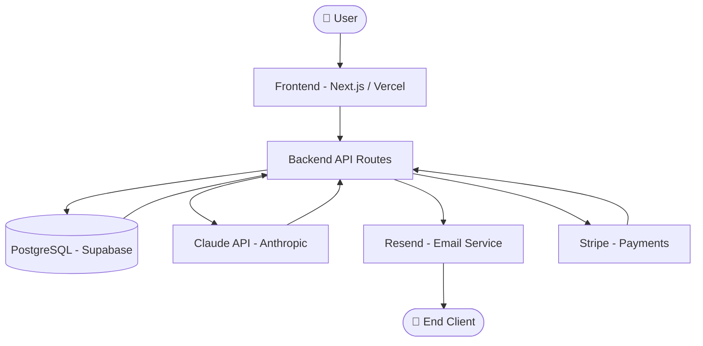

# 📖 How to Fill This Document

> **Read this first — it takes 2 minutes and saves you hours.**

This file is called **AppFlow.md** — your personal product blueprint that lives alongside your code.
Think of it as the brain of your project: every decision, every design choice, every launch step
lives here so you (or anyone you hand this to) always knows what the product is, where it's going,
and exactly what needs to happen next.

### ✅ Step-by-step filling guide

1. **Open this file** in any Markdown editor — VS Code, Obsidian, Notion, or even plain Notepad.
2. **Read the grey instruction lines** (they start with `>`) — they explain each field in plain English.
3. **Delete the instruction line** once you've filled that field. Your document stays clean.
4. **Replace every `[PLACEHOLDER]`** with real content for your project.
5. **Update the status badge** on each section as work progresses:
   - `[TODO]` → You haven't started this section yet.
   - `[IN PROGRESS]` → You're actively working on it.
   - `[DONE]` → This section is complete and reviewed.
6. **Never store real passwords, API keys, or tokens** in this file.
   Use `[YOUR_SECRET_HERE]` as a placeholder and store the real value in a `.env` file.
7. **Re-read this document before every sprint.** It keeps the whole team (or just future-you) aligned.

---

```
🏠 One rule: This file should always tell the TRUTH.
   If something changed — update this doc. Outdated docs are worse than no docs.
```

---
---

# 🗂️ AppFlow.md — AI-Driven Product Blueprint

> **Template Version:** 2.0 | **For:** Solo Founders & Small Teams | **Stack:** Web App / Mobile App (SaaS)
> **AI Engine:** Claude (Anthropic) | **Methodology:** AI-First Development Life Cycle

---

## 📌 Document Header

> **What this is:** The cover page of your product. Fill this first so anyone who opens the file
> immediately knows what product this is about and who is responsible.

| Field | Your Answer |
|---|---|
| **Project Name** | [e.g. TaskPilot — The AI Task Manager] |
| **Tagline** | [One sentence. e.g. "AI that turns chaos into done lists."] |
| **Product Type** | [Web App / Mobile App / Both] |
| **Status** | [Idea / Validating / Building / Beta / Launched] |
| **Owner / Founder** | [Your full name] |
| **Start Date** | [e.g. October 14, 2026] |
| **Target Launch Date** | [e.g. December 1, 2026] |
| **First 500 Users Goal Date** | [e.g. March 1, 2027] |
| **Primary AI Tool** | Claude (Anthropic) |
| **Document Last Updated** | [Auto-fill: today's date] |

---
---

## 🧠 PHASE 0 — Foundation

> **What this phase is about:** Before writing a single line of code, you need to be crystal clear
> about WHY this product exists. This section is the soul of the project. If you skip it, you'll
> build the wrong thing. This is the most important phase — take your time.

**Phase Status:** `[TODO]` / `[IN PROGRESS]` / `[DONE]`

---

### 0.1 🎯 Product Vision

> **What is "Vision"?** Vision is the big dream. Imagine your product 5 years from now.
> What does the world look like because your product exists? Write it in 1–3 sentences.
> Example: *"A world where every solo founder has a senior engineering team in their pocket."*

```
[Write your product vision here]
```

---

### 0.2 🔥 Problem Statement

> **What is a Problem Statement?** Describe the pain your user feels RIGHT NOW before
> your product exists. Be specific. Bad example: "People waste time." Good example:
> "Freelance designers spend 3+ hours every week chasing unpaid invoices by hand."

**The Problem:**
```
[Describe the problem in 2–4 sentences. Be as specific as possible.]
```

**Who feels this pain the most?**
```
[e.g. Freelance UX designers with 3–10 clients who invoice monthly]
```

**How are people solving it today (badly)?**
```
[e.g. They use spreadsheets + manual emails + Venmo reminders]
```

**Why existing solutions fail:**
```
[e.g. QuickBooks is too expensive; spreadsheets have no automation]
```

---

### 0.3 🌟 Mission Statement

> **Mission vs Vision:** Vision is the dream destination. Mission is HOW you'll get there.
> Example Mission: *"We make invoice tracking automatic so designers get paid on time, every time."*

```
[Write your mission in 1 sentence — start with "We" or "To"]
```

---

### 0.4 👥 Target Audience (Who Is This For?)

> **What this is:** A description of the EXACT person you're building for. The more specific
> you are, the better your product will be. Don't say "everyone" — that means nobody.
> Think of your ideal first customer. Give them a name. What do they do at 9am on a Monday?

**Primary User Persona:**

| Field | Details |
|---|---|
| **Persona Name** | [e.g. "Freelancer Fiona"] |
| **Age Range** | [e.g. 28–42] |
| **Job / Role** | [e.g. Freelance UX Designer] |
| **Location** | [e.g. USA, UK, Canada — English-speaking markets] |
| **Tech Comfort Level** | [Beginner / Intermediate / Advanced] |
| **Device They Use Most** | [Desktop / Mobile / Both] |
| **Biggest Pain Point** | [e.g. Chasing invoices kills her creative flow] |
| **What They Already Use** | [e.g. Figma, Notion, PayPal] |
| **How They'll Find Us** | [e.g. Twitter/X, Reddit r/freelance, ProductHunt] |
| **What Success Looks Like for Them** | [e.g. Get paid 2x faster with zero manual chasing] |

**Secondary Persona (if any):**
```
[Optional: Describe your second target user in 2–3 sentences]
```

---

### 0.5 💡 Unique Value Proposition (UVP)

> **What is a UVP?** It's the ONE reason your product is different from everything else.
> Fill in this sentence: "For [who], [product name] is the [what] that [does this benefit]
> unlike [competitor] which [does this instead]."

**Your UVP:**
```
[e.g. For freelance designers, InvoiceFlow is the only tool that automatically
chases overdue payments using AI — unlike QuickBooks which requires manual follow-ups.]
```

---

### 0.6 📊 Success Definition

> **What does "winning" look like?** Set specific numbers — not just "grow a lot."
> These become your targets in Phase 4.

| Milestone | Target | Timeline |
|---|---|---|
| First paying customer | [e.g. 1 user paying $9/mo] | [e.g. Week 6] |
| First 10 users | [e.g. 10 signups] | [e.g. Week 8] |
| First 100 users | [e.g. 100 active users] | [e.g. Month 3] |
| First 500 users | [e.g. 500 active users] | [e.g. Month 6] |
| Break-even revenue | [e.g. $500 MRR] | [e.g. Month 4] |

---
---

## 🔍 PHASE 1 — Idea → Validation

> **What this phase is about:** Before building anything, you must PROVE that real people
> want this product. This phase saves you from spending 6 months building something nobody buys.
> The goal: get 10 real people to say "I would pay for this."

**Phase Status:** `[TODO]` / `[IN PROGRESS]` / `[DONE]`

---

### 1.1 🔬 Problem Research

> **What is Problem Research?** You're gathering evidence that the problem is real.
> List every source where you found people complaining about this problem.

**Where did you discover this problem?**

| Source | Link / Reference | Key Insight Found |
|---|---|---|
| [e.g. Reddit r/freelance] | [URL] | [e.g. "I spend 2hrs/week chasing clients"] |
| [e.g. Twitter search] | [URL] | [e.g. "#freelance #unpaidinvoices trending"] |
| [e.g. Personal experience] | — | [e.g. Happened to me for 2 years] |
| [e.g. User interview #1] | — | [e.g. Sara confirmed she hates this] |

---

### 1.2 🏆 Competitor Analysis

> **Why this matters:** You need to know who else is solving this problem — and why your
> solution is better, different, or cheaper. List up to 5 competitors and compare honestly.

| Competitor | What They Do | Price | Weakness (Why Users Hate It) | Your Advantage |
|---|---|---|---|---|
| [e.g. FreshBooks] | [Invoicing + accounting] | [$17/mo] | [Too complex for freelancers] | [Simpler + AI-automated] |
| [e.g. Wave] | [Free invoicing] | [Free] | [No automation, manual] | [AI chases payments for you] |
| [Add more…] | | | | |

**Biggest gap in the market:**
```
[What are ALL competitors missing that you'll do?]
```

---

### 1.3 🗣️ User Interview Log

> **What is a User Interview?** You talk to 5–15 real potential users BEFORE building.
> You ask about their pain, NOT about your idea. Record each conversation here.
> Goal: Find patterns. If 8/10 people say the same pain, that's your product.

**Interview Template (copy for each person):**

```
--- Interview #[1] ---
Date: [date]
Person: [first name only, for privacy]
Job / Role: [their job]
How I found them: [e.g. Twitter DM, Reddit, friend]

Key Questions Asked:
  Q: "Walk me through how you handle [the problem] today."
  A: [their answer]

  Q: "What's the most painful part of that process?"
  A: [their answer]

  Q: "How much time does this cost you per week?"
  A: [their answer]

  Q: "Have you paid for any solution before? What happened?"
  A: [their answer]

  Q: "If this problem disappeared tomorrow, what would change for you?"
  A: [their answer]

My Takeaway: [1 sentence — what surprised me or confirmed my assumption]
Would they pay?: [Yes / No / Maybe — and their price guess]
```

**Validation Summary:**
```
[After 10+ interviews, write 3–5 bullet points of the patterns you found]
- Most common pain: [...]
- Willingness to pay: [e.g. 7/10 said yes, avg price guess $12/mo]
- Biggest surprise: [...]
```

---

### 1.4 ✅ Validation Checklist

> **Use this before moving to Phase 2.** All boxes should be checked before you start building.
> If 3+ are unchecked, go back and validate more. This saves months of wasted work.

- [ ] I talked to at least **10 real potential users** (not friends/family)
- [ ] At least **7 out of 10** confirmed the problem is real and painful
- [ ] At least **5 out of 10** said they would pay for a solution
- [ ] I found a **price range** people are comfortable with: `[$__ – $__/mo]`
- [ ] I have **documented quotes** from real users describing their pain
- [ ] I checked that this problem is **not already perfectly solved** by a free tool
- [ ] I know exactly who my **first 10 customers** will be and how to reach them
- [ ] I have a **waitlist** or landing page with at least **50 email sign-ups**

---
---

## 🏗️ PHASE 2 — MVP Build (1 → Launch)

> **What this phase is about:** You build the MINIMUM version of your product that solves
> the core problem. MVP = Minimum Viable Product. This is NOT the final product.
> It's the smallest thing that proves your idea works and gets your first users.
> Rule: If you're not embarrassed by your first version, you launched too late.

**Phase Status:** `[TODO]` / `[IN PROGRESS]` / `[DONE]`

---

### 2.1 📋 Feature List

> **What goes here:** Every feature you want to build. Split them into:
> - **MUST HAVE (MVP)** — Without this, the product doesn't work at all
> - **NICE TO HAVE** — Useful, but launch works fine without it
> - **FUTURE** — Great idea, but not now

| # | Feature Name | Description | Priority | Status | Owner |
|---|---|---|---|---|---|
| 1 | [e.g. User Sign Up] | [Create an account with email] | MUST HAVE | `[TODO]` | [You] |
| 2 | [e.g. Invoice Creator] | [Fill in client + amount, generate PDF] | MUST HAVE | `[TODO]` | [You] |
| 3 | [e.g. Auto-Reminder Email] | [AI sends overdue notice automatically] | MUST HAVE | `[TODO]` | [You] |
| 4 | [e.g. Dashboard] | [See all invoices + payment status] | MUST HAVE | `[TODO]` | [You] |
| 5 | [e.g. Stripe Integration] | [Accept credit card payments inline] | NICE TO HAVE | `[TODO]` | [You] |
| 6 | [e.g. Mobile App] | [iOS/Android version] | FUTURE | `[TODO]` | [You] |
| … | | | | | |

**MVP Scope Decision:**
```
[Write 2–3 sentences summarizing what IS and IS NOT in your MVP.
Example: "MVP includes sign-up, invoice creation, and one AI-generated payment reminder email.
Stripe integration and mobile app are deferred to v1.1."]
```

---

### 2.2 🛠️ Tech Stack

> **What is a Tech Stack?** The list of technologies, tools, and services your product
> is built with. Think of it as your ingredient list for the software recipe.
> Fill in what you use for each layer. If you don't know yet, write [TBD].

#### 🖥️ Frontend (What users see and click)

| Layer | Technology | Why You Chose It |
|---|---|---|
| Framework | [e.g. Next.js 14 / React Native / Flutter] | [e.g. Fast, SEO-friendly, great ecosystem] |
| Styling | [e.g. Tailwind CSS / NativeWind] | [e.g. Utility-first, rapid prototyping] |
| State Management | [e.g. Zustand / Redux / useState] | [e.g. Lightweight for MVP] |
| UI Component Library | [e.g. shadcn/ui / Expo UI] | [e.g. Pre-built accessible components] |
| Animation | [e.g. Framer Motion / Reanimated] | [e.g. Smooth micro-interactions] |

#### ⚙️ Backend (The engine behind the scenes)

| Layer | Technology | Why You Chose It |
|---|---|---|
| Runtime | [e.g. Node.js / Python / Go] | [e.g. Familiar, fast to prototype] |
| Framework | [e.g. Next.js API Routes / FastAPI / Express] | [e.g. Co-located with frontend] |
| Database | [e.g. PostgreSQL via Supabase / MongoDB] | [e.g. Relational + real-time support] |
| ORM | [e.g. Prisma / SQLAlchemy / Drizzle] | [e.g. Type-safe queries] |
| Auth | [e.g. Clerk / Supabase Auth / NextAuth] | [e.g. Free tier, social login ready] |

#### 🤖 AI Layer

| Component | Technology | Purpose |
|---|---|---|
| LLM Provider | Claude (Anthropic) API | Core AI reasoning and generation |
| Claude Model | [e.g. claude-opus-4-5 / claude-sonnet-4-5] | [e.g. Balanced cost + quality] |
| Prompt Management | [e.g. Hardcoded / Langchain / Custom PromptStore] | [e.g. Store prompts as constants] |
| Vector DB (if needed) | [e.g. Pinecone / pgvector / None] | [e.g. Semantic search over invoices] |
| Embeddings (if needed) | [e.g. Voyage AI / OpenAI Ada] | [e.g. Semantic similarity] |

#### 🏗️ Infrastructure & DevOps

| Layer | Technology | Why You Chose It |
|---|---|---|
| Hosting (Frontend) | [e.g. Vercel / Netlify] | [e.g. Free tier, auto-deploy from GitHub] |
| Hosting (Backend) | [e.g. Railway / Render / Fly.io] | [e.g. Simple Docker deploy] |
| File Storage | [e.g. Cloudflare R2 / AWS S3 / Supabase Storage] | [e.g. Cheap object storage] |
| Email Service | [e.g. Resend / SendGrid] | [e.g. Simple API, transactional email] |
| Payments | [e.g. Stripe / LemonSqueezy] | [e.g. Easy subscription billing] |
| Analytics | [e.g. PostHog / Plausible / Mixpanel] | [e.g. Privacy-friendly, open source] |
| Error Tracking | [e.g. Sentry / LogRocket] | [e.g. Get alerts when things break] |
| CI/CD | [e.g. GitHub Actions / Vercel auto-deploy] | [e.g. Auto-test and deploy on push] |

#### 🔐 Secrets & Environment Variables

> **CRITICAL RULE:** NEVER paste real values in this file. This file may be committed to git.
> Store all real secrets in a `.env` file and add `.env` to your `.gitignore`.

**Reference your `.env.example` file:**
```bash
# See .env.example in the root of your project for all required variables.
# Required variables for this project:

CLAUDE_API_KEY=[YOUR_ANTHROPIC_API_KEY]
DATABASE_URL=[YOUR_DATABASE_CONNECTION_STRING]
NEXTAUTH_SECRET=[YOUR_RANDOM_SECRET_STRING]
STRIPE_SECRET_KEY=[YOUR_STRIPE_SECRET_KEY]
STRIPE_WEBHOOK_SECRET=[YOUR_STRIPE_WEBHOOK_SECRET]
RESEND_API_KEY=[YOUR_RESEND_API_KEY]
```

---

### 2.3 🏛️ Architecture Overview

> **What is Architecture?** It's the big-picture map of how all the parts of your app talk
> to each other. Draw this as a flowchart in your head, then describe it below.
> Include: user → frontend → backend → database → AI → external services.

**System Architecture Description:**
```
[Describe in plain English how data flows through your app.
Example:
1. User opens the web app (Next.js — hosted on Vercel)
2. They create an invoice → frontend sends request to backend API
3. Backend saves invoice to PostgreSQL (Supabase)
4. A CRON job runs daily → checks for unpaid invoices older than 7 days
5. Triggers Claude API → generates a personalized reminder email
6. Resend API sends the email to the client
7. Client pays → Stripe webhook updates invoice status to "paid"
8. User sees updated dashboard in real-time via Supabase Realtime]
```

**Architecture Diagram (Mermaid — paste in GitHub or Obsidian to see it rendered):**


> **How to edit:** Replace the nodes above with your actual services. The `-->` means "sends data to."

---

### 2.4 📊 Database Schema (Key Tables)

> **What is a Database Schema?** It's the blueprint of how your data is organized.
> Think of it like an Excel spreadsheet — what columns does each table have?
> List your most important tables and their key fields.

**Table: `users`**

| Column | Type | Description |
|---|---|---|
| id | UUID | Unique identifier for each user |
| email | TEXT | User's email address |
| name | TEXT | Full name |
| plan | TEXT | "free" / "pro" / "enterprise" |
| created_at | TIMESTAMP | When they signed up |

**Table: `[your_table_name]`**

| Column | Type | Description |
|---|---|---|
| id | UUID | [description] |
| user_id | UUID | Links to users table |
| [field_name] | [TEXT/INT/BOOL] | [what this stores] |
| created_at | TIMESTAMP | Record creation time |

> **Add more tables as needed. Copy the table above.**

---

### 2.5 🔄 User Flow

> **What is a User Flow?** The exact steps a user takes from first landing on your site to
> completing their first key action. Map the happy path (things going right) first.

**New User Happy Path:**
```
Step 1: User lands on homepage (from [Google / Twitter / ProductHunt])
Step 2: Reads headline → clicks "Get Started Free"
Step 3: Signs up with [email+password / Google OAuth]
Step 4: Onboarding → [3-step wizard: connects bank / sets up profile / creates first invoice]
Step 5: [Core action completed — e.g. first invoice sent]
Step 6: Receives confirmation email
Step 7: Returns to dashboard — sees [what they built]
Step 8: [Optional: upgrades to paid plan after hitting free limit]
```

**Error / Edge Case Flows (list the risky paths):**
```
- What if email already exists? → [show "login instead" link]
- What if payment fails? → [retry with different card flow]
- What if AI returns an error? → [show fallback message, log error to Sentry]
- What if user loses internet mid-flow? → [auto-save draft]
```

---

### 2.6 📐 Sprint Planning

> **What is a Sprint?** A sprint is a fixed block of time (usually 1–2 weeks) where you
> commit to completing specific tasks. This keeps you focused and stops scope creep.

**Sprint Board:**

| Sprint # | Dates | Goal | Features / Tasks | Status |
|---|---|---|---|---|
| Sprint 1 | [e.g. Oct 14–21] | [Auth + basic UI] | [Sign up, login, dashboard skeleton] | `[TODO]` |
| Sprint 2 | [e.g. Oct 22–28] | [Core feature] | [Invoice creator + PDF export] | `[TODO]` |
| Sprint 3 | [e.g. Oct 29–Nov 4] | [AI integration] | [Claude reminder emails] | `[TODO]` |
| Sprint 4 | [e.g. Nov 5–11] | [Payments] | [Stripe checkout + webhooks] | `[TODO]` |
| Sprint 5 | [e.g. Nov 12–18] | [Beta polish] | [Bug fixes, onboarding flow, analytics] | `[TODO]` |

**Daily Check-in Format:**
```
Date: [today]
Yesterday I completed: [task]
Today I will work on: [task]
Blocked by: [blocker or "nothing"]
```

---

### 2.7 🤖 AI Agent & Prompt Design

> **What is this section?** If your product uses AI (Claude), this is where you design
> exactly how the AI behaves. Think of it as writing a job description for your AI employee.
> Every AI feature needs: a Role, a Task, Guardrails (what it must NOT do), and an Output Format.

#### AI Features in This Product

| AI Feature | Where It's Used | Claude Model | Est. Cost per Use |
|---|---|---|---|
| [e.g. Reminder email generator] | [Invoice overdue flow] | [claude-haiku-4-5] | [~$0.001] |
| [e.g. Invoice line item suggester] | [Invoice creation form] | [claude-sonnet-4-5] | [~$0.005] |
| [Add more…] | | | |

---

#### AI Feature Design Card

> **Copy this card for each AI feature in your product.**

```
=== AI FEATURE: [Feature Name] ===

PURPOSE:
[What does this AI feature do? 1 sentence.
Example: Generate a personalized payment reminder email for overdue invoices.]

TRIGGER:
[When does this AI run? What user action or system event causes it?
Example: Runs automatically when an invoice is 7 days overdue.]

INPUT DATA (what you send to Claude):
- [e.g. Client name: {client_name}]
- [e.g. Invoice amount: {amount}]
- [e.g. Days overdue: {days_overdue}]
- [e.g. Sender name: {user_name}]
- [e.g. Tone preference: {professional / friendly / firm}]

SYSTEM PROMPT:
---
You are a professional invoice reminder assistant helping freelancers get paid on time.
Your job is to write a short, polite payment reminder email on behalf of the freelancer.

Rules you MUST follow:
- Always be professional and non-confrontational
- Never threaten legal action unless explicitly instructed
- Keep the email under 150 words
- Use the client's first name
- End with a clear call-to-action (e.g., "Click here to pay: [payment link]")
- Do not make up any information not provided to you
---

USER PROMPT TEMPLATE:
---
Write a payment reminder email for the following invoice:
- Freelancer name: {user_name}
- Client name: {client_name}
- Invoice #: {invoice_number}
- Amount due: ${amount}
- Original due date: {due_date}
- Days overdue: {days_overdue} days
- Tone: {tone}
- Payment link: {payment_link}
---

EXPECTED OUTPUT FORMAT:
Subject: [email subject line]
Body: [email body, 100–150 words]

GUARDRAILS (things the AI must NEVER do):
- Must NOT make up amounts or dates not in the input
- Must NOT be rude or threatening
- Must NOT include any legal terms unless instructed
- Must NOT reveal that the email was AI-generated

FALLBACK (what to show if Claude fails):
[Display a pre-written default template and log the error to Sentry]

COST ESTIMATE:
Input tokens: ~200 | Output tokens: ~150 | Model: claude-haiku-4-5 | Est: ~$0.001/run

TESTING NOTES:
[How will you test this works correctly? What are the edge cases?
e.g. "Test with $0 amount, test with special characters in names, test in French"]
```

---
---

## 🧪 PHASE 2.5 — Quality Assurance (QA)

> **What is QA?** Quality Assurance is making sure your product actually works before
> real users touch it. Think of it like taste-testing your food before serving guests.
> This section covers testing every layer: your code, your UI, and your AI outputs.

**Phase Status:** `[TODO]` / `[IN PROGRESS]` / `[DONE]`

---

### QA 1: Unit Testing

> **What is a Unit Test?** Testing one small piece of code in isolation.
> Example: "Does the `calculateTotal()` function return the right number?"

| Test File | What It Tests | Pass/Fail | Notes |
|---|---|---|---|
| [e.g. invoice.test.ts] | [calculateTotal returns correct sum] | [ ] | |
| [e.g. auth.test.ts] | [User can sign up with valid email] | [ ] | |
| [e.g. ai.test.ts] | [Claude returns response within 10 seconds] | [ ] | |
| [Add more…] | | | |

**Test Coverage Target:** `[e.g. 70% coverage on all business logic functions]`

---

### QA 2: Integration Testing

> **What is an Integration Test?** Testing two or more parts of your app working together.
> Example: "Does signing up actually save a user to the database AND send a welcome email?"

| Test Scenario | Systems Involved | Pass/Fail | Notes |
|---|---|---|---|
| [e.g. New user signs up] | [Auth + DB + Email] | [ ] | |
| [e.g. Invoice created → PDF generated] | [Backend + Storage] | [ ] | |
| [e.g. Overdue invoice triggers AI email] | [CRON + Claude API + Resend] | [ ] | |
| [Add more…] | | | |

---

### QA 3: AI Output Testing

> **Why AI needs special testing:** Unlike regular code, AI doesn't always give the same answer.
> You need to test that Claude's outputs are consistently good, safe, and accurate.
> This is called "LLM evaluation" or "AI output testing."

| AI Feature | Test Input | Expected Output | Actual Output | Quality Score (1–5) | Issues Found |
|---|---|---|---|---|---|
| [Reminder email] | [$500 invoice, 7 days late, friendly tone] | [Professional 120-word email] | [paste sample] | [ ] | |
| [e.g. Suggest line items] | [Client: "web design project"] | [3 relevant line item suggestions] | [paste sample] | [ ] | |
| [Add more…] | | | | | |

**AI Hallucination Checks:**
- [ ] AI does not invent amounts or dates not in the input
- [ ] AI does not add information about people not in the prompt
- [ ] AI stays within requested word limits
- [ ] AI follows tone instructions correctly
- [ ] AI output passes basic grammar check
- [ ] AI returns sensible response when given edge-case inputs

**AI Safety Checks:**
- [ ] System prompt prevents harmful outputs (tested with adversarial inputs)
- [ ] Prompt injection attempts were tested and blocked
- [ ] PII (Personal Identifiable Information) is not stored in prompt logs

---

### QA 4: End-to-End (E2E) Testing

> **What is E2E Testing?** You test the entire product from the user's point of view.
> Open the app, do things a real user would do, check that everything works from start to finish.

**E2E Test Scenarios (Manual Checklist):**

**User Journey 1: New User Onboarding**
- [ ] Land on homepage — loads in under 3 seconds
- [ ] Click "Get Started" — goes to sign up page
- [ ] Sign up with email — account created, welcome email received
- [ ] Complete onboarding steps — no errors shown
- [ ] Dashboard loads with correct empty state message
- [ ] First [core action] — works correctly end-to-end

**User Journey 2: [Your core feature flow]**
- [ ] [Step 1]
- [ ] [Step 2]
- [ ] [Step 3]
- [ ] [Expected result occurs]

---

### QA 5: Pre-Launch Checklist

> **Run this before you launch to any real users.** Every checkbox must be ticked.

**Performance:**
- [ ] Homepage loads in under **3 seconds** on mobile (test with Google PageSpeed)
- [ ] API responses return in under **2 seconds** for 95% of requests
- [ ] App works on Chrome, Safari, Firefox (and Edge if targeting enterprise)
- [ ] App works on iOS Safari and Android Chrome (for mobile-first features)

**Security:**
- [ ] All API routes require authentication (no public endpoints that shouldn't be)
- [ ] Passwords are hashed (never stored in plain text)
- [ ] All secrets are in `.env` — **ZERO secrets committed to git**
- [ ] HTTPS is enforced on all endpoints
- [ ] Rate limiting is enabled on AI endpoints (prevent abuse + cost blowup)
- [ ] SQL injection protection in place (use ORM or parameterized queries)
- [ ] User data is isolated — User A cannot access User B's data
- [ ] GDPR/CCPA compliance noted: [ ] Privacy policy live [ ] Cookie consent if needed

**UX:**
- [ ] Error messages are human-readable (not raw error codes)
- [ ] Loading states shown for all async actions (no blank screens)
- [ ] Empty states have helpful guidance (not just blank pages)
- [ ] Mobile layout tested on 375px screen width
- [ ] All forms validate inputs before submission

**Business Logic:**
- [ ] Free plan limits are enforced correctly
- [ ] Paid plan upgrade flow works end-to-end
- [ ] Email notifications are sent correctly
- [ ] Stripe webhooks are connected and tested with Stripe CLI

**Monitoring:**
- [ ] Error tracking (Sentry / LogRocket) is set up and sending alerts
- [ ] Analytics (PostHog / Plausible) is tracking key events
- [ ] Database backups are enabled
- [ ] Uptime monitoring is configured (UptimeRobot / Better Uptime)

---
---

## 🚀 PHASE 3 — Beta → Public Launch

> **What this phase is about:** You've built the MVP and it passes QA. Now you launch it
> to a small group of beta users first, collect feedback, fix critical issues, and then
> open it to the public. A beta launch is a "soft launch" — invite-only, low pressure.

**Phase Status:** `[TODO]` / `[IN PROGRESS]` / `[DONE]`

---

### 3.1 📧 Beta User Plan

> **Who are your beta users?** These are the first 10–50 people who use your product before
> the public launch. They give you honest feedback in exchange for free or discounted access.
> Find them from your user interviews, Twitter followers, or relevant communities.

| # | Beta User Name | Contact | How They Were Found | Signed Up? | Feedback Received? |
|---|---|---|---|---|---|
| 1 | [First name] | [email] | [e.g. Twitter DM] | [ ] | [ ] |
| 2 | [First name] | [email] | [e.g. User interview] | [ ] | [ ] |
| 3–50 | … | | | | |

**Beta Access Instructions (what you'll send them):**
```
[Draft the message you'll send to invite beta users. Example:

"Hey [Name], I've been building a tool to automate invoice follow-ups for freelancers.
Since you mentioned this was a pain for you, I'd love to give you free access to the beta.
It takes 5 minutes to set up. In return, would you fill out a quick feedback form after 1 week?
Beta link: [your-app.com/beta] | Code: BETA2026
Thanks!"]
```

---

### 3.2 🎯 Onboarding Flow Design

> **What is Onboarding?** It's the experience a new user has in their FIRST 5 minutes.
> Great onboarding gets users to their "First Value Moment" as fast as possible.
> Your First Value Moment (FVM) is when the user first "gets it" and feels the product working.

**First Value Moment for your product:**
```
[e.g. "User has sent their first invoice and sees the AI reminder is scheduled"]
```

**Onboarding Steps:**

| Step # | Screen / Page | Goal | Call-to-Action | If User Skips |
|---|---|---|---|---|
| 1 | [Welcome screen] | [Set user name + business] | ["Let's set you up →"] | [Can skip, fills later in settings] |
| 2 | [Connect feature] | [e.g. Add first client] | ["Add your first client →"] | [Show sample data] |
| 3 | [Core action] | [e.g. Create first invoice] | ["Create invoice →"] | [Use template invoice] |
| 4 | [First value] | [e.g. Invoice preview + send] | ["Send invoice 🚀"] | — |
| 5 | [Celebration] | [Affirm success] | ["View your dashboard →"] | — |

**Onboarding Emails (automated sequence after sign-up):**

| Email # | Sent | Subject | Goal |
|---|---|---|---|
| 1 | Immediately | [e.g. "Welcome! Here's your first step"] | [Drive to complete step 1 of onboarding] |
| 2 | Day 2 | [e.g. "Did you send your first invoice?"] | [Reactivate users who didn't complete setup] |
| 3 | Day 5 | [e.g. "Here's what your peers are doing"] | [Social proof + feature discovery] |
| 4 | Day 10 | [e.g. "You're missing this feature…"] | [Highlight underused feature] |
| 5 | Day 14 | [e.g. "How is [Product] working for you?"] | [Request feedback + testimonial] |

---

### 3.3 🎉 Public Launch Plan

> **Launch day is not random.** Pick a platform and own it. Don't try to launch everywhere
> at once. Pick ONE primary channel, prepare everything, then go.

**Primary Launch Platform:** `[e.g. Product Hunt / Hacker News / Twitter / AppSumo]`

**Launch Date:** `[e.g. November 15, 2026 at 12:01 AM PST]`

**Launch Preparation Checklist:**

**Content to prepare before launch:**
- [ ] Landing page is live with clear headline + CTA
- [ ] Demo video (60–90 seconds) recorded and uploaded
- [ ] 5 screenshots of the product ready
- [ ] Product Hunt hunter confirmed (if PH launch)
- [ ] 10 people committed to upvote / comment on launch day
- [ ] Twitter/X thread about the backstory written and scheduled
- [ ] One-liner explanation ready: "[Product] is [X] for [Y] — [benefit]"
- [ ] Press kit ready (logo, screenshots, founder bio)

**Launch Day Schedule:**

| Time | Action | Done? |
|---|---|---|
| 12:01 AM | Submit to Product Hunt (if using PH) | [ ] |
| 8:00 AM | Post Twitter/X thread | [ ] |
| 8:30 AM | Post in relevant Reddit communities | [ ] |
| 9:00 AM | Email your waitlist | [ ] |
| 10:00 AM | Post in relevant Slack / Discord communities | [ ] |
| All day | Reply to every comment and question within 30 min | [ ] |
| 6:00 PM | Post a "Day 1 update" with numbers | [ ] |
| End of day | Log all signups, feedback, and issues | [ ] |

---
---

## 📈 PHASE 4 — Post-Launch → First 500 Users

> **What this phase is about:** You're live! Now the real work begins. This phase is about
> learning from real users, fixing what's broken, and growing your user base to 500 people.
> You track specific metrics, run experiments, and talk to users constantly.

**Phase Status:** `[TODO]` / `[IN PROGRESS]` / `[DONE]`

---

### 4.1 📊 Metrics Dashboard

> **What are Metrics?** Numbers that tell you if your product is working or failing.
> Track these weekly. If a number drops, investigate immediately.

#### 🔵 User Acquisition (How users find you)

| Metric | Week 1 | Week 2 | Week 4 | Month 2 | Month 3 | Target |
|---|---|---|---|---|---|---|
| Total Sign-ups | | | | | | [500] |
| Weekly New Sign-ups | | | | | | [50/week] |
| Top Traffic Source | | | | | | [e.g. Twitter] |
| Customer Acquisition Cost (CAC) | | | | | | [e.g. < $15] |
| Waitlist → Signup Conversion % | | | | | | [e.g. > 30%] |

> **CAC Formula:** Total $ spent on marketing ÷ Number of new customers acquired
> **Example:** If you spent $150 on ads and got 10 customers → CAC = $15

#### 🟢 Activation & Onboarding (First value moment)

| Metric | Week 1 | Week 2 | Week 4 | Month 2 | Month 3 | Target |
|---|---|---|---|---|---|---|
| % Users who complete onboarding | | | | | | [> 60%] |
| % Users who hit First Value Moment | | | | | | [> 40%] |
| Avg. time to First Value Moment | | | | | | [< 5 min] |
| Day-1 Retention (came back day after sign-up) | | | | | | [> 30%] |

#### 🟡 Retention & Engagement (Are users coming back?)

| Metric | Week 1 | Week 2 | Week 4 | Month 2 | Month 3 | Target |
|---|---|---|---|---|---|---|
| DAU (Daily Active Users) | | | | | | [growing] |
| WAU (Weekly Active Users) | | | | | | [growing] |
| MAU (Monthly Active Users) | | | | | | [growing] |
| Day-7 Retention % | | | | | | [> 20%] |
| Day-30 Retention % | | | | | | [> 10%] |
| Churn Rate % (monthly) | | | | | | [< 5%] |

> **Retention Rule of Thumb:** If Day-30 retention is below 10%, your product isn't sticky enough.
> Focus on improving the core value before scaling growth.

#### 🔴 Revenue & Unit Economics (Is it making money?)

| Metric | Month 1 | Month 2 | Month 3 | Month 6 | Target |
|---|---|---|---|---|---|
| MRR (Monthly Recurring Revenue) | | | | | [$500+] |
| ARR (Annual Run Rate) | | | | | [$6,000+] |
| Paying Customers | | | | | [50+] |
| Free → Paid Conversion % | | | | | [> 3%] |
| ARPU (Avg Revenue Per User) | | | | | [e.g. $12] |
| LTV (Lifetime Value) | | | | | [e.g. $144] |
| Payback Period | | | | | [< 6 months] |

> **LTV Formula:** ARPU × Average months a customer stays before churning
> **Payback Period:** How many months until you earn back the cost of acquiring a customer

---

### 4.2 🐛 Bug Triage Log

> **What is Bug Triage?** When users report bugs, you log them here and decide which ones
> to fix first. Priority = how badly the bug affects the user's core experience.

| # | Date Reported | Bug Description | Reported By | Priority | Status | Fixed In |
|---|---|---|---|---|---|---|
| 1 | [date] | [e.g. "PDF not generating for invoices > $10,000"] | [e.g. Beta user Sara] | [P0 CRITICAL] | `[IN PROGRESS]` | [v1.0.1] |
| 2 | [date] | [e.g. "Email shows wrong date on mobile"] | [e.g. Sentry alert] | [P1 HIGH] | `[TODO]` | |
| … | | | | | | |

**Priority Levels:**
- `P0 CRITICAL` — Product is broken, data is lost, or security is at risk. Fix within hours.
- `P1 HIGH` — Core feature doesn't work. Fix within 24 hours.
- `P2 MEDIUM` — Feature works but has issues. Fix within 1 week.
- `P3 LOW` — Minor annoyance. Fix when time permits.

---

### 4.3 🔁 Feedback Collection System

> **Why collect feedback systematically?** So you build what users actually need, not what
> you think they need. Set up multiple channels so feedback flows in automatically.

**Feedback Channels:**

| Channel | Tool | Frequency | Who Reviews |
|---|---|---|---|
| In-app feedback widget | [e.g. Canny / Satiismeter / Custom] | Always on | [You / weekly] |
| Net Promoter Score (NPS) | [e.g. Delighted / Typeform] | [Monthly] | [You] |
| Onboarding exit survey | [e.g. Typeform / Tally] | [Day 14 auto-email] | [You] |
| Churn survey | [e.g. Typeform] | [On cancellation] | [You] |
| User interviews | [Calendly booking link] | [2/week in months 1–3] | [You] |

**Top Feature Requests (update weekly):**

| # | Feature Requested | Requested By (count) | Priority | Status |
|---|---|---|---|---|
| 1 | [e.g. Stripe direct payout] | [12 users] | [High] | `[TODO]` |
| 2 | | | | |

---

### 4.4 🧪 Growth Experiments

> **What is a Growth Experiment?** A small, time-boxed test to see if a specific action
> increases a key metric. Run one experiment at a time. Document results.

| # | Hypothesis | Metric to Move | Test | Duration | Result | Decision |
|---|---|---|---|---|---|---|
| 1 | [e.g. Adding a "Share invoice" button will increase referrals] | [Referral sign-ups] | [A/B: 50% see button / 50% don't] | [2 weeks] | [+23% referrals] | [SHIP IT] |
| 2 | [Add your next experiment…] | | | | | |

---

### 4.5 🗺️ Roadmap to 500 Users

> **Your growth plan:** Break the journey to 500 users into monthly milestones.
> Think about what must be TRUE for each stage to be reached.

| Month | Users Goal | Revenue Goal | Key Action to Get There | Key Risk |
|---|---|---|---|---|
| Month 1 | [10] | [$0 — free beta] | [Get 10 beta users from personal network + Twitter] | [Low retention] |
| Month 2 | [50] | [$200 MRR] | [ProductHunt launch + Reddit posts] | [Poor activation] |
| Month 3 | [150] | [$600 MRR] | [Content marketing + SEO article #1] | [Churn spike] |
| Month 4 | [300] | [$1,500 MRR] | [Referral program launch + AppSumo deal] | [Support overload] |
| Month 5 | [420] | [$2,500 MRR] | [Paid ads test + influencer partnership] | [CAC too high] |
| Month 6 | [500] | [$3,500 MRR] | [Community building + case studies] | [Feature gap] |

---
---

## 🤖 AI Prompt Library

> **What is this?** A collection of ready-to-use prompts you can give to Claude for
> every stage of building and running your product. Copy-paste these, swap the
> `[BRACKETS]` for your real details, and Claude will do the heavy lifting.

---

### 💡 Phase 0–1: Ideation & Validation Prompts

```
PROMPT: Competitor Analysis
---
I'm building [product name], a [one-line description].
My target user is [persona].
My main competitors are: [list competitors].

Please analyze each competitor and create a comparison table showing:
1. Their core features
2. Their pricing
3. Their main user complaints (based on common SaaS patterns)
4. The gap in the market my product can fill

Then write a 2-sentence positioning statement for my product.
---
```

```
PROMPT: User Interview Question Generator
---
I'm validating an idea for [product description].
My target user is [persona — e.g. "freelance graphic designers who struggle with invoicing"].

Generate 10 open-ended discovery interview questions I can ask real potential users.
The questions should:
- Uncover their current pain and workflow (NOT ask about my product)
- Be non-leading (don't suggest the answer)
- Reveal willingness to pay without directly asking "would you pay?"
- Be conversational and friendly in tone
---
```

```
PROMPT: Landing Page Copy Generator
---
Write a high-converting landing page for my product using this structure:
- Headline: [benefit-focused, under 10 words]
- Subheadline: [expand on the promise, 1–2 sentences]
- Feature bullets: 3 bullets in "So you can [benefit]" format
- Social proof placeholder: [3 fake testimonials I'll replace with real ones]
- CTA button text: [action-oriented, 2–5 words]

My product: [name + one-line description]
Target user: [persona]
Main benefit: [e.g. "get paid 2x faster with zero manual work"]
Tone: [e.g. friendly + professional]
---
```

---

### 🏗️ Phase 2: Build Prompts

```
PROMPT: Architecture Review
---
I'm building [product name] with this tech stack:
- Frontend: [e.g. Next.js 14 + Tailwind]
- Backend: [e.g. Next.js API routes + Prisma]
- Database: [e.g. PostgreSQL on Supabase]
- AI: [e.g. Claude Haiku via Anthropic API]

My MVP features are:
[list your MUST HAVE features]

Please:
1. Review my stack and flag any obvious issues or mismatches
2. Suggest the folder structure for this project
3. Identify the top 3 technical risks I should design around
4. Recommend a sensible file naming convention
---
```

```
PROMPT: Database Schema Design
---
I need to design a PostgreSQL database for [product name].

The product does: [describe what the product does]
Key entities (things we store): [e.g. users, invoices, clients, payments]

For each entity, please:
1. List the recommended columns with data types
2. Identify relationships between tables (foreign keys)
3. Suggest which fields need database indexes for performance
4. Flag any data that should NOT be stored in the database (e.g. PII that needs encryption)

Output as SQL CREATE TABLE statements I can copy into my migration file.
---
```

```
PROMPT: AI System Prompt Designer
---
I need to design a system prompt for a Claude-powered feature in my product.

Feature: [name and description]
User context: [who will trigger this? what do they want?]
Input data available: [list every variable you'll send to Claude]
Desired output: [describe exactly what Claude should return, including format]
Tone: [e.g. professional, friendly, concise]
Hard constraints: [things Claude must NEVER do in this context]

Please write:
1. The system prompt (what Claude's role and rules are)
2. The user prompt template (with {variable} placeholders)
3. 3 adversarial test cases I should run to ensure safety
4. A suggested output parsing strategy
---
```

```
PROMPT: Code Review Assistant
---
Please review the following code for:
1. Correctness — does it do what it's supposed to?
2. Security — any vulnerabilities or data exposure risks?
3. Performance — any obvious inefficiencies?
4. Readability — is it clear what the code does?
5. Edge cases — what inputs could break this?

Context: This is [describe what the code does] in a [Next.js / Node.js / etc.] project.

[PASTE YOUR CODE HERE]

Format your review as:
- ✅ What's good
- ⚠️ Issues to fix (with severity: critical / major / minor)
- 💡 Suggestions for improvement
---
```

---

### 🧪 Phase 2.5: QA Prompts

```
PROMPT: Test Case Generator
---
Generate comprehensive test cases for the following feature:

Feature: [feature name and description]
Tech stack: [e.g. Jest + React Testing Library / Pytest]

Please generate:
1. 5 unit tests for the core business logic
2. 3 integration tests for the API endpoints
3. 2 edge case tests (weird inputs, empty states, error conditions)
4. 1 AI output validation test (if the feature uses Claude)

Format each test as pseudocode first, then the actual test code.
---
```

```
PROMPT: AI Output Evaluator
---
I need to evaluate the quality of AI outputs from my [feature name] feature.

Feature description: [what it does]
Evaluation criteria:
1. Accuracy (does the output match the input facts?)
2. Safety (no harmful content?)
3. Format compliance (correct length, structure, tone?)
4. Usefulness (would the target user find this genuinely helpful?)

Here are 5 sample outputs from Claude:
[paste 5 outputs]

For each output, score it 1–5 on each criterion and suggest improvements.
---
```

---

### 🚀 Phase 3: Launch Prompts

```
PROMPT: Product Hunt Launch Materials
---
Help me write all copy for my Product Hunt launch for [product name].

Product: [name + one-line description]
Target user: [persona]
Key features: [top 3]
Origin story: [why I built this — 2 sentences]

Please write:
1. Tagline (under 60 characters)
2. Product description (under 260 characters)
3. First comment from the maker (200–300 words — story format)
4. 5 different first-comment openers I can choose from
5. Responses to 5 common ProductHunt questions
6. The Tweet I'll post announcing the launch
---
```

---

### 📈 Phase 4: Growth Prompts

```
PROMPT: Churn Analysis & Retention Ideas
---
Here is data about users who cancelled [product name] in the last 30 days:
[paste churn survey responses or describe patterns]

Most common cancellation reasons:
- [reason 1]: [X users]
- [reason 2]: [X users]

Please:
1. Identify the root cause behind each churn reason (not the surface reason)
2. Suggest 3 product changes that would address the top churn driver
3. Write a win-back email sequence (3 emails) for churned users
4. Propose one experiment to test the highest-impact retention idea
---
```

```
PROMPT: Weekly User Update Email
---
Write a brief weekly product update email to send to all [product name] users.

This week's updates:
- New: [feature or improvement]
- Fixed: [bug or issue]
- Coming next: [what you're working on]

Data this week:
- [key metric]: [number]

Tone: [friendly / professional / casual startup]
Length: under 200 words
Include: 1 clear CTA at the end
Don't: use corporate buzzwords or excessive exclamation points
---
```

---
---

## 🔐 Security Checklist

> **What is this section?** Security might sound scary, but it's just a set of habits.
> Run through this list before each major release. If you don't know what something means,
> Claude can explain it — just ask!

**Section Status:** `[TODO]` / `[IN PROGRESS]` / `[DONE]`

### Authentication & Access

- [ ] Passwords are hashed using bcrypt or Argon2 (never stored as plain text)
- [ ] JWT tokens expire within 24 hours; refresh tokens used for longer sessions
- [ ] "Forgot password" flow sends link to email — doesn't reveal if account exists
- [ ] Admin routes are protected by admin role checks (not just "logged in" checks)
- [ ] Rate limiting on login endpoint (prevent brute force: e.g. 5 attempts then lockout)
- [ ] OAuth providers (Google, GitHub) used where possible instead of password storage

### Data & Storage

- [ ] `.env` file is in `.gitignore` — verified by checking git history
- [ ] No API keys or passwords appear anywhere in the codebase or git commits
- [ ] Database connections use environment variables, never hardcoded
- [ ] User data (User A) cannot be accessed by other users (User B) — tested manually
- [ ] Sensitive data fields (SSN, card numbers) are never stored — use Stripe's tokenization

### API & Backend

- [ ] All API routes require authentication (except intentional public endpoints)
- [ ] Input validation on all form fields and API inputs (prevent SQL injection, XSS)
- [ ] AI API calls have a rate limit (e.g. max 10 calls/minute per user) to prevent abuse
- [ ] Webhooks (e.g. Stripe) verify the signature before processing
- [ ] Error responses don't leak internal system details (stack traces, file paths)

### Frontend

- [ ] No API keys exposed in frontend JavaScript (browser DevTools test)
- [ ] HTTPS enforced — HTTP requests redirect to HTTPS
- [ ] Content Security Policy (CSP) headers set to prevent script injection
- [ ] User-generated content is sanitized before display (prevent XSS)

### Infrastructure

- [ ] Database has automated daily backups enabled
- [ ] Principle of least privilege: services only have permissions they absolutely need
- [ ] Production environment variables are separate from development
- [ ] Dependency audit run (`npm audit` or `pip-audit`) — no critical vulnerabilities

### Privacy & Compliance

- [ ] Privacy Policy page is live and linked in footer
- [ ] Terms of Service page is live and linked in footer
- [ ] Cookie consent banner shown if using tracking cookies (GDPR)
- [ ] Users can delete their account and all associated data (GDPR right to erasure)
- [ ] Data processing practices documented if handling EU user data

---
---

## 📝 Changelog

> **What is a Changelog?** A running log of every meaningful update to the product.
> Update this after every release. Users and investors love seeing this — it shows momentum.

| Version | Date | Type | What Changed |
|---|---|---|---|
| v0.1.0 | [date] | [Beta Launch] | [Initial beta released to first 10 users] |
| v0.1.1 | [date] | [Bug Fix] | [Fixed PDF generation for large invoices] |
| v1.0.0 | [date] | [Public Launch] | [Product Hunt launch — public access opened] |
| v1.1.0 | [date] | [Feature] | [Added Stripe direct payment links] |
| [add more…] | | | |

---
---

## 🔗 Quick Links & Resources

> **What is this?** A shortcut section so you (and anyone you share this with) can find
> every important link, account, and resource in one place. Fill these in as you set things up.

| Resource | Link / Location |
|---|---|
| **Repository (GitHub)** | [https://github.com/[your-username]/[repo-name]] |
| **Staging / Dev URL** | [https://[app-name]-dev.vercel.app] |
| **Production URL** | [https://[app-name].com] |
| **Design Files (Figma)** | [Figma link] |
| **Analytics Dashboard** | [PostHog / Plausible link] |
| **Error Tracking** | [Sentry project link] |
| **Database** | [Supabase project link] |
| **Hosting** | [Vercel / Railway project link] |
| **Payment Dashboard** | [Stripe dashboard link] |
| **Email Service** | [Resend dashboard link] |
| **Domain Registrar** | [Namecheap / Cloudflare link] |
| **Team Communication** | [Slack / Discord link] |
| **Customer Support** | [Intercom / email address] |

---
---

## ✅ Master Progress Tracker

> **What is this?** A one-page summary of your entire product's progress.
> Update the status after completing each phase.

| Phase | Name | Status | Completed On |
|---|---|---|---|
| Phase 0 | Foundation | `[TODO]` | |
| Phase 1 | Idea → Validation | `[TODO]` | |
| Phase 2 | MVP Build | `[TODO]` | |
| Phase 2.5 | QA & Testing | `[TODO]` | |
| Phase 3 | Beta → Public Launch | `[TODO]` | |
| Phase 4 | Post-Launch → 500 Users | `[TODO]` | |

**Current Sprint:** `[Sprint # — dates — goal]`

**Top 3 Priorities This Week:**
1. `[Priority 1]`
2. `[Priority 2]`
3. `[Priority 3]`

**Biggest Risk Right Now:**
```
[What is the ONE thing that could derail the project? How are you mitigating it?]
```

---

> 📌 **Remember:** This document is a living document. The best version of AppFlow.md is
> the most RECENT version. Update it every week. The goal isn't a perfect document —
> it's a document that perfectly reflects where your product actually is.
>
> **Built with ❤️ using Claude (Anthropic) — AI-First Development**
