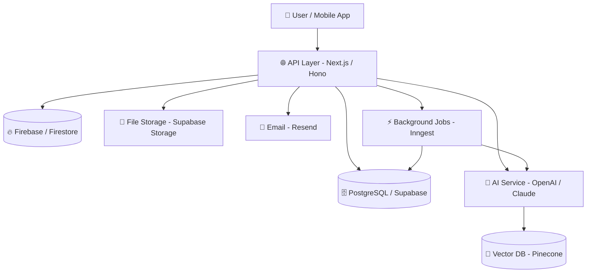

# 📦 Backend Schema
<!-- ============================================================
     HOW TO FILL THIS DOCUMENT — READ THIS FIRST
     ============================================================
     
     Welcome! This document is your single source of truth for
     everything that lives on the backend of your product.
     
     ✅ Fill every section marked [REQUIRED] before writing code.
     🟡 Fill sections marked [RECOMMENDED] before your first launch.
     ⚪ Sections marked [OPTIONAL] can be filled later or skipped.
     
     PHASE LABELS tell you WHEN each section matters:
       🔵 ALPHA   → Building the first working version (internal only)
       🟠 BETA    → Sharing with first real testers (10–50 users)
       🟢 LAUNCH  → Going public (100–500 customers)
       🚀 GROWTH  → Scaling beyond 500 customers
     
     STATUS LABELS track where each item stands:
       📝 Draft      → Written but not reviewed
       👀 Review     → Being checked by someone
       ✅ Approved   → Agreed, ready to build
       🚢 Live       → Running in production
       ❌ Deprecated → No longer used
     
     NAMING RULES for this project:
       • Database fields:  snake_case   → user_id, created_at
       • API routes:       snake_case   → /api/v1/user_profiles
       • TypeScript types: PascalCase   → UserProfile, AiMessage
     
     💡 TIP: Use Ctrl+F (or Cmd+F on Mac) to search this document
     by table name, endpoint, or keyword.
     
     LINKED DOCUMENTS (update these paths for your project):
       • PRD:            [docs/PRD.md]
       • Frontend Schema:[docs/Frontend_Schema.md]
       • AI Workflows:   [docs/AI_Workflow.md]
       • DevOps / Infra: [docs/Infra.md]
     ============================================================ -->

---

## 📋 DOCUMENT META

| Field              | Value                                   |
|--------------------|-----------------------------------------|
| **Project Name**   | `[Your Project Name Here]`              |
| **Document Owner** | `[Your Name]`                           |
| **Created Date**   | `[YYYY-MM-DD]`                          |
| **Last Updated**   | `[YYYY-MM-DD]`                          |
| **Version**        | `v0.1`                                  |
| **Status**         | 📝 Draft                                |
| **Phase**          | 🔵 ALPHA                                |
| **Linked PRD**     | `[Link to PRD]`                         |
| **Repo / Codebase**| `[GitHub / GitLab URL]`                 |

> 💡 **Beginner Tip:** Update "Last Updated" and "Version" every time you change anything in this document. Use version numbers like v0.1 → v0.2 for small changes, v1.0 for your first launch-ready version.

---

## 1. PROJECT OVERVIEW 🔵 ALPHA · [REQUIRED]

### 1.1 What Does This Product Do?

> Write 2–3 sentences. Imagine explaining it to a friend who has never heard of it.

```
[Example: TaskFlow is a SaaS app that helps solo freelancers manage client
projects and send invoices automatically using AI. The backend stores all
project data, triggers AI invoice generation, and sends payment reminders.]
```

**Your Description:**
```
[Write here]
```

### 1.2 Who Are the Users?

| User Type      | Description                              | Example                    |
|----------------|------------------------------------------|----------------------------|
| `[user_type_1]`| [What they do in the app]                | [e.g., "Freelancer who creates projects"] |
| `[user_type_2]`| [What they do in the app]                | [e.g., "Client who receives invoices"]   |
| `[admin]`      | Full system access, manages all data     | Internal team member        |

### 1.3 Core Product Goals (for Backend)

> List the 3–5 most important things the backend MUST do correctly.

- [ ] `[e.g., Store user data securely and never expose one user's data to another]`
- [ ] `[e.g., Process AI requests and return results within 3 seconds]`
- [ ] `[e.g., Handle 500 concurrent users without slowing down]`
- [ ] `[e.g., Send emails reliably for invoices and notifications]`
- [ ] `[e.g., Log every AI call for debugging and cost tracking]`

---

## 2. TECH STACK 🔵 ALPHA · [REQUIRED]

> 💡 **Beginner Tip:** This section is like the ingredients list before you cook. Fill it in before writing a single line of code.

### 2.1 Stack at a Glance

| Layer                  | Technology              | Why Chosen                                  | Status   |
|------------------------|-------------------------|---------------------------------------------|----------|
| **Primary Database**   | `[Supabase/PostgreSQL]` | [e.g., SQL + built-in auth + RLS]           | 📝 Draft |
| **Secondary Database** | `[Firebase/Firestore]`  | [e.g., Real-time data for chat feature]     | 📝 Draft |
| **Vector Database**    | `[e.g., Pinecone]`      | [e.g., AI memory and semantic search]       | ⚪ TBD   |
| **Cache**              | `[e.g., Redis/Upstash]` | [e.g., Cache API responses, rate limiting]  | ⚪ TBD   |
| **API Layer**          | `[e.g., Next.js/Hono]`  | [e.g., Serverless API routes]               | 📝 Draft |
| **Auth Provider**      | `[e.g., Supabase Auth]` | [e.g., Managed JWT + social login]          | 📝 Draft |
| **AI / LLM Provider**  | `[e.g., OpenAI/Claude]` | [e.g., GPT-4o for core AI features]        | 📝 Draft |
| **AI Orchestration**   | `[e.g., LangChain]`     | [e.g., RAG pipeline, agent memory]          | ⚪ TBD   |
| **File Storage**       | `[e.g., Supabase Storage / S3]` | [e.g., User file uploads]          | ⚪ TBD   |
| **Email Provider**     | `[e.g., Resend]`        | [e.g., Transactional emails]                | ⚪ TBD   |
| **Queue / Workers**    | `[e.g., Inngest]`       | [e.g., Background jobs, scheduled tasks]    | ⚪ TBD   |
| **Deployment**         | `[e.g., Vercel + Supabase]` | [e.g., One-click deploy, managed DB]    | 📝 Draft |
| **Monitoring**         | `[e.g., Sentry + LogRocket]` | [e.g., Error tracking + session replay]| ⚪ TBD   |

### 2.2 Architecture Style

- [ ] Monolith (one server handles everything — great for solo founders starting out)
- [ ] Serverless Functions (individual API routes, e.g., Vercel/Netlify Functions)
- [ ] Microservices (separate services for auth, payments, AI, etc.)
- [ ] Hybrid (serverless for most things, long-running server for AI/agents)

**Chosen Architecture:** `[Pick one above and explain in 1 sentence why]`

### 2.3 Architecture Diagram

> 💡 **Beginner Tip:** Draw a simple box diagram showing how the pieces connect. You can use [Mermaid](https://mermaid.live) to create diagrams in code. Replace the example below with your actual services.



---

## 3. DATABASE DESIGN 🔵 ALPHA · [REQUIRED]

> 💡 **Beginner Tip:** Think of tables like spreadsheets. Each table stores one "type of thing" (users, products, orders). Columns are the details about that thing. Rows are individual records.

### 3.1 Database Selection Guide

| If you need...                          | Use this DB          |
|-----------------------------------------|----------------------|
| Structured data with relations (users, payments) | **PostgreSQL / Supabase** |
| Real-time sync (chat, live updates)     | **Firestore**        |
| Fast caching (API response, sessions)   | **Redis**            |
| AI search / similar content lookup     | **Vector DB (Pinecone, Weaviate)** |

**Your primary data store:** `[e.g., Supabase (PostgreSQL)]`
**Your secondary data store:** `[e.g., Firestore — used for real-time chat]`

---

### 3.2 Entity Relationship Overview

> List ALL the main "things" (entities) your app needs to store. Draw relationships between them.

```
[Example for a SaaS app:]

users ──── owns ────> workspaces
workspaces ──── has ────> projects
projects ──── has ────> tasks
tasks ──── has ────> ai_messages
users ──── has ────> subscriptions
users ──── has ────> ai_usage_logs
```

**Your Entity Map:**
```
[Draw your entity relationships here in plain text or Mermaid]

[Entity 1] ──── [relationship] ────> [Entity 2]
[Entity 2] ──── [relationship] ────> [Entity 3]
```

---

### 3.3 Table / Collection Schemas

> 💡 **Beginner Tip:** Copy the table template below for EVERY table in your database. Fill in one table at a time. Don't skip columns — even if you're not sure, write [TBD].

---

#### 📋 TABLE TEMPLATE — Copy this block for each table

```
┌─────────────────────────────────────────────────────────────────┐
│  TABLE NAME:  table_name                                        │
│  PURPOSE:     [What kind of data does this table store?]        │
│  PHASE:       🔵 ALPHA                                          │
│  STATUS:      📝 Draft                                          │
│  DB:          [Supabase / Firestore / Both]                     │
└─────────────────────────────────────────────────────────────────┘
```

| Column Name       | Data Type       | Required? | Default         | Description                                  |
|-------------------|-----------------|-----------|-----------------|----------------------------------------------|
| `id`              | `uuid`          | ✅ Yes    | `gen_random_uuid()` | Unique identifier for this record        |
| `created_at`      | `timestamptz`   | ✅ Yes    | `now()`         | When this record was first created           |
| `updated_at`      | `timestamptz`   | ✅ Yes    | `now()`         | Last time this record was changed            |
| `[column_name]`   | `[type]`        | ✅/❌     | `[default]`     | [What this column stores]                    |

**Relationships:**
- `[column_name]` → references `[other_table]`.`id` (one-to-many / many-to-many)

**Indexes:**
- `[column_name]` — reason: [e.g., "searched frequently by user_id"]

**Row-Level Security (RLS) Rules — Supabase:**
```sql
-- Example: Users can only see their own rows
CREATE POLICY "Users see own rows" ON table_name
  FOR SELECT USING (auth.uid() = user_id);
```

**Firestore Security Rules (if using Firestore):**
```js
// Example: Only the owner can read their document
match /table_name/{docId} {
  allow read, write: if request.auth.uid == resource.data.user_id;
}
```

**Notes / Business Rules:**
- [e.g., "Never hard-delete rows — use soft delete with deleted_at timestamp"]
- [Any other important rules for this table]

---

#### 👤 TABLE: `users`
```
PURPOSE:  Stores all registered users of the product
PHASE:    🔵 ALPHA
STATUS:   📝 Draft
DB:       Supabase (PostgreSQL) — synced from Supabase Auth
```

| Column Name         | Data Type       | Required? | Default              | Description                                     |
|---------------------|-----------------|-----------|----------------------|-------------------------------------------------|
| `id`                | `uuid`          | ✅ Yes    | `gen_random_uuid()`  | Primary key — matches Supabase Auth user ID     |
| `created_at`        | `timestamptz`   | ✅ Yes    | `now()`              | Account creation timestamp                      |
| `updated_at`        | `timestamptz`   | ✅ Yes    | `now()`              | Last profile update                             |
| `email`             | `text`          | ✅ Yes    | —                    | User's email address (unique)                   |
| `display_name`      | `text`          | ❌ No     | `null`               | Name shown in the UI                            |
| `avatar_url`        | `text`          | ❌ No     | `null`               | Profile picture URL                             |
| `role`              | `text`          | ✅ Yes    | `'user'`             | Permission level: `user`, `admin`, `guest`      |
| `plan`              | `text`          | ✅ Yes    | `'free'`             | Subscription plan: `free`, `pro`, `enterprise`  |
| `onboarded_at`      | `timestamptz`   | ❌ No     | `null`               | When user completed onboarding flow             |
| `deleted_at`        | `timestamptz`   | ❌ No     | `null`               | Soft delete — null means account is active      |
| `auth_provider`     | `text`          | ✅ Yes    | `'email'`            | How they signed up: `email`, `google`, `github` |
| `metadata`          | `jsonb`         | ❌ No     | `{}`                 | Flexible extra data (e.g., UTM source, flags)   |

**Indexes:** `email` (unique), `role`, `plan`, `deleted_at`

**RLS Rules:**
```sql
-- Users can read and update only their own profile
CREATE POLICY "Users manage own profile" ON users
  FOR ALL USING (auth.uid() = id);

-- Admins can read all users
CREATE POLICY "Admins read all users" ON users
  FOR SELECT USING (
    EXISTS (SELECT 1 FROM users WHERE id = auth.uid() AND role = 'admin')
  );
```

**Notes:**
- Never delete rows — use `deleted_at` for soft deletes
- `id` must match the `auth.users.id` from Supabase Auth
- Sync `email` and `avatar_url` from the auth hook on signup

---

#### 🏢 TABLE: `workspaces` *(if your product has teams/orgs)*
```
PURPOSE:  Organizational unit — one user can own multiple workspaces
PHASE:    🔵 ALPHA
STATUS:   📝 Draft
DB:       Supabase (PostgreSQL)
```

| Column Name      | Data Type     | Required? | Default              | Description                                |
|------------------|---------------|-----------|----------------------|--------------------------------------------|
| `id`             | `uuid`        | ✅ Yes    | `gen_random_uuid()`  | Primary key                                |
| `created_at`     | `timestamptz` | ✅ Yes    | `now()`              | When workspace was created                 |
| `updated_at`     | `timestamptz` | ✅ Yes    | `now()`              | Last update                                |
| `owner_id`       | `uuid`        | ✅ Yes    | —                    | FK → `users.id` — who created this         |
| `name`           | `text`        | ✅ Yes    | —                    | Workspace display name                     |
| `slug`           | `text`        | ✅ Yes    | —                    | URL-safe name e.g. `my-company` (unique)   |
| `plan`           | `text`        | ✅ Yes    | `'free'`             | Workspace subscription level               |
| `settings`       | `jsonb`       | ❌ No     | `{}`                 | Feature flags, preferences, config         |
| `deleted_at`     | `timestamptz` | ❌ No     | `null`               | Soft delete                                |

---

#### 👥 TABLE: `workspace_members` *(junction table)*
```
PURPOSE:  Links users to workspaces with a role
PHASE:    🔵 ALPHA
STATUS:   📝 Draft
DB:       Supabase (PostgreSQL)
```

| Column Name      | Data Type     | Required? | Default              | Description                          |
|------------------|---------------|-----------|----------------------|--------------------------------------|
| `id`             | `uuid`        | ✅ Yes    | `gen_random_uuid()`  | Primary key                          |
| `created_at`     | `timestamptz` | ✅ Yes    | `now()`              | When member was added                |
| `workspace_id`   | `uuid`        | ✅ Yes    | —                    | FK → `workspaces.id`                 |
| `user_id`        | `uuid`        | ✅ Yes    | —                    | FK → `users.id`                      |
| `role`           | `text`        | ✅ Yes    | `'member'`           | `owner`, `admin`, `member`, `viewer` |
| `invited_by`     | `uuid`        | ❌ No     | `null`               | FK → `users.id` — who invited them   |
| `accepted_at`    | `timestamptz` | ❌ No     | `null`               | When they accepted the invite        |

---

#### ➕ ADD YOUR TABLES BELOW

> Copy the TABLE TEMPLATE block from section 3.3 for each additional table in your project.

```
Tables you likely need (tick when added):
[ ] products / features / services
[ ] projects / tasks / tickets  
[ ] subscriptions / billing
[ ] notifications
[ ] audit_logs
[ ] [your domain-specific table]
[ ] [your domain-specific table]
```

---

## 4. AUTHENTICATION & AUTHORIZATION 🔵 ALPHA · [REQUIRED]

> 💡 **Beginner Tip:** Authentication = "Who are you?" (login). Authorization = "What are you allowed to do?" (permissions). Both MUST be designed before writing any API code.

### 4.1 Auth Provider Configuration

| Setting                 | Value                                                |
|-------------------------|------------------------------------------------------|
| **Auth Provider**       | `[e.g., Supabase Auth / Firebase Auth]`              |
| **Session Type**        | `[JWT / Session Token]`                              |
| **Token Expiry**        | `[e.g., 1 hour access token, 30 day refresh token]`  |
| **Social Login Enabled**| `[Google: ✅ / GitHub: ✅ / Apple: ❌]`              |
| **Magic Link / OTP**    | `[✅ Enabled / ❌ Disabled]`                         |
| **Email Verification**  | `[✅ Required / ❌ Optional]`                        |
| **MFA / 2FA**           | `[✅ Available / ❌ Not yet]`                        |

### 4.2 User Roles & Permission Matrix

> Define every role in your system and what they can do.

| Action                          | 👤 Guest | 🙍 User | 👑 Admin | 🤖 AI Agent |
|---------------------------------|----------|---------|---------|-------------|
| View public content             | ✅       | ✅      | ✅      | ✅          |
| Create account                  | ✅       | ✅      | ✅      | ❌          |
| Read own data                   | ❌       | ✅      | ✅      | ✅          |
| Update own profile              | ❌       | ✅      | ✅      | ❌          |
| Delete own account              | ❌       | ✅      | ✅      | ❌          |
| Read other users' data          | ❌       | ❌      | ✅      | ❌          |
| Manage all users                | ❌       | ❌      | ✅      | ❌          |
| Access admin dashboard          | ❌       | ❌      | ✅      | ❌          |
| Call AI endpoints               | ❌       | ✅      | ✅      | ✅          |
| Manage billing / subscriptions  | ❌       | ✅      | ✅      | ❌          |
| `[Add your custom actions here]`| —        | —       | —       | —           |

> 💡 Add more rows for your product's specific actions (e.g., "Export data", "Invite team members", "Publish content").

### 4.3 API Authentication Flow

```
Step 1: User logs in via [Supabase Auth / Firebase Auth / OAuth]
Step 2: Auth provider returns a JWT access token
Step 3: Frontend stores token in memory (NOT localStorage for security)
Step 4: Every API request includes: Authorization: Bearer <token>
Step 5: Backend validates the JWT on every request
Step 6: If valid → process request. If expired → return 401 Unauthorized
Step 7: Frontend uses refresh token to get a new access token silently
```

### 4.4 API Key Authentication (for AI Agents / B2B)

| Field              | Value                                          |
|--------------------|------------------------------------------------|
| **Key Format**     | `sk_live_[32-char random string]`              |
| **Key Storage**    | Hashed in DB (never store raw key)             |
| **Key Scopes**     | `[e.g., read, write, ai_only]`                 |
| **Rate Limit**     | `[e.g., 1000 req/hour per key]`                |
| **Key Rotation**   | `[e.g., Manual via dashboard / auto every 90d]`|

---

## 5. API DESIGN 🔵 ALPHA · [REQUIRED]

> 💡 **Beginner Tip:** An API endpoint is like a door into your backend. Each door has an address (URL), a knock type (GET/POST/etc.), what you hand through (request), and what comes back (response).

### 5.1 API Style & Base URL

| Setting               | Value                                           |
|-----------------------|-------------------------------------------------|
| **API Style**         | `[REST / GraphQL / tRPC]`                       |
| **API Version**       | `v1`                                            |
| **Base URL (Dev)**    | `http://localhost:3000/api/v1`                  |
| **Base URL (Staging)**| `https://staging.yourapp.com/api/v1`            |
| **Base URL (Prod)**   | `https://yourapp.com/api/v1`                    |
| **Content Type**      | `application/json`                              |
| **Authentication**    | `Authorization: Bearer <JWT>`                   |

### 5.2 Standard Response Format

> Every API response should follow the same structure. This makes it easy for the frontend to handle responses consistently.

**Success Response:**
```json
{
  "success": true,
  "data": { ... },
  "meta": {
    "page": 1,
    "per_page": 20,
    "total": 143
  }
}
```

**Error Response:**
```json
{
  "success": false,
  "error": {
    "code": "VALIDATION_ERROR",
    "message": "Email address is invalid",
    "field": "email",
    "doc_url": "https://docs.yourapp.com/errors/VALIDATION_ERROR"
  }
}
```

### 5.3 Standard Error Codes

| HTTP Status | Error Code              | When It Happens                                  |
|-------------|-------------------------|--------------------------------------------------|
| `400`       | `VALIDATION_ERROR`      | Request data is missing or in the wrong format   |
| `401`       | `UNAUTHORIZED`          | Not logged in, or JWT expired                    |
| `403`       | `FORBIDDEN`             | Logged in but not allowed to do this action      |
| `404`       | `NOT_FOUND`             | The resource doesn't exist                       |
| `409`       | `CONFLICT`              | Trying to create something that already exists   |
| `422`       | `UNPROCESSABLE`         | Data is valid format but breaks business rules   |
| `429`       | `RATE_LIMIT_EXCEEDED`   | Too many requests — slow down                    |
| `500`       | `INTERNAL_ERROR`        | Something broke on our side                      |
| `503`       | `SERVICE_UNAVAILABLE`   | AI provider or 3rd party is down                 |

### 5.4 API Endpoints

> Copy the endpoint template below for EACH API endpoint you create.

---

#### 📋 ENDPOINT TEMPLATE — Copy this block for each endpoint

```
METHOD:   GET / POST / PUT / PATCH / DELETE
ROUTE:    /api/v1/[resource]
NAME:     [Human-readable name]
PURPOSE:  [One sentence: what does this endpoint do?]
AUTH:     [Required / Optional / None]
ROLES:    [user, admin, agent — who can call this?]
PHASE:    🔵 ALPHA
STATUS:   📝 Draft
```

**Request:**
```json
Headers: { "Authorization": "Bearer <token>" }
Body: {
  "field_name": "value"  // [type] — [description, is it required?]
}
```

**Success Response (200/201):**
```json
{
  "success": true,
  "data": {
    "field_name": "value"
  }
}
```

**Error Responses:**
| Status | Code               | When                        |
|--------|--------------------|-----------------------------|
| `401`  | `UNAUTHORIZED`     | No token provided           |
| `400`  | `VALIDATION_ERROR` | Missing required field       |

**Rate Limit:** `[e.g., 60 requests / minute]`

---

#### ENDPOINT: POST /api/v1/auth/signup
```
PURPOSE:  Register a new user account
AUTH:     None (public endpoint)
ROLES:    Anyone
PHASE:    🔵 ALPHA  |  STATUS: 📝 Draft
```

**Request:**
```json
{
  "email": "user@example.com",    // string, required
  "password": "••••••••",         // string, min 8 chars, required
  "display_name": "Jane Smith"    // string, optional
}
```

**Success Response (201):**
```json
{
  "success": true,
  "data": {
    "user_id": "uuid",
    "email": "user@example.com",
    "session_token": "eyJhbGc..."
  }
}
```

---

#### ENDPOINT: GET /api/v1/users/me
```
PURPOSE:  Get the currently authenticated user's profile
AUTH:     Required
ROLES:    user, admin
PHASE:    🔵 ALPHA  |  STATUS: 📝 Draft
```

**Request:**
```
Headers: { "Authorization": "Bearer <token>" }
No body required.
```

**Success Response (200):**
```json
{
  "success": true,
  "data": {
    "id": "uuid",
    "email": "user@example.com",
    "display_name": "Jane Smith",
    "role": "user",
    "plan": "free",
    "created_at": "2026-01-15T10:30:00Z"
  }
}
```

---

#### ➕ ADD YOUR ENDPOINTS BELOW

```
Common endpoints to document (tick when added):
Auth
  [ ] POST /auth/login
  [ ] POST /auth/logout
  [ ] POST /auth/forgot-password
  [ ] POST /auth/reset-password
  [ ] POST /auth/refresh-token

Users
  [ ] PATCH /users/me (update profile)
  [ ] DELETE /users/me (delete account)
  [ ] GET /users (admin only)

[Your Domain]
  [ ] GET /[resource]
  [ ] POST /[resource]
  [ ] GET /[resource]/:id
  [ ] PATCH /[resource]/:id
  [ ] DELETE /[resource]/:id

AI
  [ ] POST /ai/chat
  [ ] POST /ai/generate
  [ ] GET /ai/history

Billing
  [ ] POST /billing/checkout
  [ ] POST /billing/portal
  [ ] POST /billing/webhook (Stripe/Paddle)
```

---

## 6. AI INTEGRATION SCHEMA 🔵 ALPHA · [REQUIRED for AI products]

> 💡 **Beginner Tip:** This section documents how AI fits into your backend. Think of AI like a powerful tool you plug in — this section describes the tool, what you send to it, what comes back, and how much it costs.

### 6.1 AI Models Inventory

| Purpose                    | Provider        | Model                  | Max Tokens | Cost/1M Tokens  | Phase   | Status   |
|----------------------------|-----------------|------------------------|------------|-----------------|---------|----------|
| Main chat / generation     | `[OpenAI]`      | `[gpt-4o]`             | `128,000`  | `[~$5 in/$15 out]`| 🔵 ALPHA | 📝 Draft |
| Fast/cheap classification  | `[OpenAI]`      | `[gpt-4o-mini]`        | `128,000`  | `[~$0.15 in]`   | 🔵 ALPHA | 📝 Draft |
| Document embeddings        | `[OpenAI]`      | `[text-embedding-3-small]` | `8,191` | `[~$0.02]`   | 🟠 BETA  | 📝 Draft |
| Reasoning tasks            | `[Anthropic]`   | `[claude-sonnet-5-5]`  | `200,000`  | `[~$3 in/$15 out]`| 🟠 BETA | 📝 Draft |
| `[Your use case]`          | `[Provider]`    | `[Model]`              | `[tokens]` | `[cost]`        | —       | ⚪ TBD   |

### 6.2 Prompt Template Storage

> Store prompts in your database (not hardcoded in code) so you can update them without redeploying.

#### TABLE: `prompt_templates`
```
PURPOSE:  Stores all AI system prompts and user prompt templates
PHASE:    🔵 ALPHA  |  STATUS: 📝 Draft  |  DB: Supabase
```

| Column Name       | Data Type     | Required? | Default            | Description                                      |
|-------------------|---------------|-----------|--------------------|--------------------------------------------------|
| `id`              | `uuid`        | ✅ Yes    | `gen_random_uuid()`| Primary key                                      |
| `created_at`      | `timestamptz` | ✅ Yes    | `now()`            | When prompt was created                          |
| `updated_at`      | `timestamptz` | ✅ Yes    | `now()`            | Last update                                      |
| `name`            | `text`        | ✅ Yes    | —                  | Unique name for this prompt (e.g., `chat_system`)|
| `version`         | `integer`     | ✅ Yes    | `1`                | Version number — increment on every change       |
| `type`            | `text`        | ✅ Yes    | —                  | `system`, `user`, `few_shot`, `tool`             |
| `content`         | `text`        | ✅ Yes    | —                  | The actual prompt text. Use `{{variable}}` for dynamic parts |
| `model`           | `text`        | ✅ Yes    | —                  | Which model this prompt is for                   |
| `is_active`       | `boolean`     | ✅ Yes    | `true`             | Only one active version per name at a time       |
| `variables`       | `jsonb`       | ❌ No     | `[]`               | List of variables used: `["user_name", "context"]`|
| `test_output`     | `text`        | ❌ No     | `null`             | Expected output for testing this prompt          |
| `created_by`      | `uuid`        | ✅ Yes    | —                  | FK → `users.id`                                  |
| `notes`           | `text`        | ❌ No     | `null`             | Why this prompt exists, what it does             |

**Example Record:**
```json
{
  "name": "chat_system_v2",
  "type": "system",
  "model": "gpt-4o",
  "content": "You are a helpful assistant for {{product_name}}. The user's name is {{user_name}}. Today is {{date}}. Always respond in {{language}}.",
  "variables": ["product_name", "user_name", "date", "language"],
  "is_active": true
}
```

### 6.3 AI Conversation / Message Storage

#### TABLE: `ai_conversations`
```
PURPOSE:  Groups AI messages into a conversation thread
PHASE:    🔵 ALPHA  |  STATUS: 📝 Draft  |  DB: Supabase
```

| Column Name       | Data Type     | Required? | Default            | Description                                  |
|-------------------|---------------|-----------|--------------------|----------------------------------------------|
| `id`              | `uuid`        | ✅ Yes    | `gen_random_uuid()`| Primary key                                  |
| `created_at`      | `timestamptz` | ✅ Yes    | `now()`            | When conversation started                    |
| `updated_at`      | `timestamptz` | ✅ Yes    | `now()`            | Last message time                            |
| `user_id`         | `uuid`        | ✅ Yes    | —                  | FK → `users.id` — who is having this chat    |
| `workspace_id`    | `uuid`        | ❌ No     | `null`             | FK → `workspaces.id` (if workspace-scoped)   |
| `title`           | `text`        | ❌ No     | `null`             | Auto-generated conversation title            |
| `model`           | `text`        | ✅ Yes    | —                  | AI model used in this conversation           |
| `status`          | `text`        | ✅ Yes    | `'active'`         | `active`, `archived`, `deleted`              |
| `metadata`        | `jsonb`       | ❌ No     | `{}`               | Tags, context, custom fields                 |

#### TABLE: `ai_messages`
```
PURPOSE:  Individual messages within an AI conversation
PHASE:    🔵 ALPHA  |  STATUS: 📝 Draft  |  DB: Supabase
```

| Column Name          | Data Type     | Required? | Default            | Description                                    |
|----------------------|---------------|-----------|--------------------|------------------------------------------------|
| `id`                 | `uuid`        | ✅ Yes    | `gen_random_uuid()`| Primary key                                    |
| `created_at`         | `timestamptz` | ✅ Yes    | `now()`            | When message was sent/received                 |
| `conversation_id`    | `uuid`        | ✅ Yes    | —                  | FK → `ai_conversations.id`                     |
| `role`               | `text`        | ✅ Yes    | —                  | `user`, `assistant`, `system`, `tool`          |
| `content`            | `text`        | ✅ Yes    | —                  | The message text                               |
| `input_tokens`       | `integer`     | ✅ Yes    | `0`                | Tokens sent to the AI model                    |
| `output_tokens`      | `integer`     | ✅ Yes    | `0`                | Tokens returned by the AI model                |
| `model`              | `text`        | ✅ Yes    | —                  | Exact model used (e.g., `gpt-4o-2024-11-20`)   |
| `latency_ms`         | `integer`     | ✅ Yes    | —                  | How long the AI took to respond (milliseconds) |
| `tool_calls`         | `jsonb`       | ❌ No     | `null`             | Tool/function calls made during this message   |
| `finish_reason`      | `text`        | ❌ No     | `null`             | Why AI stopped: `stop`, `length`, `tool_calls` |
| `cost_usd`           | `numeric(10,8)`| ✅ Yes  | —                  | Calculated cost of this message in USD         |

### 6.4 Vector Database / Embeddings Schema

> 💡 **Beginner Tip:** Embeddings are a way to turn text into numbers so the AI can find similar content. Think of it like a "meaning fingerprint" — two pieces of text about the same topic will have similar fingerprints.

| Setting                | Value                                         |
|------------------------|-----------------------------------------------|
| **Vector DB Provider** | `[e.g., Pinecone / Supabase pgvector / Weaviate]`|
| **Embedding Model**    | `[e.g., text-embedding-3-small (1536 dims)]`  |
| **Index / Namespace**  | `[e.g., production-docs, user-memory]`        |
| **Similarity Metric**  | `[cosine / euclidean / dot product]`          |

**What gets embedded (stored in vector DB):**

| Content Type         | Namespace / Collection  | Refreshed When             | Phase    |
|----------------------|-------------------------|----------------------------|----------|
| `[User documents]`   | `user_docs`             | Document created/updated   | 🟠 BETA  |
| `[Help articles]`    | `help_center`           | Article published/edited   | 🟠 BETA  |
| `[Agent memory]`     | `agent_memory`          | After each agent session   | 🟢 LAUNCH|
| `[Your content type]`| `[namespace]`           | `[when]`                   | —        |

### 6.5 AI Agent Architecture

> Fill this section only if your product uses autonomous AI agents.

| Agent Name          | Purpose                                  | Tools Available              | Memory Type       | Phase    |
|---------------------|------------------------------------------|------------------------------|-------------------|----------|
| `[agent_name]`      | [What does this agent do autonomously?]  | [e.g., web_search, db_query] | [short/long term] | 🟠 BETA  |
| `[agent_name]`      | [What does this agent do autonomously?]  | [e.g., email, calendar]      | [short/long term] | 🟢 LAUNCH|

**Agent Memory Schema:**

#### TABLE: `agent_memory`
```
PURPOSE:  Stores long-term memory for AI agents (facts learned about users)
PHASE:    🟠 BETA  |  STATUS: 📝 Draft  |  DB: Supabase + Vector DB
```

| Column Name       | Data Type       | Required? | Description                                        |
|-------------------|-----------------|-----------|----------------------------------------------------|
| `id`              | `uuid`          | ✅ Yes    | Primary key                                        |
| `created_at`      | `timestamptz`   | ✅ Yes    | When this memory was stored                        |
| `user_id`         | `uuid`          | ✅ Yes    | FK → `users.id` — whose memory is this            |
| `agent_name`      | `text`          | ✅ Yes    | Which agent created this memory                    |
| `memory_type`     | `text`          | ✅ Yes    | `fact`, `preference`, `summary`, `instruction`     |
| `content`         | `text`          | ✅ Yes    | The actual memory text                             |
| `embedding_id`    | `text`          | ❌ No     | ID in vector DB (for semantic search)              |
| `confidence`      | `float`         | ❌ No     | How confident the agent is (0.0 to 1.0)            |
| `expires_at`      | `timestamptz`   | ❌ No     | Auto-delete date (null = keep forever)             |
| `source_message_id`| `uuid`         | ❌ No     | FK → `ai_messages.id` — where this memory came from|

---

## 7. AI COST & TOKEN TRACKING 🟠 BETA · [REQUIRED]

> 💡 **Beginner Tip:** AI APIs charge per token (like words). Without tracking, your costs can skyrocket unexpectedly. This section documents how you'll monitor and control your AI spending from the very beginning.

### 7.1 Cost Tracking Strategy

| Setting                       | Value                                             |
|-------------------------------|---------------------------------------------------|
| **Track per user?**           | `✅ Yes — store cost in ai_usage_logs`            |
| **Track per feature?**        | `✅ Yes — tag each call with feature_name`        |
| **Budget alert threshold**    | `[e.g., Alert when daily spend > $50]`            |
| **Per-user monthly limit**    | `[e.g., Free: $0.50 / Pro: $5 / Enterprise: Unlimited]`|
| **External observability**    | `[e.g., Helicone / LangSmith / custom]`           |

### 7.2 AI Usage Log Schema

#### TABLE: `ai_usage_logs`
```
PURPOSE:  Tracks every AI API call — model, tokens, cost, latency, user, feature
PHASE:    🔵 ALPHA  |  STATUS: 📝 Draft  |  DB: Supabase
```

| Column Name           | Data Type       | Required? | Default              | Description                                       |
|-----------------------|-----------------|-----------|----------------------|---------------------------------------------------|
| `id`                  | `uuid`          | ✅ Yes    | `gen_random_uuid()`  | Primary key                                       |
| `created_at`          | `timestamptz`   | ✅ Yes    | `now()`              | Timestamp of the API call                         |
| `user_id`             | `uuid`          | ❌ No     | `null`               | FK → `users.id` (null = system call)              |
| `workspace_id`        | `uuid`          | ❌ No     | `null`               | FK → `workspaces.id`                              |
| `feature_name`        | `text`          | ✅ Yes    | —                    | Which feature triggered this call (e.g., `chat`, `summarize`) |
| `provider`            | `text`          | ✅ Yes    | —                    | `openai`, `anthropic`, `google`, `mistral`        |
| `model`               | `text`          | ✅ Yes    | —                    | Exact model ID (e.g., `gpt-4o-2024-11-20`)        |
| `prompt_tokens`       | `integer`       | ✅ Yes    | —                    | Tokens in the request (input)                     |
| `completion_tokens`   | `integer`       | ✅ Yes    | —                    | Tokens in the response (output)                   |
| `total_tokens`        | `integer`       | ✅ Yes    | —                    | prompt + completion tokens                        |
| `cost_usd`            | `numeric(10,8)` | ✅ Yes    | —                    | Calculated cost in USD for this call              |
| `latency_ms`          | `integer`       | ✅ Yes    | —                    | Response time in milliseconds                     |
| `status`              | `text`          | ✅ Yes    | —                    | `success`, `error`, `timeout`, `rate_limited`     |
| `error_message`       | `text`          | ❌ No     | `null`               | Error details if status is not `success`          |
| `conversation_id`     | `uuid`          | ❌ No     | `null`               | FK → `ai_conversations.id` (if part of a chat)   |
| `request_id`          | `text`          | ❌ No     | `null`               | Provider's request ID for debugging               |
| `cached`              | `boolean`       | ✅ Yes    | `false`              | Was this response served from cache? (= $0 cost)  |
| `tags`                | `jsonb`         | ❌ No     | `{}`                 | Custom labels for filtering (e.g., `{"env":"prod"}`) |

### 7.3 Daily Cost Summary View

> Create this database view to quickly see daily spending without querying all logs.

```sql
-- Run this in Supabase SQL Editor to create the view
CREATE VIEW ai_daily_cost_summary AS
SELECT
  DATE(created_at) AS date,
  provider,
  model,
  feature_name,
  COUNT(*) AS total_calls,
  SUM(total_tokens) AS total_tokens,
  SUM(cost_usd) AS total_cost_usd,
  AVG(latency_ms) AS avg_latency_ms,
  SUM(CASE WHEN status = 'error' THEN 1 ELSE 0 END) AS error_count
FROM ai_usage_logs
GROUP BY DATE(created_at), provider, model, feature_name
ORDER BY date DESC, total_cost_usd DESC;
```

### 7.4 Per-User Budget Enforcement

| Plan        | Monthly Token Budget | Hard Limit Action                    |
|-------------|----------------------|--------------------------------------|
| `free`      | `[e.g., 50,000 tokens]` | Block AI calls, show upgrade prompt |
| `pro`       | `[e.g., 1,000,000 tokens]` | Send 80% warning email, block at 100% |
| `enterprise`| `Unlimited`          | Alert admin, no block                |

---

## 8. ENVIRONMENT CONFIGURATION 🔵 ALPHA · [REQUIRED]

> 💡 **Beginner Tip:** Environment variables are like secret ingredients stored outside your code. NEVER put passwords, API keys, or secret values directly in your code files. Always use .env files or a secrets manager.

### 8.1 Environments

| Environment  | Purpose                                  | Who Has Access          |
|--------------|------------------------------------------|-------------------------|
| `local`      | Your personal computer — for development | Just you                |
| `staging`    | Test environment — mirrors production    | Dev team + QA           |
| `production` | Live app — real users, real data         | Senior team only        |

### 8.2 Environment Variables Reference

> ⚠️ **Security Rule:** NEVER commit real values to Git. Store secrets in `.env.local` (local) and your hosting platform's secret manager (Vercel, Railway, AWS Secrets Manager, etc.)

```env
# ============================================================
# COPY THIS TO YOUR .env.local FILE AND FILL IN REAL VALUES
# ============================================================

# ── APP ──────────────────────────────────────────────────────
APP_ENV=development               # development | staging | production
APP_URL=http://localhost:3000
APP_SECRET=                       # [REQUIRED] Random 32+ char string

# ── SUPABASE ─────────────────────────────────────────────────
NEXT_PUBLIC_SUPABASE_URL=         # [REQUIRED] Your Supabase project URL
NEXT_PUBLIC_SUPABASE_ANON_KEY=    # [REQUIRED] Public anon key (safe to expose)
SUPABASE_SERVICE_ROLE_KEY=        # [REQUIRED] PRIVATE — never expose to browser!

# ── FIREBASE (if using Firestore) ────────────────────────────
NEXT_PUBLIC_FIREBASE_API_KEY=
NEXT_PUBLIC_FIREBASE_AUTH_DOMAIN=
NEXT_PUBLIC_FIREBASE_PROJECT_ID=
FIREBASE_ADMIN_SDK_JSON=          # [REQUIRED server-side] Service account JSON

# ── AI PROVIDERS ─────────────────────────────────────────────
OPENAI_API_KEY=                   # [REQUIRED] sk-...
ANTHROPIC_API_KEY=                # sk-ant-...
GOOGLE_AI_API_KEY=                # For Gemini

# ── VECTOR DATABASE ──────────────────────────────────────────
PINECONE_API_KEY=
PINECONE_ENVIRONMENT=
PINECONE_INDEX_NAME=

# ── CACHE ────────────────────────────────────────────────────
UPSTASH_REDIS_REST_URL=
UPSTASH_REDIS_REST_TOKEN=

# ── EMAIL ────────────────────────────────────────────────────
RESEND_API_KEY=
EMAIL_FROM=noreply@yourapp.com

# ── PAYMENTS ─────────────────────────────────────────────────
STRIPE_SECRET_KEY=                # sk_test_... (dev) / sk_live_... (prod)
STRIPE_WEBHOOK_SECRET=            # whsec_...
NEXT_PUBLIC_STRIPE_PUBLISHABLE_KEY=

# ── BACKGROUND JOBS ──────────────────────────────────────────
INNGEST_EVENT_KEY=
INNGEST_SIGNING_KEY=

# ── MONITORING & OBSERVABILITY ───────────────────────────────
SENTRY_DSN=
HELICONE_API_KEY=                 # [OPTIONAL] AI observability

# ── OAUTH ────────────────────────────────────────────────────
GOOGLE_CLIENT_ID=
GOOGLE_CLIENT_SECRET=
GITHUB_CLIENT_ID=
GITHUB_CLIENT_SECRET=
```

### 8.3 Secrets Management

| Environment  | Where Secrets Live                             |
|--------------|------------------------------------------------|
| `local`      | `.env.local` file (add to `.gitignore`!)       |
| `staging`    | `[e.g., Vercel Environment Variables → Preview]`|
| `production` | `[e.g., Vercel Environment Variables → Production / AWS Secrets Manager]` |

---

## 9. FILE STORAGE SCHEMA 🟠 BETA · [RECOMMENDED]

> 💡 **Beginner Tip:** File storage is where user-uploaded files live — profile pictures, documents, images. Think of it like a hard drive in the cloud with a web address for each file.

### 9.1 Storage Provider

| Setting              | Value                                                |
|----------------------|------------------------------------------------------|
| **Provider**         | `[e.g., Supabase Storage / AWS S3 / Google Cloud Storage]` |
| **CDN**              | `[e.g., Cloudflare CDN / Supabase built-in CDN]`     |
| **Max File Size**    | `[e.g., Free: 5MB / Pro: 50MB / Enterprise: 500MB]`  |
| **Allowed Types**    | `[e.g., image/png, image/jpeg, image/webp, application/pdf]`|

### 9.2 Storage Buckets

| Bucket Name         | Public? | Who Can Upload       | Who Can Read          | Max Size | Phase    |
|---------------------|---------|----------------------|-----------------------|----------|----------|
| `avatars`           | ✅ Yes  | Authenticated users  | Anyone                | 2MB      | 🔵 ALPHA |
| `user_uploads`      | ❌ No   | Authenticated users  | Owner only            | 50MB     | 🟠 BETA  |
| `ai_exports`        | ❌ No   | System (AI agent)    | Owner + Admin         | 20MB     | 🟠 BETA  |
| `[bucket_name]`     | —       | —                    | —                     | —        | —        |

### 9.3 File Path Convention

```
[bucket_name]/[user_id]/[YYYY/MM]/[uuid].[ext]

Examples:
  avatars/abc123/profile.jpg
  user_uploads/abc123/2026/01/report-uuid.pdf
  ai_exports/abc123/2026/01/summary-uuid.txt
```

---

## 10. THIRD-PARTY INTEGRATIONS 🟠 BETA · [RECOMMENDED]

### 10.1 Integration Map

| Service          | Purpose                        | Auth Method     | Webhooks? | Phase    | Status   |
|------------------|--------------------------------|-----------------|-----------|----------|----------|
| `[Stripe]`       | Payments & subscriptions       | Secret key + webhook | ✅ Yes | 🟠 BETA | 📝 Draft |
| `[Resend]`       | Transactional emails           | API key         | ❌ No     | 🔵 ALPHA | 📝 Draft |
| `[Sentry]`       | Error tracking                 | DSN             | ❌ No     | 🔵 ALPHA | 📝 Draft |
| `[Inngest]`      | Background jobs / queues       | Event key       | ✅ Yes   | 🟠 BETA  | 📝 Draft |
| `[Your service]` | [Purpose]                      | [Auth method]   | [Yes/No]  | —        | ⚪ TBD  |

### 10.2 Webhook Schema

#### TABLE: `webhook_events`
```
PURPOSE:  Log incoming webhook events from third parties (Stripe, etc.)
PHASE:    🟠 BETA  |  STATUS: 📝 Draft  |  DB: Supabase
```

| Column Name        | Data Type     | Required? | Description                                      |
|--------------------|---------------|-----------|--------------------------------------------------|
| `id`               | `uuid`        | ✅ Yes    | Primary key                                      |
| `created_at`       | `timestamptz` | ✅ Yes    | When webhook was received                        |
| `source`           | `text`        | ✅ Yes    | Which service sent it: `stripe`, `inngest`       |
| `event_type`       | `text`        | ✅ Yes    | Event name e.g. `payment.succeeded`              |
| `payload`          | `jsonb`       | ✅ Yes    | Full raw webhook payload                         |
| `status`           | `text`        | ✅ Yes    | `received`, `processed`, `failed`, `ignored`     |
| `processed_at`     | `timestamptz` | ❌ No     | When it was processed (null = still pending)     |
| `error_message`    | `text`        | ❌ No     | Error details if processing failed               |
| `idempotency_key`  | `text`        | ✅ Yes    | Provider event ID to prevent duplicate processing|

---

## 11. CACHING STRATEGY 🟠 BETA · [RECOMMENDED]

> 💡 **Beginner Tip:** Caching means saving the answer to a question so you don't have to look it up again. It makes your app faster and reduces AI API costs.

### 11.1 Cache Layer

| Cache Type         | Tool Used                     | Purpose                                     | TTL (Time to Live)  |
|--------------------|-------------------------------|---------------------------------------------|---------------------|
| API Response Cache | `[e.g., Redis/Upstash]`       | Cache expensive query results               | `[e.g., 5 minutes]` |
| AI Response Cache  | `[e.g., Redis/Upstash]`       | Cache identical AI prompts → save money     | `[e.g., 24 hours]`  |
| Session Cache      | `[e.g., Supabase/Redis]`      | User session data                           | `[e.g., 1 hour]`    |
| Static Data Cache  | `[e.g., CDN]`                 | Public pages, help articles                 | `[e.g., 7 days]`    |

### 11.2 Cache Invalidation Rules

| Data That Changes    | Cache to Clear                         | When to Clear              |
|----------------------|----------------------------------------|----------------------------|
| User profile update  | User profile cache                     | On PATCH /users/me         |
| New AI message       | Conversation cache                     | After AI response          |
| Payment completed    | Subscription/plan cache                | On billing webhook         |
| `[Data type]`        | `[Cache key pattern]`                  | `[Trigger event]`          |

---

## 12. BACKGROUND JOBS & QUEUES 🟠 BETA · [RECOMMENDED]

> 💡 **Beginner Tip:** Some tasks take too long to do while a user is waiting (e.g., "process this 50-page document"). Background jobs do the work quietly in the background while the user sees "Processing..." in the UI.

### 12.1 Jobs Inventory

| Job Name                  | Trigger                        | What It Does                              | Retry? | Phase    | Status   |
|---------------------------|--------------------------------|-------------------------------------------|--------|----------|----------|
| `process_document`        | User uploads a file            | Extract text, create embeddings           | ✅ 3x  | 🟠 BETA  | 📝 Draft |
| `send_welcome_email`      | User signs up                  | Send welcome email via Resend             | ✅ 3x  | 🔵 ALPHA | 📝 Draft |
| `generate_monthly_report` | 1st of every month (cron)      | AI-generated usage report per user        | ✅ 1x  | 🟢 LAUNCH| 📝 Draft |
| `sync_billing_status`     | Stripe webhook fires           | Update user plan in database              | ✅ 5x  | 🟠 BETA  | 📝 Draft |
| `cleanup_old_logs`        | Daily at 2am (cron)            | Delete logs older than 90 days            | ❌ No  | 🟢 LAUNCH| ⚪ TBD  |
| `[job_name]`              | `[trigger]`                    | `[what it does]`                          | —      | —        | —        |

---

## 13. SCHEMA MIGRATION STRATEGY 🔵 ALPHA · [REQUIRED]

> 💡 **Beginner Tip:** A migration is a recorded change to your database. Like "save history" for your database structure. This way, everyone on your team (and future you!) can replay the exact same changes.

### 13.1 Migration Approach

| DB Tool              | Migration Method                                      | File Location               |
|----------------------|-------------------------------------------------------|-----------------------------|
| **Supabase**         | SQL migration files via `supabase migration new`      | `supabase/migrations/`      |
| **Prisma**           | `prisma migrate dev` auto-generates migration files   | `prisma/migrations/`        |
| **Drizzle ORM**      | `drizzle-kit generate:pg` generates SQL files         | `drizzle/migrations/`       |
| **Firebase/Firestore** | No formal migrations — document schema in this file  | (This document is the source of truth) |

**Your chosen approach:** `[Pick from above]`

### 13.2 Migration Naming Convention

```
Format:   [YYYYMMDDHHMMSS]_[short_description].sql
Example:  20260115143022_add_ai_usage_logs_table.sql
          20260201090000_add_workspace_members_roles.sql
```

### 13.3 Migration Checklist (Before Running in Production)

```
Before every production migration:
[ ] Migration tested locally and works correctly
[ ] Migration tested on staging environment
[ ] Backup created for production database
[ ] Migration is backward-compatible (old code still works during deploy)
[ ] Team is notified — no one is actively using the feature being changed
[ ] Rollback script written and tested
[ ] Migration estimated to run in < 30 seconds (or scheduled for off-peak)
```

---

## 14. SECURITY CHECKLIST 🔵 ALPHA · [REQUIRED]

> 💡 **Beginner Tip:** Security is not optional. Even small products get hacked. This checklist ensures you cover the basics before your first real user arrives.

### 14.1 Authentication Security

- [ ] Passwords hashed with bcrypt or Argon2 (never stored as plain text)
- [ ] JWT tokens expire within 1 hour
- [ ] Refresh tokens expire within 30 days and rotate on each use
- [ ] API keys hashed in database (never stored in raw form)
- [ ] Rate limiting on auth endpoints (max 5 login attempts / 15 min per IP)
- [ ] Email verification required before accessing protected features

### 14.2 Data Security

- [ ] Row-Level Security (RLS) enabled on all Supabase tables with user data
- [ ] Firestore security rules written and tested for all collections
- [ ] `SUPABASE_SERVICE_ROLE_KEY` is NEVER exposed to the browser or client code
- [ ] All API inputs validated and sanitized before hitting the database
- [ ] SQL injection prevented (use parameterized queries — never string concat)
- [ ] Sensitive fields (PII) never logged in plain text

### 14.3 API Security

- [ ] All endpoints require authentication (unless intentionally public)
- [ ] Rate limiting configured for all API routes
- [ ] CORS configured to allow only your frontend domain(s)
- [ ] Webhook signatures verified before processing (e.g., `stripe-signature` header)
- [ ] Request body size limits set (prevent large payload attacks)
- [ ] HTTPS enforced everywhere — HTTP redirects to HTTPS

### 14.4 AI-Specific Security

- [ ] User inputs are NOT injected directly into system prompts
- [ ] Prompt injection protection: user content wrapped in delimiters
- [ ] AI-generated content is sanitized before displaying to other users
- [ ] Per-user AI rate limits enforced to prevent abuse
- [ ] AI API keys rotated if leaked (have rotation procedure documented)

### 14.5 Secrets & Infrastructure

- [ ] No API keys or secrets committed to Git (ever)
- [ ] `.env` and `.env.local` files are in `.gitignore`
- [ ] Production secrets stored in platform secrets manager (not in code)
- [ ] Database not publicly accessible — only accessible via server/backend
- [ ] Audit logging enabled for admin actions

---

## 15. MONITORING & OBSERVABILITY 🟠 BETA · [RECOMMENDED]

> 💡 **Beginner Tip:** Monitoring is like a "check engine light" for your app. It tells you when something breaks — ideally before your users report it.

### 15.1 Monitoring Stack

| What We Monitor       | Tool                                  | Alert Method         | Phase    |
|-----------------------|---------------------------------------|----------------------|----------|
| Frontend errors       | `[e.g., Sentry]`                      | Email + Slack alert  | 🔵 ALPHA |
| API errors (5xx)      | `[e.g., Sentry / Datadog]`            | Email + PagerDuty    | 🔵 ALPHA |
| Database performance  | `[e.g., Supabase Dashboard]`          | Dashboard review     | 🟠 BETA  |
| AI costs / tokens     | `[e.g., Helicone / custom dashboard]` | Daily email digest   | 🔵 ALPHA |
| Uptime / availability | `[e.g., UptimeRobot / Checkly]`       | SMS + Email          | 🟠 BETA  |
| Background job fails  | `[e.g., Inngest dashboard]`           | Slack alert          | 🟠 BETA  |
| User analytics        | `[e.g., PostHog / Mixpanel]`          | Weekly digest        | 🟠 BETA  |

### 15.2 Key Metrics to Track

| Metric                        | Target / Threshold            | Alert If...                     |
|-------------------------------|-------------------------------|----------------------------------|
| API P95 latency               | `< 500ms`                     | > 1000ms for 5 min               |
| API error rate (5xx)          | `< 0.1%`                      | > 1% for 2 min                   |
| AI response latency           | `< 3000ms`                    | > 8000ms                         |
| Daily AI spend                | `< $[your budget]/day`        | > 80% of daily budget            |
| Database connection pool      | `< 80% used`                  | > 90% for 5 min                  |
| Failed background jobs        | `0`                           | Any failure in production        |
| Active users (DAU)            | `[your target]`               | > 20% drop from previous day     |

---

## 16. PHASE-BASED ROLLOUT PLAN 🔵→🚀 · [REQUIRED]

> This section maps every backend feature to its delivery phase, helping you build only what's needed for each milestone.

### Phase Overview

```
🔵 ALPHA    (Week 1-4)   → Internal testing. You + 1-5 trusted testers only.
🟠 BETA     (Week 5-12)  → First real users. 10–50 people you know personally.
🟢 LAUNCH   (Week 13-20) → Public launch. 50–200 paying customers.
🚀 GROWTH   (Week 21+)   → Scaling to 500+ customers.
```

### 16.1 Feature → Phase Mapping

| Backend Feature                        | Phase    | Status   | Owner     | Notes                                    |
|----------------------------------------|----------|----------|-----------|------------------------------------------|
| User signup + login (email)            | 🔵 ALPHA | 📝 Draft | `[name]`  | Core — block everything else on this     |
| User profile CRUD                      | 🔵 ALPHA | 📝 Draft | `[name]`  |                                          |
| Core data tables (your domain)         | 🔵 ALPHA | 📝 Draft | `[name]`  | Define your #1 feature tables first      |
| Basic AI endpoint (single LLM call)    | 🔵 ALPHA | 📝 Draft | `[name]`  |                                          |
| AI usage logging                       | 🔵 ALPHA | 📝 Draft | `[name]`  | Track costs from day one                 |
| Email (welcome + transactional)        | 🔵 ALPHA | 📝 Draft | `[name]`  |                                          |
| Error tracking (Sentry)                | 🔵 ALPHA | 📝 Draft | `[name]`  |                                          |
| Social login (Google/GitHub)           | 🟠 BETA  | ⚪ TBD   | `[name]`  |                                          |
| Stripe billing + subscription plans    | 🟠 BETA  | ⚪ TBD   | `[name]`  |                                          |
| File upload storage                    | 🟠 BETA  | ⚪ TBD   | `[name]`  |                                          |
| Per-user AI rate limiting + budgets    | 🟠 BETA  | ⚪ TBD   | `[name]`  | Prevent runaway costs                    |
| Vector DB + embeddings (RAG)           | 🟠 BETA  | ⚪ TBD   | `[name]`  |                                          |
| Background jobs (queue)                | 🟠 BETA  | ⚪ TBD   | `[name]`  |                                          |
| Workspace / team collaboration         | 🟢 LAUNCH| ⚪ TBD   | `[name]`  |                                          |
| Admin dashboard                        | 🟢 LAUNCH| ⚪ TBD   | `[name]`  |                                          |
| Uptime monitoring + alerting           | 🟢 LAUNCH| ⚪ TBD   | `[name]`  |                                          |
| AI agents / autonomous workflows       | 🟢 LAUNCH| ⚪ TBD   | `[name]`  |                                          |
| Multi-region deployment                | 🚀 GROWTH| ⚪ TBD   | `[name]`  | Only needed at scale                     |
| Database read replicas                 | 🚀 GROWTH| ⚪ TBD   | `[name]`  |                                          |
| `[Your feature]`                       | —        | ⚪ TBD   | `[name]`  |                                          |

### 16.2 500-Customer Readiness Checklist

```
Before your 500th customer, verify:

Infrastructure
[ ] Database can handle 10x current load (run a load test)
[ ] Connection pooling configured (PgBouncer or Supabase Pooler)
[ ] CDN caching live for static assets and public API responses
[ ] Auto-scaling configured for sudden traffic spikes

Security
[ ] Security audit completed (even a quick self-review)
[ ] All RLS policies tested with a non-admin test user
[ ] API rate limiting stress-tested and working
[ ] Backup strategy tested — can you restore in under 1 hour?

AI & Costs
[ ] Per-user AI limits enforced and tested
[ ] Daily budget alerts active and tested
[ ] AI cost dashboard reviewed weekly

Ops & Support
[ ] Monitoring and alerting live for all critical paths
[ ] On-call rotation or personal alert configured
[ ] Runbook written for top 5 failure scenarios
[ ] Customer support flow documented
```

---

## 17. TESTING REQUIREMENTS 🟠 BETA · [RECOMMENDED]

> 💡 **Beginner Tip:** Tests are like a safety net. They automatically check that your code still works after you make changes. Even a few tests are better than none.

### 17.1 Testing Strategy

| Test Type            | What It Tests                              | When It Runs           | Tool                      |
|----------------------|--------------------------------------------|------------------------|---------------------------|
| Unit Tests           | Individual functions in isolation          | On every code change   | `[Jest / Vitest]`         |
| Integration Tests    | API endpoints end-to-end                   | Before every merge     | `[Supertest / Hoppscotch]`|
| Database Tests       | SQL queries, RLS policies, constraints     | Before every migration | `[pgTAP / manual]`        |
| AI Prompt Tests      | Prompt output quality + safety             | Before prompt updates  | `[Custom eval scripts]`   |
| Load Tests           | App behavior under high traffic            | Before major launches  | `[k6 / Artillery]`        |

### 17.2 Critical Test Cases (Must Pass Before Launch)

```
Auth Tests:
[ ] New user can sign up with email + password
[ ] User cannot access another user's data (RLS enforcement)
[ ] Expired JWT token is rejected with 401
[ ] Rate limiting blocks after N login attempts

API Tests:
[ ] All [REQUIRED] endpoints return correct status codes
[ ] Missing required fields return 400 VALIDATION_ERROR
[ ] Unauthenticated requests to protected routes return 401

AI Tests:
[ ] AI endpoint returns a response within 10 seconds
[ ] AI cost is logged for every call
[ ] User at plan limit is blocked from making AI calls

Billing Tests:
[ ] Stripe checkout creates subscription in DB
[ ] Stripe webhook updates user plan correctly
[ ] Cancellation sets plan back to free
```

---

## 18. CHANGELOG

> Track every significant change to this document here. This helps teammates understand what changed and why.

| Version | Date         | Author       | What Changed                                     |
|---------|--------------|--------------|--------------------------------------------------|
| `v0.1`  | `YYYY-MM-DD` | `[Your Name]`| Initial draft created                            |
| `v0.2`  | `YYYY-MM-DD` | `[Name]`     | [e.g., Added ai_usage_logs table schema]         |
| `v1.0`  | `YYYY-MM-DD` | `[Name]`     | [e.g., Approved for ALPHA development start]     |
| `[ver]` | `YYYY-MM-DD` | `[Name]`     | `[What changed]`                                 |

---

## 19. OPEN QUESTIONS & DECISIONS LOG

> Use this section to track unresolved decisions. Move items to the relevant section once decided.

| # | Question / Decision Needed              | Raised By    | Date         | Decision Made             | Decided By   | Date Closed  |
|---|-----------------------------------------|--------------|--------------|---------------------------|--------------|--------------|
| 1 | [e.g., Should we use Supabase or Firebase as primary DB?] | [Name] | YYYY-MM-DD | [e.g., Supabase — better SQL support] | [Name] | YYYY-MM-DD |
| 2 | [Your open question]                    | `[Name]`     | `YYYY-MM-DD` | —                         | —            | —            |

---

## 20. RELATED DOCUMENTS

| Document                  | Description                                  | Link                                    |
|---------------------------|----------------------------------------------|-----------------------------------------|
| PRD                       | Product requirements and user stories        | `[docs/PRD.md]`                         |
| Frontend_Schema.md        | UI component tree and API consumption map    | `[docs/Frontend_Schema.md]`             |
| AI_Workflow.md            | AI agent logic, prompt design, RAG pipelines | `[docs/AI_Workflow.md]`                 |
| Infra.md                  | CI/CD, environments, deployment runbook      | `[docs/Infra.md]`                       |
| Runbook.md                | Step-by-step ops procedures & incident guide | `[docs/Runbook.md]`                     |

---

*This document is a living specification — update it every time the backend changes.*  
*Last reviewed: `[YYYY-MM-DD]` by `[Name]`*
