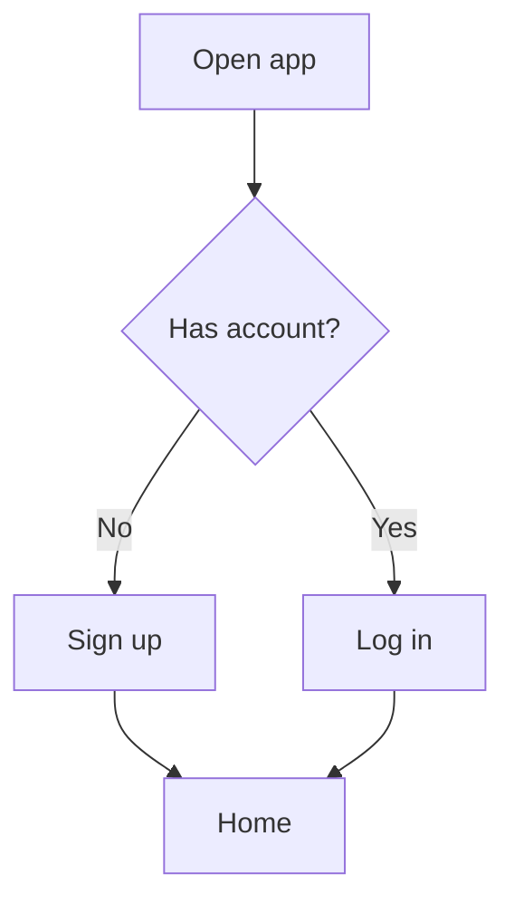

# UI Specification: [PROJECT NAME]

> **Template version:** 1.1 | **Folder:** `UX, UI and Design System/UI_Specification.md`
> **Covers:** Development → Design → Build → QA → Launch → First 500 customers
> **Built for:** Humans and AI agents (Claude / Claude Code) working together

---

# HOW TO FILL THIS DOCUMENT (READ THIS FIRST)

You do not need to be a designer or a programmer to fill this in. If you can answer simple questions about your product, you can do this. Follow the steps below in order.

## The 10 Golden Rules

1. **Fill the document top to bottom.** Earlier sections feed later ones.
2. **Replace everything in `[SQUARE BRACKETS]`.** Brackets mean "put your answer here."
3. **Never leave a blank.** If you do not know yet, write `TBD` and add the question to the **Open Questions Log** (Section 18.3). A `TBD` without a logged question is not allowed.
4. **Be specific.** Write `Blue #2563EB`, not `a nice blue`. Write `Button is 48px tall`, not `big button`.
5. **Use the examples.** Every table has an `Example:` row. Copy its shape, then delete the example row.
6. **One fact, one place.** Write each fact once. Elsewhere, link to it (e.g. "see Section 6.1").
7. **Use the status tags** (below) on every section so everyone knows what is finished.
8. **Delete what does not apply.** If you do not have a mobile app, mark the mobile parts `N/A` and write why in one line. Do not delete the heading.
9. **Short sentences.** If a sentence has more than 20 words, split it.
10. **If an AI agent would have to guess, you are not done.** The goal of this document is zero guessing.

## Status Tags (put one at the top of each section)

| Tag | Meaning |
|---|---|
| `🔴 NOT STARTED` | Nothing written yet |
| `🟡 DRAFT` | Written but not checked |
| `🟢 APPROVED` | Checked and signed off |
| `⚪ N/A` | Does not apply (explain why) |

## Priority Tags (use in tables)

| Tag | Meaning |
|---|---|
| `P0` | Must have. Product cannot launch without it |
| `P1` | Should have. Launch is weaker without it |
| `P2` | Nice to have. Can come after launch |

## Who Fills What

| Who | Fills sections |
|---|---|
| Product owner / founder | 0, 1, 2, 15, 16 (+ 11A, 11B, 11C if used) |
| Designer | 3, 4, 5, 6, 7, 8, 9, 10, 11A–11C |
| Developer / AI agent | 11, 12, 13, 17, 18 |
| QA / tester | 14 |
| Anyone (when stuck) | Ask in Open Questions Log (18.3) |

## Fill Order (quickest path)

`Section 0 → 1 → 2 → 3 → 4 → 5 → 6 → 7 → 8 → 9 → 10 → 11 → (11A, 11B, 11C only if your product needs them) → 12 → 13 → 14 → 15 → 16 → 17 → 18`. Appendix A shows a finished example.

## "How do I know I'm done?" Checklist

- [ ] No `[BRACKETS]` left
- [ ] Every `TBD` is in the Open Questions Log
- [ ] Every section has a status tag
- [ ] Every screen in Section 11 has all states filled (loading, empty, error, success)
- [ ] The Definition of Done (18.2) is all ticked for the current phase
- [ ] Someone who has never seen the product could build the UI from this file alone

## Quick Glossary (words you will see)

| Word | Plain meaning |
|---|---|
| UI | What the user sees and touches (buttons, text, colors) |
| UX | How it feels to use the product (easy or confusing) |
| Design token | A named value, like `color-primary = #2563EB`, used everywhere so things stay consistent |
| Component | A reusable piece of UI, like a button or a card |
| State | A look a component can be in: normal, hover, pressed, disabled, loading, error |
| Breakpoint | A screen width where the layout changes (phone → tablet → laptop) |
| Wireframe | A rough black-and-white drawing of a screen |
| Mockup | A finished-looking picture of a screen |
| Persona | A made-up example person who represents your users |
| Empty state | What a screen shows when there is no data yet |
| WCAG | The international rules for making products usable by everyone |
| A/B test | Showing two versions to different users to see which works better |
| Definition of Done | The checklist that says "this is truly finished" |

---

# DOCUMENT CONTROL

> 💡 **How to fill:** Fill once at the start. Update the version every time you change the file.

| Field | Value | Example |
|---|---|---|
| Project name | [NAME] | Plantly |
| Document owner | [NAME + ROLE] | Sara Khan, Product Owner |
| Current version | [X.Y] | 0.3 |
| Last updated | [YYYY-MM-DD] | 2026-10-17 |
| Current lifecycle phase | [0–5] | Phase 1: Design |
| Overall status | [🔴/🟡/🟢] | 🟡 DRAFT |
| Related documents | [LINKS] | PRD.md, Architecture.md, API_Spec.md |
| Design files link | [FIGMA / OTHER URL] | figma.com/file/... |
| Code repository link | [URL] | github.com/org/plantly |

## Lifecycle Map (where this document is used)

| Phase | Name | Goal | Sections used | Gate to pass |
|---|---|---|---|---|
| 0 | Discover | Know who and why | 1, 2 | Gate 0: Scope signed off |
| 1 | Design | Decide how it looks and feels | 3–10 | Gate 1: Design approved |
| 2 | Build | Turn design into working UI | 11, 11A–11C (optional), 12, 13 | Gate 2: Feature complete |
| 3 | Test | Prove it works for everyone | 14 | Gate 3: QA passed |
| 4 | Launch | Release to the public | 15 | Gate 4: Launch approved |
| 5 | Grow to 500 | Learn from the first 500 customers | 16 | Gate 5: 500 customers reached and reviewed |

---

# SECTION 0: PROJECT SNAPSHOT (ONE-PAGE SUMMARY)

> 🏷️ Status: `[TAG]` | Phase: 0
> 🧒 **Why this matters:** This is the 30-second story of your product. If you cannot say it simply, the design will be confusing.
> 💡 **How to fill:** Imagine explaining your product to a friend in 30 seconds. Write that.

| Field | Your answer | Example |
|---|---|---|
| Product name | [NAME] | Plantly |
| One-sentence description | [WHAT IT DOES FOR WHOM] | Helps busy people remember to water their plants |
| Problem it solves | [PROBLEM] | People forget and plants die |
| Who it is for | [USER TYPE] | Apartment dwellers aged 22–45 |
| Why they will choose it | [REASON] | Takes 10 seconds a day, no setup |
| Main action users do | [ACTION] | Mark a plant as watered |
| Business goal | [GOAL] | 500 paying customers in 6 months |

## 0.1 Platform Switch (tick everything that applies)

> 💡 **How to fill:** Tick the boxes. Every later section that says "platform" will use these answers. Unticked platforms become `N/A`.

| Platform | Build it? | Tech / framework | Min. version supported | Example |
|---|---|---|---|---|
| Web (responsive) | [ ] Yes [ ] No | [e.g. React, Next.js] | [e.g. Chrome, Safari, Firefox, Edge last 2 versions] | Yes, Next.js, last 2 versions |
| iOS app | [ ] Yes [ ] No | [e.g. SwiftUI, React Native] | [e.g. iOS 16+] | Yes, React Native, iOS 16+ |
| Android app | [ ] Yes [ ] No | [e.g. Kotlin, Flutter] | [e.g. Android 10+] | Yes, React Native, Android 10+ |
| Desktop app | [ ] Yes [ ] No | [e.g. Electron, Tauri] | [e.g. Windows 10+, macOS 13+] | No |

**Primary platform (design this one first):** [WEB / iOS / ANDROID / DESKTOP]
**Why:** [ONE SENTENCE]

---

# PHASE 0: DISCOVER

---

# SECTION 1: PRODUCT CONTEXT

> 🏷️ Status: `[TAG]` | Phase: 0
> 🧒 **Why this matters:** Knowing who you build for and what you will NOT build keeps the project small, cheap and on time.

## 1.1 Goals and Success Numbers

> 💡 **How to fill:** A goal without a number cannot be checked. Add a number and a date to each one.

| # | Goal | How we measure it | Target | By when | Priority | Example |
|---|---|---|---|---|---|---|
| G1 | [GOAL] | [METRIC] | [NUMBER] | [DATE] | P0 | Users finish sign-up | Sign-up completion rate | 70% | Launch day | P0 |
| G2 | | | | | | |
| G3 | | | | | | |

## 1.2 Users (Personas)

> 💡 **How to fill:** Create 1 to 3 made-up people who represent your real users. Give each a name and a real-life situation.

### Persona 1: [NAME]

| Field | Your answer | Example |
|---|---|---|
| Age range | [RANGE] | 28–35 |
| Job | [JOB] | Nurse |
| Tech comfort | [LOW / MEDIUM / HIGH] | Medium |
| Device they use most | [DEVICE] | iPhone |
| Where they use the product | [PLACE] | On the couch in the evening |
| What they want | [GOAL] | Not kill another plant |
| What frustrates them | [PAIN] | Apps with too many steps |
| Accessibility needs | [NEEDS OR NONE] | Needs large text |
| Languages | [LANGUAGES] | English, Spanish |

*(Copy the table above for Persona 2 and 3.)*

## 1.3 Scope

> 💡 **How to fill:** Say clearly what is IN and what is OUT. This stops the project from growing forever.

| In scope (we will build) | Out of scope (we will NOT build now) |
|---|---|
| [FEATURE] | [FEATURE] |
| Example: Sign-up, plant list, watering reminders | Example: Social sharing, plant-ID camera |

## 1.4 Constraints and Rules We Must Follow

| Type | Constraint | Example |
|---|---|---|
| Budget | [LIMIT] | Under $15,000 total |
| Deadline | [DATE] | Launch by 2027-02-01 |
| Legal / privacy | [LAWS] | GDPR, CCPA, COPPA if under 13 |
| Brand | [RULES] | Must use brand green |
| Technical | [LIMITS] | Must work offline for viewing plants |
| Accessibility | [LEVEL] | WCAG 2.2 AA |

## 1.5 Competitors and Inspiration

| Name | Link | What they do well | What they do badly | What we copy or avoid |
|---|---|---|---|---|
| [NAME] | [URL] | [GOOD] | [BAD] | [DECISION] |

---

# SECTION 2: USER JOURNEYS AND FLOWS

> 🏷️ Status: `[TAG]` | Phase: 0
> 🧒 **Why this matters:** A flow is the path a person walks to get something done. If the path has bumps, people give up.

> 💡 **How to fill:** A flow is the path a user takes to finish a task. Write each step as: *User does X → Screen shows Y.*

## 2.1 Main Journeys

| Flow ID | Flow name | Starts when | Ends when | Persona | Priority | Example |
|---|---|---|---|---|---|---|
| F1 | [NAME] | [START] | [END] | [PERSONA] | P0 | Sign up | User opens app first time | Account created, on home screen | Persona 1 | P0 |
| F2 | | | | | | |

## 2.2 Step-by-Step Flow Detail (one table per flow)

### Flow F1: [NAME]

| Step | User does | Screen shows | If something goes wrong | Screen ID |
|---|---|---|---|---|
| 1 | [ACTION] | [RESULT] | [ERROR HANDLING] | [S-XX] |
| Example | Taps "Sign up" | Email and password form | Shows "Enter a valid email" under the field | S-02 |

## 2.3 Flow Diagram (optional but recommended)



---

# PHASE 1: DESIGN

---

# SECTION 3: DESIGN PRINCIPLES AND BRAND

> 🏷️ Status: `[TAG]` | Phase: 1
> 🧒 **Why this matters:** These are rules for how the product looks and sounds. They stop arguments and keep everything feeling like one product.

## 3.1 Design Principles (3 to 5)

> 💡 **How to fill:** Rules that help you choose between two designs. Each needs a "so we..." line.

| # | Principle | So we... | Example |
|---|---|---|---|
| 1 | [PRINCIPLE] | [DECISION RULE] | Simple first | Show only one main action per screen |
| 2 | | | |

## 3.2 Brand Personality

| Question | Answer | Example |
|---|---|---|
| If the product were a person, how would it act? | [3 WORDS] | Friendly, calm, helpful |
| What it must never feel like | [3 WORDS] | Pushy, cold, childish |
| Tone of voice | [DESCRIPTION] | Warm and short, like a kind friend |

## 3.3 Brand Assets

| Asset | File / link | Rules | Example |
|---|---|---|---|
| Logo (light background) | [PATH] | [MIN SIZE, CLEAR SPACE] | /assets/logo.svg | Min 24px tall, 8px space around |
| Logo (dark background) | [PATH] | | |
| App icon | [PATH] | [SIZES NEEDED] | 1024×1024 PNG |
| Favicon | [PATH] | | 32×32, 180×180 |

---

# SECTION 4: INFORMATION ARCHITECTURE AND NAVIGATION

> 🏷️ Status: `[TAG]` | Phase: 1
> 🧒 **Why this matters:** This is the map of your product. If people cannot find things, they will not use them.

## 4.1 Screen Inventory (the master list of every screen)

> 💡 **How to fill:** List EVERY screen. Give each a unique ID like `S-01`. You will detail each one in Section 11.

| Screen ID | Screen name | Purpose (one line) | Flow(s) | Platforms | Needs login? | Priority | Example |
|---|---|---|---|---|---|---|---|
| S-01 | [NAME] | [PURPOSE] | [F#] | [W/I/A/D] | [Y/N] | [P#] | Welcome | Explain product, start sign-up | F1 | W/I/A | No | P0 |
| S-02 | | | | | | | |

## 4.2 Navigation Structure

| Level | Item | Goes to | Visible when | Platform notes | Example |
|---|---|---|---|---|---|
| Main nav | [LABEL] | [SCREEN ID] | [CONDITION] | [NOTES] | Home | S-05 | Logged in | Bottom tab on mobile, left sidebar on desktop |
| Secondary nav | | | | | |
| Footer / utility | | | | | |

## 4.3 Navigation Rules

| Rule | Your answer | Example |
|---|---|---|
| Back button behavior | [DESCRIPTION] | Goes to previous screen, never closes the app |
| Deep links supported | [YES/NO + FORMAT] | Yes, `plantly://plant/123` |
| URL structure (web) | [PATTERN] | `/plants/:id` |
| Unsaved changes warning | [WHEN] | Ask before leaving a form with edits |
| Logged-out redirect | [WHERE] | Send to S-03 Login, then return to the page |

---

# SECTION 5: DESIGN TOKENS (THE BUILDING BLOCKS)

> 🏷️ Status: `[TAG]` | Phase: 1
> 🧒 **Why this matters:** Tokens are a shared box of crayons with names. Everyone uses the same blue, so nothing looks random.
> 💡 **How to fill:** Tokens are named values used everywhere. Developers and AI agents must use token names, never raw numbers or colors in code. Fill every table.

## 5.1 Color Tokens

| Token name | Light mode | Dark mode | Used for | Example |
|---|---|---|---|---|
| `color-primary` | [HEX] | [HEX] | Main buttons, links | #2563EB | #60A5FA | Main buttons |
| `color-primary-hover` | | | | |
| `color-secondary` | | | | |
| `color-background` | | | Page background | |
| `color-surface` | | | Cards, sheets | |
| `color-text-primary` | | | Main text | |
| `color-text-secondary` | | | Hints, captions | |
| `color-border` | | | Lines, outlines | |
| `color-success` | | | Good news | |
| `color-warning` | | | Careful | |
| `color-error` | | | Problems | |
| `color-info` | | | Tips | |
| `color-disabled` | | | Unavailable items | |
| `color-focus-ring` | | | Keyboard focus outline | |

**Contrast rule:** Normal text must reach at least **4.5:1** contrast, large text and icons **3:1**. Contrast checked with: [TOOL NAME].

## 5.2 Typography Tokens

| Token | Font family | Size | Weight | Line height | Letter spacing | Used for | Example |
|---|---|---|---|---|---|---|---|
| `text-display` | [FONT] | [PX/REM] | [W] | [LH] | [LS] | Big hero titles | Inter | 40px | 700 | 48px | -0.5px |
| `text-h1` | | | | | | Page titles | |
| `text-h2` | | | | | | Section titles | |
| `text-h3` | | | | | | Card titles | |
| `text-body` | | | | | | Normal text | |
| `text-body-small` | | | | | | Secondary text | |
| `text-caption` | | | | | | Labels, hints | |
| `text-button` | | | | | | Button text | |
| `text-code` | | | | | | Code, numbers | |

| Font rule | Your answer |
|---|---|
| Font source and license | [GOOGLE FONTS / PURCHASED / SYSTEM] |
| Fallback fonts | [LIST] |
| Supports users' languages? | [YES/NO, WHICH SCRIPTS] |
| Text scaling | [MUST SUPPORT 200% TEXT SIZE: YES/NO] |

## 5.3 Spacing Scale

| Token | Value | Typical use | Example |
|---|---|---|---|
| `space-1` | [PX] | Tiny gaps | 4px |
| `space-2` | | Icon and text gap | 8px |
| `space-3` | | Inside small items | 12px |
| `space-4` | | Standard padding | 16px |
| `space-6` | | Between groups | 24px |
| `space-8` | | Between sections | 32px |
| `space-12` | | Big breaks | 48px |

## 5.4 Layout Grid and Breakpoints

| Breakpoint | Name | Width range | Columns | Gutter | Side margin | Example |
|---|---|---|---|---|---|---|
| `bp-xs` | Small phone | [PX] | [N] | [PX] | [PX] | 0–359 | 4 | 16 | 16 |
| `bp-sm` | Phone | | | | | |
| `bp-md` | Tablet | | | | | |
| `bp-lg` | Laptop | | | | | |
| `bp-xl` | Large desktop | | | | | |

**Max content width:** [PX]
**Approach:** [MOBILE-FIRST / DESKTOP-FIRST]

## 5.5 Shape, Elevation and Borders

| Token | Value | Used for | Example |
|---|---|---|---|
| `radius-sm` | [PX] | Inputs, tags | 4px |
| `radius-md` | | Buttons, cards | 8px |
| `radius-lg` | | Sheets, modals | 16px |
| `radius-full` | | Pills, avatars | 9999px |
| `shadow-sm` | [CSS VALUE] | Cards at rest | 0 1px 2px rgba(0,0,0,.08) |
| `shadow-md` | | Dropdowns | |
| `shadow-lg` | | Modals | |
| `border-default` | | Standard border | 1px solid `color-border` |

## 5.6 Motion and Animation

| Token | Duration | Easing | Used for | Example |
|---|---|---|---|---|
| `motion-fast` | [MS] | [CURVE] | Hover, press | 100ms | ease-out |
| `motion-normal` | | | Menus, fades | 200ms |
| `motion-slow` | | | Page changes | 350ms |

**Reduced motion rule:** When the user turns on "reduce motion", animations must be [REMOVED / SHORTENED TO FADE ONLY].
**Nothing may flash more than 3 times per second.**

## 5.7 Icons and Images

| Item | Your answer | Example |
|---|---|---|
| Icon set | [NAME + LINK] | Lucide |
| Icon sizes | [LIST] | 16, 20, 24 |
| Icon style | [OUTLINE/FILLED] | Outline, 1.5px stroke |
| Icon-only buttons need a text label for screen readers | Yes | Required |
| Photo style | [DESCRIPTION] | Natural light, real people |
| Illustration style | [DESCRIPTION] | Flat, 3 colors |
| Image formats and max file size | [LIST] | WebP/AVIF, under 200KB |
| Alt text rule | [RULE] | Every meaningful image has alt text |

## 5.8 Dark Mode and Theming

| Question | Your answer | Example |
|---|---|---|
| Dark mode supported? | [YES/NO] | Yes |
| Default theme | [LIGHT/DARK/FOLLOW SYSTEM] | Follow system |
| User can switch manually? | [YES/NO + WHERE] | Yes, Settings → Appearance |
| Where is choice saved? | [PLACE] | Local storage + account |
| Images in dark mode | [RULE] | Use dark-safe logo variant |
| Elevation in dark mode | [RULE] | Lighter surface instead of shadow |
| Brand theming (white-label)? | [YES/NO] | No |
| High-contrast mode supported? | [YES/NO] | Yes, Windows forced colors |

---

# SECTION 6: COMPONENT LIBRARY

> 🏷️ Status: `[TAG]` | Phase: 1
> 🧒 **Why this matters:** Components are LEGO bricks. Build each brick once, perfectly, and reuse it everywhere.
> 💡 **How to fill:** First list every component (6.1). Then fill the Component Detail Card (6.2) for each one. Every component needs ALL its states.

## 6.1 Component Catalog

| Component | Needed? | Priority | Source (custom / library) | Figma link | Code path | Example |
|---|---|---|---|---|---|---|
| Button | [Y/N] | [P#] | [SOURCE] | [URL] | [PATH] | Y | P0 | Custom | figma.com/... | /components/Button |
| Text input | | | | | | |
| Text area | | | | | | |
| Select / dropdown | | | | | | |
| Checkbox | | | | | | |
| Radio button | | | | | | |
| Toggle switch | | | | | | |
| Slider | | | | | | |
| Date / time picker | | | | | | |
| Search bar | | | | | | |
| Tabs | | | | | | |
| Navigation bar | | | | | | |
| Top app bar / header | | | | | | |
| Sidebar | | | | | | |
| Breadcrumbs | | | | | | |
| Pagination / infinite scroll | | | | | | |
| Card | | | | | | |
| List / list item | | | | | | |
| Table | | | | | | |
| Accordion | | | | | | |
| Modal / dialog | | | | | | |
| Bottom sheet | | | | | | |
| Drawer | | | | | | |
| Tooltip / popover | | | | | | |
| Toast / snackbar | | | | | | |
| Banner / alert | | | | | | |
| Badge / tag / chip | | | | | | |
| Avatar | | | | | | |
| Progress bar / spinner | | | | | | |
| Skeleton loader | | | | | | |
| File upload | | | | | | |
| Stepper / wizard | | | | | | |
| Empty-state block | | | | | | |
| Other: [NAME] | | | | | | |

## 6.2 Component Detail Card (copy one per component)

### Component: [NAME]

| Field | Your answer | Example (Button) |
|---|---|---|
| Purpose | [WHAT IT IS FOR] | Starts an action |
| Variants | [LIST] | Primary, Secondary, Ghost, Danger |
| Sizes | [LIST + PX] | Small 32, Medium 40, Large 48 |
| Min touch / click size | [PX] | 44×44 (mobile), 24×24 (web) |
| Anatomy (parts) | [LIST] | Label, optional left icon, optional right icon |
| Tokens used | [LIST] | `color-primary`, `radius-md`, `text-button` |
| Content rules | [RULES] | Verb first, max 3 words, e.g. "Save plant" |
| Do | [RULES] | One primary button per screen |
| Don't | [RULES] | Don't use "Click here" |
| Keyboard behavior | [KEYS] | Enter and Space activate |
| Screen reader label | [RULE] | Uses visible text; icon-only needs `aria-label` |

**States (fill every row; write `N/A` with a reason if not needed):**

| State | Looks like | Example |
|---|---|---|
| Default | [DESCRIPTION] | Blue fill, white text |
| Hover (web/desktop) | [DESCRIPTION] | Darker blue (`color-primary-hover`) |
| Pressed / active | [DESCRIPTION] | Even darker, slight shrink |
| Focus (keyboard) | [DESCRIPTION] | 2px focus ring with 2px offset |
| Disabled | [DESCRIPTION] | Gray, no hover, not clickable |
| Loading | [DESCRIPTION] | Spinner replaces label, button stays same width |
| Error | [DESCRIPTION] | N/A for button |
| Success | [DESCRIPTION] | N/A for button |

## 6.3 Form Rules (apply to every form)

| Rule | Your answer | Example |
|---|---|---|
| Label position | [TOP / LEFT / FLOATING] | Always on top |
| Required fields marked | [HOW] | Asterisk plus text "(required)" |
| Validation timing | [WHEN] | On leaving the field, and again on submit |
| Error message position | [WHERE] | Directly under the field |
| Error message style | [RULE] | Says what is wrong and how to fix |
| Submit button when form invalid | [ENABLED/DISABLED] | Enabled; show errors on tap |
| Autofill and password managers | [SUPPORTED?] | Yes, correct `autocomplete` values |
| Keyboard type on mobile | [RULE] | Email field shows email keyboard |
| Prevent double submit | [HOW] | Disable button while saving |

---

# SECTION 7: UX PATTERNS AND CONTENT

> 🏷️ Status: `[TAG]` | Phase: 1
> 🧒 **Why this matters:** Real products have empty, slow and broken moments. Planning them keeps users calm instead of confused.

## 7.1 System State Patterns

| Situation | What the user sees | Message text | Action offered | Example |
|---|---|---|---|---|
| First load | [LOOK] | [TEXT] | [ACTION] | Skeleton cards | none | none |
| Empty (no data yet) | | | | Illustration + "No plants yet" | "Add your first plant" button |
| Loading (long > 3s) | | | | |
| Error (can retry) | | | | "Something went wrong" | "Try again" |
| Error (cannot retry) | | | | |
| Offline | | | | Banner "You are offline" | Show saved data |
| No permission | | | | |
| Not found (404) | | | | |
| Success | | | | Toast "Plant saved" | Undo for 5s |
| Session expired | | | | |
| Maintenance | | | | |

## 7.2 Feedback and Notifications

| Type | When used | Where it appears | How long it stays | Can be dismissed? | Example |
|---|---|---|---|---|---|
| Toast | [WHEN] | [WHERE] | [SEC] | [Y/N] | Quick success | Bottom center | 4s | Yes |
| Banner | | | | | |
| Modal | | | | | |
| Inline message | | | | | |
| Push notification | | | | | |
| Email | | | | | |

## 7.3 Destructive Actions

| Action | Confirmation needed? | Wording | Undo possible? | Example |
|---|---|---|---|---|
| Delete [ITEM] | [Y/N] | [TEXT] | [Y/N + TIME] | Delete plant | Yes | "Delete Fern? This cannot be undone." | No |

## 7.4 Writing Style and Microcopy

| Rule | Your answer | Example |
|---|---|---|
| Reading level | [GRADE] | Grade 6 |
| Voice | [DESCRIPTION] | Friendly, short |
| Button wording | [RULE] | Verb + noun |
| Error wording | [RULE] | Never blame the user |
| Words to always use | [LIST] | "Plant", "Reminder" |
| Words to never use | [LIST] | "Invalid", "Oops" |
| Date, time, number, currency formats | [RULE] | Follow user's locale |
| Capitalization | [RULE] | Sentence case |

## 7.5 Onboarding and First-Run Experience

| Step | What user sees | Can skip? | Goal | Example |
|---|---|---|---|---|
| 1 | [SCREEN] | [Y/N] | [GOAL] | Welcome screen | Yes | Explain value |
| 2 | | | | |
| First "win" moment | [WHAT IS IT] | | | User adds first plant within 60 seconds |

## 7.6 Localization and Right-to-Left (RTL)

| Question | Your answer | Example |
|---|---|---|
| Launch languages | [LIST] | English, Spanish |
| Future languages | [LIST] | Arabic, French |
| Where are texts stored | [FILE/TOOL] | `/locales/*.json` |
| Text expansion allowance | [%] | Layouts must handle +40% longer text |
| RTL supported? | [YES/NO] | Yes (Arabic later) |
| RTL rule | [RULE] | Use logical properties (start/end, not left/right); mirror arrows and layout, not logos or numbers |
| Never hard-code text in components | Yes | Required |
| Plurals and gender handled by | [LIBRARY] | ICU MessageFormat |
| Date, number, currency by | [LIBRARY] | Intl API |
| Images with text | [RULE] | Avoid; use live text |

---

# SECTION 8: ACCESSIBILITY (WCAG 2.2 AA)

> 🏷️ Status: `[TAG]` | Phase: 1
> 🧒 **Why this matters:** Accessible design lets everyone use your product, including people with disabilities. It is often the law too.
> 💡 **How to fill:** Accessibility means everyone can use the product, including people who cannot see well, hear, use a mouse, or have trouble reading. Tick the box when your design meets the rule. Every box must be ticked before Gate 3.

## 8.1 Target

| Item | Value |
|---|---|
| Standard | WCAG 2.2 Level AA |
| Legal requirements for our markets | [e.g. ADA, EN 301 549, European Accessibility Act] |
| Accessibility owner | [NAME] |

## 8.2 Checklist

| # | Rule | Plain meaning | Met? |
|---|---|---|---|
| A1 | Text contrast ≥ 4.5:1 (large text 3:1) | Text is easy to read | [ ] |
| A2 | Non-text contrast ≥ 3:1 | Icons, input borders are visible | [ ] |
| A3 | Everything works with keyboard only | No mouse needed | [ ] |
| A4 | Visible focus on every interactive item | You can see where you are | [ ] |
| A5 | Focus not hidden behind sticky headers | Focused item is never covered | [ ] |
| A6 | Logical tab order | Tab goes in reading order | [ ] |
| A7 | Touch targets ≥ 24×24 CSS px (web), 44×44 pt (iOS), 48×48 dp (Android) | Easy to tap | [ ] |
| A8 | Works with screen readers (VoiceOver, TalkBack, NVDA, JAWS) | Blind users can use it | [ ] |
| A9 | Every image has text alternative (or marked decorative) | Pictures are described | [ ] |
| A10 | Headings in order, landmarks used | Structure is clear | [ ] |
| A11 | Form fields have labels and clear errors | Forms make sense | [ ] |
| A12 | Color is never the only signal | Use icon or text too | [ ] |
| A13 | Text can zoom to 200%, reflow at 320px width | No broken layouts when enlarged | [ ] |
| A14 | Respects reduced motion setting | No dizzy animations | [ ] |
| A15 | No time limits without warning and extend option | No rushing | [ ] |
| A16 | Videos have captions; audio has transcript | Deaf users can follow | [ ] |
| A17 | Drag actions have a non-drag alternative | Tap-only users can still do it | [ ] |
| A18 | Authentication does not require memory or puzzle tests only | Login is easy for all | [ ] |
| A19 | Help is in the same place across pages | Users can find help | [ ] |
| A20 | Page title and language are set | Screen readers speak correctly | [ ] |

## 8.3 Screen Reader Notes per Screen

> Fill inside each screen spec (Section 11, field "Accessibility notes").

---

# SECTION 9: RESPONSIVE AND PLATFORM BEHAVIOR

> 🏷️ Status: `[TAG]` | Phase: 1
> 🧒 **Why this matters:** People use phones, tablets and laptops. This makes sure the product feels right on each one.
> 💡 **How to fill:** Describe how things change on different devices. Skip rows for platforms you did not tick in Section 0.1.

## 9.1 Layout Changes by Screen Size

| Element | Phone | Tablet | Laptop / desktop | Example |
|---|---|---|---|---|
| Main navigation | [BEHAVIOR] | [BEHAVIOR] | [BEHAVIOR] | Bottom tabs | Side rail | Left sidebar |
| Content columns | | | | 1 | 2 | 3 |
| Tables | | | | Cards | Scroll | Full table |
| Modals | | | | Full screen | Centered | Centered |
| Images | | | | | | |

## 9.2 Platform-Specific Rules

| Topic | Web | iOS | Android | Desktop | Notes |
|---|---|---|---|---|---|
| Design guideline followed | [e.g. own system] | [Human Interface Guidelines] | [Material 3] | [OS guidelines] | |
| Navigation style | | | | | |
| Gestures (swipe, pull-to-refresh) | N/A | | | N/A | |
| Safe areas / notch / system bars | N/A | | | N/A | |
| Keyboard shortcuts | | N/A | N/A | | |
| Right-click / context menu | | N/A | N/A | | |
| System permissions (camera, location, notifications) | | | | | |
| Haptics | N/A | | | N/A | |
| Window resize / multi-window | | | | | |
| Share sheet / native pickers | | | | | |
| App icon badge / widgets | N/A | | | N/A | |
| Orientation (portrait/landscape) | | | | | |
| Offline behavior | | | | | |

## 9.3 Permission Request Pattern

| Permission | When we ask | Why we ask (shown to user) | If user says no | Example |
|---|---|---|---|---|
| [PERMISSION] | [MOMENT] | [REASON TEXT] | [FALLBACK] | Notifications | After first plant added | "Get reminders when your plant is thirsty" | Show in-app reminders only |

---

# SECTION 10: DESIGN DELIVERABLES AND HANDOFF

> 🏷️ Status: `[TAG]` | Phase: 1
> 🧒 **Why this matters:** A clean handoff means designers and builders see the same picture and nothing gets lost.

## 10.1 Design Files

| Deliverable | Link | Owner | Status | Example |
|---|---|---|---|---|
| Wireframes | [URL] | [NAME] | [TAG] | Low-fi for all P0 screens |
| High-fidelity mockups | | | | |
| Clickable prototype | | | | |
| Design system library | | | | |
| Icon and asset export | | | | |
| Redlines / specs | | | | |

## 10.2 Design-to-Code Mapping

| Design item | Code item | Notes |
|---|---|---|
| Figma color style `Primary/500` | CSS variable `--color-primary` | Must match token table 5.1 |
| Figma component `Button/Primary` | `<Button variant="primary">` | |

## 10.3 Gate 1 Checklist: Design Approved

- [ ] All P0 screens designed with all states
- [ ] Light and dark mode designed
- [ ] Accessibility checklist (8.2) passed on designs
- [ ] Prototype tested with at least 5 real users
- [ ] Tokens and components finalized
- [ ] Sign-off from product owner and engineering lead

---

# PHASE 2: BUILD

---

# SECTION 11: SCREEN SPECIFICATIONS

> 🏷️ Status: `[TAG]` | Phase: 2
> 🧒 **Why this matters:** One card per screen means builders never have to guess what a screen should do.
> 💡 **How to fill:** Copy the "Screen Card" below once for EVERY screen in your Screen Inventory (4.1). Do not skip any state. If a state does not apply, write `N/A: [reason]`.

## Screen Card: [S-XX] [SCREEN NAME]

| Field | Your answer | Example |
|---|---|---|
| Screen ID | [S-XX] | S-05 |
| Name | [NAME] | Plant List |
| Purpose | [ONE LINE] | Show all my plants and which need water |
| Flow(s) | [F#] | F2 |
| Platforms | [W/I/A/D] | W, I, A |
| Priority | [P#] | P0 |
| Who can see it | [ROLES] | Logged-in users |
| URL / route / deep link | [PATH] | `/plants` |
| Design link | [FIGMA URL] | figma.com/... |
| Comes from | [PREVIOUS SCREENS] | S-04 |
| Goes to | [NEXT SCREENS] | S-06 |

### Layout (top to bottom)

| Order | Element | Component (from 6.1) | Content / data | Behavior | Example |
|---|---|---|---|---|---|
| 1 | [ELEMENT] | [COMPONENT] | [CONTENT] | [WHAT HAPPENS] | Header | Top app bar | Title "My plants" | Stays fixed on scroll |
| 2 | | | | | |

### Actions on this screen

| Action | Trigger | Result | Validation | Success message | Error message | Example |
|---|---|---|---|---|---|---|
| [ACTION] | [TAP/CLICK] | [RESULT] | [RULES] | [TEXT] | [TEXT] | Mark watered | Tap drop icon | Plant turns green, next date updates | None | "Watered!" | "Could not save. Try again." |

### Screen States (all required)

| State | What user sees | Example |
|---|---|---|
| Loading | [DESCRIPTION] | 6 skeleton cards |
| Empty | [DESCRIPTION] | Illustration + "Add your first plant" |
| Normal (with data) | [DESCRIPTION] | Grid of plant cards |
| Partial data | [DESCRIPTION] | Missing photo shows placeholder |
| Error | [DESCRIPTION] | Message + Retry button |
| Offline | [DESCRIPTION] | Cached list and banner |
| No permission | [DESCRIPTION] | N/A |
| Success | [DESCRIPTION] | Toast |
| Long content / overflow | [DESCRIPTION] | Names cut after 2 lines with ellipsis |

### Responsive Behavior

| Phone | Tablet | Desktop |
|---|---|---|
| [DESCRIPTION] | [DESCRIPTION] | [DESCRIPTION] |

### Data and Backend Link

| UI element | Data field | API endpoint / source | Format | Limits | Example |
|---|---|---|---|---|---|
| [ELEMENT] | [FIELD] | [ENDPOINT] | [TYPE] | [MAX LENGTH ETC.] | Plant name | `plant.name` | `GET /api/plants` | string | 1–40 chars |

### Accessibility Notes

| Item | Your answer | Example |
|---|---|---|
| Page title | [TEXT] | "My plants, Plantly" |
| Heading order | [LIST] | h1 My plants, h2 Needs water |
| Focus on open | [WHERE] | h1 |
| Screen reader announcements | [TEXT] | "Fern marked as watered" |
| Special keyboard shortcuts | [KEYS] | None |

### Analytics Events on This Screen

| Event name | Fires when | Properties | Example |
|---|---|---|---|
| [snake_case_name] | [TRIGGER] | [PROPERTIES] | `plant_watered` | Tap on drop icon | `plant_id`, `source` |

### Acceptance Criteria (testable "Given / When / Then")

| # | Given | When | Then |
|---|---|---|---|
| AC1 | [STARTING SITUATION] | [USER ACTION] | [EXPECTED RESULT] |
| Example | User has 3 plants | User taps drop icon on Fern | Fern shows "Watered today" and toast appears |

---

*(Repeat the Screen Card for every screen: S-01, S-02, S-03 …)*

---

# OPTIONAL MODULES (fill only the ones your product needs; otherwise mark `⚪ N/A` with one line of why)

---

# SECTION 11A: PAYMENTS, PRICING AND BILLING UI (OPTIONAL MODULE)

> 🏷️ Status: `[TAG]` | Phase: 1–2 | Needed? [ ] Yes [ ] No (if No, write why: [REASON])
> 🧒 **Why this matters:** Money screens are where trust is won or lost. One confusing price or hidden fee and people leave, or worse, ask for refunds.

## 11A.1 Pricing Model

| Field | Your answer | Example |
|---|---|---|
| Model | [FREE / FREEMIUM / SUBSCRIPTION / ONE-TIME / USAGE-BASED] | Freemium + subscription |
| Currencies shown | [LIST] | USD, EUR |
| Billing periods | [LIST] | Monthly, yearly (2 months free) |
| Free trial | [LENGTH + CARD REQUIRED?] | 14 days, no card |
| Taxes shown | [RULE] | Price shown before tax; tax added at checkout |
| Payment provider | [NAME] | Stripe Checkout |
| Store billing rules (mobile) | [RULE] | Digital goods on iOS/Android use store billing |

## 11A.2 Plans Table (what the user sees)

| Plan | Price | Who it is for | Limits | Highlighted? | Button text | Example |
|---|---|---|---|---|---|---|
| [PLAN NAME] | [PRICE] | [AUDIENCE] | [LIMITS] | [Y/N] | [TEXT] | Pro | $6/mo | Plant lovers | Unlimited plants | Yes | "Start free trial" |

## 11A.3 Screens in This Module (add each to the Screen Inventory 4.1)

| Screen | Purpose | Must show | Must never | Example |
|---|---|---|---|---|
| Pricing page | Compare plans | Price, period, what is included, cancel info | Hide fees or auto-select the priciest plan | Plan cards with a monthly/yearly toggle |
| Checkout | Take payment | Order summary, total, tax, payment form, secure badge | Ask for data we do not need | One page, 3 fields + wallet buttons |
| Payment success | Confirm | Receipt summary, next step | Leave user wondering | "You're in! Receipt sent to your email." |
| Payment failed | Recover | Reason in plain words, retry, other method | Blame user, lose cart | "Your card was declined. Try another card." |
| Billing settings | Manage | Plan, next charge date, payment method, invoices | Make cancel hard | Link to "Cancel plan" visible |
| Cancel flow | Let user leave | Clear confirm, what they keep, end date | Dark patterns, guilt text | 2 steps maximum |
| Upgrade / paywall prompt | Offer upgrade | What they unlock, price, a "Not now" option | Block the screen without a way out | Inline card at the limit |

## 11A.4 Payment UI Rules

| Rule | Your answer | Example |
|---|---|---|
| Card fields | [RULE] | Use provider's hosted fields; we never touch card numbers |
| Total always visible | [RULE] | Sticky summary |
| Renewal notice | [RULE] | Email 7 days before yearly renewal |
| Cancel path | [RULE] | Cancel in the same place user signed up, 2 taps |
| Refund wording | [RULE] | "Refunds within 14 days, no questions" |
| Receipts | [RULE] | Email + downloadable PDF in Billing |
| Failed payment retries | [RULE] | Retry 3 times over 7 days, banner in app |
| Accessibility | [RULE] | Errors tied to fields, autofill works |
| Analytics events | `paywall_viewed`, `checkout_started`, `payment_succeeded`, `payment_failed`, `plan_cancelled` | Add to 13.3 |

---

# SECTION 11B: ADMIN / BACK-OFFICE UI (OPTIONAL MODULE)

> 🏷️ Status: `[TAG]` | Phase: 1–2 | Needed? [ ] Yes [ ] No (if No, write why: [REASON])
> 🧒 **Why this matters:** Your team needs tools to help customers. Without an admin area, every small fix needs a developer.

## 11B.1 Roles and Permissions

| Role | Who | Can see | Can do | Cannot do | Example |
|---|---|---|---|---|---|
| [ROLE] | [PERSON TYPE] | [DATA] | [ACTIONS] | [LIMITS] | Support agent | Customer service | User profile, orders | Reset password, refund up to $50 | See card data, delete users |
| Admin | | | | | |
| Viewer (read-only) | | | | | |

## 11B.2 Admin Screens

| Screen ID | Name | Purpose | Roles allowed | Priority | Example |
|---|---|---|---|---|---|
| A-01 | [NAME] | [PURPOSE] | [ROLES] | [P#] | User search | Find a customer in under 10 seconds | Support, Admin | P0 |
| A-02 | | | | | |

## 11B.3 Admin Design Rules

| Topic | Your answer | Example |
|---|---|---|
| Layout style | [STYLE] | Dense tables, left sidebar |
| Tables need | [FEATURES] | Search, sort, filter, pagination, export CSV |
| Bulk actions | [RULE] | Select rows, confirm count before running |
| Dangerous actions | [RULE] | Type the word DELETE to confirm; always logged |
| Audit log | [RULE] | Every change shows who, what, when |
| Viewing user data | [RULE] | Mask sensitive fields; "Reveal" is logged |
| Impersonate user (if allowed) | [RULE] | Banner shows "Viewing as…", time limited, logged |
| Access login | [RULE] | Single sign-on + two-step verification |
| Keyboard use and accessibility | [RULE] | Fully keyboard operable; same WCAG level as main app |
| Environment label | [RULE] | Colored banner "STAGING" vs "PRODUCTION" |

---

# SECTION 11C: AI-FEATURE UI PATTERNS (OPTIONAL MODULE)

> 🏷️ Status: `[TAG]` | Phase: 1–2 | Needed? [ ] Yes [ ] No (if No, write why: [REASON])
> 🧒 **Why this matters:** AI can be wrong, slow or surprising. Good screens tell people what the AI is doing, let them check it, and keep them in control.

## 11C.1 AI Features Overview

| Feature | What the AI does | Input from user | Output shown | Risk if wrong (L/M/H) | Human check needed? | Example |
|---|---|---|---|---|---|---|
| [FEATURE] | [TASK] | [INPUT] | [OUTPUT] | [LEVEL] | [Y/N] | Care tips | Suggests watering advice | Plant name + photo | Short tip card | M | Yes, "Was this helpful?" |

## 11C.2 Required AI Patterns (decide each one)

| Pattern | Your decision | Example |
|---|---|---|
| Label AI content | [HOW] | "AI-generated" tag on every AI answer |
| Starting prompts / examples | [WHAT] | 3 suggested questions |
| Streaming (text appears gradually) | [YES/NO + RULE] | Yes, with stop button |
| Loading wait over 3 seconds | [WHAT USER SEES] | "Thinking…" with step hints |
| Stop / cancel | [RULE] | Always visible while generating |
| Retry / regenerate | [RULE] | Button under the answer |
| Edit user's last message | [RULE] | Allowed |
| Sources and citations | [RULE] | Show links when facts are used |
| Uncertainty | [RULE] | Say "I'm not sure" instead of guessing |
| Feedback | [RULE] | Thumbs up/down + optional comment |
| Human in the loop | [RULE] | AI drafts; user presses Send. AI never sends money or deletes data alone |
| Undo for AI actions | [RULE] | 10-second undo, plus history |
| Safe refusal message | [TEXT] | "I can't help with that. Here's what I can do…" |
| Errors and limits | [TEXT] | "We're busy. Try again in a minute." |
| Long conversations | [RULE] | Chat history list, rename, delete |
| Copy / share / export | [RULE] | Copy button on each answer |
| Data use notice | [TEXT] | "Your chats are not used to train models" (only if true) |
| Cost or usage limits shown | [RULE] | "18 of 20 free answers left" |
| Accessibility | [RULE] | Screen reader announces when a new answer is ready; streaming text is not announced word by word |

## 11C.3 AI Safety and Trust Checklist

- [ ] User always knows when they are talking to AI
- [ ] User can see, edit or delete the data the AI uses
- [ ] AI answers in sensitive areas (health, legal, money) include a plain warning and a pointer to a professional
- [ ] No fake human names or photos for the AI
- [ ] There is a way to report a bad answer
- [ ] Failure state works when the AI service is down
- [ ] Test set of 20+ real prompts checked before launch (include tricky and abusive ones)
- [ ] Prompts, model name, and version are recorded in [LOCATION]

---

# SECTION 12: TECHNICAL UI IMPLEMENTATION RULES

> 🏷️ Status: `[TAG]` | Phase: 2
> 🧒 **Why this matters:** These rules keep the code tidy, fast and safe, so the product stays easy to change later.

## 12.1 Tech Stack for the UI

| Item | Choice | Version | Example |
|---|---|---|---|
| Language | [LANG] | [V] | TypeScript 5.x |
| Framework | [FRAMEWORK] | | Next.js 15 |
| Styling | [METHOD] | | Tailwind CSS using tokens |
| Component base | [LIBRARY] | | Radix UI |
| State management | [TOOL] | | Zustand |
| Routing | [TOOL] | | Next.js App Router |
| Forms and validation | [TOOL] | | React Hook Form + Zod |
| Data fetching | [TOOL] | | TanStack Query |
| Icons | [LIBRARY] | | Lucide |
| Animation | [LIBRARY] | | CSS transitions |
| Testing | [TOOLS] | | Vitest, Playwright, Storybook |
| Package manager | [TOOL] | | pnpm |

## 12.2 Code Structure and Naming

| Rule | Your answer | Example |
|---|---|---|
| Folder structure | [TREE] | `/components`, `/screens`, `/tokens`, `/hooks` |
| Component file naming | [RULE] | PascalCase, one component per file |
| Token naming | [RULE] | `category-role-variant` e.g. `color-text-primary` |
| CSS class naming | [RULE] | Utility classes only |
| Test file location | [RULE] | Next to component: `Button.test.tsx` |
| Storybook story required | [Y/N] | Yes, every component |

**Hard rules for developers and AI agents:**

1. Never write raw color values, pixel sizes, or fonts in screens. Use tokens from Section 5.
2. Never build a new component if one exists in 6.1. Reuse it.
3. Every component must implement all states listed in its Detail Card.
4. Every user-visible text comes from the localization files (7.6).

## 12.3 Performance Budgets

| Metric | Target | Tool | Example |
|---|---|---|---|
| Largest Contentful Paint | [SEC] | [TOOL] | ≤ 2.5s |
| Interaction to Next Paint | [MS] | | ≤ 200ms |
| Cumulative Layout Shift | [VALUE] | | ≤ 0.1 |
| First load JS size | [KB] | | ≤ 170KB gzipped |
| Mobile app start time | [SEC] | | ≤ 2s cold start |
| Frame rate while scrolling | [FPS] | | 60fps |
| Image weight per screen | [KB] | | ≤ 500KB |
| Slow network test profile | [PROFILE] | | Slow 4G |

## 12.4 Security and Privacy in the UI

| Topic | Rule | Example |
|---|---|---|
| Passwords | [RULE] | Show/hide toggle, no paste blocking |
| Sensitive data on screen | [RULE] | Mask card numbers |
| Session timeout UX | [RULE] | Warn 2 min before logout |
| Cookie / consent banner | [RULE] | Shown in regions that require it |
| Personal data collection notes | [RULE] | Ask only what we need |
| Screenshots / clipboard (mobile) | [RULE] | Block on payment screens |
| Links opening externally | [RULE] | `rel="noopener noreferrer"` |
| Input sanitizing | [RULE] | Never render raw HTML from users |

## 12.5 Feature Flags and Configuration

| Flag name | What it controls | Default | Who can change | Remove by | Example |
|---|---|---|---|---|---|
| [flag_name] | [FEATURE] | [ON/OFF] | [ROLE] | [DATE] | `new_onboarding` | New onboarding flow | OFF | Product | 2027-03-01 |

---

# SECTION 13: ANALYTICS, EVENTS AND EXPERIMENTS

> 🏷️ Status: `[TAG]` | Phase: 2
> 🧒 **Why this matters:** Numbers tell you what users really do, not what you hope they do.

## 13.1 Tools

| Purpose | Tool | Example |
|---|---|---|
| Product analytics | [TOOL] | PostHog |
| Error tracking | [TOOL] | Sentry |
| Session replay (with consent) | [TOOL] | PostHog / none |
| Feedback widget | [TOOL] | In-app form |
| A/B testing | [TOOL] | Feature flags |

## 13.2 Event Naming Rules

| Rule | Your answer | Example |
|---|---|---|
| Naming style | [RULE] | `object_action` in snake_case |
| Required properties on every event | [LIST] | `user_id`, `platform`, `app_version`, `timestamp` |
| No personal data in events | Yes | Never log email or name |
| Consent needed before tracking | [Y/N] | Yes in EU |

## 13.3 Master Event List

| Event | Screen | Fires when | Properties | Used for which metric | Priority | Example |
|---|---|---|---|---|---|---|
| [event_name] | [S-XX] | [TRIGGER] | [PROPS] | [METRIC] | [P#] | `signup_completed` | S-03 | Account created | `method` | Sign-up completion rate | P0 |

## 13.4 Funnels to Watch

| Funnel | Steps (events in order) | Target conversion | Example |
|---|---|---|---|
| [NAME] | [EVENT 1 → EVENT 2 → …] | [%] | Activation | `signup_completed → plant_added → reminder_enabled` | 50% |

## 13.5 Experiment Template (one per A/B test)

| Field | Your answer | Example |
|---|---|---|
| Experiment name | [NAME] | Shorter onboarding |
| Question | [WHAT DO WE WANT TO LEARN] | Does 3 steps beat 5 steps? |
| Hypothesis | [IF… THEN… BECAUSE…] | If we cut to 3 steps, completion rises because there is less effort |
| Version A (control) | [DESCRIPTION] | 5-step flow |
| Version B (variant) | [DESCRIPTION] | 3-step flow |
| Main metric | [METRIC] | Onboarding completion |
| Safety metric (must not drop) | [METRIC] | Day-7 retention |
| Users needed | [NUMBER] | See note below |
| Decision rule | [RULE] | Ship B if +5 points and safety metric flat |
| Start / end | [DATES] | |
| Result | [FILL AFTER] | |

> ⚠️ **Note for small user counts:** With fewer than 500 customers, tests are rarely statistically reliable. Prefer **talking to users and watching sessions** over A/B tests until you have more traffic. Use experiments only for big changes.

---

# PHASE 3: TEST

---

# SECTION 14: QUALITY ASSURANCE

> 🏷️ Status: `[TAG]` | Phase: 3
> 🧒 **Why this matters:** Testing finds problems before your customers do. It is much cheaper to fix them now.

## 14.1 Test Types

| Test type | What it checks | Tool | Who | When | Example |
|---|---|---|---|---|---|
| Component tests | Each component and its states | [TOOL] | Dev / AI agent | Every commit | Storybook + Vitest |
| Visual regression | Pixels did not change by accident | [TOOL] | Automated | Every pull request | Chromatic |
| End-to-end flow tests | Flows F1–Fn work | [TOOL] | Automated | Before release | Playwright |
| Accessibility (automated) | Rule checks | [TOOL] | Automated | Every pull request | axe-core |
| Accessibility (manual) | Keyboard and screen reader | [TOOL] | QA | Before release | VoiceOver, TalkBack, NVDA |
| Cross-browser / device | Works on all targets | [TOOL] | QA | Before release | BrowserStack |
| Performance | Budgets in 12.3 met | [TOOL] | Automated | Before release | Lighthouse CI |
| Localization | Long text, RTL, formats | [TOOL] | QA | Before release | Pseudo-locale test |
| Usability test | Real people can finish tasks | Observation | Designer | Before launch | 5 users × main flow |
| Security (UI) | Checklist 12.4 | [TOOL] | QA | Before release | |

## 14.2 Device and Browser Test Matrix

| Platform | Device / browser | OS / version | Screen size | Must pass? | Tested? | Example |
|---|---|---|---|---|---|---|
| Web | [BROWSER] | [OS] | [SIZE] | [Y/N] | [ ] | Chrome | Windows 11 | 1440×900 | Y | [ ] |
| Web | Safari | iOS 17 | 390×844 | Y | [ ] |
| iOS | [DEVICE] | | | | [ ] |
| Android | [DEVICE] | | | | [ ] |
| Desktop | [DEVICE] | | | | [ ] |

## 14.3 Visual QA Checklist (per screen)

- [ ] Matches design in light mode
- [ ] Matches design in dark mode
- [ ] All states shown correctly (loading, empty, error, offline, success)
- [ ] Only design tokens used (no hard-coded values)
- [ ] Spacing and alignment match
- [ ] Text does not overflow with long names or 40% longer translations
- [ ] RTL layout works (if supported)
- [ ] Works at 200% text size
- [ ] Works on all breakpoints
- [ ] Images load fast and have alt text
- [ ] No console errors or warnings

## 14.4 Bug Severity Rules

| Severity | Meaning | Example | Fix before launch? |
|---|---|---|---|
| S1 Blocker | Cannot use the product or data loss | Cannot sign up | Yes, always |
| S2 Major | Main feature broken, workaround exists | Reminder time not saved | Yes |
| S3 Minor | Small visual or wording problem | Icon 2px off | Decide per case |
| S4 Trivial | Cosmetic, rare | Typo in help page | No |

## 14.5 Usability Test Plan

| Field | Your answer | Example |
|---|---|---|
| Participants | [NUMBER AND WHO] | 5 people matching Persona 1 |
| Tasks to try | [LIST] | Sign up, add a plant, set a reminder |
| Success = | [RULE] | 4 of 5 finish each task without help |
| Questions to ask after | [LIST] | "What was confusing?" |
| Where results are saved | [LINK] | /research/usability-01.md |

## 14.6 Gate 3 Checklist: QA Passed

- [ ] Zero S1 and zero S2 bugs open
- [ ] Accessibility checklist (8.2) 100% met, manual test done
- [ ] Performance budgets met
- [ ] All P0 acceptance criteria pass
- [ ] Test matrix (14.2) all ticked
- [ ] Usability test success rule met
- [ ] Analytics events verified in a test environment
- [ ] Sign-off from QA lead and product owner

---

# PHASE 4: LAUNCH

---

# SECTION 15: LAUNCH READINESS

> 🏷️ Status: `[TAG]` | Phase: 4
> 🧒 **Why this matters:** A launch is a big day. A plan, a rollback button and a helper on call stop panic.

## 15.1 Launch Plan

| Item | Your answer | Example |
|---|---|---|
| Launch type | [SOFT / BETA / PUBLIC] | Soft launch to waitlist |
| Launch date | [DATE] | 2027-02-01 |
| Rollout method | [ALL AT ONCE / PERCENT] | 10% → 50% → 100% over 3 days |
| Rollback plan | [HOW] | Turn off feature flag, revert release |
| Launch owner | [NAME] | |
| Who is on call launch week | [NAMES + HOURS] | |

## 15.2 Public-Facing UI Assets

| Asset | Needed for | Status | Example |
|---|---|---|---|
| Landing page | Web | [TAG] | Hero, features, pricing, sign-up |
| App store listing (screenshots, icon, description) | iOS, Android | [TAG] | 6 screenshots per size |
| Store privacy labels | iOS, Android | [TAG] | |
| Social share image / meta tags | Web | [TAG] | 1200×630 |
| Help center / FAQ | All | [TAG] | 10 top questions |
| Terms, Privacy, Cookie pages | All | [TAG] | Linked in footer and sign-up |
| Email templates (welcome, reset, receipt) | All | [TAG] | Uses brand tokens |
| Error and 404 pages | Web | [TAG] | |
| Status page | All | [TAG] | |

## 15.3 Support and Feedback in the UI

| Item | Your answer | Example |
|---|---|---|
| Where users find help | [WHERE] | "?" icon in top right |
| How users report a bug | [HOW] | "Send feedback" in Settings |
| Support response time promised | [TIME] | 24 hours |
| In-app feedback prompt timing | [WHEN] | After 3rd successful action |

## 15.4 Monitoring on Launch Day

| What | Tool | Alert when | Who gets alert | Example |
|---|---|---|---|---|
| Crash / error rate | [TOOL] | [LIMIT] | [NAME] | Sentry | > 1% of sessions | On-call dev |
| Sign-up funnel drop | | | | |
| Performance regression | | | | |
| Support tickets spike | | | | |

## 15.5 Gate 4 Checklist: Launch Approved

- [ ] Gate 3 passed
- [ ] Legal pages live and linked
- [ ] Store listings approved (if mobile)
- [ ] Analytics and error tracking confirmed live
- [ ] Rollback tested
- [ ] Support team ready with FAQ
- [ ] Launch plan and owners confirmed
- [ ] Final sign-off from product owner

---

# PHASE 5: GROW TO THE FIRST 500 CUSTOMERS

---

# SECTION 16: FIRST 500 CUSTOMERS PLAN

> 🏷️ Status: `[TAG]` | Phase: 5
> 🧒 **Why this matters:** Your first 500 customers are your best teachers. This plan turns their behavior into improvements.
> 💡 **How to fill:** Your first 500 customers teach you what to fix. Define who counts as a "customer," then plan what to learn at each stage.

## 16.1 Definitions

| Term | Your definition | Example |
|---|---|---|
| "Customer" means | [DEFINITION] | A user who paid at least once |
| "Active user" means | [DEFINITION] | Opened the app at least 1× in 7 days |
| "Activated user" means | [DEFINITION] | Added a plant AND enabled a reminder |
| Counting tool | [TOOL] | Analytics dashboard |

## 16.2 Stage Plan

| Stage | Customers | Main question | What we do | UI focus | Exit rule |
|---|---|---|---|---|---|
| Stage A | 1–50 | Can people use it at all? | Talk to every user, watch sessions, fix blockers fast | Onboarding, bugs | 80% finish activation unaided |
| Stage B | 51–150 | Why do people stay or leave? | Interview churned users, study retention | Core loop, empty and error states | Day-7 retention ≥ [TARGET %] |
| Stage C | 151–350 | What should we improve first? | Rank feedback, small experiments | Speed, friction, settings | Top 5 pain points fixed |
| Stage D | 351–500 | Is it ready to scale? | Check support load, performance, accessibility regressions | Polish, scale readiness | Gate 5 passed |

## 16.3 Metrics Dashboard

| Metric | Formula | Target | Check how often | Owner | Example |
|---|---|---|---|---|---|
| Activation rate | Activated ÷ signed-up | [%] | Weekly | [NAME] | 50% |
| Day-1 / Day-7 / Day-30 retention | Returning ÷ cohort | [%] | Weekly | | |
| Task success rate (key tasks) | Completed ÷ started | [%] | Weekly | | |
| Time to first value | Median time | [TIME] | Weekly | | |
| Support tickets per 100 users | Tickets ÷ users × 100 | [N] | Weekly | | |
| Crash-free sessions | Sessions w/o crash ÷ all | [%] | Daily | | 99.5% |
| Customer satisfaction (CSAT or NPS) | Survey | [SCORE] | Monthly | | |
| Accessibility issues reported | Count | 0 open S1/S2 | Weekly | | |

## 16.4 Feedback Loop

| Step | How it works | Cadence | Example |
|---|---|---|---|
| Collect | [WHERE FEEDBACK COMES FROM] | Daily | In-app form, email, interviews |
| Tag | [HOW WE LABEL] | Daily | Bug / Confusing / Missing / Love |
| Rank | [HOW WE PRIORITIZE] | Weekly | Impact × how many users ÷ effort |
| Decide | [WHO DECIDES] | Weekly | Product owner |
| Ship | [HOW OFTEN WE RELEASE] | Weekly | Every Tuesday |
| Tell users | [HOW] | Each release | In-app "What's new" |

## 16.5 UI Iteration Backlog

| ID | Problem found | Evidence (numbers or quotes) | Screen | Proposed fix | Priority | Status | Example |
|---|---|---|---|---|---|---|---|
| UI-001 | [PROBLEM] | [EVIDENCE] | [S-XX] | [FIX] | [P#] | [STATUS] | Users miss the reminder toggle | 6 of 10 sessions skipped it | S-04 | Move toggle above the fold | P0 | Open |

## 16.6 Gate 5 Checklist: 500 Customers Reached and Reviewed

- [ ] 500 customers reached (per definition 16.1)
- [ ] Activation and retention reviewed against targets
- [ ] Top 10 feedback themes addressed or planned
- [ ] No open S1/S2 bugs, accessibility re-audited
- [ ] This document updated with everything learned (see Change Log)
- [ ] Decision made: **scale / fix first / pivot**

---

# SECTION 17: AI-AGENT WORKING RULES (CLAUDE / CLAUDE CODE)

> 🏷️ Status: `[TAG]` | Phases: all
> 🧒 **Why this matters:** AI agents are fast but cannot read minds. Clear rules make them careful instead of inventive with your brand.
> 💡 **How to fill:** This section tells the AI how to behave. Edit the project-specific rows, keep the rest.

## 17.1 How the AI Agent Must Use This Document

1. **Read the whole file before writing code.** Start with Sections 0, 5, 6, then the screen being built.
2. **This file is the source of truth.** If code, chat, or memory disagrees, this file wins unless a human changes it.
3. **Do not guess.** If a value is missing, `TBD`, or unclear, stop, add it to the Open Questions Log (18.3), and ask a human.
4. **Never invent** colors, sizes, text, endpoints, events, or screens. Use only what is defined here.
5. **Use tokens and existing components only** (Rules in 12.2).
6. **Build every state** listed in the Screen Card. No "happy path only."
7. **Work in small steps:** one screen or component at a time, then self-check against the Definition of Done.
8. **Show your work:** after each task, report what was built, which sections were used, and what questions remain.
9. **Do not change this document** unless asked. Propose changes in the Change Log with a reason.
10. **Never put secrets** (keys, passwords) in code or this file.

## 17.2 Do-Not-Guess List (always ask a human)

| Topic | Why the AI must not guess |
|---|---|
| Brand colors, logos, fonts | Wrong brand = rework |
| Legal text, privacy wording, consent flows | Legal risk |
| Pricing and payment screens | Money risk |
| Error message wording not defined in 7.1 | Tone and trust |
| Accessibility exceptions | User harm |
| Data fields not in API spec | Breaks backend |
| Analytics event names not in 13.3 | Corrupts data |
| Anything marked `TBD` | Not decided yet |

## 17.3 Task Prompt Template (copy, fill, paste to Claude Code)

```text
You are building the UI for [PROJECT NAME].

1. Read UI_Specification.md fully.
2. Task: Build screen [S-XX NAME] for platform [WEB/IOS/ANDROID/DESKTOP].
3. Use only tokens (Section 5) and components (Section 6).
4. Implement all states in the Screen Card, plus accessibility (Section 8)
   and analytics events (Section 13.3).
5. Write tests for each acceptance criterion (AC1…ACn).
6. If any information is missing or TBD, STOP and list questions. Do not guess.
7. When finished, reply with:
   - What you built (files changed)
   - Which acceptance criteria pass
   - Open questions
   - Anything you changed that is not in the spec
```

## 17.4 AI Self-Check Before Saying "Done"

- [ ] I read every section that applies to this task
- [ ] I used only tokens and existing components
- [ ] All states implemented (loading, empty, error, offline, success)
- [ ] Light and dark mode work
- [ ] Keyboard and screen reader checks pass
- [ ] All acceptance criteria have passing tests
- [ ] Analytics events fire with correct properties
- [ ] No hard-coded text (localization used)
- [ ] I listed all assumptions and open questions

---

# SECTION 18: GOVERNANCE, TRACKING AND SIGN-OFF

> 🏷️ Status: `[TAG]` | Phases: all
> 🧒 **Why this matters:** This is the memory of the project: what was decided, why, and who said yes.

## 18.1 Phase Gates Summary

| Gate | Phase | Passed? | Date | Approved by |
|---|---|---|---|---|
| Gate 0 | Scope signed off | [ ] | | |
| Gate 1 | Design approved (10.3) | [ ] | | |
| Gate 2 | Feature complete | [ ] | | |
| Gate 3 | QA passed (14.6) | [ ] | | |
| Gate 4 | Launch approved (15.5) | [ ] | | |
| Gate 5 | 500 customers reviewed (16.6) | [ ] | | |

**Gate 2 checklist: Feature Complete**

- [ ] All P0 screens built with all states
- [ ] Tokens and components match design
- [ ] Analytics events implemented
- [ ] Feature flags in place
- [ ] Code reviewed and merged
- [ ] Storybook up to date

## 18.2 Definition of Done (for any screen or component)

A screen or component is **DONE** only when ALL are true:

- [ ] Built exactly as the spec says, using tokens and components
- [ ] All states and responsive behavior implemented
- [ ] Light and dark mode correct
- [ ] Accessibility checks pass (automated and manual)
- [ ] Texts are localized, layout survives longer text and RTL (if supported)
- [ ] Analytics events verified
- [ ] Performance budget met
- [ ] Tests written and passing
- [ ] Reviewed by a human
- [ ] Spec updated if anything changed

## 18.3 Open Questions Log

> 💡 Every `TBD` must appear here. Close a question by writing the answer and updating the section it came from.

| ID | Question | Section | Asked by | Asked on | Owner | Needed by | Answer | Status | Example |
|---|---|---|---|---|---|---|---|---|---|
| Q-001 | [QUESTION] | [#] | [NAME] | [DATE] | [NAME] | [DATE] | [ANSWER] | [Open/Closed] | What is the exact brand green? | 5.1 | AI agent | 2026-10-17 | Designer | 2026-10-24 | #16A34A | Closed |

## 18.4 Decision Log

> 💡 Write down WHY you chose something, so nobody argues about it again.

| ID | Date | Decision | Options considered | Why we chose this | Decided by |
|---|---|---|---|---|---|
| D-001 | [DATE] | [DECISION] | [OPTIONS] | [REASON] | [NAME] |

## 18.5 Risks and Assumptions

| ID | Type | Description | Impact (H/M/L) | Chance (H/M/L) | What we do about it | Owner |
|---|---|---|---|---|---|---|
| R-001 | Risk / Assumption | [DESCRIPTION] | | | | |

## 18.6 Requirement Traceability (goal → screen → test)

| Goal (1.1) | Flow (2.1) | Screens (4.1) | Acceptance criteria (11) | Test (14) | Metric (16.3) |
|---|---|---|---|---|---|
| G1 | F1 | S-01, S-02 | AC1–AC4 | E2E-01 | Activation rate |

## 18.7 Change Log

| Version | Date | Changed by | What changed | Why |
|---|---|---|---|---|
| 0.1 | [DATE] | [NAME] | First draft | |

## 18.8 Sign-Off

| Role | Name | Decision | Date | Signature / note |
|---|---|---|---|---|
| Product owner | | [ ] Approve [ ] Changes | | |
| Design lead | | [ ] Approve [ ] Changes | | |
| Engineering lead | | [ ] Approve [ ] Changes | | |
| QA lead | | [ ] Approve [ ] Changes | | |
| Accessibility owner | | [ ] Approve [ ] Changes | | |

## 18.9 References and Standards Used

| Topic | Source | Link |
|---|---|---|
| Accessibility | W3C WCAG 2.2 | https://www.w3.org/TR/WCAG22/ |
| Web performance | web.dev Core Web Vitals | https://web.dev/vitals/ |
| iOS design | Apple Human Interface Guidelines | https://developer.apple.com/design/human-interface-guidelines/ |
| Android design | Material Design 3 | https://m3.material.io/ |
| Design tokens | W3C Design Tokens Community Group | https://www.w3.org/community/design-tokens/ |
| Usability | Nielsen Norman Group heuristics | https://www.nngroup.com/articles/ten-usability-heuristics/ |
| Localization | Unicode CLDR / ICU MessageFormat | https://cldr.unicode.org/ |
| Add your own | [SOURCE] | [URL] |

---

---

# APPENDIX A: FILLED EXAMPLE (PLANTLY, A PLANT-WATERING REMINDER APP)

> 🧒 **Why this matters:** Seeing a finished example is the fastest way to learn. Copy the style, never the content. This is a short example, so it shows the most important sections only.

## A.1 Section 0: Snapshot

| Field | Answer |
|---|---|
| Product name | Plantly |
| One-sentence description | Plantly reminds busy people when to water each of their plants. |
| Problem it solves | People forget, and plants die. |
| Who it is for | Apartment dwellers aged 22–45 |
| Why they will choose it | Takes 10 seconds a day, no setup |
| Main action users do | Tap "Watered" on a plant |
| Business goal | 500 paying customers within 6 months of launch |
| Platforms | Web (responsive) ✅, iOS ✅, Android ✅, Desktop ❌ (not needed) |
| Primary platform | iOS (most of our target users have iPhones) |

## A.2 Section 1: Goals and Scope

| # | Goal | Metric | Target | By when | Priority |
|---|---|---|---|---|---|
| G1 | People finish sign-up | Sign-up completion rate | 70% | Launch day | P0 |
| G2 | People add a first plant | Activation within 24 hours | 50% | Month 1 | P0 |
| G3 | People come back | Day-7 retention | 35% | Month 2 | P1 |

| In scope | Out of scope |
|---|---|
| Sign-up, plant list, add plant, reminders, settings | Social sharing, plant identification by camera |

## A.3 Section 2: One Flow

**Flow F1: Add my first plant**

| Step | User does | Screen shows | If something goes wrong | Screen |
|---|---|---|---|---|
| 1 | Opens app for the first time | Welcome with "Get started" | No internet: "You're offline. Connect to start." | S-01 |
| 2 | Taps "Get started" | Sign-up form (email, password) | Bad email: "Enter an email like name@mail.com" | S-02 |
| 3 | Submits form | Home with empty state | Server error: "Something went wrong. Try again." | S-05 |
| 4 | Taps "Add your first plant" | Add-plant form | None | S-06 |
| 5 | Saves plant | Home shows the plant, toast "Plant saved" | Name too long: "Keep it under 40 characters" | S-05 |

## A.4 Section 4: Screen Inventory

| ID | Name | Purpose | Flow | Platforms | Login? | Priority |
|---|---|---|---|---|---|---|
| S-01 | Welcome | Explain product, start sign-up | F1 | W/I/A | No | P0 |
| S-02 | Sign up | Create account | F1 | W/I/A | No | P0 |
| S-03 | Log in | Return to account | F1 | W/I/A | No | P0 |
| S-05 | Plant list (Home) | Show all plants and which need water | F1, F2 | W/I/A | Yes | P0 |
| S-06 | Add plant | Save a new plant | F1 | W/I/A | Yes | P0 |
| S-07 | Settings | Reminders, appearance, account | F3 | W/I/A | Yes | P1 |

## A.5 Section 5: A Few Tokens

| Token | Light | Dark | Used for |
|---|---|---|---|
| `color-primary` | #16A34A | #4ADE80 | Main buttons, links |
| `color-background` | #FFFFFF | #0B1210 | Page background |
| `color-text-primary` | #0F172A | #F1F5F9 | Main text |
| `color-error` | #B91C1C | #F87171 | Errors |
| `space-4` | 16px | 16px | Standard padding |
| `radius-md` | 8px | 8px | Buttons, cards |
| `text-body` | Inter 16px / 24px, weight 400 | same | Normal text |

Contrast check: `color-text-primary` on `color-background` = 17:1 (light), passes. Checked with WebAIM Contrast Checker.

## A.6 Section 6: One Component Card (Button)

| Field | Answer |
|---|---|
| Purpose | Starts an action |
| Variants | Primary, Secondary, Ghost, Danger |
| Sizes | Small 32, Medium 40, Large 48 |
| Min touch size | 44×44 on mobile |
| Tokens used | `color-primary`, `radius-md`, `text-button` |
| Content rule | Verb first, 3 words max ("Save plant") |

| State | Looks like |
|---|---|
| Default | Green fill, white text |
| Hover | Darker green |
| Pressed | Even darker, shrinks 2% |
| Focus | 2px ring, 2px offset |
| Disabled | Gray fill, no hover |
| Loading | Spinner replaces text, same width |

## A.7 Section 11: One Screen Card (S-05 Plant List)

| Field | Answer |
|---|---|
| Purpose | Show all my plants and which need water |
| Route | `/plants` |
| Comes from / goes to | S-02, S-03 / S-06, S-07 |

| Order | Element | Component | Content | Behavior |
|---|---|---|---|---|
| 1 | Header | Top app bar | "My plants" | Fixed on scroll |
| 2 | Needs water group | List | Plants due today | Sorted by most overdue |
| 3 | Plant card | Card | Photo, name, "Water in 2 days" | Tap opens detail |
| 4 | Add button | Button (Primary) | "Add plant" | Opens S-06 |

| State | What user sees |
|---|---|
| Loading | 6 skeleton cards |
| Empty | Illustration + "No plants yet" + "Add your first plant" |
| Normal | Grid of plant cards |
| Error | "Could not load plants." + "Try again" |
| Offline | Cached list + banner "You're offline" |
| Long names | Cut after 2 lines with "…" |

| AC | Given | When | Then |
|---|---|---|---|
| AC1 | User has 3 plants | Taps the drop icon on Fern | Fern shows "Watered today" and toast "Watered!" appears |
| AC2 | User has 0 plants | Opens S-05 | Empty state with "Add your first plant" button appears |
| AC3 | No internet | Opens S-05 | Cached list plus offline banner appears |

Analytics: `plant_watered` fires on AC1 with `plant_id`, `source = list`.

## A.8 Section 16: First-500 Plan Snapshot

| Stage | Customers | Main question | Exit rule |
|---|---|---|---|
| A | 1–50 | Can people use it at all? | 80% finish activation unaided |
| B | 51–150 | Why do people stay or leave? | Day-7 retention ≥ 35% |
| C | 151–350 | What should we fix first? | Top 5 pain points fixed |
| D | 351–500 | Ready to scale? | Gate 5 passed |

**Definitions:** "Customer" = paid at least once. "Activated" = added a plant AND turned on reminders.

## A.9 Section 18: Open Question Example

| ID | Question | Section | Owner | Needed by | Answer | Status |
|---|---|---|---|---|---|---|
| Q-001 | What is the exact error-red for dark mode? | 5.1 | Designer | 2026-10-24 | #F87171 | Closed |

---

**END OF DOCUMENT. Before sharing, re-read the "How do I know I'm done?" checklist at the top.**
