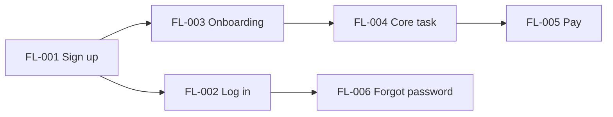
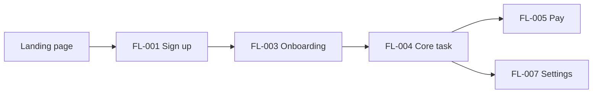
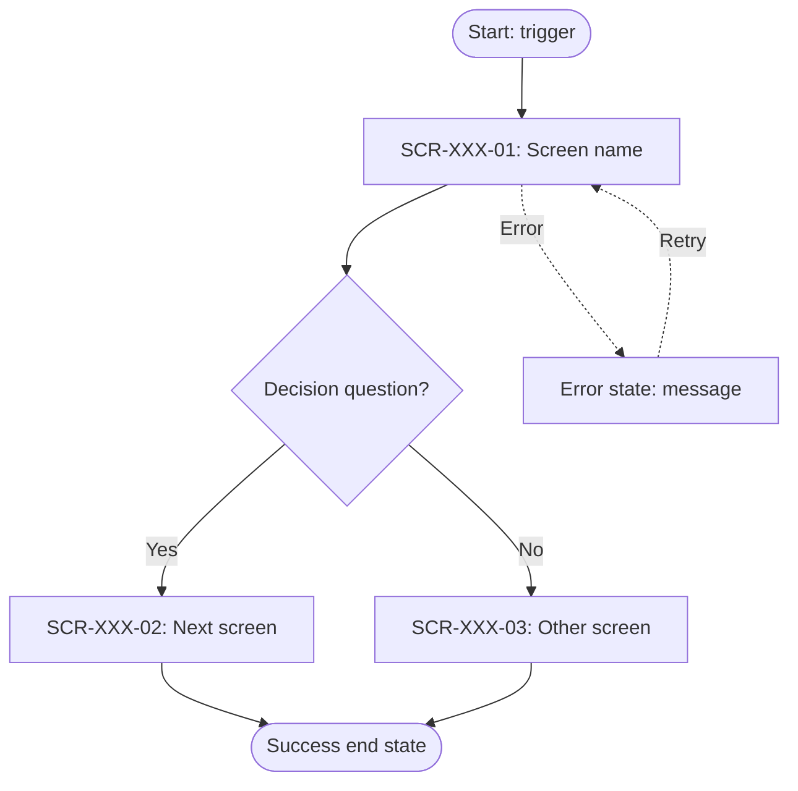
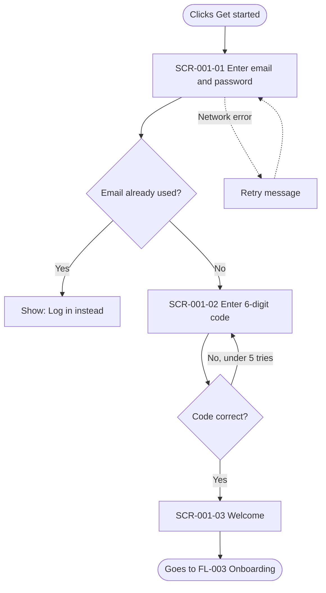

# HOW TO FILL THIS DOCUMENT (READ FIRST)

> **Template: MASTER v1.0.** To start a new project: (1) copy this file, (2) keep the name `UX_Flows.md`, (3) put it in `/UX-UI-Design-System/`, (4) fill Section 0 first. Never edit the master copy for one project; write improvements in Section 16 and update the master later.

> **File location:** `/UX-UI-Design-System/UX_Flows.md`
> **Purpose:** This file is the single source of truth for *how a person moves through your product*, from the first click to becoming one of your first 500 customers. Humans and AI agents (such as Claude Code) read it to build, test and launch the product **without guessing**.

## The 6 golden rules

1. **Fill every `[PLACEHOLDER]`.** Replace the text inside the square brackets. Delete the brackets when you're done.
2. **Never leave a blank.** If you don't know yet, write `TBD – owner: [name] – due: [date]`. If it does not apply, write `N/A – [reason in 5 words]`.
3. **Write short sentences.** One idea per line. If a 10-year-old can't understand it, rewrite it.
4. **Use real examples.** Not "user enters data" but "user types their email, e.g. `sam@example.com`".
5. **Name things once, use the same name everywhere.** If you call it "Dashboard" here, never call it "Home" later. Add new names to the Glossary (Section 17).
6. **Do not delete sections.** Mark unused ones `N/A`. This keeps all 100s of projects identical and easy to compare.

## How to use it (5 steps)

| Step | What to do | Sections |
|---|---|---|
| 1 | Describe your product and who it is for | 0–3 |
| 2 | List every flow, rank them, and draw what depends on what | 0.2, 4 |
| 3 | Set the shared rules (navigation, states, content, language) | 5, 8–11, 21 |
| 4 | Look at the worked example (Section 22), then copy the **Flow Block** in Section 6 once per flow and fill it | 22, 6 |
| 5 | List every message you send and every money flow | 19, 20 |
| 6 | Plan your back office and what to do when things break | 23, 24 |
| 7 | Plan launch to the first 500 customers, update the scorecard weekly, run the final checklist | 0.1, 7, 12–16, 18 |

> **Short on time?** Do Steps 1, 2 and 4 for your P0 flows only. Mark everything else `TBD`. That is enough for an AI agent to start building the first flow.

## Status labels (use only these)

| Label | Meaning |
|---|---|
| `DRAFT` | Still being written |
| `REVIEW` | Ready for someone else to check |
| `APPROVED` | Safe for the AI agent to build |
| `BUILT` | Coded and merged |
| `TESTED` | Passed QA |
| `LIVE` | Real customers use it |

## Priority labels

`P0` = product is useless without it · `P1` = needed for launch · `P2` = nice to have after launch

## Who does what (RACI-lite)

`Owner` = writes it · `Approver` = says yes · `Builder` = human or AI that codes it · `Tester` = checks it works.

> **Working alone?** You can write your own name in every role. To keep things honest, wait at least one night between writing a flow (`Owner`) and approving it (`Approver`), and re-read it with fresh eyes. Let a friend or an AI agent play `Tester` and list anything that confused them.

---

# 0. DOCUMENT CONTROL

| Field | Value |
|---|---|
| Product name | `[PRODUCT NAME]` |
| Project code | `[SHORT-CODE, e.g. PRJ-001]` |
| Document version | `[0.1]` (this template: **MASTER v1.0**; when you copy it to a new project, reset your own version to 0.1) |
| Status | `[DRAFT / REVIEW / APPROVED]` |
| Owner | `[NAME]` |
| Approver | `[NAME]` |
| Last updated | `[YYYY-MM-DD]` |
| Next review date | `[YYYY-MM-DD]` |
| Related files | `[PRD.md, Design_System.md, UI_Screens.md, API_Spec.md, Analytics_Plan.md]` |
| Design tool link | `[Figma / other URL]` |
| Code repository | `[URL]` |

### 0.1 Progress scorecard (update weekly, takes 2 minutes)

> **How to fill:** Count your flows in Section 4. Write how many are in each status. Percent = (BUILT + TESTED + LIVE) ÷ total flows × 100.

| Status | Number of flows | Percent of all flows |
|---|---|---|
| `DRAFT` | `[ ]` | `[ ]%` |
| `REVIEW` | `[ ]` | `[ ]%` |
| `APPROVED` | `[ ]` | `[ ]%` |
| `BUILT` | `[ ]` | `[ ]%` |
| `TESTED` | `[ ]` | `[ ]%` |
| `LIVE` | `[ ]` | `[ ]%` |
| **Total flows** | `[ ]` | 100% |

| Health check | Answer |
|---|---|
| Overall health | `[GREEN = on track / YELLOW = at risk / RED = blocked]` |
| Biggest blocker this week | `[ ]` |
| What I will finish next week | `[ ]` |
| Open questions in Section 15 | `[number]` |
| Customers so far (Section 7 ladder) | `[number / 500]` |

### 0.2 Dependency map (which flow must be finished before another)

> **How to fill:** Draw an arrow from the flow that must come FIRST to the flow that needs it. Build in arrow order, left to right. Flows with no arrows pointing at them can be built any time.



| Flow ID | Needs these flows first | Needs these services first (email, payments, database) | Can start? |
|---|---|---|---|
| FL-001 | `[None]` | `[Database, email sender]` | `[Yes/No]` |
| FL-003 | `[FL-001]` | `[ ]` | `[Yes/No]` |

---

# 1. PRODUCT SNAPSHOT

**One-sentence description** (fill the blanks):
`[PRODUCT NAME]` helps `[WHO]` to `[DO WHAT]` so they can `[GET WHAT BENEFIT]`.

| Question | Your answer |
|---|---|
| Product type (tick all) | `[ ] Web app  [ ] SaaS  [ ] Mobile app (iOS)  [ ] Mobile app (Android)  [ ] Marketplace / e-commerce  [ ] Other: ____` |
| Business model | `[Free / Subscription / One-time purchase / Commission / Ads]` |
| The ONE problem we solve | `[1 sentence]` |
| The ONE action that proves a customer got value (the "aha moment") | `[e.g. "sends first invoice"]` |
| Supported devices & screen sizes | `[e.g. Desktop 1280px+, Tablet 768px, Phone 375px]` |
| Supported browsers / OS versions | `[e.g. Chrome, Safari, Edge latest 2; iOS 16+; Android 12+]` |
| Languages at launch | `[e.g. English only]` |
| Countries / regions at launch | `[e.g. USA, UK]` |
| Launch date target | `[YYYY-MM-DD]` |
| Goal | `[Reach 500 active customers by YYYY-MM-DD]` |

---

# 2. USERS & PERSONAS

> Add one block per persona. Keep to 1–4 personas. For marketplaces, include BOTH sides (e.g. buyer and seller).

### Persona `[A]`: `[Name, e.g. "Busy Bella"]`

| Field | Answer |
|---|---|
| Role / job | `[ ]` |
| Age range & tech skill | `[ ] Beginner  [ ] Average  [ ] Expert` |
| Main goal | `[ ]` |
| Biggest frustration today | `[ ]` |
| Where they will use the product | `[Phone on the bus / Desk at work / ...]` |
| Accessibility needs | `[None known / Screen reader / Large text / Color-blind / Other]` |
| Quote in their own words | `"[ ]"` |

### User roles & permissions

| Role | Can see | Can do | Cannot do |
|---|---|---|---|
| Visitor (not logged in) | `[ ]` | `[ ]` | `[ ]` |
| Registered user | `[ ]` | `[ ]` | `[ ]` |
| `[Seller / Admin / Team member]` | `[ ]` | `[ ]` | `[ ]` |

---

# 3. GOALS & SUCCESS METRICS

| # | Goal (plain words) | How we measure it | Target | Where we look |
|---|---|---|---|---|
| G1 | `[Users finish sign-up]` | `[Sign-up completion %]` | `[≥ 70%]` | `[Analytics tool]` |
| G2 | `[Users reach the aha moment]` | `[% who do the key action in 24h]` | `[≥ 40%]` | `[ ]` |
| G3 | `[Users come back]` | `[Week-1 retention %]` | `[≥ 30%]` | `[ ]` |
| G4 | `[We reach 500 customers]` | `[Total active customers]` | `[500]` | `[ ]` |

**Customer milestone ladder** (used in Section 7):

`0 → 10 → 50 → 100 → 250 → 500` customers

---

# 4. FLOW INVENTORY (THE MASTER LIST)

> List **every** journey a user can take. Give each a unique ID. Each row here MUST have a full Flow Block in Section 6.

| Flow ID | Flow name | Persona | Trigger (what starts it) | End goal | Priority | Lifecycle stage (Sec 7) | Status | Owner |
|---|---|---|---|---|---|---|---|---|
| FL-001 | `[Sign up]` | `[A]` | `[Clicks "Get started"]` | `[Account created & email verified]` | `P0` | `[Build]` | `DRAFT` | `[ ]` |
| FL-002 | `[Log in]` | `[A]` | `[ ]` | `[ ]` | `P0` | `[ ]` | `DRAFT` | `[ ]` |
| FL-003 | `[Onboarding]` | `[A]` | `[ ]` | `[Reaches aha moment]` | `P0` | `[ ]` | `DRAFT` | `[ ]` |
| FL-004 | `[Core task, e.g. Create first project]` | `[A]` | `[ ]` | `[ ]` | `P0` | `[ ]` | `DRAFT` | `[ ]` |
| FL-005 | `[Pay / Subscribe / Checkout]` | `[A]` | `[ ]` | `[ ]` | `P1` | `[ ]` | `DRAFT` | `[ ]` |
| FL-006 | `[Forgot password]` | `[A]` | `[ ]` | `[ ]` | `P1` | `[ ]` | `DRAFT` | `[ ]` |
| FL-007 | `[Settings & profile]` | `[A]` | `[ ]` | `[ ]` | `P1` | `[ ]` | `DRAFT` | `[ ]` |
| FL-008 | `[Contact support / Give feedback]` | `[A]` | `[ ]` | `[ ]` | `P1` | `[ ]` | `DRAFT` | `[ ]` |
| FL-009 | `[Cancel / Delete account / Export data]` | `[A]` | `[ ]` | `[ ]` | `P1` | `[ ]` | `DRAFT` | `[ ]` |
| FL-0XX | `[Add more rows]` | | | | | | | |

### Standard flows checklist (tick or mark N/A)

`[ ] Sign up  [ ] Log in  [ ] Log out  [ ] Forgot/reset password  [ ] Email/phone verification  [ ] Onboarding  [ ] Core task  [ ] Search & filter  [ ] Notifications  [ ] Payment / checkout  [ ] Refund / cancel  [ ] Profile & settings  [ ] Invite a teammate  [ ] Help & support  [ ] Feedback  [ ] Delete account  [ ] Empty state first visit  [ ] Offline / no internet  [ ] Error 404 / 500  [ ] Admin tasks  [ ] Marketplace: list an item  [ ] Marketplace: buy an item  [ ] Marketplace: message other party  [ ] Marketplace: dispute / review`

### Flow map (how flows connect)



---

# 5. GLOBAL UX RULES (APPLY TO EVERY FLOW)

### 5.1 Navigation

| Item | Rule |
|---|---|
| Main navigation type | `[Top bar / Side bar / Bottom tabs]` |
| Items in main navigation (in order) | `[1. Home  2. ...  max 5]` |
| Where is the user's profile/menu? | `[Top right]` |
| Back-button behavior | `[Goes to previous screen; never loses typed data]` |
| Breadcrumbs used? | `[Yes / No]` |
| Deep links supported? | `[Yes / No, and list]` |

### 5.2 Screen naming & URL / route convention

| Item | Rule |
|---|---|
| Screen ID format | `SCR-[FlowNumber]-[ScreenNumber]`, e.g. `SCR-001-02` |
| Route / URL format | `[/sign-up, /dashboard, /items/:id]` |
| Name casing | `[Title Case for screens, kebab-case for URLs]` |

### 5.3 Required states (EVERY screen must define all of these)

| State | What the user sees | Required? |
|---|---|---|
| Default | Normal screen with data | Yes |
| Loading | `[Skeleton / spinner, shown after 300ms]` | Yes |
| Empty | `[Friendly message + one button to fix it]` | Yes |
| Error | `[What went wrong + how to fix + Retry button]` | Yes |
| Success | `[Confirmation, auto-hides after 4s]` | Yes |
| Offline | `[Banner: "You're offline. Changes will sync."]` | `[Yes/No]` |
| Disabled | `[Greyed button + reason on hover]` | Yes |
| Permission denied | `[Message + who to contact]` | Yes |

### 5.4 Performance & timing promises

| Item | Rule |
|---|---|
| Page/screen load target | `[< 2 seconds]` |
| Show loading indicator after | `[300 ms]` |
| Give up and show error after | `[10 seconds]` |
| Max steps for sign-up | `[3]` |
| Max taps/clicks to reach the core task | `[3]` |

### 5.5 Form rules

`[ ] Ask only what you need  [ ] Show errors next to the field  [ ] Validate on blur, not on every keystroke  [ ] Never clear the form on error  [ ] Mark optional (not required) fields  [ ] Autofocus first field  [ ] Show/hide password toggle  [ ] Support autofill`

### 5.6 Confirmation rules (when to ask "Are you sure?")

| Action | Ask first? | Wording |
|---|---|---|
| Delete anything | Yes | `["Delete [item]? This can't be undone."]` |
| Leave screen with unsaved work | Yes | `[ ]` |
| Pay money | Yes (show total) | `[ ]` |
| Log out | No | |

### 5.7 Platform behavior

| Topic | Web | iOS | Android |
|---|---|---|---|
| Navigation pattern | `[ ]` | `[Tab bar]` | `[Bottom nav]` |
| Back gesture | `[Browser back]` | `[Swipe from left edge]` | `[System back]` |
| Push notifications | `N/A` | `[Ask permission AFTER aha moment]` | `[Same]` |
| Pull to refresh | `N/A` | `[Yes/No]` | `[Yes/No]` |
| Minimum tap target | `[44×44 px]` | `[44×44 pt]` | `[48×48 dp]` |

---

# 6. FLOW BLOCKS (COPY THIS WHOLE BLOCK ONCE PER FLOW)

> **How to fill:** Duplicate everything from `## FLOW FL-XXX` to `END FLOW`. Change the ID and fill every field. Do one flow at a time. Finish the **happy path** first, then add problems.

## FLOW FL-XXX: `[Flow name]`

### A. Summary

| Field | Answer |
|---|---|
| Flow ID | `FL-XXX` |
| Priority | `[P0/P1/P2]` |
| Status | `[DRAFT]` |
| Persona | `[A]` |
| User's goal (in their words) | `"I want to [ ]"` |
| Business goal | `[Link to Goal G1/G2/...]` |
| Trigger (what starts this flow) | `[Clicks X on screen Y / Receives email / ...]` |
| Entry points (all places it can start) | `[ ]` |
| Preconditions (must be true before) | `[User is logged out / Has items in cart]` |
| Success end state | `[What is true when finished]` |
| Exit points (where the user goes next) | `[Screen / flow]` |
| Estimated time for the user | `[e.g. 45 seconds]` |
| Devices | `[ ] Web  [ ] iOS  [ ] Android` |
| Related screens | `[SCR-XXX-01, SCR-XXX-02]` |
| Related API endpoints / services | `[POST /api/..., or N/A]` |

### B. Diagram (Mermaid)



### C. Step table (happy path = everything goes right)

| Step | Screen ID | User does | System does | User sees | Data created/changed | Next step |
|---|---|---|---|---|---|---|
| 1 | `SCR-XXX-01` | `[Types email]` | `[Checks format live]` | `[Green tick]` | `[None]` | 2 |
| 2 | `SCR-XXX-01` | `[Clicks "Continue"]` | `[Saves draft, sends code]` | `[Code screen]` | `[user record created]` | 3 |
| 3 | `[ ]` | `[ ]` | `[ ]` | `[ ]` | `[ ]` | `[ ]` |

### D. Screen details (one row per screen in this flow)

| Screen ID | Screen name | Purpose (1 sentence) | Main button (primary action) | Other actions | Fields / content | Figma frame link (1 per screen) |
|---|---|---|---|---|---|---|
| `SCR-XXX-01` | `[ ]` | `[ ]` | `["Continue"]` | `[Back, Cancel]` | `[Email (required, text)]` | `[https://figma.com/... (paste the frame link)]` |

**Component map** (which design-system parts each screen uses; never build a new part if one exists):

| Screen ID | Component | Variant / props | Design tokens (use names, never raw values) |
|---|---|---|---|
| `SCR-XXX-01` | `[TextField]` | `[type=email, state=default/error/disabled]` | `[color.text.primary, space.4, radius.md]` |
| `SCR-XXX-01` | `[Button]` | `[variant=primary, size=lg, state=loading]` | `[color.brand.500, font.button]` |
| `SCR-XXX-01` | `[Toast]` | `[type=error]` | `[color.danger.600]` |

> If a needed component does not exist, write `MISSING: [name]` here and add a question to Section 15. The agent must not invent one.

### E. Field & validation rules (for every input)

| Field | Type | Required? | Rules | Error message (exact words) | Example |
|---|---|---|---|---|---|
| `[Email]` | `[email]` | `Yes` | `[Valid email, max 254 chars]` | `["Please enter a valid email, like name@example.com"]` | `sam@example.com` |
| `[Password]` | `[password]` | `Yes` | `[Min 8 chars, 1 number]` | `["Use at least 8 characters and 1 number"]` | `Sunny2026!` |

### F. Unhappy paths (what can go wrong, and what we do)

| # | What goes wrong | Where | What the user sees (exact words) | What the user can do | What the system does |
|---|---|---|---|---|---|
| E1 | `[Internet drops]` | `[Step 2]` | `["Connection lost. Try again."]` | `[Retry]` | `[Keeps typed data]` |
| E2 | `[Email already used]` | `[Step 2]` | `["That email already has an account. Log in?"]` | `[Go to Log in]` | `[No new record]` |
| E3 | `[Server error 500]` | `[Any]` | `["Something went wrong on our side."]` | `[Retry / Contact support]` | `[Logs error + alerts team]` |
| E4 | `[Session expired]` | `[Any]` | `[ ]` | `[ ]` | `[ ]` |
| E5 | `[User quits halfway]` | `[Any]` | `[ ]` | `[Resume later]` | `[Saves progress / sends reminder after 24h]` |

### G. Edge cases to check

`[ ] Very long text  [ ] Special characters/emoji  [ ] Double-click / double-submit  [ ] Slow network  [ ] Back button mid-flow  [ ] Refresh mid-flow  [ ] Two tabs open  [ ] User with no permission  [ ] Empty data  [ ] Huge amounts of data  [ ] Different time zone / currency / language  [ ] Screen rotated (mobile)  [ ] App sent to background (mobile)`

### H. Content (microcopy)

| Where | Exact text |
|---|---|
| Page title | `[ ]` |
| Button labels | `[ ]` |
| Helper text | `[ ]` |
| Success message | `[ ]` |
| Email/SMS sent (subject + 1-line preview) | `[ ]` |

### I. Analytics events (what we track)

| Event name | When it fires | Properties | Used for goal |
|---|---|---|---|
| `[flow_xxx_started]` | `[Step 1 shown]` | `[source, device]` | `[G1]` |
| `[flow_xxx_step_completed]` | `[Each step done]` | `[step_number]` | `[G1]` |
| `[flow_xxx_completed]` | `[Success state]` | `[duration_seconds]` | `[G1]` |
| `[flow_xxx_failed]` | `[Any error]` | `[error_code, step]` | `[G1]` |

> **Privacy rule:** never put passwords, card numbers, or full personal data in event properties.

### J. Accessibility checks for this flow

`[ ] Can finish using keyboard only  [ ] Screen reader reads each step in order  [ ] Focus moves to the new screen/error  [ ] Color contrast ≥ 4.5:1  [ ] Works at 200% zoom  [ ] Errors not shown by color alone  [ ] Buttons have text labels`

### K. Acceptance criteria (the flow is DONE when…)

Write each as: **Given** [start], **When** [action], **Then** [result].

| ID | Given | When | Then | Test type |
|---|---|---|---|---|
| AC-XXX-1 | `[A new visitor on the sign-up page]` | `[Enters a valid email and password and clicks Continue]` | `[Sees the "Check your email" screen within 2s]` | `[Manual / Automated]` |
| AC-XXX-2 | `[ ]` | `[ ]` | `[ ]` | `[ ]` |

### L. Instructions for the AI agent (this flow)

| Item | Answer |
|---|---|
| Files the agent may create or edit | `[src/features/xxx/*]` |
| Files the agent must NOT touch | `[auth core, payment core, .env]` |
| Design system components to reuse | `[Button, TextField, Toast]` |
| Must ask a human before | `[Changing the database, adding a paid service]` |
| Definition of done | `[All acceptance criteria pass + tests green + states in 5.3 built]` |

### M. Screenshot checklist (proof it matches the design)

> Save screenshots in `[/docs/screenshots/FL-XXX/]` and name them `SCR-XXX-01_default_desktop.png`. Compare each to its Figma frame.

| Screen ID | Default | Loading | Empty | Error | Success | Mobile (375px) | Desktop (1280px) | Matches Figma? |
|---|---|---|---|---|---|---|---|---|
| `SCR-XXX-01` | `[ ]` | `[ ]` | `[ ]` | `[ ]` | `[ ]` | `[ ]` | `[ ]` | `[Yes/No + notes]` |

**END FLOW FL-XXX**

---

# 7. LIFECYCLE ROADMAP: BUILD → LAUNCH → FIRST 500 CUSTOMERS

> Fill one row per stage. This tells everyone *when* each flow matters and *how we know* we can move on.

| Stage | Customers | Goal | Flows in focus | Who uses it | Exit gate (all must be YES to move on) | Target date | Status |
|---|---|---|---|---|---|---|---|
| 1. Design & prototype | 0 | `[Flows agreed]` | `[All P0]` | `[Team]` | `[ ] Sections 0–6 APPROVED  [ ] Clickable prototype tested with 5 people` | `[ ]` | `[ ]` |
| 2. AI-assisted build | 0 | `[Working product]` | `[P0 flows]` | `[Team]` | `[ ] All P0 acceptance criteria pass  [ ] No critical bugs` | `[ ]` | `[ ]` |
| 3. Internal test (alpha) | 0–10 | `[Find big problems]` | `[All P0 + P1]` | `[Team, friends]` | `[ ] 10 testers finish the core task  [ ] Section 13 checks done` | `[ ]` | `[ ]` |
| 4. Private beta | 10–50 | `[Prove value]` | `[Onboarding, Core task, Feedback]` | `[Invited users]` | `[ ] ≥ [40]% reach aha moment  [ ] Top 5 issues fixed` | `[ ]` | `[ ]` |
| 5. Public launch | 50–100 | `[Open the doors]` | `[All P0 + P1]` | `[Anyone]` | `[ ] Section 18 launch checklist all ticked` | `[ ]` | `[ ]` |
| 6. Early growth | 100–250 | `[Reduce drop-off]` | `[Onboarding, Pay, Support]` | `[ ]` | `[ ] Week-1 retention ≥ [30]%  [ ] Support replies < [24h]` | `[ ]` | `[ ]` |
| 7. First 500 | 250–500 | `[Hit 500 active customers]` | `[All]` | `[ ]` | `[ ] 500 active customers  [ ] Retrospective done (Sec 16)` | `[ ]` | `[ ]` |

### 7.1 Onboarding & activation plan (first 500 customers)

| Question | Answer |
|---|---|
| What is the very first screen after sign-up? | `[ ]` |
| What is the first thing we ask them to do? | `[ ]` |
| How many steps until the aha moment? | `[Max 5]` |
| Is there a guided tour / checklist? | `[Yes/No, describe]` |
| What does a new user see with NO data? (empty state) | `[ ]` |
| Welcome email: when + subject line | `[Immediately: "Welcome to ___"]` |
| Nudge if they stall: when + how | `[After 24h email; after 3 days push]` |
| How do they invite others / refer a friend? | `[ ]` |
| How do we ask for a review/testimonial? When? | `[After 3rd success, not before]` |

### 7.2 Feedback loop (how we learn from the first 500)

| Channel | Where it lives in the UI | Who reads it | How often | What we do with it |
|---|---|---|---|---|
| In-app feedback button | `[ ]` | `[ ]` | `[Daily]` | `[Tag, rank, add to backlog]` |
| Short survey after aha moment (1 question) | `[ ]` | `[ ]` | `[Weekly]` | `[ ]` |
| Support inbox / chat | `[ ]` | `[ ]` | `[Daily]` | `[ ]` |
| Customer interviews | `[Off-product]` | `[ ]` | `[5 per week]` | `[ ]` |
| Analytics funnels | `[Tool]` | `[ ]` | `[Weekly]` | `[ ]` |

### 7.3 Funnel to watch (fill the real numbers each week)

| Funnel step | Event | Week 1 | Week 2 | Week 3 | Week 4 | Target |
|---|---|---|---|---|---|---|
| Visited | `[page_view]` | | | | | |
| Started sign-up | `[flow_001_started]` | | | | | |
| Finished sign-up | `[flow_001_completed]` | | | | | |
| Reached aha moment | `[ ]` | | | | | |
| Came back in 7 days | `[ ]` | | | | | |
| Paid (if applicable) | `[ ]` | | | | | |

---

# 8. PRODUCT-TYPE ADD-ONS (FILL ONLY WHAT APPLIES; MARK OTHERS `N/A`)

### 8.1 Web app / SaaS

| Topic | Answer |
|---|---|
| Workspace / team / organization model | `[Single user / Teams / Orgs]` |
| Invite teammate flow | `[Flow ID]` |
| Billing & plan upgrade/downgrade flow | `[Flow ID]` |
| Trial rules (length, what happens at end) | `[ ]` |
| Roles & permission screens | `[ ]` |
| Data import / export | `[ ]` |
| Integrations (Slack, Google, etc.) | `[ ]` |

### 8.2 Mobile app

| Topic | Answer |
|---|---|
| Permissions asked (camera, location, notifications) + WHEN + WHY text | `[ ]` |
| Offline behavior | `[ ]` |
| App update prompt | `[ ]` |
| Deep links / share sheet | `[ ]` |
| App store rating prompt: when | `[After aha moment, max once per 90 days]` |
| Biometric login (Face ID / fingerprint) | `[Yes/No]` |

### 8.3 Marketplace / e-commerce

| Topic | Answer |
|---|---|
| Buyer flow IDs (browse → search → item → cart → pay → receipt) | `[ ]` |
| Seller flow IDs (sign up → verify → list item → get paid) | `[ ]` |
| Messaging between buyer and seller | `[ ]` |
| Reviews & ratings rules | `[ ]` |
| Payment methods | `[ ]` |
| Shipping / delivery tracking | `[ ]` |
| Refund / return / dispute flow | `[Flow ID]` |
| Trust & safety (report, block, fake listing) | `[ ]` |
| Cold-start plan (how we get the first sellers/buyers) | `[ ]` |

---

# 9. CONTENT & TONE GUIDE

| Item | Rule |
|---|---|
| Voice (pick 3 words) | `[Friendly, clear, calm]` |
| Reading level | `[Age 10–12: short words, short sentences]` |
| Words we use | `["Sign in" not "Authenticate"]` |
| Words we avoid | `[Jargon, blame ("You failed"), all caps]` |
| Error message formula | `[What happened + why (if known) + how to fix]` |
| Button label formula | `[Verb + noun: "Save changes"]` |
| Date / time / currency format | `[ ]` |

---

# 10. ACCESSIBILITY & INCLUSION (WHOLE PRODUCT)

| Requirement | Standard | Status |
|---|---|---|
| Target standard | `[WCAG 2.2 AA]` | `[ ]` |
| Keyboard navigation everywhere | Required | `[ ]` |
| Screen reader labels | Required | `[ ]` |
| Color contrast | ≥ 4.5:1 text, ≥ 3:1 large text/UI | `[ ]` |
| Respect "reduce motion" setting | Required | `[ ]` |
| Text can resize to 200% | Required | `[ ]` |
| Captions for video / transcripts for audio | `[Yes/N/A]` | `[ ]` |
| Plain-language check | Required | `[ ]` |

---

# 11. TRUST, SAFETY & PRIVACY IN THE UX

| Topic | Answer |
|---|---|
| Data we collect (list) | `[ ]` |
| Why we need each item | `[ ]` |
| Consent screens / cookie banner | `[ ]` |
| Terms & Privacy link locations | `[Sign-up screen, footer]` |
| How a user deletes their data | `[Flow ID]` |
| How a user exports their data | `[Flow ID]` |
| Sensitive actions needing re-login or 2-step check | `[Change email, delete account, pay]` |
| Rate limits shown to user | `[ ]` |
| Abuse / spam reporting | `[ ]` |
| Children under 13 allowed? | `[Yes/No, and what we do]` |

---

# 12. ANALYTICS PLAN (SUMMARY)

| Item | Answer |
|---|---|
| Analytics tools | `[ ]` |
| Naming rule for events | `[snake_case: object_action, e.g. invoice_sent]` |
| Who can see the dashboards | `[ ]` |
| Weekly review meeting day/time | `[ ]` |
| Alert when funnel drops by | `[20%]` |
| Link to full plan | `[Analytics_Plan.md]` |

---

# 13. QA & TEST PLAN FOR FLOWS

| Test type | What it proves | Who runs it | When | Pass rule |
|---|---|---|---|---|
| Walkthrough by author | Diagram matches the real screens | `[Owner]` | `[Before REVIEW]` | `[0 mismatches]` |
| Automated end-to-end test per P0 flow | Happy path works | `[AI agent / QA]` | `[Every code change]` | `[All green]` |
| Unhappy-path test (Section 6F) | Errors are handled | `[QA]` | `[Before alpha]` | `[All E# pass]` |
| Usability test, 5 real people | People can finish without help | `[Owner]` | `[Stage 1 and 4]` | `[≥ 4 of 5 finish]` |
| Accessibility scan + manual check | Section 10 met | `[QA]` | `[Before launch]` | `[0 critical]` |
| Device/browser matrix | Works on Section 1 list | `[QA]` | `[Before launch]` | `[ ]` |
| Load / speed check | Section 5.4 met | `[Engineer]` | `[Before launch]` | `[ ]` |

### Bug severity

| Level | Meaning | Fix by |
|---|---|---|
| S1 Critical | User blocked, money or data at risk | `[Same day]` |
| S2 High | Core flow broken, workaround exists | `[3 days]` |
| S3 Medium | Annoying | `[Next release]` |
| S4 Low | Cosmetic | `[Backlog]` |

---

# 14. AI-AGENT WORKING RULES (WHOLE PROJECT)

> These rules tell an AI agent (e.g. Claude Code) how to use this file. A human reviews every result.

| Rule | Value |
|---|---|
| Read order before coding | `1) Section 0–3  2) Section 5  3) The one Flow Block being built  4) Design system file` |
| Build one flow at a time | `Yes` |
| Autonomy level | `STRICT: build only what is written. On any gap, STOP, write the question in Section 15, and wait for a human answer. Never guess.` |
| Approval before merge | `A human approves every flow (status REVIEW → APPROVED → BUILT). The agent never sets APPROVED or LIVE itself.` |
| Scope limit | `One flow per task. Do not "improve" other flows, rename things, or refactor unrelated code.` |
| Token-saving read order | `Read only Sections 0, 5, 14, the one Flow Block being built, and Section 19 rows with that Flow ID. Do not read the whole file.` |
| Stop-and-ask triggers | `Missing field rule, missing error text, missing state, unclear permission, any money/auth/privacy change, any conflict between two sections.` |
| Report back format | `After each task: (1) what was built, (2) files changed, (3) acceptance criteria passed/failed, (4) questions left, (5) screenshots per 6M.` |
| Never invent screens, fields, copy or rules not in this file | `Yes. If missing, ask or add to Section 15.` |
| Reuse components from the design system | `Yes` |
| Every screen needs all states from 5.3 | `Yes` |
| Write tests from Acceptance Criteria (6K) | `Yes` |
| Update this file when the product changes | `Yes, same pull request` |
| Mark flow status after each stage (BUILT / TESTED) | `Yes` |
| Human approval needed for | `[Payments, auth, data deletion, new dependencies, legal text]` |
| Branch & commit naming | `[feat/FL-001-signup]` |

### Prompt to give your AI agent (copy-paste)

```text
Read UX_Flows.md. Build flow FL-[XXX] only. Follow Sections 5 and 14 and the FL-[XXX] Flow Block.
Do not invent anything that is not written there. If something is missing, list the questions first.
Build all states, write tests from the Acceptance Criteria, then summarize what you changed.
```

---

# 15. OPEN QUESTIONS & DECISIONS LOG

| ID | Question / decision needed | Options | Owner | Due | Decision | Date decided |
|---|---|---|---|---|---|---|
| Q-001 | `[ ]` | `[A / B]` | `[ ]` | `[ ]` | `[ ]` | `[ ]` |

---

# 16. RISKS & LAUNCH RETROSPECTIVE

### Risks

| Risk | Chance (L/M/H) | Impact (L/M/H) | What we do about it | Owner |
|---|---|---|---|---|
| `[Users drop off at sign-up]` | `[ ]` | `[ ]` | `[Shorten form, add social login]` | `[ ]` |

### Retrospective after the first 500 customers

| Question | Answer |
|---|---|
| Which flow worked best? | `[ ]` |
| Which flow lost the most people? | `[ ]` |
| Top 3 things customers loved | `[ ]` |
| Top 3 things customers hated | `[ ]` |
| What we will change in the next version of this template | `[ ]` |

---

# 17. GLOSSARY

| Word | Meaning in this project |
|---|---|
| Flow | A path a user takes to finish one goal |
| Screen | One full view the user sees |
| State | How a screen looks at one moment (loading, empty, error…) |
| Happy path | Everything goes right |
| Unhappy path | Something goes wrong |
| Aha moment | The first time the user feels the product's value |
| Persona | A made-up but realistic user |
| Acceptance criteria | A test sentence that proves a flow is done |
| `[Your word]` | `[ ]` |

---

# 18. FINAL CHECKLISTS

### 18.1 Before the AI agent starts building (flow is `APPROVED`)

`[ ] Every screen has a Figma link and component map  [ ] No MISSING components  [ ] No [PLACEHOLDER] left  [ ] Every flow in Section 4 has a Flow Block  [ ] Every screen has all states (5.3)  [ ] Every field has validation + error text  [ ] Unhappy paths listed  [ ] Acceptance criteria written  [ ] Analytics events named  [ ] Accessibility checked  [ ] Approver signed off`

### 18.2 Before public launch (Stage 5)

`[ ] All P0 and P1 flows are TESTED  [ ] Admin flows AD-001, AD-004, AD-008 work  [ ] Outage, fraud, privacy and rollback plans (Sec 24) written and a restore was tested  [ ] Screenshots match Figma (6M)  [ ] No open S1 or S2 bugs  [ ] Sign-up → aha moment works on every supported device  [ ] Payment tested with real small amount  [ ] Emails/SMS arrive and aren't spam  [ ] Analytics events arrive in the dashboard  [ ] Privacy, Terms, cookie banner live  [ ] Support channel monitored  [ ] Feedback button works  [ ] Backup & rollback plan ready  [ ] Error alerts reach the team  [ ] Launch announcement ready`

### 18.3 Before declaring "First 500 reached"

`[ ] 500 active customers (definition: [ ])  [ ] Funnel numbers recorded (7.3)  [ ] Retrospective filled (16)  [ ] This file updated to match the real product  [ ] Template improvements noted`

### Sign-off

| Role | Name | Date | Signature / OK |
|---|---|---|---|
| Owner | `[ ]` | `[ ]` | `[ ]` |
| Approver | `[ ]` | `[ ]` | `[ ]` |
| QA | `[ ]` | `[ ]` | `[ ]` |

---

# 19. NOTIFICATIONS MATRIX (EVERY EMAIL, SMS, PUSH AND IN-APP MESSAGE)

> **How to fill:** One row per message your product ever sends. If it is not listed here, the AI agent must NOT send it.

| ID | Trigger (what makes it send) | Channel | Who gets it | When (delay) | Subject / title | Message (exact words, max 2 lines) | Button & link | Can user turn it off? | Flow ID |
|---|---|---|---|---|---|---|---|---|---|
| N-001 | `[Account created]` | `[Email]` | `[New user]` | `[Instantly]` | `["Welcome to ___"]` | `[ ]` | `["Start now" → /onboarding]` | `[No (needed)]` | `FL-001` |
| N-002 | `[Email not verified after 24h]` | `[Email]` | `[ ]` | `[24h]` | `[ ]` | `[ ]` | `[ ]` | `[Yes]` | `FL-001` |
| N-003 | `[Stuck in onboarding 3 days]` | `[Push]` | `[ ]` | `[72h]` | `[ ]` | `[ ]` | `[ ]` | `[Yes]` | `FL-003` |
| N-004 | `[Payment failed]` | `[Email + in-app]` | `[ ]` | `[Instantly]` | `[ ]` | `[ ]` | `[ ]` | `[No (needed)]` | `FL-005` |
| N-005 | `[Password reset asked]` | `[Email]` | `[ ]` | `[Instantly]` | `[ ]` | `[ ]` | `[ ]` | `[No (needed)]` | `FL-006` |

| Notification rule | Answer |
|---|---|
| Max marketing messages per user per week | `[2]` |
| Quiet hours (no push) | `[22:00–08:00 user's time]` |
| Sender name & address | `[ ]` |
| Unsubscribe link in every marketing email | `Required` |
| Fallback if email bounces | `[Show banner in app asking to fix email]` |
| Ask push permission when | `[After aha moment, never on first open]` |

---

# 20. PRICING, PAYWALL & BILLING FLOWS

> **How to fill:** Write "N/A: free product" in the first row if you do not charge. Otherwise fill every row. Money flows need extra care, so mark each `Human approval required`.

| Topic | Answer |
|---|---|
| Plans (name, price, billing period, what's included) | `[Free: $0 / Pro: $__/month / ...]` |
| Currency & tax handling | `[ ]` |
| Payment provider | `[ ]` |
| Free trial: length, card needed?, reminder before it ends | `[14 days, no card, email on day 12]` |
| What the user sees on the paywall (exact words) | `[ ]` |
| Where paywall appears (which screens/actions) | `[ ]` |
| What happens when the trial ends | `[Downgrade to Free; data kept 30 days]` |

### Billing flows to define (each needs a full Flow Block in Section 6)

| Flow | Flow ID | Special rules |
|---|---|---|
| Start trial | `[FL-___]` | `[ ]` |
| Upgrade plan | `[FL-___]` | `[Takes effect immediately; prorate]` |
| Downgrade plan | `[FL-___]` | `[Takes effect next billing date]` |
| Payment fails (retry schedule + messages) | `[FL-___]` | `[Retry day 1, 3, 5; then pause account]` |
| Update card | `[FL-___]` | `[ ]` |
| Cancel subscription (ask why, offer pause) | `[FL-___]` | `[Cancel must be as easy as sign-up]` |
| Refund request | `[FL-___]` | `[Window: __ days]` |
| Receipts & invoices | `[FL-___]` | `[Emailed + downloadable]` |
| Coupon / discount code | `[FL-___]` | `[ ]` |

---

# 21. LANGUAGE & REGION (LOCALIZATION)

> **How to fill:** If you only support one language and region at launch, fill the first table and write `N/A: later` in the rest.

| Topic | Answer |
|---|---|
| Launch languages | `[English]` |
| Languages planned later | `[ ]` |
| Default language rule | `[Browser/phone language, else English]` |
| Can user switch language? Where? | `[Settings → Language]` |
| Writing direction (left-to-right / right-to-left) | `[LTR]` |
| Date format | `[MM/DD/YYYY or follows device]` |
| Time zone handling | `[Store in UTC, show in user's time zone]` |
| Currency display | `[ ]` |
| Number format | `[1,234.56 or follows device]` |
| Text that must NEVER be hard-coded (use translation keys) | `[All user-visible text]` |
| Room for longer text (e.g. German is ~30% longer) | `[Buttons grow, never cut text off]` |
| Names & addresses: do not assume "first/last name" or one address format | `[Use one "Full name" field]` |
| Who translates and checks quality | `[ ]` |
| Legal text per country (Terms, Privacy) | `[ ]` |

---

# 22. WORKED EXAMPLE (A FULLY FILLED FLOW, COPY THE STYLE)

> This is a finished example for a made-up product called **"TaskNest"** (a to-do app). Your flow should look this detailed. **Delete this section from your real project if you want, but keep it in the master template.**

## FLOW FL-001: Sign up with email

### A. Summary

| Field | Answer |
|---|---|
| Flow ID | `FL-001` |
| Priority | `P0` |
| Status | `APPROVED` |
| Persona | `Busy Bella (parent with 2 kids, beginner)` |
| User's goal | `"I want to start using TaskNest quickly."` |
| Business goal | `G1: sign-up completion ≥ 70%` |
| Trigger | `Clicks "Get started" on the landing page` |
| Entry points | `Landing page button, pricing page button, invite link` |
| Preconditions | `User has no account and is not logged in` |
| Success end state | `Account exists, email verified, user is on the Welcome screen` |
| Exit points | `FL-003 Onboarding` |
| Time for the user | `About 60 seconds` |
| Devices | `Web, iOS, Android` |
| Related screens | `SCR-001-01, SCR-001-02, SCR-001-03` |
| Related API | `POST /api/signup, POST /api/verify-code` |

### B. Diagram



### C. Step table

| Step | Screen ID | User does | System does | User sees | Data changed | Next |
|---|---|---|---|---|---|---|
| 1 | `SCR-001-01` | Types email `bella@example.com` | Checks format as she leaves the field | Green tick next to email | None | 2 |
| 2 | `SCR-001-01` | Types password `Sunny2026!` | Checks length and number | "Strong password" label | None | 3 |
| 3 | `SCR-001-01` | Clicks "Create account" | Creates unverified account, emails 6-digit code | Button shows spinner, then code screen | `users` row (status = unverified) | 4 |
| 4 | `SCR-001-02` | Types the code | Compares with stored code | Spinner for under 1s | None | 5 |
| 5 | `SCR-001-03` | Reads welcome, clicks "Let's go" | Sets status = verified, starts session | Welcome screen with her name | `users.status = verified` | FL-003 |

### D. Screen details

| Screen ID | Name | Purpose | Main button | Other actions | Fields | Design |
|---|---|---|---|---|---|---|
| `SCR-001-01` | Create account | Collect email and password | "Create account" | "Log in" link, Back to landing | Email, Password | `[Figma URL]` |
| `SCR-001-02` | Check your email | Confirm email is real | "Verify" | "Resend code" (after 30s), "Change email" | 6-digit code | `[Figma URL]` |
| `SCR-001-03` | Welcome | Celebrate and move on | "Let's go" | None | None | `[Figma URL]` |

### E. Fields

| Field | Type | Required | Rules | Error message | Example |
|---|---|---|---|---|---|
| Email | email | Yes | Valid format, max 254 characters | "Please enter a valid email, like name@example.com" | `bella@example.com` |
| Password | password | Yes | Min 8 characters, at least 1 number | "Use at least 8 characters and 1 number" | `Sunny2026!` |
| Code | 6 digits | Yes | Exactly 6 numbers, expires in 10 min | "That code isn't right. Try again." | `483920` |

### F. Unhappy paths

| # | What goes wrong | Where | User sees | User can | System does |
|---|---|---|---|---|---|
| E1 | Internet drops | Step 3 | "Connection lost. Try again." | Click Retry | Keeps typed email; clears password field only |
| E2 | Email already used | Step 3 | "That email already has an account. Log in?" | Click "Log in" | Creates nothing |
| E3 | Wrong code 5 times | Step 4 | "Too many tries. Get a new code." | Click "Resend code" | Locks old code for 15 min |
| E4 | Code expired | Step 4 | "That code expired. We sent a new one." | Enter new code | Sends new code automatically |
| E5 | Closes tab at Step 4 | Step 4 | On return: "Finish signing up" screen | Resume | Account stays unverified; reminder N-002 after 24h |
| E6 | Server error | Any | "Something went wrong on our side. Try again in a minute." | Retry or contact support | Logs error and alerts founder |

### K. Acceptance criteria

| ID | Given | When | Then | Test |
|---|---|---|---|---|
| AC-001-1 | A visitor on SCR-001-01 | Enters a valid new email and password and clicks "Create account" | The code screen appears within 2 seconds and an email arrives within 60 seconds | Automated |
| AC-001-2 | A visitor with an already-used email | Clicks "Create account" | Sees the E2 message and no new account is created | Automated |
| AC-001-3 | A user on SCR-001-02 | Enters the correct code | Lands on SCR-001-03 and `users.status` is `verified` | Automated |
| AC-001-4 | A keyboard-only user | Tabs through the form | Every field and button is reachable and focus is visible | Manual |

*(Sections G–J and L are filled the same way as in Section 6; skipped here to save space.)*

**END EXAMPLE**

---

# 23. ADMIN & SUPPORT FLOWS (BACK OFFICE FOR RUNNING YOUR FIRST 500 CUSTOMERS)

> **How to fill:** These are the screens only YOU (or your team) see. Each row below needs its own Flow Block in Section 6 (use IDs like `AD-001`). Write `N/A` only if you will do it by hand in the database, and say so.

| Admin flow | ID | Who can use it | What it must do | Safety rule | Priority |
|---|---|---|---|---|---|
| Find a user (search by email, name, ID) | `AD-001` | `[Admin, Support]` | `[Show profile, plan, status, last login]` | `[Hide passwords, card data]` | `P0` |
| See a user's history (actions, payments, messages) | `AD-002` | `[ ]` | `[Timeline, newest first]` | `[Read-only]` | `P1` |
| View as user ("impersonate") | `AD-003` | `[Admin only]` | `[See what the user sees]` | `[Banner always shown; read-only; logged; needs user consent or ticket number]` | `P1` |
| Refund a payment | `AD-004` | `[Admin only]` | `[Full or partial refund + reason]` | `[Asks "Are you sure?"; logs who/when/why; email to user]` | `P0` |
| Fix an account by hand (unlock, change email, reset 2-step) | `AD-005` | `[ ]` | `[ ]` | `[Verify identity first; log every change]` | `P1` |
| Moderation queue (reports, flagged content) | `AD-006` | `[Moderator]` | `[Review → Keep / Remove / Warn / Ban]` | `[User can appeal; decision reason saved]` | `P1` |
| Appeals | `AD-007` | `[ ]` | `[ ]` | `[Second person reviews if possible]` | `P2` |
| Metrics dashboard | `AD-008` | `[Owner]` | `[Daily: signups, activation %, revenue, errors, open tickets]` | `[No personal data on the dashboard]` | `P0` |
| Support inbox / ticket view | `AD-009` | `[ ]` | `[Reply, tag, close, link to user]` | `[Reply templates; response target __ hours]` | `P1` |
| Send a message to users (announcement) | `AD-010` | `[Admin]` | `[Pick audience, preview, schedule]` | `[Test send first; honors unsubscribe]` | `P2` |

| Admin rule | Answer |
|---|---|
| How admins log in | `[2-step login required]` |
| Roles (Admin / Support / Moderator / Read-only) and what each can do | `[ ]` |
| Audit log: what is recorded | `[Who, what, which user, when, reason]` |
| Audit log kept for | `[ ]` |
| Daily 5-minute founder check (what to look at) | `[Errors, failed payments, new tickets, abuse queue]` |

---

# 24. FAILURE & INCIDENT FLOWS (WHEN THINGS GO WRONG IN THE REAL WORLD)

> **How to fill:** For each scenario, decide NOW what users see and what you do. Calm people with a plan fix problems faster. Each row needs a Flow Block (IDs like `IN-001`) or a short runbook link.

### 24.1 Outage & maintenance

| Item | Answer |
|---|---|
| How we find out we are down | `[Uptime monitor alerts phone/email]` |
| Status page link | `[URL]` |
| What users see when we are down (exact words) | `["We're fixing something. Your data is safe. Back soon. Status: [link]"]` |
| Planned maintenance notice: how early, which channel | `[48h, banner + email]` |
| Read-only mode allowed? | `[Yes/No]` |
| Who fixes it & escalation order | `[ ]` |
| After fixing: tell users? write a post-mortem? | `[Yes, within 3 days]` |
| Flow ID | `[IN-001]` |

### 24.2 Fraud & abuse

| Scenario | How we notice | What the user sees | What we do | Flow ID |
|---|---|---|---|---|
| Fake or spam sign-ups | `[Many sign-ups from one source]` | `[Extra check (captcha/code)]` | `[Block source, delete accounts]` | `[IN-002]` |
| Account takeover (someone else logs in) | `[Login from new place + user report]` | `["Check your account" email]` | `[Force password reset, end all sessions]` | `[IN-003]` |
| Stolen card / chargeback | `[Payment provider alert]` | `[ ]` | `[Freeze order, collect proof, respond by deadline]` | `[IN-004]` |
| Spam or harmful content | `[Reports + automatic checks]` | `[Content hidden, user told why]` | `[Moderation queue AD-006]` | `[IN-005]` |
| Marketplace fake listing / scam | `[ ]` | `[ ]` | `[ ]` | `[IN-006]` |

### 24.3 Privacy requests (GDPR / CCPA and similar)

| Request | Where the user asks | Prove who they are | We must finish within | What we deliver | Flow ID |
|---|---|---|---|---|---|
| Access / download my data | `[Settings → Privacy]` | `[Re-login + email confirm]` | `[30 days or less. Check your local law]` | `[ZIP/JSON file by secure link]` | `[IN-007]` |
| Delete my data | `[Settings → Delete account]` | `[Same]` | `[30 days or less. Check your local law]` | `[Confirmation email; list of anything legally kept]` | `[IN-008]` |
| Fix wrong data | `[Profile]` | `[ ]` | `[ ]` | `[ ]` | `[IN-009]` |
| Stop marketing / opt out of sale or sharing | `[Settings, email footer]` | `[ ]` | `[Immediately]` | `[ ]` | `[IN-010]` |
| Request by email instead of the app | `[privacy@yourdomain]` | `[ ]` | `[ ]` | `[Same as above; log it]` | `[IN-011]` |

> I am not a lawyer. Confirm deadlines and duties for your countries with a qualified professional before launch.

### 24.4 Data loss & rollback

| Item | Answer |
|---|---|
| Backup schedule & where stored | `[Daily, different region]` |
| Last time we TESTED a restore | `[YYYY-MM-DD]` |
| Maximum data we can afford to lose | `[e.g. 24 hours]` |
| Maximum time to be back online | `[e.g. 4 hours]` |
| How we roll back a bad release | `[One command / one button; who is allowed]` |
| Who we tell if user data is lost or leaked | `[Users, authorities if required, payment provider]` |
| What we tell users (exact words) | `["On [date] we lost/exposed [what]. Here is what we did and what you should do: ..."]` |
| Flow ID | `[IN-012]` |

---

# 25. CHANGE LOG

| Version | Date | Who | What changed | Why |
|---|---|---|---|---|
| 0.1 | `[YYYY-MM-DD]` | `[ ]` | `[First draft]` | `[ ]` |
| 0.2 | `[YYYY-MM-DD]` | `[ ]` | `[Added scorecard, dependency map, notifications, pricing, localization, worked example]` | `[Review round 1]` |
| 0.3 | `[YYYY-MM-DD]` | `[ ]` | `[Strict AI rules, component map, screenshot checklist, admin flows, incident flows]` | `[Review round 2]` |
| 1.0 (master) | 2026-10-17 | Template author | Approved as the master template | Final review |
