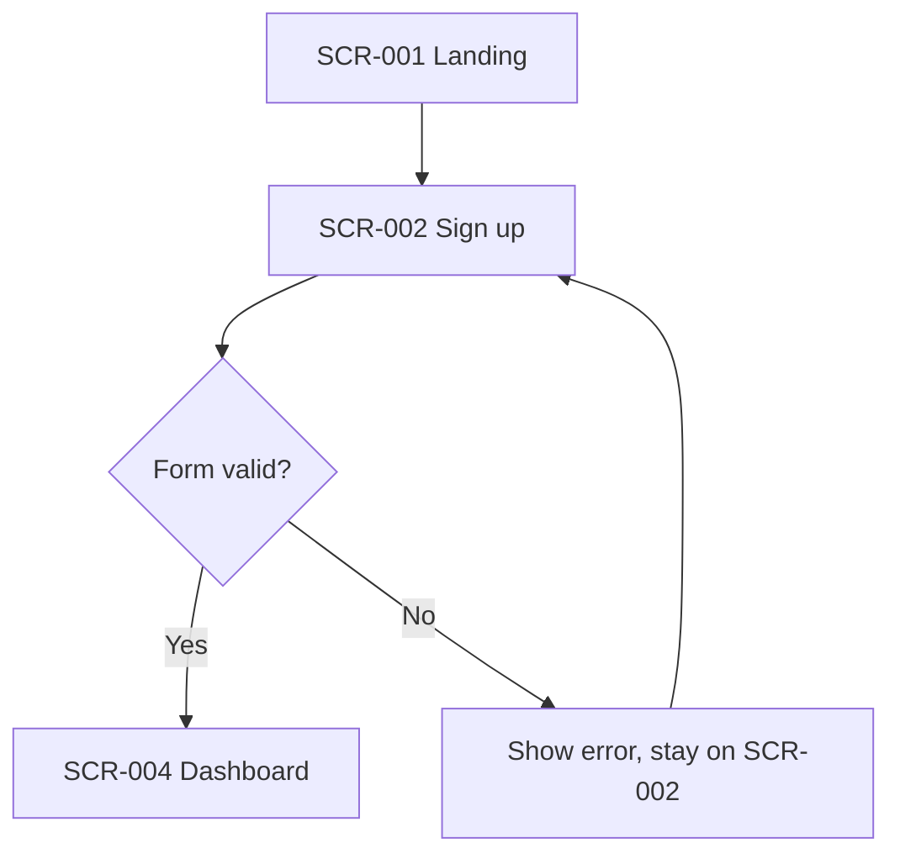

# HOW TO FILL THIS DOCUMENT (READ THIS FIRST)

> **File location:** `/ux-ui-design-system/Wireframes.md`
> **Template version:** 1.1 | **Covers:** Web apps / SaaS, Mobile apps, Marketing / landing sites, plus optional modules for Dashboards, E-commerce checkout and AI chat
> **Lifecycle covered:** Discovery -> Design sign-off -> Build & QA -> Launch -> First 500 customers

## What is a wireframe?
A wireframe is a **simple black-and-white sketch of a screen**. It shows WHERE things go (buttons, text, pictures), not colors or fancy looks. Think of it as a floor plan for a house before you pick paint.

## Why does this file exist?
So that **any person or AI agent** can read one file and know exactly what every screen looks like and does, with **no guessing**.

## The 8 simple rules
1. **Fill every `[BRACKET]`.** Replace the text inside `[ ]` with your answer. Delete the hint after it if you like.
2. **Never leave a blank.** If something does not apply, write `N/A - [one-line reason]`. If you do not know yet, write `TBD - owner: [name] - due: [date]`.
3. **Use plain words.** Short sentences. No secret abbreviations. If you must use a special word, explain it in the Glossary (Section 14).
4. **One idea per line.** Do not squeeze three facts into one sentence.
5. **Be specific.** Write "Button says 'Save changes'", not "a button".
6. **Use numbers.** Write "up to 50 characters", not "short".
7. **Copy the Screen Template (Section 8) once per screen.** Do not skip the sad cases (empty, loading, error).
8. **Update the Change Log (Section 15)** every time you edit this file.

## Status words (use ONLY these)
| Word | Meaning |
|---|---|
| `Draft` | Still being written |
| `In Review` | Others are checking it |
| `Approved` | Signed off, safe to build |
| `Built` | Developers finished it |
| `Live` | Customers are using it |
| `Changed` | Updated after launch (see Change Log) |

## How to draw a wireframe in text (ASCII cheat sheet)
Draw inside a code block. Use these pieces:

```
+----------------------+   a box / a screen edge
| Text                 |   normal text
| [ Button ]           |   a button
| [____________]       |   a text input box
| [x] Checked  [ ] No  |   checkboxes
| (o) Chosen   ( ) No  |   radio buttons
| [v Dropdown       ]  |   a dropdown
| {Image}              |   a picture
| ---                  |   a divider line
| < Back      Menu >   |   navigation
+----------------------+
```

## For AI agents reading this file
- Treat this file as the **single source of truth** for UI layout and behavior.
- If this file and any other document disagree, **stop and ask the human owner**. Do not guess.
- Build only screens with status `Approved`.
- Every screen has an ID (like `SCR-001`). Reference that ID in code, tests, and commit messages.
- Never invent a component, text, or behavior that is not written here. Write `QUESTION:` in the Open Questions section (Section 13) instead.

## Quick fill order (do it in this order)
Section 1 -> 2 -> 3 -> 4 -> 5 -> 6 -> 7 -> 8 (once per screen; peek at 8A for a finished example) -> 8B (only modules you need) -> 8C (privacy, cookies, age) -> 9 -> 10 -> 11 -> 12 -> 13 -> 14 -> 15 -> 16

---

# 1. Document Control

| Field | Your answer |
|---|---|
| Project name | [Name of the product] |
| Project ID | [Short code, e.g. PRJ-001] |
| Document owner | [Name and email of ONE person] |
| Designer | [Name] |
| Product owner | [Name] |
| Lead developer | [Name] |
| QA lead | [Name] |
| Document status | [Draft / In Review / Approved / Built / Live / Changed] |
| Version | [e.g. 0.1] |
| Created on | [YYYY-MM-DD] |
| Last updated | [YYYY-MM-DD] |
| Next review date | [YYYY-MM-DD] |

## Related documents (links)
| Document | Link or path |
|---|---|
| Product requirements (PRD) | [link] |
| User research / personas | [link] |
| Design system / style guide | [link] |
| Component library | [link] |
| Figma / design file (master) | [link] |
| Technical spec | [link] |
| Test plan | [link] |
| Analytics plan | [link] |

---

# 2. Product Summary (in plain words)

| Question | Your answer |
|---|---|
| What is the product? (1 sentence) | [e.g. "An app that helps dog owners book walkers."] |
| Who is it for? (1 sentence) | [e.g. "Busy dog owners in cities."] |
| What problem does it solve? (1 sentence) | [ ] |
| Product type (pick all) | [ ] Web app / SaaS  [ ] Mobile app  [ ] Marketing / landing site |
| Platforms | [ ] Desktop browser  [ ] Mobile browser  [ ] iOS  [ ] Android  [ ] Tablet |
| Main goal of this version | [e.g. "Let a new user sign up and book a first walk."] |
| What is NOT in this version? | [List things you are deliberately leaving out] |

---

# 3. Goals and Success Measures

## 3.1 Customer-journey target
Our target: **the first 500 customers actively using the product.**

| Milestone | Definition of "done" | Target date |
|---|---|---|
| Design approved | [All screens marked Approved] | [date] |
| Build complete | [All screens marked Built and QA passed] | [date] |
| Beta launch | [e.g. 20 invited users] | [date] |
| Public launch | [Anyone can sign up] | [date] |
| Customer #100 | [100 users who completed the Key Action] | [date] |
| Customer #500 | [500 users who completed the Key Action] | [date] |

**Key Action** (the one thing that proves a customer is "using" the product): [e.g. "Booked at least one walk"]

## 3.2 Success numbers for the screens
| Measure | How we count it | Target |
|---|---|---|
| Sign-up completion rate | [people who finish sign-up / people who start] | [e.g. 60%] |
| Time to first Key Action | [minutes from sign-up to Key Action] | [e.g. under 5 min] |
| Drop-off on worst screen | [which screen, what %] | [e.g. under 20%] |
| Task success in usability test | [people who finish the task / people tested] | [e.g. 80%] |
| Support questions per 100 users | [count] | [e.g. under 10] |

---

# 4. Users and Situations

## 4.1 Who uses it
| Persona name | Short description | Skill with tech (Low/Med/High) | Main device | Top goal |
|---|---|---|---|---|
| [Name] | [1 line] | [ ] | [ ] | [ ] |
| [Name] | [1 line] | [ ] | [ ] | [ ] |

## 4.2 User roles and what each can see
| Role | Can do | Cannot do |
|---|---|---|
| [Visitor (not logged in)] | [ ] | [ ] |
| [Member] | [ ] | [ ] |
| [Admin] | [ ] | [ ] |

## 4.3 Special needs to design for (tick all that apply)
- [ ] Screen readers (blind or low-vision users)
- [ ] Keyboard-only use
- [ ] Color blindness
- [ ] Slow internet
- [ ] One-handed phone use
- [ ] Users who do not speak English (languages: [list])
- [ ] Other: [ ]

---

# 5. Screen Inventory (the master list)

> List EVERY screen here first. Each row gets a full entry in Section 8.
> ID format: `SCR-001`, `SCR-002`, and so on. Never reuse an ID.

| ID | Screen name | Platform | Who sees it | Priority (Must / Should / Could) | Status | Figma link |
|---|---|---|---|---|---|---|
| SCR-001 | [Welcome / Landing] | [Web+Mobile] | [Visitor] | [Must] | [Draft] | [link] |
| SCR-002 | [Sign up] | [ ] | [ ] | [Must] | [Draft] | [link] |
| SCR-003 | [Log in] | [ ] | [ ] | [Must] | [Draft] | [link] |
| SCR-004 | [Home / Dashboard] | [ ] | [ ] | [Must] | [Draft] | [link] |
| SCR-005 | [ ] | [ ] | [ ] | [ ] | [ ] | [ ] |

**Total screens:** [number]
**Must-have screens:** [number]

---

# 6. User Flows (how people move between screens)

> Draw each flow with arrows. One flow per main task.

## 6.1 Flow list
| Flow ID | Flow name | Starts at | Ends at | Screens in order |
|---|---|---|---|---|
| FLW-001 | [New user sign-up] | [SCR-001] | [SCR-004] | [SCR-001 -> SCR-002 -> SCR-004] |
| FLW-002 | [ ] | [ ] | [ ] | [ ] |

## 6.2 Flow drawings
Copy this block for each flow.

**FLW-001: [Flow name]**


---

# 7. Navigation and Layout Rules (apply to ALL screens)

## 7.1 Navigation map
```
[Top bar / Bottom tab bar - draw yours here]
+--------------------------------------------+
| Logo      Home   [Menu item]  [Menu item] Me|
+--------------------------------------------+
```

| Item | Your answer |
|---|---|
| Main navigation type | [Top bar / Side menu / Bottom tabs / Hamburger menu] |
| Menu items in order | [1. ___  2. ___  3. ___] |
| Where does "Back" go? | [Previous screen / Parent screen] |
| Is there a search? Where? | [Yes/No - location] |
| Footer content (web) | [Links list] |

## 7.2 Screen sizes (breakpoints)
| Device | Width | Layout notes |
|---|---|---|
| Small phone | [360 px] | [1 column] |
| Large phone | [430 px] | [1 column] |
| Tablet | [768 px] | [ ] |
| Laptop | [1280 px] | [ ] |
| Large monitor | [1920 px] | [ ] |

## 7.3 Shared rules
| Rule | Your answer |
|---|---|
| Spacing grid | [e.g. 8 px] |
| Page max width | [e.g. 1200 px] |
| Smallest tap target (mobile) | [44 x 44 px minimum recommended] |
| Where do primary buttons sit? | [Bottom right / Full width at bottom] |
| Where do error messages show? | [Under the field in red text] |
| Loading style | [Spinner / Skeleton grey boxes] |

## 7.4 Reusable components (from the design system)
| Component | Name in design system | Used on screens |
|---|---|---|
| Primary button | [ ] | [SCR-002, SCR-003] |
| Text input | [ ] | [ ] |
| Card | [ ] | [ ] |
| Modal / popup | [ ] | [ ] |
| Toast message | [ ] | [ ] |

---

# 8. SCREEN TEMPLATE (COPY THIS BLOCK ONCE FOR EVERY SCREEN)

> Copy from `## SCR-XXX` to the line `--- END OF SCREEN ---`. Paste it below Section 8 and fill every field.

## SCR-001: [Screen name]

### 8.1 Basics
| Field | Your answer |
|---|---|
| Screen ID | SCR-001 |
| Status | [Draft / In Review / Approved / Built / Live / Changed] |
| Platform | [Web / iOS / Android / All] |
| Who sees it | [Role] |
| Web address or app route | [e.g. /signup] |
| Priority | [Must / Should / Could] |
| Figma link | [link] |
| Screen owner | [Name] |

### 8.2 Purpose (ONE sentence)
The user comes to this screen to: [e.g. "create an account."]
After this screen the user should feel/know: [e.g. "that their account is ready."]

### 8.3 How the user gets here and where they go next
| Comes from | Trigger (what they tapped) |
|---|---|
| [SCR-001] | [Taps "Get started"] |

| Goes to | Trigger |
|---|---|
| [SCR-004] | [Taps "Create account" and form is valid] |
| [SCR-001] | [Taps "Back"] |

### 8.4 Wireframe sketch
```
+----------------------------------+
| < Back                           |
|                                  |
|  Create your account             |
|                                  |
|  Email                           |
|  [______________________]        |
|  Password                        |
|  [______________________]        |
|  [x] I agree to the Terms        |
|                                  |
|  [   Create account   ]          |
|                                  |
|  Already have one? Log in        |
+----------------------------------+
```

### 8.5 Layout order (top to bottom)
1. [Back arrow]
2. [Heading]
3. [Email field]
4. [Password field]
5. [Checkbox]
6. [Primary button]
7. [Log in link]

### 8.6 Components on this screen
| # | Component | Exact text / content | Type | Max length | Required? | Notes |
|---|---|---|---|---|---|---|
| 1 | Heading | "Create your account" | Text | 40 | - | - |
| 2 | Email field | Label: "Email" | Input | 254 | Yes | Must contain @ |
| 3 | Password field | Label: "Password" | Input (hidden) | 64 | Yes | Min 8 characters |
| 4 | Primary button | "Create account" | Button | 20 | - | Disabled until form valid |

### 8.7 Actions and what happens
| User does this | System does this | Result on screen |
|---|---|---|
| [Taps "Create account" with valid data] | [Creates account, sends welcome email] | [Goes to SCR-004] |
| [Taps "Create account" with empty email] | [Nothing is sent] | [Error under email field] |
| [Taps "Log in"] | [ ] | [Goes to SCR-003] |

### 8.8 Screen states (do NOT skip any)
| State | What the user sees | Wireframe or text description |
|---|---|---|
| Ideal (normal, filled) | [ ] | [see 8.4] |
| Empty (no data yet) | [ ] | [ ] |
| Loading | [ ] | [e.g. button shows spinner, fields locked] |
| Error (something broke) | [ ] | [e.g. red banner "Something went wrong. Try again."] |
| Offline / slow internet | [ ] | [ ] |
| Success | [ ] | [ ] |
| No permission | [ ] | [ ] |

### 8.9 Error messages (exact words)
| When this happens | Show this text | Where |
|---|---|---|
| [Email empty] | ["Please enter your email."] | [Under email field] |
| [Email already used] | ["That email already has an account. Log in instead."] | [Under email field] |
| [Server down] | ["We could not reach our servers. Please try again."] | [Top banner] |

### 8.10 Responsive behavior
| Device | What changes |
|---|---|
| Phone | [Single column, button full width] |
| Tablet | [ ] |
| Desktop | [Form centered, 400 px wide, picture on right] |

### 8.11 Accessibility
- [ ] Every input has a visible label
- [ ] Reading order matches Layout order (8.5)
- [ ] Text contrast is at least 4.5:1
- [ ] All actions work with keyboard only (Tab, Enter, Esc)
- [ ] Images have alt text: [write it here]
- [ ] Error messages are read out by screen readers
- [ ] Focus goes to: [first field on open]

### 8.12 Analytics events
| Event name | Fires when | Extra data to send |
|---|---|---|
| `signup_screen_viewed` | [Screen opens] | [source] |
| `signup_submitted` | [Taps "Create account"] | [method] |
| `signup_error` | [Validation fails] | [field, error type] |

### 8.13 Data needed
| Data | Where it comes from | When it loads |
|---|---|---|
| [User's email] | [User types it] | [-] |

### 8.14 Acceptance criteria (the screen is DONE when all are true)
- [ ] AC-1: [A user with a valid email and password can create an account in under 60 seconds.]
- [ ] AC-2: [Every error in 8.9 shows the exact text.]
- [ ] AC-3: [All states in 8.8 are built and checked.]
- [ ] AC-4: [Accessibility list in 8.11 passes.]
- [ ] AC-5: [Analytics events in 8.12 appear in the dashboard.]

### 8.15 Notes and open questions
- [Anything not yet decided. Also add it to Section 13.]

--- END OF SCREEN ---

*(Paste the next screen block below: SCR-002, SCR-003, and so on.)*

---

# 8A. WORKED EXAMPLE (A FULLY FILLED SCREEN - COPY THE PATTERN, NOT THE WORDS)

> This is a made-up app called **PawWalk** (book a dog walker). **Delete this whole section (8A) in your real project**, or move it to a separate `Wireframes-Example.md`.

## SCR-002: Sign up

### 8.1 Basics
| Field | Your answer |
|---|---|
| Screen ID | SCR-002 |
| Status | Approved |
| Platform | Web + iOS + Android |
| Who sees it | Visitor (not logged in) |
| Web address or app route | /signup |
| Priority | Must |
| Figma link | https://figma.com/file/example-pawwalk-signup |
| Screen owner | Maya Lopez |

### 8.2 Purpose (ONE sentence)
The user comes to this screen to: create a PawWalk account.
After this screen the user should feel/know: that their account is ready and they can book a walk.

### 8.3 How the user gets here and where they go next
| Comes from | Trigger (what they tapped) |
|---|---|
| SCR-001 Landing | Taps "Get started" |
| SCR-003 Log in | Taps "Create one" |

| Goes to | Trigger |
|---|---|
| SCR-004 Dashboard | Taps "Create account" and form is valid |
| SCR-003 Log in | Taps "Log in" link |
| SCR-001 Landing | Taps "Back" |

### 8.4 Wireframe sketch
```
+----------------------------------+
| < Back                           |
|                                  |
|  Create your account             |
|                                  |
|  Email                           |
|  [______________________]        |
|  Password                        |
|  [______________________] (eye)  |
|  At least 8 characters           |
|                                  |
|  [x] I agree to the Terms        |
|                                  |
|  [    Create account    ]        |
|                                  |
|  Already have an account? Log in |
+----------------------------------+
```

### 8.5 Layout order (top to bottom)
1. Back arrow
2. Heading "Create your account"
3. Email field
4. Password field with show/hide eye icon
5. Help text "At least 8 characters"
6. Terms checkbox
7. Primary button "Create account"
8. Link "Already have an account? Log in"

### 8.6 Components on this screen
| # | Component | Exact text / content | Type | Max length | Required? | Notes |
|---|---|---|---|---|---|---|
| 1 | Heading | "Create your account" | Text | 40 | - | - |
| 2 | Email field | Label: "Email" | Input | 254 | Yes | Must contain @ and a dot after it |
| 3 | Password field | Label: "Password" | Input (hidden) | 64 | Yes | Min 8 characters; eye icon shows/hides |
| 4 | Terms checkbox | "I agree to the Terms" ("Terms" is a link) | Checkbox | - | Yes | Unchecked by default |
| 5 | Primary button | "Create account" | Button | 20 | - | Disabled until 2, 3, 4 are valid |
| 6 | Log in link | "Already have an account? Log in" | Link | - | - | Goes to SCR-003 |

### 8.7 Actions and what happens
| User does this | System does this | Result on screen |
|---|---|---|
| Taps "Create account" with valid data | Creates account, sends welcome email | Goes to SCR-004 |
| Types an email without @ and leaves the field | Nothing is sent | Error under email field |
| Taps the eye icon | Nothing is sent | Password becomes visible; tap again hides it |
| Taps "Terms" | Opens Terms page | Opens in a new tab (web) or in-app sheet (mobile) |

### 8.8 Screen states
| State | What the user sees | Wireframe or text description |
|---|---|---|
| Ideal (normal, filled) | Form with valid data, button enabled | See 8.4 |
| Empty | Empty form, button greyed out | Fields show placeholder "you@example.com" |
| Loading | Button shows spinner and text "Creating..." | All fields locked |
| Error | Red text under the wrong field | Field border turns red |
| Offline / slow internet | Banner at top | "You seem to be offline. Check your connection." |
| Success | Brief green check, then SCR-004 opens | Lasts 1 second |
| No permission | N/A - this screen is for visitors only | Logged-in users are sent to SCR-004 |

### 8.9 Error messages (exact words)
| When this happens | Show this text | Where |
|---|---|---|
| Email empty | "Please enter your email." | Under email field |
| Email wrong format | "That email doesn't look right. Try name@example.com." | Under email field |
| Email already used | "That email already has an account. Log in instead." | Under email field |
| Password too short | "Use at least 8 characters." | Under password field |
| Terms not ticked | "Please agree to the Terms to continue." | Under checkbox |
| Server down | "We could not reach our servers. Please try again." | Top banner |

### 8.10 Responsive behavior
| Device | What changes |
|---|---|
| Phone | Single column; button is full width and sticks above the keyboard |
| Tablet | Form centered, 480 px wide |
| Desktop | Form centered, 400 px wide; dog photo on the right half |

### 8.11 Accessibility
- [x] Every input has a visible label
- [x] Reading order matches Layout order (8.5)
- [x] Text contrast is at least 4.5:1
- [x] All actions work with keyboard only (Tab, Enter, Esc)
- [x] Images have alt text: "A happy dog on a leash" (desktop photo)
- [x] Error messages are read out by screen readers
- [x] Focus goes to: Email field when the screen opens

### 8.12 Analytics events
| Event name | Fires when | Extra data to send |
|---|---|---|
| `signup_screen_viewed` | Screen opens | source (landing, ad, referral) |
| `signup_submitted` | Taps "Create account" | none |
| `signup_succeeded` | Account created | time_on_screen_seconds |
| `signup_error` | Validation or server fails | field, error_type |

### 8.13 Data needed
| Data | Where it comes from | When it loads |
|---|---|---|
| Email and password | User types them | Not applicable |
| Terms page link | Config file | On screen open |

### 8.14 Acceptance criteria
- [x] AC-1: A user with a valid email and password can create an account in under 60 seconds.
- [x] AC-2: Every error in 8.9 shows the exact text.
- [x] AC-3: All states in 8.8 are built and checked.
- [x] AC-4: The accessibility list in 8.11 passes.
- [x] AC-5: All four analytics events in 8.12 appear in the dashboard.

### 8.15 Notes and open questions
- Social sign-in (Google, Apple) is NOT in version 1. See Q4 in Section 13.

--- END OF SCREEN ---

---

# 8B. EXTRA SCREEN MODULES (USE ONLY THE ONES YOUR PRODUCT NEEDS)

> If a module does not apply, write `N/A - [reason]` at the top of it. Fill these IN ADDITION to the normal Screen Template (Section 8) for the same screen.

## 8B.1 Dashboard and Charts Module

| Field | Your answer |
|---|---|
| Screen ID | [SCR-XXX] |
| Question this dashboard answers | [e.g. "How many walks were booked this week?"] |
| Who reads it and how often | [Role - daily / weekly] |
| Date range choices | [Today / 7 days / 30 days / Custom] |
| Default date range | [Last 7 days] |
| Filters available | [e.g. city, walker, status] |
| Data refresh | [Live / every 5 min / daily] |
| Export options | [CSV / PDF / None] |

### Chart list
| # | Chart name | Chart type (line / bar / pie / table / number card) | What X shows | What Y shows | Data source | Colors meaning | Empty-data message |
|---|---|---|---|---|---|---|---|
| 1 | [Walks per day] | [Line] | [Date] | [Count] | [API / table name] | [Blue = completed] | ["No walks yet. Book one to see data here."] |

### Chart rules
- [ ] Every chart has a title and a one-line description
- [ ] Axes have labels and units
- [ ] Colors are not the ONLY way to tell things apart (add labels or patterns)
- [ ] Hover or tap shows exact numbers
- [ ] A table version of each chart is available for screen readers
- [ ] Loading state: [grey placeholder boxes]
- [ ] Error state: ["We could not load this chart. Try again."]
- [ ] Very large numbers shown as: [e.g. 1.2K, 3.4M]

## 8B.2 E-commerce Checkout Module

| Field | Your answer |
|---|---|
| Screens in the checkout path (in order) | [Cart -> Shipping -> Payment -> Review -> Confirmation] |
| Guest checkout allowed? | [Yes / No] |
| Payment methods | [Card / PayPal / Apple Pay / Google Pay / Other] |
| Payment provider | [e.g. Stripe] |
| Currencies | [List] |
| Taxes shown | [When and how] |
| Shipping options shown | [List with price and time] |
| Promo code box | [Yes / No - where] |

### Checkout screens
| Screen ID | Step name | Fields the user fills | Primary button text | What can go wrong |
|---|---|---|---|---|
| [SCR-XXX] | [Cart] | [Quantity] | ["Checkout"] | [Item out of stock] |
| [SCR-XXX] | [Shipping] | [Name, address, phone] | ["Continue to payment"] | [Address not found] |
| [SCR-XXX] | [Payment] | [Card details via provider's secure fields] | ["Pay now"] | [Card declined] |
| [SCR-XXX] | [Review] | [None] | ["Place order"] | [Price changed] |
| [SCR-XXX] | [Confirmation] | [None] | ["Track my order"] | [Page refreshed] |

### Checkout error and edge-case messages (exact words)
| Case | Show this text |
|---|---|
| Card declined | ["Your card was declined. Try another card."] |
| Item out of stock | ["Sorry, [item] just sold out. We removed it from your cart."] |
| Price changed | ["The price changed. Please review your order."] |
| Payment timeout | ["Payment is taking longer than usual. Do not pay again. We will email you."] |
| Double-click on "Place order" | [Button locks after first tap so the user is never charged twice] |

### Checkout rules
- [ ] Order summary visible on every step
- [ ] Progress indicator shows "Step X of Y"
- [ ] Card numbers are NEVER typed into our own fields (use the provider's secure fields)
- [ ] Confirmation screen shows order number, items, total, and delivery date
- [ ] Confirmation email text is written in Section 9 or linked: [link]

## 8B.3 AI Chat Interface Module

| Field | Your answer |
|---|---|
| Screen ID | [SCR-XXX] |
| What the AI helps with (1 sentence) | [ ] |
| What the AI must NOT do | [e.g. give medical advice] |
| Opening message | ["Hi! I can help with [topic]. What do you need?"] |
| Suggested starter prompts (up to 4) | [1. ___ 2. ___ 3. ___ 4. ___] |
| Max length of a user message | [e.g. 4,000 characters] |
| Can users attach files? | [Yes / No - types and max size] |
| History kept for | [This session / 30 days / Forever] |

### Chat wireframe
```
+----------------------------------+
| Assistant name        [New chat] |
|----------------------------------|
|  AI: Hi! I can help with...      |
|                                  |
|            You: How do I...  [U] |
|                                  |
|  AI: Here is how... (typing...)  |
|  [Copy] [Good] [Bad] [Retry]     |
|----------------------------------|
|  [Type your message...   ] [Send]|
|  AI can make mistakes. Check     |
|  important info.                 |
+----------------------------------+
```

### Chat states (do NOT skip any)
| State | What the user sees |
|---|---|
| Empty (new chat) | [Opening message + starter prompts] |
| AI is thinking | [Animated dots, "Thinking..."] |
| AI is streaming a reply | [Text appears word by word; Stop button replaces Send] |
| AI finished | [Copy, Good, Bad, Retry buttons appear] |
| AI error | ["Something went wrong. [Retry]"] |
| Rate limit reached | ["You've reached today's limit. Try again at [time]."] |
| Message blocked by safety rules | ["I can't help with that. Here's what I can do: ..."] |
| Offline | [Message saved, "Waiting for connection..."] |
| Very long reply | [Scrolls; "Jump to latest" button appears] |

### Chat rules
- [ ] Stop button works at any time during a reply
- [ ] User can edit and resend their last message
- [ ] Feedback buttons (Good/Bad) send an analytics event: [event name]
- [ ] A visible note tells users the AI can make mistakes
- [ ] The user can clear or delete their chat history: [where]
- [ ] Links, code, lists, and tables in replies display correctly
- [ ] New replies are announced to screen readers

---

# 8C. PRIVACY, CONSENT AND AGE RULES

> Fill the parts that apply. Delete a part and write `N/A - [reason]` if it does not. **This is a planning checklist, not legal advice. Have a lawyer or privacy expert review it before launch.**

## 8C.1 Personal data on each screen (privacy and data: GDPR / CCPA)
| Screen ID | Personal data collected | Why we need it | Stored where | Kept for how long | Shared with |
|---|---|---|---|---|---|
| [SCR-002] | [Email, password] | [To create the account] | [Database name] | [Until account deleted] | [Email service provider] |

| Question | Your answer |
|---|---|
| Where do users read the Privacy Policy? | [Link and screens that show it] |
| Where can users see their data? | [Screen ID] |
| Where can users download their data? | [Screen ID] |
| Where can users delete their account and data? | [Screen ID] |
| Where can users change marketing email choices? | [Screen ID] |
| Regions we serve | [e.g. EU, UK, US-California, Global] |
| Who is our privacy contact? | [Name and email] |

## 8C.2 Cookie and consent banners
| Field | Your answer |
|---|---|
| Does the product use cookies or trackers? | [Yes / No] |
| Which kinds | [Necessary / Analytics / Advertising] |
| Banner appears on | [First visit, all pages] |
| Banner wording | ["We use cookies to ..."] |
| Choices offered | [Accept all / Reject non-essential / Choose settings] |
| "Reject" is as easy as "Accept"? | [Yes - required in many regions] |
| Where can users change their choice later? | [Footer link "Cookie settings"] |
| Tools wait for consent before loading? | [Yes / No - list tools] |

Banner sketch:
```
+--------------------------------------------------+
| We use cookies to make this site work and to     |
| understand how it is used.                       |
| [Accept all]  [Reject non-essential]  [Settings] |
+--------------------------------------------------+
```

## 8C.3 Age limits and kids' rules
| Field | Your answer |
|---|---|
| Minimum age to use the product | [e.g. 13 / 16 / 18] |
| Are children expected to use it? | [Yes / No] |
| How do we check age? | [Birth year field / Checkbox / Parent confirmation / None] |
| Age-gate wording | ["Please enter your birth year."] |
| Message shown if user is too young | ["Sorry, you need to be [age] or older to use [product]."] |
| Parent/guardian consent needed? | [Yes / No - where it is asked] |
| Extra data limits for minors | [e.g. no ads, no tracking] |
| Where in the flow is age asked? | [Screen ID] |

---

# 9. Content and Copy Rules

| Rule | Your answer |
|---|---|
| Tone of voice | [Friendly / Professional / Playful] |
| Reading level | [e.g. a 12-year-old can understand it] |
| Button text style | [Verb first: "Save", "Send"] |
| Capitalization | [Sentence case] |
| Date format | [e.g. 17 Oct 2026] |
| Time format | [12-hour / 24-hour] |
| Currency format | [e.g. $1,234.50] |
| Languages supported | [List] |
| Who approves copy changes? | [Name] |

---

# 10. AI-Agent Build Instructions

> Use this section to give an AI coding agent clear, safe orders.

## 10.1 Build order
| Step | Screens | Why this order |
|---|---|---|
| 1 | [Shared components from Section 7.4] | [Everything uses them] |
| 2 | [SCR-001 to SCR-003] | [Entry path] |
| 3 | [SCR-004 and others] | [Core features] |

## 10.2 Copy-paste prompt for an AI agent
```
You are building screen [SCR-XXX] from Wireframes.md.
1. Read Section 7 (shared rules) and the full SCR-XXX block in Section 8.
2. Use ONLY components listed in Section 7.4.
3. Build every state listed in 8.8 and every error text in 8.9.
4. Add the analytics events in 8.12.
5. Do not add features, text, or colors that are not written in this file.
6. If anything is unclear, STOP and add a QUESTION to Section 13 instead of guessing.
7. When done, tick the checklist in 8.14 and report which items pass or fail.
```

## 10.3 Rules the AI agent must follow
- [ ] Build only screens marked `Approved`.
- [ ] Never change this file without a human approving it.
- [ ] Mention the screen ID in every commit message (e.g. `feat(SCR-002): sign-up form`).
- [ ] Write tests from the Acceptance Criteria.
- [ ] Ask a human before deleting or renaming any screen.

---

# 11. Review and Sign-off

## 11.1 Design review checklist (do before marking `Approved`)
- [ ] Every screen in Section 5 has a full Section 8 entry
- [ ] No `[BRACKET]` is left unfilled
- [ ] Every flow in Section 6 is drawn and every screen has a way in and a way out
- [ ] All states (empty, loading, error, offline) are covered
- [ ] All error messages are written out
- [ ] Accessibility checks are done
- [ ] Analytics events are listed
- [ ] Open Questions (Section 13) are answered or accepted as risks
- [ ] Tested with at least [5] real people (see 11.2)

## 11.2 Usability test results
| Date | Tester (initials) | Task given | Passed? | Problems found | Fix screen ID |
|---|---|---|---|---|---|
| [date] | [AB] | [Sign up] | [Yes/No] | [ ] | [SCR-002] |

## 11.3 Sign-off table
| Role | Name | Decision (Approved / Changes needed) | Date |
|---|---|---|---|
| Product owner | [ ] | [ ] | [ ] |
| Designer | [ ] | [ ] | [ ] |
| Lead developer | [ ] | [ ] | [ ] |
| QA lead | [ ] | [ ] | [ ] |
| Accessibility reviewer | [ ] | [ ] | [ ] |

---

# 12. Lifecycle Tracker (Design to First 500 Customers)

## 12.1 Phase checklist
### Phase 1: Discovery and Design
- [ ] Sections 1-7 filled
- [ ] All screens drawn (Section 8)
- [ ] Usability test done (11.2)
- [ ] Sign-off complete (11.3)

### Phase 2: Build and QA
- [ ] Build order agreed (10.1)
- [ ] Each screen built and set to `Built`
- [ ] Each screen tested against its Acceptance Criteria
- [ ] Tested on devices: [list phones, browsers]
- [ ] Bugs logged with screen ID: [link to tracker]
- [ ] Performance check: main screen loads in under [3] seconds

### Phase 3: Launch Readiness
- [ ] Analytics events all verified live
- [ ] Error messages checked in production
- [ ] Support team has screen list and FAQ
- [ ] Beta group chosen: [who, how many]
- [ ] Rollback plan written: [how to go back if it breaks]
- [ ] Privacy, cookie and age rules (Section 8C) reviewed by a qualified person
- [ ] Optional modules (Section 8B) filled or marked `N/A`
- [ ] Final go/no-go meeting held on [date]; decision: [Go / No-go]

### Phase 4: Customers 1 to 500
| Customer range | Main question | What to check | Action if bad |
|---|---|---|---|
| 1-20 (beta) | [Can people finish the Key Action?] | [Watch sessions, ask for feedback] | [Fix top 3 problems within 1 week] |
| 21-100 | [Where do people get stuck?] | [Drop-off per screen from analytics] | [Redesign worst screen, update wireframe] |
| 101-250 | [Do they come back?] | [Return rate after 7 days] | [Improve onboarding screens] |
| 251-500 | [Is it smooth at scale?] | [Support questions, errors, speed] | [Prioritize top issues for next version] |

## 12.2 Drop-off tracker (fill weekly after launch)
| Week | Screen ID | People who arrived | People who left here | Drop-off % | Planned fix |
|---|---|---|---|---|---|
| [1] | [SCR-002] | [ ] | [ ] | [ ] | [ ] |

## 12.3 Customer feedback log
| Date | Source (email, survey, call) | What they said (short) | Screen ID | Decision | Done? |
|---|---|---|---|---|---|
| [date] | [ ] | [ ] | [ ] | [Fix now / Later / Ignore - reason] | [ ] |

## 12.4 Customer count tracker
| Date | Total customers who did the Key Action | Notes |
|---|---|---|
| [date] | [ ] | [ ] |

---

# 13. Open Questions, Risks and Decisions

## 13.1 Open questions
| # | Question | Screen ID | Asked by | Owner | Due | Answer |
|---|---|---|---|---|---|---|
| Q1 | [ ] | [ ] | [ ] | [ ] | [ ] | [ ] |

## 13.2 Risks
| # | What could go wrong | How likely (Low/Med/High) | How bad (Low/Med/High) | What we will do |
|---|---|---|---|---|
| R1 | [ ] | [ ] | [ ] | [ ] |

## 13.3 Decisions made
| Date | Decision | Why | Who decided |
|---|---|---|---|
| [date] | [ ] | [ ] | [ ] |

## 13.4 Assumptions
- [Things we believe are true but have not proven, e.g. "Most users are on phones."]

---

# 14. Glossary (simple word meanings)

| Word | Simple meaning |
|---|---|
| Wireframe | A plain sketch of a screen showing where things go |
| Screen | One page the user sees |
| Flow | The path a user takes through several screens |
| Component | A reusable building block, like a button |
| State | A different "look" of the same screen (empty, loading, error) |
| Empty state | What shows when there is no data yet |
| Modal | A small window that pops up over the screen |
| Toast | A small message that appears briefly, then goes away |
| Breakpoint | The screen width where the layout changes |
| Acceptance criteria | A checklist that proves a screen is finished |
| Key Action | The one thing that proves a customer is using the product |
| Drop-off | People who leave before finishing a step |
| Analytics event | A note the app sends when something happens |
| Accessibility | Making the product usable by everyone, including people with disabilities |
| MVP | The smallest version of the product that is still useful |
| [Add your own] | [ ] |

---

# 15. Change Log

| Version | Date | Changed by | Screens affected | What changed and why |
|---|---|---|---|---|
| 0.1 | [YYYY-MM-DD] | [Name] | [All] | [First draft] |
| 1.1 | 2026-10-17 | Template author | Template | Added worked example (8A), dashboard / e-commerce / AI chat modules (8B), privacy, cookie and age rules (8C) |

---

# 16. Final Quality Check (do this LAST)

Tick every box before you share or approve this file.

- [ ] I replaced every `[BRACKET]`, or wrote `N/A` / `TBD` with owner and date
- [ ] Every screen has a unique ID and appears in Section 5
- [ ] Every screen has a sketch, states, error texts, and acceptance criteria
- [ ] The example in Section 8A is deleted (or moved out) and Sections 8B and 8C are filled or marked `N/A`
- [ ] A person who has never seen the project could build or test from this file alone
- [ ] A 10-year-old could follow the steps and fill in the blanks
- [ ] No sentence needs guessing to understand
- [ ] Change Log updated
- [ ] Status word is correct in Section 1

**Filled by:** [Name] **Date:** [YYYY-MM-DD]
