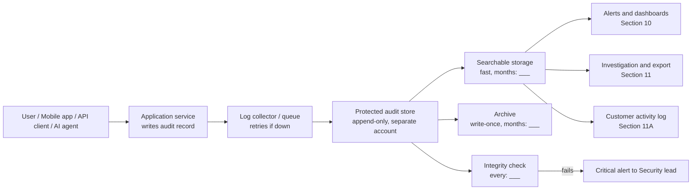
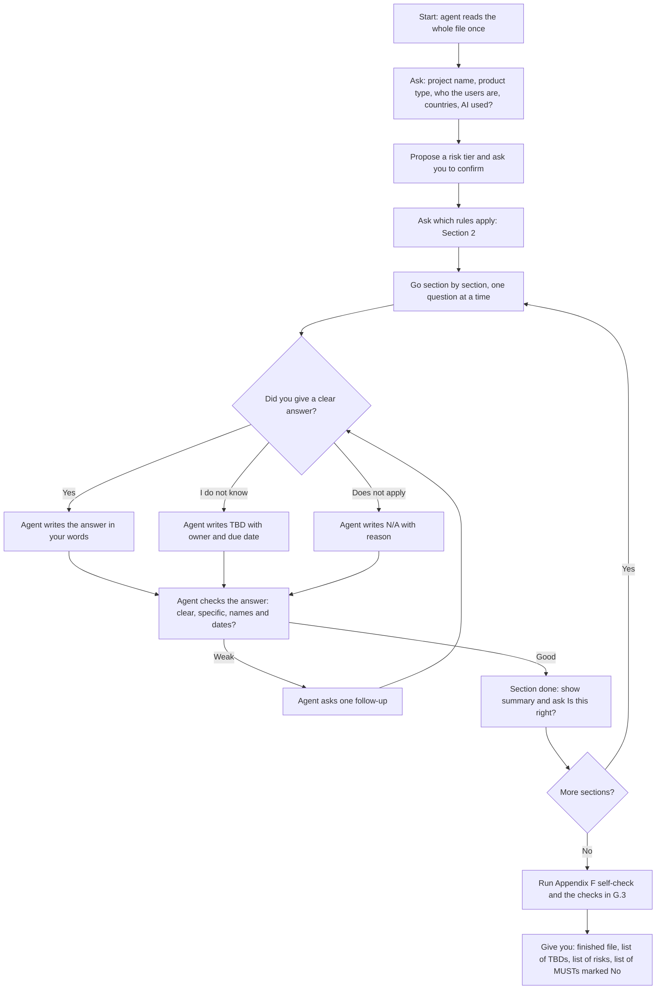

# HOW TO FILL IN THIS DOCUMENT (READ THIS FIRST)

> **Template version:** 1.2 | **Folder:** Security, Compliance and Governance | **Lifecycle covered:** Idea → Build → Test → Launch → first 500 customers
> **Time to fill in:** about 2–4 hours for a small project, 1–2 days for a large one. You can save and come back.

## What is this document?

An **audit trail** is a diary that a computer keeps. Every time something important happens in your product, the diary writes down **who** did **what**, **to what**, **when**, and **what happened**. Nobody is allowed to erase or secretly change the diary.

This document is the plan for that diary. It answers: *What do we write down? Where do we keep it? Who can read it? How long do we keep it? How do we prove nobody changed it?*

If you fill in every section, a new teammate, an auditor, a lawyer, or an AI agent can read this file and **build and check the audit trail without guessing**.

## The 8 simple rules

1. **Answer every question.** Every question has a line that says `ANSWER:`. Replace the blanks with your answer.
2. **Never leave a blank.** If something does not apply, write `N/A – because <reason>`. If you do not know yet, write `TBD – owner: <name> – due: <date>`. A blank means "someone forgot"; `N/A` and `TBD` mean "someone thought about it".
3. **Use plain words.** Short sentences. If you must use a technical word, check the **Glossary (Appendix A)**.
4. **Look at the examples.** Many questions have an `EXAMPLE:`. Copy its style, not its content.
5. **Tick boxes like this:** `[x]` = yes, `[ ]` = no.
6. **Never paste secrets or real personal data here.** No passwords, API keys, card numbers, real customer names, or real emails. Use fake examples such as `user_123`.
7. **Dates look like this:** `2026-10-17` (year-month-day). Times are **UTC**.
8. **When done, run the Self-Check (Appendix F).** If you score 90% or more, ask your reviewer to sign (Section 20).

## Example of a good answer and a bad answer

| Question | Bad answer | Good answer |
|---|---|---|
| How long do we keep login records? | "A while" | "13 months. 3 months in fast storage, 10 months in cheap archive. Reason: PCI DSS needs 12 months, we added 1 month of safety." |
| Who can read the audit logs? | "Admins" | "Only the Security Lead and two named Auditors (list in Section 8). Developers cannot read production logs." |
| Do we log AI agent actions? | "Yes" | "Yes. Every tool call by the support agent is logged with agent ID, model version, input summary, result, and whether a human approved it (Section 5)." |

## What the labels mean

| Label | Meaning |
|---|---|
| **MUST** | Required. Do not launch without it. |
| **SHOULD** | Strongly recommended. If you skip it, write the reason. |
| **MAY** | Optional. |
| **P1…P8** | Lifecycle phases (see Section 12). Example: "P3+" means "from the Test phase onward". |
| **Owner** | One named person (not a team) who is responsible. |

## Stuck? Say it simply (the 10-year-old guide)

Imagine your product is a **school**. The audit trail is the **sign-in book at the front door and the teacher's attendance book**.

| Question in this document | Think of it like this |
|---|---|
| What do we log? (Section 3) | Which things must be written in the book? (Someone enters, someone leaves, someone changes a grade.) |
| What is in each record? (Section 4) | Each line says: **who**, **what**, **which thing**, **when**, **where from**, **why**, **how it went**. |
| What must we never write? (Section 6) | We never write down someone's secret locker code in the book. |
| Where do we store it? (Section 7) | In a locked cabinet that nobody can erase from, even the principal. |
| Who can read it? (Section 8) | Only the few people we named on a list. Reading the book is also written in the book. |
| How long do we keep it? (Section 9) | Keep each old book for a set number of months, then shred it safely. |
| Alerts and reviews (Section 10) | A bell rings if something strange happens; someone also reads the book every week. |
| Phases P1 to P8 (Section 12) | Plan the school, build it, test the doors, open day, first 100 students, first 500 students, hand over to the school staff. |

**Three questions to ask yourself for any row:**
1. *Could a stranger understand my answer without calling me?*
2. *Did I write a name, a number, or a date instead of "soon" or "some people"?*
3. *If something went wrong tomorrow, would my answer help someone find out what happened?*

If all three are "yes", your answer is good.

**Quick words to use instead of hard words**

| Instead of | Say |
|---|---|
| Immutable | Cannot be changed after it is written |
| Provenance | Where it came from |
| Non-repudiation | The person cannot say "that was not me" |
| Pseudonymization | Replace a name with a code |
| Granular | In small, specific pieces |
| Remediate | Fix |

## How to use this with an AI assistant

You may give this file to an AI assistant and say: *"Interview me one question at a time and fill in this template. Do not guess. If I say I do not know, write TBD with an owner."* Appendix E has a ready-made instruction block you can paste.

## Order of work (the easy path)

1. Section 0 → 2 (who, why, **risk tier**, which rules apply)
2. Section 3 → 5 (what we log)
3. Section 6 → 11A (how we protect, store, review, measure, and report, including what customers see)
4. Section 12 (what happens in each phase up to customer 500)
5. Sections 13 → 19 (roles, tests, incidents, vendors, cost, risks, launch checklist)
6. Appendix F self-check → Section 20 sign-off

---

# AUDIT TRAIL SPECIFICATION

## Section 0. Document Control

| Field | Your answer |
|---|---|
| Project name | ANSWER: |
| Project ID / code | ANSWER: |
| Product owner (one named person) | ANSWER: |
| Document owner (writes and updates this file) | ANSWER: |
| Security reviewer | ANSWER: |
| Compliance / legal reviewer | ANSWER: |
| Document version | ANSWER: `0.1` |
| Status | ANSWER: `Draft` / `In review` / `Approved` / `Retired` |
| Created on | ANSWER: |
| Last updated on | ANSWER: |
| Next review date (SHOULD be every 6 months or at each major change) | ANSWER: |
| Where this file lives (link) | ANSWER: |
| Related documents (architecture, privacy policy, incident plan, data map) | ANSWER: |

**Project risk tier** (pick one, it controls how strict the rest of this document is):

- [ ] **Tier 1 – Low**: no personal data, no money, no AI decisions about people
- [ ] **Tier 2 – Medium**: some personal data or internal business data
- [ ] **Tier 3 – High**: sensitive personal data, payments, health data, or AI that acts on its own
- [ ] **Tier 4 – Critical**: regulated industry, or harm to people if something goes wrong

ANSWER (why this tier):

**How your tier changes the rules (Tiered strictness).**

| Rule label | Tier 1 – Low | Tier 2 – Medium | Tier 3 – High | Tier 4 – Critical |
|---|---|---|---|---|
| **MUST** | Required. A MUST may be skipped only with a written reason in Section 20.2, signed by the product owner. | Required. A MUST may be skipped only with a written reason in Section 20.2, signed by the product owner and the security lead. | Required. **No skipping.** Exceptions need written approval from security, compliance, and the product owner, with an end date. | Required. **No skipping.** Exceptions need executive approval and an end date. |
| **MUST (Tier 3+)** | Treat as SHOULD | Treat as SHOULD | Required | Required |
| **SHOULD** | Optional | Do it or write a short reason | Do it or write a reason signed by security | Do it or write a reason signed by security |
| **Review of this document** | Yearly | Every 6 months | Every 6 months | Every 3 months |
| **Independent reviewer (someone who did not write it)** | Optional | Required before launch | Required before launch and at customers 100 and 500 | Required at every phase gate |

Rules that **never** relax for any tier: never log secrets (Section 6.1), logs must not be editable by normal users (Section 7.2), and turning logging off must be recorded and alerted (Section 3.5).

---

## Section 1. Purpose and Scope

**1.1 In one or two sentences, what does the product do?**
ANSWER:

**1.2 Why do we need an audit trail? Tick all that apply.**
- [ ] Prove to customers and auditors that we are trustworthy
- [ ] Follow laws or industry rules (see Section 2)
- [ ] Investigate security problems
- [ ] Find out who changed something and why
- [ ] Resolve customer disputes
- [ ] Understand and explain what our AI did
- [ ] Other: ______

**1.3 What is IN scope? List every system, service, database, app, and AI agent that will write audit records.**

| # | System / component | Owner | Writes audit records? (Y/N) | Notes |
|---|---|---|---|---|
| 1 | ANSWER: | | | |
| 2 | | | | |

**1.4 What is OUT of scope, and why?** (Example: "Marketing website analytics – no customer data.")
ANSWER:

**1.5 Who are the users of the product?** (Tick all.)
- [ ] Customers (end users)
- [ ] Customer admins
- [ ] Our staff (support, operations)
- [ ] Our developers
- [ ] External partners / APIs
- [ ] Automated services
- [ ] AI agents

**1.6 In which countries or regions do users live? Where is data stored?**
ANSWER:

**1.7 How is this different from normal "debug logs"?**
Write one sentence. (Standard answer you may keep: *"Debug logs help engineers fix bugs and may be deleted. Audit records prove what happened, are protected from change, and are kept on purpose for a set time."*)
ANSWER:

---

## Section 2. Rules and Standards That Apply

Tick every rule that applies to this project. For each ticked rule, confirm with your legal or compliance person. The "Typical audit trail need" column is a **starting guide, not legal advice**.

| Apply? | Rule / standard | Typical audit trail need (guide only) | Confirmed by (name, date) |
|---|---|---|---|
| [ ] | **SOC 2** (security, availability, confidentiality) | Prove access control, changes, and monitoring are logged and reviewed | |
| [ ] | **ISO/IEC 27001:2022** | Annex A logging, monitoring, clock sync, and evidence collection controls | |
| [ ] | **GDPR** (EU/UK personal data) | Accountability; who accessed personal data; consent and deletion requests; breach reporting within 72 hours | |
| [ ] | **CCPA / CPRA** (California) | Track consumer requests (know, delete, opt-out) and how we answered them | |
| [ ] | **HIPAA** (US health data) | Record who looked at or changed health records; keep related documentation for 6 years | |
| [ ] | **PCI DSS v4.0** (card payments) | Log access to card data and admin actions; keep 12 months, with the latest 3 months quickly available | |
| [ ] | **EU AI Act** (if AI is high-risk or similar) | Automatic event records for AI systems, human oversight records, logs kept at least 6 months (check your role: provider or deployer) | |
| [ ] | **NIST AI RMF** | Evidence for Govern, Map, Measure, Manage activities on AI | |
| [ ] | **Other** (e.g. SOX, FedRAMP, local law): ______ | | |

**2.1 Where there are two rules with different needs (example: 6 months vs 12 months), which one wins?**
Standard answer you may keep: *"The longest retention and the strictest detail wins, unless legal says otherwise."*
ANSWER:

**2.2 Which internal policies must this follow?** (Security policy, data retention policy, privacy policy, AI policy.)
ANSWER:

**2.3 Where to look: rule and clause pointers for each framework.**
Use this table to find the exact place in each rule that talks about logging, access records, retention, or AI traceability. Write the reference you rely on in the last column. **This is a reading guide, not legal advice. Rules change: always open the current official text and have your compliance or legal person confirm.** (Last checked while preparing this template: October 2026.)

| Framework | Where to look | What it is about, in plain words | Section(s) of this document it feeds | Reference you rely on |
|---|---|---|---|---|
| **SOC 2** (AICPA Trust Services Criteria) | CC6.1–CC6.3 (who can get in) · CC7.1–CC7.4 (detect, assess, respond) · CC8.1 (changes) · CC4.1 (monitoring) | Prove access is controlled, strange activity is noticed and handled, and changes are approved | 3, 7, 8, 10, 15 | |
| **ISO/IEC 27001:2022** (Annex A) | 8.15 Logging · 8.16 Monitoring activities · 8.17 Clock synchronization · 5.28 Collection of evidence · 8.2 Privileged access rights · 8.3 Information access restriction · 8.10 Information deletion · 8.11 Data masking · 5.33 Protection of records | Keep protected logs, watch them, use one time source, collect evidence properly, restrict access, delete on time, hide sensitive parts | 4, 6, 7, 8, 9, 10, 15 | |
| **GDPR** (EU 2016/679, also UK GDPR) | Art. 5(1)(e) keep no longer than needed · Art. 5(1)(f) integrity and confidentiality · Art. 5(2) accountability · Art. 15 and 17 (access and erasure requests) · Art. 25 privacy by design · Art. 30 records of processing · Art. 32 security · Arts. 33–34 breach notice (authority within 72 hours where required) | Prove we handle personal data lawfully, delete when due, answer people's requests, and report breaches on time | 3.4, 6, 9, 11, 15 | |
| **CCPA / CPRA** (California) | Civil Code §1798.100 onward (rights to know, delete, correct, opt out) · CCPA regulations on keeping records of consumer requests (24 months) | Track every consumer request and how and when we answered | 3.4, 9, 11 | |
| **HIPAA Security Rule** (US) | 45 CFR 164.312(b) audit controls · 164.308(a)(1)(ii)(D) information system activity review · 164.312(c) integrity · 164.316(b)(2) keep documentation 6 years | Record and review activity on systems with health data; keep policies and records for 6 years | 3.2, 7, 9, 10 | |
| **PCI DSS v4.0 / v4.0.1** | Requirement 10: 10.2 (what to log, including 10.2.1.1–10.2.1.7) · 10.2.2 (what each record contains) · 10.3 (protect logs) · 10.4 (review logs) · 10.5 (keep 12 months, latest 3 months immediately available) · 10.6 (time sync) | Log access to card data, admin actions, failed access, and changes to log settings; protect, review, and keep logs | 3, 4, 7, 9, 10 | |
| **EU AI Act** (Regulation (EU) 2024/1689) | Art. 12 record-keeping (automatic event logs for high-risk AI) · Art. 14 human oversight · Art. 13 transparency · Art. 19 and Art. 26(6) keeping logs (at least 6 months, unless other law says longer) · Art. 72 post-market monitoring · Art. 73 serious incident reporting · Art. 50 transparency duties | AI systems must record events so their behaviour can be traced, humans must be able to oversee them, and serious incidents must be reported. **Check current dates when each duty starts to apply and whether you are a provider or a deployer.** | 5, 9, 10, 15 | |
| **NIST AI RMF 1.0** | Functions GOVERN, MAP, MEASURE, MANAGE | A way to show you manage AI risk; logs are evidence for MEASURE and MANAGE | 5, 10, 10A | |
| **NIST SP 800-53 (AU family)** and **NIST SP 800-92** | AU-2 event selection · AU-3 content of records · AU-6 review · AU-9 protection of audit information · AU-11 retention · AU-12 record generation · SP 800-92 log management guide | A detailed US government checklist and guide for audit logging; helpful as a design check | 3, 4, 7, 9, 10 | |
| **OWASP Logging Cheat Sheet** | Which events to log, what never to log, and how to protect logs in web apps | A friendly developer guide | 3, 4, 6 | |

**2.4 Compliance gap list.** After you finish the document, list any rule you ticked in Section 2 where you are **not yet** meeting a requirement.

| Rule | Requirement we are not meeting yet | Plan to fix | Owner | Due date |
|---|---|---|---|---|
| ANSWER: | | | | |

---

## Section 3. What We Log: The Event Catalogue

Think of each row as one thing that can happen. Every row has a **unique Event ID**. Use the naming rule in Appendix C (example: `AUTH.LOGIN.SUCCESS`).

**How to fill:** Keep the starter rows that apply, delete the ones that do not (write the reason in the Notes column), and add your own.

**Severity:** `Info` (normal) · `Notice` (worth reading) · `Warning` (look soon) · `Critical` (wake someone up).
**Required from phase:** the first phase where this event MUST be logged (see Section 12).

### 3.1 Identity and access events

| Event ID | What happened | Severity | Required from phase | Log it? | Notes |
|---|---|---|---|---|---|
| AUTH.LOGIN.SUCCESS | A user signed in | Info | P2 | [ ] | |
| AUTH.LOGIN.FAILURE | A sign-in failed | Warning | P2 | [ ] | Count repeats to spot attacks |
| AUTH.LOGOUT | A user signed out | Info | P2 | [ ] | |
| AUTH.MFA.CHANGE | Two-step sign-in turned on, off, or reset | Notice | P2 | [ ] | |
| AUTH.PASSWORD.CHANGE | Password changed or reset | Notice | P2 | [ ] | Never log the password |
| AUTH.SESSION.REVOKE | A session or token was cancelled | Notice | P2 | [ ] | |
| ACCESS.ROLE.GRANT | A role or permission was given | Notice | P2 | [ ] | |
| ACCESS.ROLE.REVOKE | A role or permission was removed | Notice | P2 | [ ] | |
| ACCESS.DENIED | Someone tried something they are not allowed to do | Warning | P2 | [ ] | |
| ACCESS.PRIVILEGED.USE | An admin or "break-glass" account was used | Critical | P2 | [ ] | |
| ACCESS.APIKEY.CREATE / REVOKE | An API key was created or removed | Notice | P2 | [ ] | Log key ID only, never the key |

### 3.2 Data events

| Event ID | What happened | Severity | Required from phase | Log it? | Notes |
|---|---|---|---|---|---|
| DATA.RECORD.CREATE | A record was created | Info | P2 | [ ] | |
| DATA.RECORD.UPDATE | A record was changed (store before and after, see Section 4) | Notice | P2 | [ ] | |
| DATA.RECORD.DELETE | A record was deleted | Notice | P2 | [ ] | |
| DATA.RECORD.READ.SENSITIVE | Someone viewed sensitive data | Notice | P2 | [ ] | Required for health, finance, children's data |
| DATA.EXPORT | Data was downloaded or exported | Warning | P2 | [ ] | |
| DATA.IMPORT | Bulk data was loaded in | Notice | P2 | [ ] | |
| DATA.SHARE | Data was shared with another person or system | Notice | P2 | [ ] | |
| DATA.BACKUP.RESTORE | A backup was restored | Warning | P4 | [ ] | |

### 3.3 Admin, configuration, and release events

| Event ID | What happened | Severity | Required from phase | Log it? | Notes |
|---|---|---|---|---|---|
| CONFIG.CHANGE | A setting changed (feature flag, limit, policy) | Notice | P2 | [ ] | |
| CONFIG.SECURITY.CHANGE | A security setting changed | Critical | P2 | [ ] | |
| DEPLOY.RELEASE | New version released to an environment | Notice | P2 | [ ] | Include version and who approved |
| DEPLOY.ROLLBACK | Release was undone | Warning | P2 | [ ] | |
| CODE.MERGE.APPROVED | Code change approved and merged | Info | P2 | [ ] | Source control already logs this; link it |
| SECRET.ACCESS | A secret or key was read from the vault | Notice | P2 | [ ] | |
| INFRA.RESOURCE.CHANGE | Cloud resource created, changed, or deleted | Notice | P2 | [ ] | |

### 3.4 Customer, billing, and privacy events

| Event ID | What happened | Severity | Required from phase | Log it? | Notes |
|---|---|---|---|---|---|
| CUST.ACCOUNT.CREATE | New customer account | Info | P5 | [ ] | |
| CUST.ACCOUNT.CLOSE | Account closed | Notice | P5 | [ ] | |
| CUST.CONSENT.GIVE / WITHDRAW | Consent given or taken back | Notice | P5 | [ ] | Store wording version shown |
| PRIV.REQUEST.RECEIVED | Customer asked to see, fix, or delete their data | Notice | P5 | [ ] | |
| PRIV.REQUEST.COMPLETED | We finished that request | Notice | P5 | [ ] | Record date answered |
| PAY.CHARGE / REFUND | Money moved | Notice | P5 | [ ] | Never log full card numbers |
| SUPPORT.IMPERSONATE | Our staff acted "as" a customer | Critical | P5 | [ ] | Needs customer-visible record if allowed |

### 3.5 Security events

| Event ID | What happened | Severity | Required from phase | Log it? | Notes |
|---|---|---|---|---|---|
| SEC.ALERT.TRIGGERED | A security alert fired | Warning | P4 | [ ] | |
| SEC.INCIDENT.OPEN / CLOSE | Incident opened or closed | Critical | P4 | [ ] | |
| SEC.LOG.TAMPER.DETECTED | Audit log integrity check failed | Critical | P2 | [ ] | |
| SEC.LOG.CONFIG.CHANGE | Logging was turned off, reduced, or changed | Critical | P2 | [ ] | Nobody should be able to switch off logs silently |
| SEC.VULN.FOUND / FIXED | Weakness found or fixed | Notice | P3 | [ ] | |

### 3.6 Your own events

| Event ID | What happened | Severity | Required from phase | Why it matters |
|---|---|---|---|---|
| ANSWER: | | | | |

**3.7 What is the minimum rule for deciding if something must be logged?**
Standard answer you may keep: *"If an action changes data, permissions, money, settings, or touches sensitive data, or if an AI acts on its own, it MUST be logged."*
ANSWER (keep or change):

---

## Section 4. What Each Log Record Contains

Every audit record answers the **7 Ws**: **Who, What, Which thing, When, Where from, Why, What was the result.**

### 4.1 Required fields

| # | Field name | Answers | Required? | Example | Your change (if any) |
|---|---|---|---|---|---|
| 1 | `event_id` | What kind of event | MUST | `DATA.RECORD.UPDATE` | |
| 2 | `record_id` | Unique ID of this log line (never repeats) | MUST | `01J9Z…` (ULID or UUID) | |
| 3 | `timestamp_utc` | When (to the millisecond, UTC) | MUST | `2026-10-17T09:30:12.123Z` | |
| 4 | `actor_id` | Who did it | MUST | `user_123` | |
| 5 | `actor_type` | Kind of actor | MUST | `human` / `service` / `ai_agent` / `system` | |
| 6 | `actor_role` | Role at the time | SHOULD | `support_admin` | |
| 7 | `on_behalf_of` | If someone/something acted for another | MUST if used | `user_456` | |
| 8 | `action` | Verb | MUST | `update` | |
| 9 | `target_type` | What kind of thing | MUST | `invoice` | |
| 10 | `target_id` | Which thing | MUST | `inv_789` | |
| 11 | `outcome` | Result | MUST | `success` / `failure` / `denied` | |
| 12 | `reason_or_ticket` | Why (ticket or approval link) | SHOULD (MUST for admin actions) | `TICKET-4521` | |
| 13 | `source_ip` | Where from (see privacy note, Section 6) | SHOULD | `203.0.113.10` | |
| 14 | `user_agent_or_client` | Which app or device | MAY | `iOS app 2.3.1` | |
| 15 | `session_id` | Which sign-in session | SHOULD | `sess_abc` | |
| 16 | `correlation_id` | Links all steps of one request | MUST | `req_555` | |
| 17 | `environment` | Where it ran | MUST | `dev` / `test` / `staging` / `prod` | |
| 18 | `service_name` and `app_version` | Which software and version | MUST | `billing-api 1.4.2` | |
| 19 | `changes_before` / `changes_after` | What changed (only fields that changed) | MUST for updates | `{"status":"open"}` → `{"status":"closed"}` | |
| 20 | `customer_or_tenant_id` | Which customer owns it | MUST in multi-customer products | `tenant_77` | |
| 21 | `integrity_hash` / `prev_hash` | Proof of no tampering (see Section 7) | SHOULD (MUST for Tier 3+) | `sha256:…` | |
| 22 | `schema_version` | Which version of this record format | MUST | `1.0` | |

### 4.2 Extra fields for AI agents
These are defined in Section 5 and are MUST when `actor_type = ai_agent`.

### 4.2b Extra fields by product type
Tick the product types you are building, then tick the extra fields you will add.

**Web app / SaaS (multi-customer)**
- [ ] `tenant_id` on every record (MUST) and a test that one customer can never read another's records
- [ ] `impersonated_by` when our staff act as a customer
- [ ] `plan_or_tier` of the customer at the time (SHOULD)

**Mobile app**
- [ ] `device_id` (a random app-generated ID, not a hardware ID that tracks people across apps)
- [ ] `app_version` and `os_version`
- [ ] `client_timestamp` **and** `server_timestamp` (phone clocks can be wrong; the server time is the truth)
- [ ] `offline_queued` (true if the event happened offline and arrived later)
- [ ] `app_store_channel` (production vs beta build)

**API / internal tool / partner integration**
- [ ] `api_key_id` or `client_app_id` (never the key itself)
- [ ] `http_method`, `endpoint`, and `status_code`
- [ ] `rate_limit_hit` (true or false)
- [ ] `caller_service` for service-to-service calls

**Other product type:** ______ → fields: ______

### 4.3 Questions

**4.3.1 Which time source do all systems use, and who checks clocks are in sync?** (Example: "Cloud provider NTP, checked weekly by DevOps.")
ANSWER:

**4.3.2 What format are records written in?** (Standard: JSON, one record per line.)
ANSWER:

**4.3.3 What happens if writing an audit record fails?**
- [ ] The action is **blocked** (safest; use for money, admin, sensitive data)
- [ ] The action continues, the record is **queued and retried**, and an alert fires
- [ ] Other: ______

ANSWER (which actions use which rule):

**4.3.4 Who approves a change to this record format, and how do we keep old records readable?**
ANSWER:

**4.3.5 (Mobile apps) What happens to audit events created while the phone is offline?**
Standard answer you may keep: *"Events are saved on the phone, sent when online, and keep their original phone time plus the server arrival time. The server marks them `offline_queued`. Events for money, admin actions, or sensitive data are not allowed while offline."*
ANSWER (keep, change, or N/A):

**4.3.6 (APIs) Which calls are logged: every call, or only changes and sensitive reads?** Write the rule and why.
ANSWER:

### 4.4 Sample record (copy and adapt in Appendix D)

---

## Section 5. AI Agent and LLM Audit Trail

Fill this section if **any** AI model, AI agent, or automated assistant is part of the product or the development process. If none, write `N/A – no AI used` and the reason.

### 5.1 AI inventory

| # | AI system / agent name | What it does | Model and version | Provider | Autonomy level (see 5.2) | Owner |
|---|---|---|---|---|---|---|
| 1 | ANSWER: | | | | | |

### 5.2 Autonomy levels (pick one per agent)

| Level | Meaning | Human approval needed? |
|---|---|---|
| L0 | AI only suggests. A human does everything. | Always |
| L1 | AI drafts. A human reviews each action. | Every action |
| L2 | AI acts on low-risk tasks alone. A human approves high-risk ones. | High-risk only |
| L3 | AI acts alone. A human reviews samples and alerts. | By exception |

ANSWER (which level for which agent, and why):

### 5.3 What we log for every AI action

| Item | Required? | What to record | Your decision |
|---|---|---|---|
| Agent ID and name | MUST | Stable ID of the agent | |
| Model name and exact version | MUST | e.g. model string and date | |
| Prompt template / system instruction version | MUST | Version number or hash, not secrets | |
| User request (input) | SHOULD | Stored in full, summarised, or hashed? Choose in 5.4 | |
| Documents or data the AI used (retrieval sources) | SHOULD | Document IDs and versions | |
| Tools or APIs the AI called | MUST | Tool name, arguments (with sensitive parts masked), result status | |
| AI output / decision | MUST | Stored or summarised, plus confidence if available | |
| Settings that change behaviour | SHOULD | Temperature, token limits, safety settings | |
| Safety filter or guardrail triggered | MUST | Which rule, what was blocked | |
| Human approval or override | MUST | Who, when, approved / rejected / edited, reason | |
| Escalation to a human | MUST | Why and to whom | |
| Cost and token usage | MAY | For budget control | |
| Errors, retries, timeouts | SHOULD | | |
| Link to evaluation / test run that approved this model version | SHOULD | Eval report ID | |

### 5.4 Questions about AI data

**5.4.1 Do we store full prompts and answers, or only summaries?**
- [ ] Full text, masked for personal data
- [ ] Summary and hash only
- [ ] Not stored (explain): ______

ANSWER (why, and for how long):

**5.4.2 Is customer data ever sent to an outside AI provider? Is it used to train models?**
ANSWER (include provider contract setting, e.g. "no training on our data"):

**5.4.3 What stops an AI agent from doing harmful or unwanted things?** (Permission limits, spending limits, allow-lists of tools, kill switch.)
ANSWER:

**5.4.4 Who can switch an agent off immediately, and is that logged?**
ANSWER:

**5.4.5 How do we change a model, prompt, or tool, and where is that change logged?**
ANSWER:

**5.4.6 How can we replay or explain one AI decision after the fact? Write the steps.**
ANSWER:

**5.4.7 How do we check the AI for mistakes, bias, or drift, and how often? Where are results kept?**
ANSWER:

**5.4.8 If AI helps write our code (coding assistants and development agents), what do we record?**
(Example: "Pull request is labelled 'AI-assisted'; a human reviews and approves every merge; the agent's actions in the repository are in the commit history.")
ANSWER:

**5.4.9 If our AI affects people (hiring, credit, health, safety, children), do we tell them, and do we log that we told them?**
ANSWER:

---

## Section 6. Sensitive Data: What We Must Never Write in Logs

**6.1 Never-log list.** Tick the items that must **never** appear in logs (we recommend ticking all).
- [ ] Passwords and security answers
- [ ] API keys, tokens, private keys, session secrets
- [ ] Full card numbers and security codes
- [ ] Government ID numbers
- [ ] Full health details
- [ ] Biometric data
- [ ] Full message or document contents (log an ID instead)
- [ ] Other: ______

**6.2 Allowed with protection.** List data we log but must protect.

| Data | Why we need it in logs | Protection (mask / hash / encrypt / shorten) | Retention |
|---|---|---|---|
| IP address | Security investigation | Shorten after ____ days | |
| Email address | Identify user | Use user ID instead; mask if needed | |
| ANSWER: | | | |

**6.3 How do we avoid accidentally logging secrets?** (Example: "Automatic scanner on logs; code review rule; blocked field names list.")
ANSWER:

**6.4 How do we handle a customer asking us to delete their personal data, when audit logs must not be changed?**
Standard answer you may keep: *"Audit records use IDs, not names. When a customer is deleted, we delete the link between the ID and the person, so records no longer identify them. Records we must legally keep are kept for the legal time only."*
ANSWER (keep or change, with legal approval name):

**6.5 Is log data encrypted while moving and while stored? Who holds the keys?**
ANSWER:

**6.6 Are logs allowed to leave our region or country?**
ANSWER:

---

## Section 7. Storage, Protection, and Proof of No Tampering

**7.1 Where are audit records stored?**

| Stage | Where | Who runs it | How long it stays there |
|---|---|---|---|
| Created (in the app) | ANSWER: | | |
| Collected (log pipeline) | | | |
| Fast storage (searchable) | | | |
| Archive (cheap, slow) | | | |

**7.2 Protection rules (tick what we will do).**
- [ ] **Append-only**: records can be added, never edited or deleted by normal users or admins
- [ ] **Write-once storage** (WORM or object lock) for the archive
- [ ] **Separate account/project** for logs, different from the one where the app runs
- [ ] **Separation of duties**: people who run the app cannot erase the logs
- [ ] **Hash chain or signed batches** so any change can be detected (MUST for Tier 3+)
- [ ] **Regular integrity check** every ______ (Example: daily)
- [ ] **Backups** of logs in a second location
- [ ] **Clock sync** across all systems
- [ ] **Alert if logging stops** or volume drops suddenly

**7.3 If the log system is down, what do we do?** (Buffer, retry, block risky actions.)
ANSWER:

**7.4 Who can change logging settings, and who approves?**
ANSWER:

**7.5 How do we prove to an auditor that logs were not changed?** (Describe the evidence.)
ANSWER:

**7.6 What is our target for "log appears and is searchable"?** (Example: within 60 seconds.)
ANSWER:

**7.7 Data-flow diagram: how does an audit record travel from the action to the archive?**
Edit the diagram below so it matches your project. Rename boxes, add or delete lines, and keep the "Who can read" and "Integrity check" boxes. (This diagram can be viewed in any tool that supports Mermaid. If yours does not, redraw it as a picture and paste the link.)



ANSWER (list every box you changed and why; list any place a record could be lost or changed on its journey):

---

## Section 8. Who Can Read the Logs

| Person / role | Can read which logs | Can export? | Can delete? | Approved by | Reviewed on |
|---|---|---|---|---|---|
| Security lead | ANSWER: | | **No one** | | |
| Auditor (external, read-only, time-limited) | | | No | | |
| Support staff | | | No | | |
| Developers | | | No | | |
| Customer admin (their own records only) | | | No | | |

**8.1 Does a customer see their own audit trail inside the product?**
ANSWER (what they can see, and from which phase):

**8.2 How often is the access list reviewed?** (SHOULD be every 3 months.)
ANSWER:

**8.3 Is reading the audit logs itself logged?** (It MUST be.)
ANSWER:

**8.4 How is emergency access ("break-glass") requested, approved, time-limited, and reviewed afterwards?**
ANSWER:

---

## Section 9. How Long We Keep Records

**9.1 Retention table.** Fill the "Our choice" column. Never go below the shortest legal minimum; write the reason for each choice.

| Log type | Starting guide | Our choice (months) | Reason / rule | Searchable (months) | Archive (months) |
|---|---|---|---|---|---|
| Security and access logs | 12 months minimum (PCI DSS: 12, with 3 immediately searchable) | ANSWER: | | | |
| Admin and configuration changes | 12–24 months | | | | |
| Customer data access (general) | 12–24 months | | | | |
| Health data access (HIPAA documentation) | Up to 6 years (confirm with legal) | | | | |
| Privacy requests (GDPR / CCPA) | At least 24 months (confirm with legal) | | | | |
| Payment and billing records | Per tax and finance law (often 6–7 years) | | | | |
| AI agent logs (EU AI Act, high-risk) | At least 6 months (confirm role and law) | | | | |
| Development and test logs | 30–90 days | | | | |
| Debug logs (not audit logs) | 7–30 days | | | | |

**9.2 What happens when time is up?** (Automatic secure deletion, review first, or move to longer archive.)
ANSWER:

**9.3 Legal hold: if there is a dispute or investigation, who can pause deletion, and how is it recorded?**
ANSWER:

**9.4 Is deletion itself logged?** (It MUST be.)
ANSWER:

---

## Section 10. Watching, Alerts, and Regular Reviews

**10.1 Alerts.** Fill the table. Starter rows are provided.

| Alert name | Trigger | Severity | Who is told | How fast must they react | Owner |
|---|---|---|---|---|---|
| Many failed logins | ____ failures in ____ minutes | Warning | ANSWER: | | |
| Admin used outside work hours | Any privileged action 22:00–06:00 | Warning | | | |
| Logging switched off or reduced | Any change to logging config | Critical | | | |
| Log gap | No records from a system for ____ minutes | Critical | | | |
| Mass export | More than ____ records exported | Warning | | | |
| Role grant to admin | Any | Notice | | | |
| AI agent guardrail triggered repeatedly | ____ times in ____ minutes | Warning | | | |
| AI agent spend or tool-call spike | Over ____ per hour | Warning | | | |
| Integrity check failed | Any | Critical | | | |
| ANSWER (add yours): | | | | | |

**10.2 Regular reviews.**

| Review | How often | Who | What they check | Where the proof is saved |
|---|---|---|---|---|
| Log review (security events) | Weekly | ANSWER: | | |
| Admin action review | Monthly | | | |
| Access list review | Quarterly | | | |
| AI behaviour review | Monthly | | | |
| Retention and deletion check | Quarterly | | | |
| Full audit trail test | Every 6 months | | | |

**10.3 How do we avoid "alert fatigue" (too many alerts that people ignore)?**
ANSWER:

---

## Section 10A. Audit Trail Health Numbers (KPIs)

These numbers tell you if the audit trail is healthy. Fill in the **Target** now. Fill in the actual numbers at each checkpoint in Phase 5, 6, and 7 (Section 12).

| # | KPI (plain words) | How to measure | Target | Launch week | Cust. 100 | Cust. 500 | Owner |
|---|---|---|---|---|---|---|---|
| 1 | **Coverage**: share of required events that write a record | Events with records ÷ events required (from test AT-01) | 100% | | | | ANSWER: |
| 2 | **Completeness**: records with all required fields filled | Records with no missing fields ÷ all records (sampled) | 99.9%+ | | | | |
| 3 | **Delay**: time until a record is searchable | 95th percentile seconds | ≤ 60 sec | | | | |
| 4 | **Lost records**: records that never arrived | Count of gaps found by checks | 0 | | | | |
| 5 | **Integrity checks passed** | Passed ÷ run | 100% | | | | |
| 6 | **Secrets or banned data found in logs** | Scanner findings | 0 | | | | |
| 7 | **Alert response time** | Minutes from alert to a person acting (Critical) | ≤ ____ min | | | | |
| 8 | **Useful alerts**: share of alerts that needed action | Actionable ÷ all alerts | ≥ 50% | | | | |
| 9 | **Reviews done on time** | Done on time ÷ planned (Section 10.2) | 100% | | | | |
| 10 | **Access list review on time** | Done ÷ planned | 100% | | | | |
| 11 | **Auditor or customer requests answered on time** | On time ÷ received | 100% | | | | |
| 12 | **Privacy requests answered on time** | On time ÷ received | 100% | | | | |
| 13 | **AI actions with a full record** (if AI used) | AI actions with complete record ÷ all AI actions | 100% | | | | |
| 14 | **AI actions that needed human correction** (if AI used) | Corrected ÷ reviewed | Falling over time | | | | |
| 15 | **Storage cost vs. budget** | Actual ÷ budget | ≤ 100% | | | | |
| 16 | **Customer activity log availability** (if offered, Section 11A) | Uptime percent | ≥ ____% | | | | |

**10A.1 Where do these numbers appear (dashboard link)?**
ANSWER:

**10A.2 What do we do if a KPI misses its target two checkpoints in a row?** (Example: product owner and security lead meet within 5 days and write a fix plan in the change log.)
ANSWER:

---

## Section 11. Reports, Auditor Requests, and Evidence

**11.1 How do we answer: "Show me everything user X did between date A and date B"?**
ANSWER (steps, tool, who can do it, how long it takes):

**11.2 How do we answer: "Show me every change to setting Y in the last year"?**
ANSWER:

**11.3 Evidence pack for auditors.** Tick what we can produce on request.
- [ ] Sample of audit records per event type
- [ ] Proof logging is on in every environment
- [ ] Access list for logs and its review history
- [ ] Retention settings and deletion proof
- [ ] Integrity check results
- [ ] Alert and incident history
- [ ] Change history of this document

**11.4 Who talks to auditors, and how fast do we answer?** (Example: "Compliance lead, within 5 working days.")
ANSWER:

**11.5 Export format for investigations** (CSV, JSON, signed PDF) and **how we prove the export is complete and unchanged:**
ANSWER:

**11.6 Do customers get reports about their own data (e.g. who accessed it)?**
ANSWER:

---

## Section 11A. Customer-Facing Activity Log (the log your customers see)

Fill this section if customers (or customer admins) can see a history of actions inside the product ("Activity", "Security log", "Audit log" page or API). If they cannot, write `N/A – not offered at launch` and the planned date to revisit (SHOULD be before customer #100 if customers are businesses).

**11A.1 Who can see it?**

| Viewer | Sees what | Can export? | From phase |
|---|---|---|---|
| End user | Their own sign-ins and key account changes | ANSWER: | |
| Customer admin | All users' actions inside their own company only | | |
| Our support staff (when the customer allows) | Same as the customer admin, read-only | | |
| API / SIEM export for customers | | | |

**11A.2 Which events does the customer see?** (Pick from Section 3. Never show internal security alerts, other customers' data, or our staff's private notes.)

| Event ID | Shown to customer? | Friendly wording on screen (plain words, no codes) |
|---|---|---|
| AUTH.LOGIN.SUCCESS | [ ] | "You signed in from Chrome on Windows" |
| ACCESS.ROLE.GRANT | [ ] | "Sam was made an admin by Priya" |
| DATA.EXPORT | [ ] | |
| SUPPORT.IMPERSONATE | [ ] | "Our support team viewed your account to help with ticket 4521" |
| ANSWER (add yours): | | |

**11A.3 Screen and data rules.**

| Question | ANSWER |
|---|---|
| How far back can customers look? (Example: 12 months on screen, longer by request) | |
| Can the customer search and filter? | |
| Which export formats are offered (CSV, JSON)? | |
| Is there a limit on export size or rate? | |
| What time zone is shown? (Store UTC; show the user's zone and keep UTC visible on export.) | |
| How do we show actions by AI agents so the customer can tell them from humans? (Example: robot label and agent name) | |
| How do we protect personal data of other people shown in the log (example: mask part of an email)? | |
| Is the customer-facing log read-only for everyone, including admins? (It SHOULD be.) | |
| Does opening or exporting the customer log write its own audit record? (It MUST.) | |
| What is the maximum delay between an action and it appearing for the customer? | |
| What happens if our internal log store is down? Does the customer page show a clear message? | |

**11A.4 Can customers ask us for more detail than the screen shows? How?** (Example: through support, with identity checks, answered within ___ days.)
ANSWER:

**11A.5 Tests for this section (add to Section 14).** Suggested test IDs: `AT-24` customer A cannot see customer B's log · `AT-25` hidden events never appear · `AT-26` export matches the screen · `AT-27` impersonation always appears to the customer.
ANSWER (tick when added to Section 14):
- [ ] AT-24 · [ ] AT-25 · [ ] AT-26 · [ ] AT-27

---

## Section 12. The Lifecycle: From Idea to the First 500 Customers

This is the heart of the document. For each phase, answer the questions and **only tick the exit gate when you have proof** (a link, a screenshot, a test result).

**Phase map**

| Phase | Name | Plain meaning | Ends when |
|---|---|---|---|
| P1 | Plan and Design | Decide what to build and what to log | Design is approved |
| P2 | Build (Development) | Write the code and the logging | Features work with logging on |
| P3 | Test and Verify (QA) | Prove logging works and cannot be bypassed | All audit tests pass |
| P4 | Pre-Launch Readiness | Final security, legal, and operations checks | Go/No-Go says Go |
| P5 | Launch Day and Week 1 | Product goes live | First week review is done |
| P6 | Customers 1–100 | Early customers, watch closely | Customer #100 reached and review done |
| P7 | Customers 101–500 | Growth; make the process steady | Customer #500 reached and review done |
| P8 | Hand-Off After 500 | Move to normal operations | Ongoing owner accepts |

For **every** phase, use this standard layout:

### P1. Plan and Design

**Goal:** Decide what we log, why, and how we protect it, before any code is written.

| Question | ANSWER |
|---|---|
| Who is the P1 owner? | |
| Planned start and end dates | |
| Have we listed all event types in Section 3? | |
| Have we picked the risk tier (Section 0)? | |
| Have we done a data map (what personal data goes where)? | |
| Have legal and compliance confirmed the rules in Section 2? | |
| Have we chosen the logging tools and storage (Section 7)? | |
| Do the architecture drawings show where audit records are written? | |
| For AI: have we chosen autonomy levels and approval points (Section 5)? | |

**Exit gate (tick only with proof):**
- [ ] Sections 0–11 are filled in and reviewed
- [ ] Threat check done: "How could someone hide their actions?" (write the top 5 answers in Section 18)
- [ ] Cost estimate done (Section 17)
- [ ] Reviewer name and date: ______

### P2. Build (Development)

**Goal:** Every important action writes a correct audit record from the very first working version.

| Question | ANSWER |
|---|---|
| Who is the P2 owner? | |
| Where is the shared logging code, so every team uses the same one? | |
| Which events from Section 3 are built? (list IDs) | |
| Do development and test environments use **fake data only**? | |
| How do developers avoid logging secrets (Section 6.3)? | |
| Are log schema changes reviewed like code? | |
| Does every code review include the question "Does this action write an audit record?" | |
| Are AI coding assistants used, and how are their changes tracked (Section 5.4.8)? | |
| Which events are in the build "Definition of Done"? | |

**Exit gate:**
- [ ] All events marked "Required from P2" are implemented
- [ ] Automated test exists for each required event
- [ ] No secrets found by log scanner
- [ ] Logs are stored in the protected place (Section 7) even in staging

### P3. Test and Verify (QA)

**Goal:** Prove, with evidence, that the audit trail is complete, correct, protected, and usable.

Fill the **Audit Trail Test Plan** (Section 14). Then answer:

| Question | ANSWER |
|---|---|
| Who is the P3 owner (a person who did not write the code)? | |
| Did we try to bypass logging as an attacker would? | |
| Did we test "what if the log system is down"? | |
| Did we test the export for investigations (Section 11)? | |
| Did we test the AI replay steps (Section 5.4.6)? | |
| Did we test retention and deletion on test data? | |
| Did we check performance with expected load (Section 17)? | |

**Exit gate:**
- [ ] 100% of MUST test cases pass
- [ ] All Critical and High defects closed (or formally accepted with name, date, reason)
- [ ] Test report link: ______

### P4. Pre-Launch Readiness

**Goal:** Make sure we are ready to run this for real customers.

| Question | ANSWER |
|---|---|
| Who is the P4 owner? | |
| Has an independent person (security or compliance) reviewed this document and the evidence? | |
| Are alerts live and routed to real people (Section 10)? | |
| Is the on-call person named for launch week? | |
| Is the incident plan updated to include audit trail steps (Section 15)? | |
| Do privacy notices tell customers what we record? | |
| Are vendor contracts and data agreements signed (Section 16)? | |
| Have we done a launch rehearsal (a pretend incident using only logs)? | |
| Is a small private beta planned (e.g. 5–20 friendly users)? | |

**Exit gate:** Complete the **Go / No-Go Checklist (Section 19)**.
- [ ] Decision: `GO` / `NO-GO` / `GO WITH CONDITIONS`
- [ ] Decided by (name, date): ______

### P5. Launch Day and Week 1

**Goal:** Go live safely and watch closely.

| Question | ANSWER |
|---|---|
| Who is the P5 owner? | |
| Launch date and time (UTC) | |
| Who watches the logs on launch day, and in which shifts? | |
| How often do we check dashboards in week 1? (Example: every 2 hours day 1, daily after) | |
| What is the rollback plan if logging breaks? | |
| What does "launch is unhealthy" mean for the audit trail? (Example: missing records, alert backlog, failed integrity check) | |

**Week 1 review (fill in after 7 days):**

| Check | Result | Action needed |
|---|---|---|
| Records per day vs. expected | | |
| Any gaps in logs? | | |
| Any alerts and what did they mean? | | |
| Any sensitive data found in logs by mistake? | | |
| Any customer or privacy request received? | | |
| Any AI decisions that needed human correction? | | |

**Exit gate:**
- [ ] Week 1 review done with no open Critical issues
- [ ] Reviewer name and date: ______

### P6. Customers 1–100

**Goal:** Learn from the first real customers. Keep fixing while the numbers are small.

| Question | ANSWER |
|---|---|
| Who is the P6 owner? | |
| How do we count customers? (Define "a customer": signed up, active, or paying) | |
| Review checkpoints (Example: at customer 10, 25, 50, 100) | |
| What do we check at each checkpoint? (See table below) | |
| How do we collect customer feedback about privacy and audit questions? | |
| How do we handle the first privacy request (access, delete) end to end? | |

**Checkpoint review table (repeat at each checkpoint):**

| Checkpoint (customer #) | Date | Log volume vs. forecast | Missing event types found | Alerts: useful vs. noisy | Privacy requests handled on time | Cost vs. budget | Decisions made |
|---|---|---|---|---|---|---|---|
| 10 | | | | | | | |
| 25 | | | | | | | |
| 50 | | | | | | | |
| 100 | | | | | | | |

**Exit gate:**
- [ ] First **audit trail health review** done (Section 10.2)
- [ ] First **access list review** done (Section 8)
- [ ] At least one **evidence pack** test done (Section 11.3)
- [ ] Retention jobs ran correctly at least once on test or real data
- [ ] Updates to this document merged (Section 20 change log)

### P7. Customers 101–500

**Goal:** Handle growth without losing control. Make the work routine.

| Question | ANSWER |
|---|---|
| Who is the P7 owner? | |
| Checkpoints (Example: 150, 250, 350, 500) | |
| Is storage and cost growth as forecast (Section 17)? | |
| Do alerts still work at larger volume? Any needed tuning? | |
| Do we need new event types for new features? | |
| Do larger customers ask for audit logs, reports, or security questionnaires? How are they answered? | |
| Do any customers need regional data storage? | |
| Have we done a mock audit (a teammate pretends to be an auditor)? | |
| Is any step still manual that should be automated? | |

**Checkpoint review table:** Use the same table as P6, with rows for customers 150, 250, 350, and 500.

**Exit gate:**
- [ ] Mock audit completed; findings fixed or accepted
- [ ] Integrity check history shows no unexplained failures
- [ ] Retention and deletion proven on real data
- [ ] Capacity plan updated for the next 2,000 customers
- [ ] Compliance framework gaps list updated (Section 2)

### P8. Hand-Off After 500

**Goal:** Move from "launch project" to "normal operations".

| Question | ANSWER |
|---|---|
| Who is the long-term owner of the audit trail? | |
| Is this document in the normal review calendar (every 6 months)? | |
| Where do ongoing metrics live? | |
| Who funds the ongoing storage and tools? | |
| What lessons learned go into the next project's template? | |
| What are the next 3 improvements? | |

**Exit gate:**
- [ ] Long-term owner has accepted in writing
- [ ] Lessons learned document saved: ______

### 12.9 Summary matrix (fill when the sections above are done)

| Capability | P1 | P2 | P3 | P4 | P5 | P6 | P7 | P8 |
|---|---|---|---|---|---|---|---|---|
| Event list defined | ✔ | update | update | freeze | update | update | update | review |
| Events implemented | | ✔ | ✔ | ✔ | ✔ | add | add | review |
| Tests written and passed | | write | ✔ | re-run | smoke | regression | regression | regression |
| Protected storage live | design | staging | ✔ | prod | prod | prod | prod | prod |
| Alerts live | design | draft | test | ✔ | ✔ | tune | tune | steady |
| Access review | | | | first | | ✔ | ✔ | quarterly |
| AI logging | design | build | test | ✔ | ✔ | review | review | review |
| Privacy requests handled | | | | rehearse | ✔ | ✔ | ✔ | ✔ |
| Evidence pack test | | | | draft | | ✔ | mock audit | yearly |
| Retention proven | | | design | test | | ✔ | ✔ | ✔ |

(Edit the cells to match your project. Anything blank is a question to answer.)

---

## Section 13. Roles and Responsibilities

**R** = does the work · **A** = final owner (only one A per row) · **C** = asked for advice · **I** = told the result

| Task | Product owner | Engineering lead | Security lead | Compliance / legal | QA lead | DevOps / SRE | AI lead | Support lead |
|---|---|---|---|---|---|---|---|---|
| Decide events to log (Section 3) | A | R | C | C | I | I | C | C |
| Build logging | I | A | C | I | I | R | R | I |
| Protect and store logs | I | C | A | C | I | R | C | I |
| Decide retention | I | I | C | A | I | R | C | I |
| Test audit trail | I | R | C | I | A | R | R | I |
| Review alerts and logs | I | C | A | I | I | R | R | C |
| Answer auditor requests | I | C | C | A | I | R | C | I |
| Handle privacy requests | I | R | C | A | I | R | C | R |
| Approve go/no-go | A | C | C | C | C | C | C | I |

ANSWER (replace role names with real people):

| Role | Name | Backup person | Contact |
|---|---|---|---|
| | | | |

---

## Section 14. Audit Trail Test Plan (QA)

For each test, write the result and the evidence link. A test passes only with evidence.

| Test ID | What we test | Steps (simple) | Expected result | Phase | Result | Evidence link |
|---|---|---|---|---|---|---|
| AT-01 | Each event in Section 3 writes a record | Do the action, then search the log | Record exists with all required fields | P3 | | |
| AT-02 | Required fields are never empty | Check 20 random records per event type | No empty required fields | P3 | | |
| AT-03 | Failed actions are logged | Try wrong password, forbidden action | `failure` or `denied` records exist | P3 | | |
| AT-04 | Time is correct and in UTC | Compare record time with real time | Difference under 1 second | P3 | | |
| AT-05 | Normal users cannot edit or delete logs | Try as admin and developer | Blocked, and the attempt is logged | P3 | | |
| AT-06 | Tamper detection works | Change a test record on purpose | Integrity check fails and alerts | P3 | | |
| AT-07 | No secrets or banned data in logs | Run scanner on all logs | Zero findings | P3 | | |
| AT-08 | Logging outage behaviour | Turn off the log system in test | Risky actions blocked or buffered as planned; alert fires | P3 | | |
| AT-09 | Turning logging off is itself recorded | Change logging settings | Critical record and alert | P3 | | |
| AT-10 | Customers cannot see other customers' logs | Try as customer A to read B's records | Blocked | P3 | | |
| AT-11 | Search "everything user X did" | Run the investigation steps (Section 11) | Complete result within target time | P3 | | |
| AT-12 | Export is complete and unchanged | Export and compare count and hash | Match | P3 | | |
| AT-13 | Retention works | Run deletion job on test data | Only expired data removed; deletion logged | P3 | | |
| AT-14 | Privacy deletion keeps audit usable | Delete a test customer | Records no longer identify the person; records still link by ID | P3 | | |
| AT-15 | AI action record is complete | Trigger an agent action | Record has agent ID, model version, tool calls, outcome | P3 | | |
| AT-16 | AI approval is recorded | Trigger action needing approval; approve and reject | Both recorded with who and when | P3 | | |
| AT-17 | AI guardrail block is logged | Send a request the AI must refuse | Block recorded | P3 | | |
| AT-18 | AI replay | Pick a past AI action and follow replay steps | We can explain what happened | P3 | | |
| AT-19 | Load test | Send expected peak volume ×3 | No lost records; delay within target | P3 | | |
| AT-20 | Alerts reach a person | Trigger each alert in Section 10 | Right person is told within target time | P4 | | |
| AT-21 | Launch rehearsal | Pretend incident; investigate using logs only | Team finds the cause in the time agreed | P4 | | |
| AT-22 | Smoke test after each release | Do 5 key actions | Records appear | P5–P8 | | |
| AT-23 | Mock audit | A teammate acts as auditor and requests evidence | Evidence pack delivered on time | P7 | | |
| AT-24 | Customer A cannot see customer B's activity log | Try as A to read B's log (screen and API) | Blocked | P3 | | |
| AT-25 | Hidden events never appear to customers | Trigger internal-only events | Not shown | P3 | | |
| AT-26 | Customer export matches the screen | Export and compare | Same records | P3 | | |
| AT-27 | Impersonation shows to the customer | Staff acts as customer in test | Customer sees it | P3 | | |
| AT-28 | (Mobile) Offline events keep both times | Use app in airplane mode, then reconnect | Client and server times stored; marked offline | P3 | | |
| AT-29 | (API) API key ID is logged, key is not | Call API with test key | Key ID present, key absent | P3 | | |
| ANSWER (add yours): | | | | | | |

**14.1 What counts as a "pass" for the whole plan?** (Standard: all MUST tests pass; no open Critical or High defects.)
ANSWER:

---

## Section 15. Using the Audit Trail in an Incident

**15.1 What is an "incident" for us?** (Example: someone accessed data they should not, a suspected breach, an AI did something harmful.)
ANSWER:

**15.2 Steps for an investigation (write simple numbered steps).**
ANSWER:
1.
2.
3.

**15.3 How do we preserve evidence so logs can be trusted later (copy, lock, note who touched it)?**
ANSWER:

**15.4 Who decides if customers or authorities must be told, and in what time?** (GDPR: authority within 72 hours of becoming aware, where required. Check local law with legal.)
ANSWER:

**15.5 After an incident, how do we update this document?**
ANSWER:

---

## Section 16. Outside Companies and Tools

| Vendor / tool | What it does for audit trail | Where data is stored | Data agreement signed? | Security proof (e.g. SOC 2 report) reviewed? | Owner |
|---|---|---|---|---|---|
| ANSWER: | | | | | |

**16.1 If a vendor loses or leaks logs, what is our plan?**
ANSWER:

**16.2 If we stop using a vendor, how do we get our logs out and keep them for the full retention time?**
ANSWER:

**16.3 Do outside AI providers keep copies of our prompts? For how long?**
ANSWER:

---

## Section 17. Size and Cost Forecast

Use simple guesses. Update at the checkpoints in P6 and P7.

| Item | At launch | At 100 customers | At 500 customers | Note |
|---|---|---|---|---|
| Customers | 0 | 100 | 500 | |
| Staff users | | | | |
| Events per customer per day | | | | |
| Total audit records per day | | | | = customers × events × (staff factor) |
| Average record size (KB) | | | | |
| Storage per month (GB) | | | | |
| Total stored at the end of retention (GB) | | | | |
| Monthly cost (searchable) | | | | |
| Monthly cost (archive) | | | | |
| AI logging extra volume | | | | |
| Peak records per second | | | | |

**17.1 What is our budget limit for logging, and what do we do if we go over?**
ANSWER:

**17.2 How do we reduce cost without losing required records?** (Example: move older logs to the archive, shorten debug logs, sample low-value events but **never** sample audit events.)
ANSWER:

---

## Section 18. Risks, Assumptions, Dependencies, and Open Questions

**18.1 Risks.**

| # | What could go wrong | How likely (L/M/H) | How bad (L/M/H) | What we do about it | Owner |
|---|---|---|---|---|---|
| 1 | An insider hides their actions by changing logs | | | | |
| 2 | Logs contain secrets or personal data by mistake | | | | |
| 3 | Logging fails silently and nobody notices | | | | |
| 4 | An AI agent acts without a record | | | | |
| 5 | Logs grow faster than forecast and cost explodes | | | | |
| 6 | We cannot answer an auditor or customer request in time | | | | |
| 7 | Deleting a customer breaks audit usefulness | | | | |
| 8 | A vendor is down or leaks data | | | | |
| ANSWER (add yours): | | | | | |

**18.2 Assumptions.** (Things we believe are true but have not proven.)
ANSWER:

**18.3 Dependencies.** (Things we need from other teams or vendors, and the date.)
ANSWER:

**18.4 Open questions.**

| # | Question | Owner | Due date | Answer when found |
|---|---|---|---|---|
| | | | | |

---

## Section 19. Go / No-Go Checklist (Before Launch and Before Customer #100 and #500)

Answer `Yes`, `No`, or `N/A + reason`. Every **MUST** that is `No` means **No-Go** unless an exception is signed in Section 20.2 by the people your tier requires (see "How your tier changes the rules" in Section 0). Tier 3 and Tier 4 projects cannot skip a MUST.

| # | Check | MUST / SHOULD | Pre-launch | At 100 | At 500 | Evidence |
|---|---|---|---|---|---|---|
| 1 | Event catalogue approved and implemented | MUST | | | | |
| 2 | All required fields are present in every record | MUST | | | | |
| 3 | No secrets or banned data in logs | MUST | | | | |
| 4 | Logs are append-only and protected | MUST | | | | |
| 5 | Tamper detection running (Tier 3+) | MUST | | | | |
| 6 | Clock sync checked | MUST | | | | |
| 7 | Access to logs limited and reviewed | MUST | | | | |
| 8 | Reading and exporting logs is itself logged | MUST | | | | |
| 9 | Retention rules set and tested | MUST | | | | |
| 10 | Alerts live and sent to named people | MUST | | | | |
| 11 | On-call person named | MUST | | | | |
| 12 | Logging outage plan tested | MUST | | | | |
| 13 | AI actions logged (if AI used) | MUST | | | | |
| 14 | Human approval points work (if AI used) | MUST | | | | |
| 15 | AI kill switch tested (if AI used) | MUST | | | | |
| 16 | Privacy request process tested | MUST | | | | |
| 17 | Investigation and export tested | MUST | | | | |
| 18 | Evidence pack can be produced | SHOULD | | | | |
| 19 | Vendors reviewed and agreements signed | MUST | | | | |
| 20 | Compliance reviewer signed off | MUST | | | | |
| 21 | Cost forecast approved | SHOULD | | | | |
| 22 | Launch rehearsal done | SHOULD | | | | |
| 23 | Customer-facing privacy notice updated | MUST | | | | |
| 24 | Audit trail KPIs have targets and a dashboard (Section 10A) | SHOULD | | | | |
| 25 | Customer-facing activity log tested, or marked N/A with a revisit date (Section 11A) | SHOULD | | | | |
| 26 | Data-flow diagram matches what is really built (Section 7.7) | SHOULD | | | | |

---

## Section 20. Change Log, Exceptions, and Sign-Off

**20.1 Change log.**

| Version | Date | Author | What changed | Why | Approved by |
|---|---|---|---|---|---|
| 0.1 | | | First draft | | |

**20.2 Exceptions.** (Anything we are NOT doing that this document says MUST be done.)

| # | Rule skipped | Why | Risk accepted | Until when | Approved by (name, date) |
|---|---|---|---|---|---|
| | | | | | |

**20.3 Sign-off.**

| Role | Name | Decision (Approve / Approve with conditions / Reject) | Date | Signature or approval link |
|---|---|---|---|---|
| Product owner | | | | |
| Engineering lead | | | | |
| Security lead | | | | |
| Compliance / legal | | | | |
| QA lead | | | | |
| AI lead (if AI used) | | | | |

---

# APPENDICES

## Appendix A. Glossary (Plain Words)

| Word | Simple meaning |
|---|---|
| **Audit trail / audit log** | A protected diary of who did what, when, and with what result |
| **Actor** | The "who": a person, a program, or an AI agent |
| **Event** | One thing that happened |
| **Record** | One line in the diary |
| **Append-only** | You can add new lines but never change or erase old ones |
| **WORM** | "Write once, read many": storage that locks records after writing |
| **Hash** | A digital fingerprint of data. If the data changes, the fingerprint changes |
| **Hash chain** | Each record holds the fingerprint of the one before it, so a change anywhere is noticed |
| **UTC** | One world time, with no summer-time changes |
| **Correlation ID** | A number that links all steps of one request |
| **PII** | Personal information that can identify a person |
| **Masking** | Hiding part of data (e.g. `****1234`) |
| **Retention** | How long we keep something |
| **Legal hold** | A pause on deleting, because of a dispute or investigation |
| **Tenant** | One customer's separate space inside our product |
| **Break-glass** | Emergency access that is rare, approved, and closely checked |
| **Separation of duties** | The person who does the work cannot also erase the proof |
| **AI agent** | An AI that can use tools and take actions, not just chat |
| **LLM** | A large language model, the "brain" behind many AI assistants |
| **Prompt** | The instructions and question we give an AI |
| **Guardrail** | A rule that stops an AI from doing something unsafe |
| **Human in the loop** | A human approves or checks the AI's action |
| **Drift** | When AI behaviour slowly changes or gets worse over time |
| **RAG** | When the AI looks up documents before answering |
| **Evidence pack** | A folder of proof we hand to auditors |
| **SOC 2 / ISO 27001** | Well-known security standards that customers often ask about |
| **GDPR / CCPA** | Privacy laws for people in Europe/UK and California |
| **HIPAA** | US law protecting health information |
| **PCI DSS** | Security rules for companies handling card payments |
| **EU AI Act** | European law on AI systems, with extra rules for high-risk AI |

## Appendix B. Mini Worked Example (Do NOT copy the facts, copy the style)

**Project:** "PetCare Booking App" (Tier 2, Medium)

- **1.1 What does it do?** "Lets pet owners book vet visits. Vets see pet records."
- **3.2 DATA.RECORD.READ.SENSITIVE:** Log it = [x]. Required from P2. Note: "Vet notes count as sensitive."
- **4.3.3 If logging fails:** "Booking continues, record is queued and retried every 10 seconds, alert after 5 minutes. Viewing vet notes is blocked if logging is down."
- **9.1 Security logs:** "13 months (3 searchable, 10 archive). Reason: PCI DSS 12 months for card payments plus 1 month safety."
- **12 / P6 checkpoint at customer 50:** "Found missing event for 'owner changed phone number'. Added `CUST.PROFILE.UPDATE` and test AT-24."

## Appendix C. Event ID Naming Rules

1. Format: `AREA.OBJECT.ACTION` (or `AREA.ACTION`), UPPERCASE, dots between parts, no spaces.
2. Areas: `AUTH`, `ACCESS`, `DATA`, `CONFIG`, `DEPLOY`, `CUST`, `PRIV`, `PAY`, `SEC`, `AI`, `SYSTEM`.
3. AI events use `AI.` (examples: `AI.TOOL.CALL`, `AI.DECISION.MADE`, `AI.APPROVAL.GRANTED`, `AI.APPROVAL.REJECTED`, `AI.GUARDRAIL.BLOCKED`, `AI.MODEL.CHANGED`, `AI.AGENT.DISABLED`).
4. Never rename an Event ID after launch. To change meaning, create a new ID and mark the old one `deprecated` in the change log.
5. Each Event ID appears once in Section 3 and once in the test plan (Section 14).

## Appendix D. Sample Audit Record (copy and adapt)

```json
{
  "schema_version": "1.0",
  "record_id": "01J9Z8K4Y3Q7M2X5N6B1C0D9EF",
  "event_id": "DATA.RECORD.UPDATE",
  "timestamp_utc": "2026-10-17T09:30:12.123Z",
  "environment": "prod",
  "service_name": "billing-api",
  "app_version": "1.4.2",
  "actor": { "id": "user_123", "type": "human", "role": "support_admin" },
  "on_behalf_of": null,
  "action": "update",
  "target": { "type": "invoice", "id": "inv_789" },
  "tenant_id": "tenant_77",
  "outcome": "success",
  "reason_or_ticket": "TICKET-4521",
  "source": { "ip": "203.0.113.10", "client": "web", "session_id": "sess_abc" },
  "correlation_id": "req_555",
  "changes": {
    "before": { "status": "open" },
    "after": { "status": "closed" }
  },
  "integrity": { "prev_hash": "sha256:aaa...", "hash": "sha256:bbb..." }
}
```

**Sample AI agent record:**

```json
{
  "schema_version": "1.0",
  "record_id": "01J9Z9A1B2C3D4E5F6G7H8J9KL",
  "event_id": "AI.TOOL.CALL",
  "timestamp_utc": "2026-10-17T09:31:05.482Z",
  "environment": "prod",
  "actor": { "id": "agent_support_01", "type": "ai_agent", "role": "support_assistant" },
  "on_behalf_of": "user_123",
  "ai": {
    "model": "<model name and version>",
    "prompt_version": "support-v7",
    "autonomy_level": "L2",
    "tool_name": "refund_create",
    "tool_args_masked": { "invoice_id": "inv_789", "amount": "25.00" },
    "retrieved_sources": ["kb_article_12@v3"],
    "guardrails_triggered": [],
    "human_approval": { "required": true, "approved_by": "user_900", "decision": "approved", "decided_at": "2026-10-17T09:31:40.100Z" }
  },
  "outcome": "success",
  "correlation_id": "req_556"
}
```

## Appendix E. Instruction Block for an AI Assistant That Helps Fill This Template

Copy and paste this to your AI assistant together with this file:

```
You are helping me complete the Audit Trail Specification template.

Rules:
1. Work one section at a time, in the order given in "Order of work".
2. Ask me ONE short question at a time, in simple words. Offer 2-4 example answers when helpful.
3. Never invent facts. If I do not know, write "TBD – owner: <name> – due: <date>" and ask who the owner is.
4. If something does not apply, write "N/A – because <reason>".
5. Never record real secrets, real personal data, or card numbers. Use fake examples.
6. Where this document gives a "starting guide" for law or retention, remind me to confirm with legal or compliance. You are not a lawyer.
7. After each section, show me a short summary and ask "Is this right?" before moving on.
8. At the end, run Appendix F and list every unanswered question, every TBD, and every MUST that is "No".
9. Keep the Markdown structure and headings unchanged. Only edit the ANSWER lines, tables, and tick boxes.
```

## Appendix F. Self-Check Before You Ask for Review

Score 1 point for each "Yes". Target: **90% or more** (at least 29 of 32).

| # | Question | Yes / No |
|---|---|---|
| 1 | Section 0 is fully filled (names, dates, risk tier) | |
| 2 | Every ANSWER line is replaced with an answer, `N/A – reason`, or `TBD – owner – date` | |
| 3 | Every rule in Section 2 is ticked or marked not applicable with a reason | |
| 4 | Each Event ID in Section 3 follows Appendix C | |
| 5 | Every Event has a "Required from phase" | |
| 6 | Section 4 required fields are agreed | |
| 7 | "If writing a log fails" is answered for each risky action | |
| 8 | Section 5 is complete or marked N/A with reason | |
| 9 | Every AI agent has an autonomy level and a kill switch owner | |
| 10 | Never-log list is ticked (Section 6) | |
| 11 | The deletion-versus-audit question is answered with a legal approver | |
| 12 | Storage, protection, and tamper proof are described (Section 7) | |
| 13 | Access table has real names or roles (Section 8) | |
| 14 | Retention table has a reason for every row (Section 9) | |
| 15 | Alerts have named recipients and reaction times (Section 10) | |
| 16 | Investigation and export steps are written (Section 11) | |
| 17 | All eight phases (P1–P8) have an owner and dates | |
| 18 | Every phase has an exit gate with evidence links | |
| 19 | Customer checkpoint numbers are chosen (P6 and P7) | |
| 20 | RACI table has one "A" per row (Section 13) | |
| 21 | Test plan has an Evidence link column filled for completed tests (Section 14) | |
| 22 | Incident steps are written (Section 15) | |
| 23 | Vendors are listed with data agreements (Section 16) | |
| 24 | Cost forecast is filled at launch, 100, and 500 customers (Section 17) | |
| 25 | At least 8 risks have owners (Section 18) | |
| 26 | Open questions all have owner and due date | |
| 27 | Go/No-Go checklist has no unexplained "No" on a MUST (Section 19) | |
| 28 | Exceptions list is filled or says "None" | |
| 29 | Glossary words are enough for a new teammate (add words if not) | |
| 30 | A person who did not write this document read it and could build the audit trail without asking you questions | |
| 31 | Risk tier is chosen and every skipped MUST is in Section 20.2 with the right approvers | |
| 32 | KPI targets (Section 10A) and the data-flow diagram (Section 7.7) are filled in; Section 11A is filled or marked N/A with a revisit date | |

**Score:** ____ / 32 (target: 29 or more)

---

## Appendix G. AI-Agent Workflow: How an AI Agent Interviews You and Fills This Template

Use this when you want an AI agent (a chat assistant or a coding agent) to complete the template with you, with no guessing. The agent works as a careful interviewer. You are the only source of facts.

### G.1 The workflow at a glance



### G.2 Rules for the agent (stricter than Appendix E)

1. **Read first, then ask.** Read the entire file once so questions are in the right order and nothing is asked twice.
2. **One question at a time.** Use short, plain words. Offer 2 to 4 example answers. Allow "I do not know".
3. **Never invent.** Do not guess names, dates, numbers, vendors, legal rules, or retention periods. Where this template gives a "starting guide", treat it as a suggestion that you must confirm.
4. **Write only what the person said.** Keep their meaning. Fix spelling, not facts.
5. **Mark the gaps.** Use `TBD – owner – due` or `N/A – reason`. Never leave `ANSWER:` empty and never fill it with "N/A" without a reason.
6. **Protect data.** Do not accept or store real secrets, real personal data, or card numbers. If the person pastes some, stop, warn, and ask for a fake example instead.
7. **Respect the tier.** Follow "How your tier changes the rules" in Section 0 when deciding if a skipped MUST needs an exception in Section 20.2.
8. **Summarise after every section** (3 to 6 lines) and wait for "yes" before moving on.
9. **Keep the structure.** Do not rename headings, delete sections, or renumber. Add rows to tables; do not remove columns.
10. **Say what you are not.** Never claim a legal or compliance conclusion. Say: "Please ask your compliance or legal person to confirm."
11. **Keep a running list** of every TBD, every N/A with reason, every skipped MUST, and every risk the person mentions.
12. **Stop and ask a human** if the person describes an active security incident, a legal deadline, or harm to people. Do not continue filling the template as if nothing happened.

### G.3 Checks the agent runs before it says "done"

| Check | Pass rule |
|---|---|
| No empty `ANSWER:` lines remain | Zero found |
| Every TBD has an owner and a due date | 100% |
| Every N/A has a reason | 100% |
| Every Event ID follows Appendix C and has a test in Section 14 | 100% |
| Every phase P1 to P8 has an owner, dates, and an exit gate | 100% |
| Every MUST that is "No" is in Section 20.2 with the right approvers (or is listed as Open) | 100% |
| Retention choices are not shorter than any rule the person ticked in Section 2 | Zero conflicts, or flagged |
| No real secrets or personal data in the file | Zero found |
| Appendix F score | At least 29 of 32 |

### G.4 What the agent hands back

1. The completed file `Audit_Trail_Specification.md` (same structure).
2. A one-page **"Open items" list**: every TBD, owner, due date.
3. A **"Needs a human decision" list**: skipped MUSTs, rule conflicts, anything flagged for legal or compliance.
4. The Appendix F score with the failing items listed.

### G.5 Agent roles when more than one AI agent is used (optional)

| Agent role | Job | Must not |
|---|---|---|
| Interviewer | Asks questions, writes answers | Invent facts |
| Checker | Runs G.3 on the finished draft; did not write the answers | Edit answers silently; it only reports |
| Compliance reader | Compares Section 2 and Section 9 choices to Section 2.3 pointers and flags conflicts | State legal conclusions |
| Test planner | Turns Section 3 events into Section 14 test rows | Mark a test as passed without evidence |

---

## Appendix H. A Filled Example (SaaS app, so you can see what "done" looks like)

This is a **short, made-up example** of a finished template. It shows style and level of detail. Your content will differ. All names, numbers, and links are fake.

**Project:** TaskPilot, a team to-do and planning web and mobile app sold to small companies. It has an AI assistant that can create and assign tasks.

**Section 0 (Document control)**

| Field | Answer |
|---|---|
| Project name / ID | TaskPilot / TP-2026 |
| Product owner | Maya Ortiz |
| Document owner | Ken Adeyemi (Engineering lead) |
| Security reviewer | Lena Fischer |
| Compliance reviewer | Tom Reyes |
| Version / status | 0.9 / In review |
| Risk tier | **Tier 3 – High**. Why: stores company data for many customers and has an AI agent that changes data on its own. |

**Section 1 (Scope):** In scope: web app, iOS and Android apps, public API, background job service, AI assistant, admin console. Out of scope: marketing website (no customer data). Users: team members, company admins, our support staff, API clients, the AI assistant. Data stored in the EU and the US (customer chooses).

**Section 2 (Rules):** Ticked SOC 2, ISO 27001, GDPR, CCPA. Not ticked: HIPAA (no health data), PCI DSS (payments are handled fully by an outside payment provider; card data never reaches us), EU AI Act (assistant only suggests and acts on low-risk tasks; legal review on 2026-09-30 judged it not high-risk; Tom Reyes to re-check yearly). Conflict rule: longest retention wins.

**Section 3 (Events), sample of decisions**

| Event ID | Log it? | Required from | Note |
|---|---|---|---|
| AUTH.LOGIN.FAILURE | Yes | P2 | Count repeats |
| DATA.EXPORT | Yes | P2 | Alert if over 10,000 tasks exported |
| SUPPORT.IMPERSONATE | Yes | P5 | Customer must be able to see it in their activity log |
| AI.TOOL.CALL | Yes | P2 | Includes task create, assign, delete |
| CUST.PROFILE.UPDATE | Yes | P6 | **Added at customer 50** after a checkpoint found it missing |
| PAY.CHARGE | N/A – payments handled fully by the payment provider | – | We log only "plan changed" |

**Section 4 (Record):** Standard fields from the template plus `tenant_id`, `device_id`, `client_timestamp`, `server_timestamp`, `offline_queued`, `api_key_id`. If audit logging fails: **block** admin actions, exports, and AI deletions; **queue and retry** everything else with an alert after 5 minutes. Time source: cloud NTP, checked weekly by DevOps.

**Section 5 (AI):** One agent, "TaskPilot Helper", autonomy level **L2** (low-risk actions alone: create and rename tasks; needs human approval to delete more than 5 tasks or assign work to people outside the team). Logs agent ID, model version, prompt version, tool calls with masked arguments, guardrail blocks, and human approvals. Full prompts are **not** stored; a summary and a hash are. Kill switch: Lena Fischer or the on-call engineer; switching it off is logged and alerts the team. Monthly review of 50 random AI actions by Maya Ortiz.

**Section 6 (Never log):** Passwords, tokens, API keys, full task text and file contents (log the task ID only). IP address shortened after 90 days. Customer deletion: audit records keep only the customer code; the link to the company name is deleted; legal approval by Tom Reyes on 2026-08-12.

**Section 7 (Storage):** Logs go to a **separate cloud account**, append-only, with write-once archive. Hash chain per tenant; integrity check **daily**; failure sends a Critical alert to Lena Fischer. Developers cannot delete or edit logs.

**Section 8 (Access):** Security lead and two named auditors can read production logs. Reading and exporting are logged. Access list reviewed every 3 months.

**Section 9 (Retention):** Security and access logs **13 months** (3 searchable, 10 archive). Admin changes 24 months. Privacy requests 24 months. AI logs 12 months. Debug logs 14 days (these are **not** audit logs).

**Section 10 (Alerts), examples:** 10 failed logins in 5 minutes → Warning, security on-call within 15 minutes. Logging setting changed → Critical, within 5 minutes. AI guardrail blocked 5 times in 10 minutes → Warning.

**Section 11A (Customer activity log):** Company admins see their company's sign-ins, role changes, exports, impersonation by our staff, and AI actions (marked with a robot label) for 12 months, and can export CSV. Delay target: 2 minutes.

**Section 12 (Lifecycle), highlights**

| Phase | Owner | Dates | Key proof at exit gate |
|---|---|---|---|
| P1 Plan | Maya Ortiz | 2026-06-01 to 2026-06-30 | Sections 0 to 11 approved by Lena and Tom |
| P2 Build | Ken Adeyemi | 2026-07-01 to 2026-09-15 | All P2 events built; log scanner reports zero secrets |
| P3 Test | Priya Nair (QA) | 2026-09-16 to 2026-10-10 | AT-01 to AT-29 pass; test report TP-QA-114 |
| P4 Pre-launch | Lena Fischer | 2026-10-11 to 2026-10-25 | Go/No-Go signed on 2026-10-25 with conditions: none |
| P5 Launch week | Ken Adeyemi | 2026-11-01 to 2026-11-08 | Week 1 review: no gaps, 2 noisy alerts tuned |
| P6 Customers 1–100 | Maya Ortiz | Nov 2026 to Feb 2027 | Checkpoints at 10, 25, 50, 100 done; first access review and evidence pack test done |
| P7 Customers 101–500 | Maya Ortiz | Feb 2027 to Jul 2027 | Mock audit done; capacity plan for 2,000 customers |
| P8 Hand-off | Ops lead | Aug 2027 | Ops lead accepted in writing |

**Section 17 (Cost):** 500 customers × about 400 events per day = roughly 200,000 records per day (about 6 million per month) at about 1 KB each, which is about 6 GB per month. Budget limit: $600 per month. If over 80% of budget, review sampling of debug logs (never audit events) and move older logs to archive sooner.

**Section 19 (Go/No-Go) result:** 25 of 26 checks "Yes". One SHOULD ("Launch rehearsal done") marked "No – scheduled for 2026-10-20" with Lena Fischer as owner. No MUST failed → **GO**.

**Section 20.2 (Exceptions):** None.

---

## Template Version History

| Template version | Date | What changed |
|---|---|---|
| 1.0 | 2026-10-17 | First full template: 20 sections, appendices A to F |
| 1.1 | 2026-10-17 | Added tiered strictness (Section 0), mobile/API/SaaS fields (4.2b), data-flow diagram (7.7), KPIs (10A), customer-facing activity log (11A), extra tests AT-24 to AT-29 |
| 1.2 | 2026-10-17 | Added beginner "10-year-old" guide, clause-level compliance pointers (2.3, 2.4), AI-agent interview workflow (Appendix G), and a filled example (Appendix H) |

*End of template. Remember: when this template changes, increase the template version at the top, add a row to the Template Version History, and tell every project owner.*
