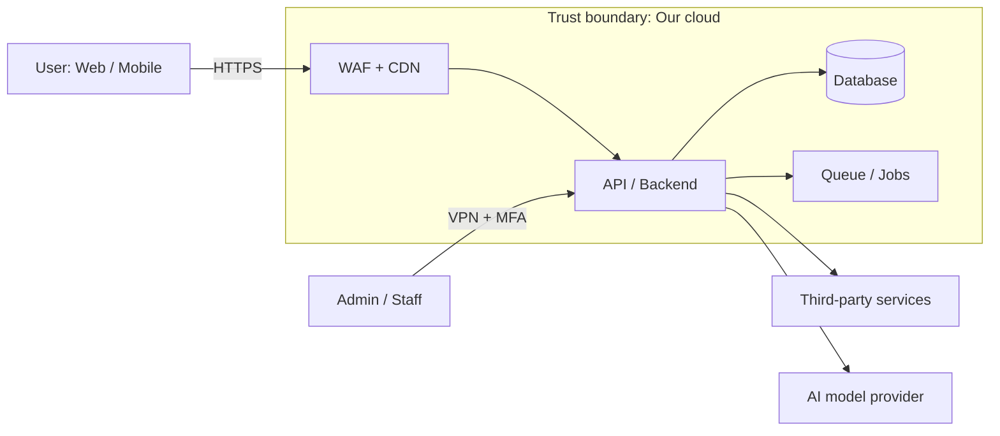

# HOW TO FILL THIS DOCUMENT (READ THIS FIRST)

> **In kid words:** Think of your product as a **house with a toy box full of treasure**. This document answers four questions: *What treasure do we keep? Who might try to take it? What locks do we have? What do we do if someone gets in?* If you can answer those four questions, you can fill this out.

> This is a reusable template. Copy it once per project, then fill it in. You do not need to be a security expert. If you can answer simple questions like "Who can log in?" and "Where is our data stored?", you can fill this out.

## The 10 Rules of Filling

1. **Replace everything in `[square brackets]`.** Example: `[Project Name]` becomes `Acme Notes`.
2. **Never leave a field blank.** Write one of these instead:
   - `N/A – <reason>` (it does not apply, and here is why)
   - `TBD – <owner> – <date>` (not decided yet; someone owns it and a deadline exists)
3. **Delete the grey help text** that starts with `> 💡 Help:` once you have filled a section. Keep it if you want future readers to see it.
4. **Use plain words.** If a 10-year-old could not follow your sentence, shorten it.
5. **Use real names, real numbers, real dates.** Not "soon", "many", "fast". Write "within 24 hours", "10,000 users", "by 2026-12-01".
6. **Never write secrets here.** No passwords, API keys, tokens, or private customer data. Write *where* they are kept (for example "stored in AWS Secrets Manager"), never the value.
7. **Every risk needs an owner and a date.** No owner means it will not get fixed.
8. **Fill the sections in order the first time.** Later sections depend on earlier ones.
9. **Use the status tags:** `✅ Done`, `🟡 In progress`, `⬜ Not started`, `⛔ Blocked`, `➖ N/A`.
10. **Update this file when things change.** Add a row to the Change Log (Section 0) every time.

## How the lifecycle phases work

This document follows one product from first idea to its first 500 customers. Throughout the file you will see these phase tags:

| Tag | Phase | Plain meaning |
|---|---|---|
| **P1** | Discover & Plan | We decide what we are building and what could go wrong |
| **P2** | Design | We draw the safe blueprint |
| **P3** | Build | We write the code (humans and AI agents) |
| **P4** | Test & Verify | We try to break it before others do |
| **P5** | Pre-Launch | We check everything is ready and safe to open the doors |
| **P6** | Launch | The product goes live |
| **P7** | Grow to 500 customers | We keep it safe while real people use it |

## What "done" looks like

The document is complete when:
- Every section marked **R (Required)** for your tier has no empty fields (see the tier table below).
- Section 18 (Launch Gates) shows all **Must-Have** items as ✅ Done.
- A person who did not write this document can read it and explain, in their own words, how the product is protected.
- The Reviewer Sign-Off (Section 21) has real names and dates.

## Pick your project tier (do this before anything else)

> 💡 Help: Not every project needs every section. Answer the questions below, then set `project_tier` in the header at the top of this file. When unsure, **pick the higher tier**.

| Question | Yes → |
|---|---|
| Does it handle payment cards, health data, or children's data? | **Tier 3** |
| Do paying business customers (or contracts / audits) require proof of security? | **Tier 3** |
| Does it handle personal data (names, emails) of the public or customers? | **Tier 2** (at least) |
| Is it public on the internet with real user accounts? | **Tier 2** (at least) |
| Is it only used by our own team, with no personal data and no public access? | **Tier 1** |

| Tier | Name | Plain meaning |
|---|---|---|
| **1** | Light | Small, internal, low-risk |
| **2** | Standard | Public product with user accounts and personal data |
| **3** | Regulated | Sensitive data, contracts, audits, or legal rules |

### Which sections do I fill? (R = Required, O = Optional, A = Only if it applies)

| Section | Tier 1 | Tier 2 | Tier 3 |
|---|---|---|---|
| 0 Document Control | R | R | R |
| 1 Product Snapshot | R | R | R |
| 2 Goals & Scope | R | R | R |
| 3 Compliance Map | O | R | R |
| 4 Assets & Data Classification | R | R | R |
| 5 Architecture Overview | R | R | R |
| 6 Threat Model | O (top 5 threats) | R | R (full) |
| 7 Identity & Access | R | R | R |
| 8 Data Protection | R | R | R |
| 9 Web & API Security | A | R | R |
| 10 Mobile Security | A | A | A |
| 11 Infrastructure & Cloud | R | R | R |
| 12 AI & AI-Agent Security | A | A | A (R if AI is used) |
| 13 Logging & Monitoring | O | R | R |
| 14 Third Parties & Supply Chain | O | R | R |
| 15 Regulated Data | N/A | A | R |
| 16 Incident Response | O (short) | R | R (with drills) |
| 17 Secure Development Lifecycle | O | R | R |
| 18 Launch Gates | R (Must-Haves only) | R | R |
| 19 First 500 Customers | O | R | R |
| 20 Tracker | R | R | R |
| 21 Sign-Off | R | R | R |

> Section 12 is always Required when `uses_ai_features` or `uses_ai_agents` is `true`, whatever the tier.

## Quick Glossary (words you will see)

| Word | Simple meaning |
|---|---|
| **Asset** | Anything valuable we must protect (customer data, code, money, reputation) |
| **Threat** | Something bad that could happen (someone steals data) |
| **Risk** | How likely a threat is × how much damage it would do |
| **Control** | A protection that reduces risk (a lock, a rule, a check) |
| **Authentication (AuthN)** | Proving *who you are* (logging in) |
| **Authorization (AuthZ)** | Deciding *what you may do* (permissions) |
| **Encryption at rest** | Data is scrambled while stored |
| **Encryption in transit** | Data is scrambled while travelling over the internet |
| **MFA** | Login that needs two proofs (password + phone code) |
| **Least privilege** | Give people and software only the access they truly need |
| **PII** | Personal info that identifies a person (name, email, phone) |
| **PHI** | Health information (covered by HIPAA) |
| **Cardholder data** | Payment card numbers (covered by PCI-DSS) |
| **Secret** | A password, API key, or token that must stay private |
| **SBOM** | A list of all software parts our product is built from |
| **Pen test** | A hired, friendly hacker tries to break in |
| **Incident** | A security problem that is happening or has happened |
| **RTO / RPO** | How fast we recover / how much data we can afford to lose |
| **Prompt injection** | Tricking an AI with hidden or sneaky instructions |
| **AI agent** | Software powered by AI that can take actions on its own |

---

# 0. DOCUMENT CONTROL

| Field | Value |
|---|---|
| **Document title** | Security Architecture – `[Project Name]` |
| **Project name** | `[Project Name]` |
| **Project ID / code** | `[e.g., PRJ-0042]` |
| **Document owner (one person)** | `[Full name, role, email]` |
| **Security reviewer** | `[Full name, role, email]` |
| **Template version** | 1.2 |
| **Document version** | `[0.1]` |
| **Status** | `[Draft / In Review / Approved / Retired]` |
| **Current lifecycle phase** | `[P1 / P2 / P3 / P4 / P5 / P6 / P7]` |
| **Confidentiality level** | `[Public / Internal / Confidential / Restricted]` |
| **Next review date** | `[YYYY-MM-DD]` (recommended: every 90 days, and before each major release) |
| **Where this file lives** | `[Repo / Drive link]` |

### Change Log

| Date | Version | Author | What changed | Why |
|---|---|---|---|---|
| `[YYYY-MM-DD]` | 0.1 | `[Name]` | First draft | Project start |

---

# 1. PRODUCT SNAPSHOT (Phase P1)

> 💡 Help: Pretend you are explaining the product to a friend in 30 seconds. Keep it short.

| Question | Your answer |
|---|---|
| **What does the product do?** (1–2 sentences) | `[...]` |
| **Who uses it?** (customers, admins, staff, other software) | `[...]` |
| **Product type** (tick all) | ☐ Web / SaaS app  ☐ Mobile app (iOS)  ☐ Mobile app (Android)  ☐ API  ☐ Other: `[...]` |
| **Does it use AI?** | ☐ Yes – `[what for]`  ☐ No |
| **Are AI agents used to build or run it?** | ☐ Build only  ☐ Run only  ☐ Both  ☐ No |
| **Launch target date** | `[YYYY-MM-DD]` |
| **"First 500 customers" target date** | `[YYYY-MM-DD]` |
| **Countries where customers live** | `[List]` (this decides which privacy laws apply) |
| **Business model** | `[Free / Paid / Freemium / B2B contract / Other]` |

### 1.1 What data will we touch? (tick all that apply)

| Data type | Yes / No | Example | Where it matters |
|---|---|---|---|
| Names, emails, phone numbers (PII) | ☐ | Sign-up form | GDPR / CCPA |
| Passwords | ☐ | Login | Always |
| Payment card numbers | ☐ | Checkout | PCI-DSS |
| Health information (PHI) | ☐ | Medical notes | HIPAA |
| Children's data (under 13/16) | ☐ | Kids' app | COPPA / GDPR-K |
| Location data | ☐ | GPS | GDPR / CCPA |
| Photos, files, documents uploaded by users | ☐ | Profile photo | Privacy |
| Messages / chats between users | ☐ | In-app chat | Privacy |
| Data sent to an AI model | ☐ | Prompts | AI risk (Section 12) |
| Company secrets / source code | ☐ | Repo | Confidentiality |
| None of the above | ☐ | | |

> **Rule of thumb:** If you ticked *Payment cards*, *Health information*, or *Children's data*, you **must** complete Section 15 in full and ask your security reviewer for help **before** writing any code.

---

# 2. SECURITY GOALS & SCOPE (Phase P1)

### 2.1 Security goals

> 💡 Help: Pick the goals that matter most. Almost every project needs the first three (known as the "CIA triad").

| Goal | What it means | Priority (High/Med/Low) | How we will know it is met |
|---|---|---|---|
| **Confidentiality** | Only the right people see the data | `[ ]` | `[e.g., zero unauthorized data access incidents]` |
| **Integrity** | Data is not changed by the wrong people | `[ ]` | `[e.g., all changes are logged]` |
| **Availability** | Product stays up when people need it | `[ ]` | `[e.g., 99.9% uptime]` |
| **Privacy** | Personal data is used fairly and legally | `[ ]` | `[e.g., deletion requests done in 30 days]` |
| **Accountability** | We can tell who did what | `[ ]` | `[e.g., audit logs kept 12 months]` |

### 2.2 What is IN scope and OUT of scope

| In scope (this document protects) | Out of scope (someone else protects or not covered) |
|---|---|
| `[e.g., our web app, mobile apps, API, database, cloud account]` | `[e.g., customer's own devices, third-party payment provider internals]` |

### 2.3 Assumptions and constraints

| Type | Statement | Owner |
|---|---|---|
| Assumption | `[e.g., We will host only on AWS]` | `[Name]` |
| Constraint | `[e.g., Budget for security tools is $500/month]` | `[Name]` |
| Constraint | `[e.g., Team has 3 engineers and no full-time security person]` | `[Name]` |

---

# 3. COMPLIANCE & LEGAL MAP (Phase P1)

> 💡 Help: Compliance means "following the rules." Only tick the ones that apply to *your* product. If unsure, write `TBD – [owner] – [date]` and ask legal.

| Framework / Law | Applies? | Why / why not | Target date | Owner | Status |
|---|---|---|---|---|---|
| **GDPR** (EU/UK personal data) | ☐ Yes ☐ No | `[Do we have EU/UK users?]` | `[ ]` | `[ ]` | `⬜` |
| **CCPA / CPRA** (California residents) | ☐ Yes ☐ No | `[ ]` | `[ ]` | `[ ]` | `⬜` |
| **SOC 2** (customer trust report) | ☐ Yes ☐ No | `[Do business customers ask for it?]` | `[ ]` | `[ ]` | `⬜` |
| **ISO 27001** (security management standard) | ☐ Yes ☐ No | `[ ]` | `[ ]` | `[ ]` | `⬜` |
| **HIPAA** (US health data) | ☐ Yes ☐ No | `[Do we handle PHI?]` | `[ ]` | `[ ]` | `⬜` |
| **PCI-DSS** (payment cards) | ☐ Yes ☐ No | `[Do card numbers touch our systems?]` | `[ ]` | `[ ]` | `⬜` |
| **COPPA / children's laws** | ☐ Yes ☐ No | `[ ]` | `[ ]` | `[ ]` | `⬜` |
| **OWASP Top 10:2025 / ASVS 5.0** (web security baseline) | ☑ Yes (always) | Technical baseline | Before P5 | `[ ]` | `⬜` |
| **OWASP MASVS / MASTG / MASWE** (mobile security baseline) | ☐ Yes ☐ No | `[Do we ship a mobile app?]` | Before P5 | `[ ]` | `⬜` |
| **OWASP Top 10 for LLM Apps (2025)** (+ OWASP Agentic Top 10 for autonomous agents) | ☐ Yes ☐ No | `[Do we use AI?]` | Before P5 | `[ ]` | `⬜` |
| **NIST CSF 2.0** (security program structure) | ☑ Yes (reference) | Used to organize controls | Ongoing | `[ ]` | `⬜` |
| **EU AI Act** | ☐ Yes ☐ No | `[Do we offer AI to EU users? Check risk category with legal. Note: rules for general-purpose AI already apply; transparency duties start Aug 2026; high-risk rules were delayed to 2 Dec 2027 (stand-alone) and 2 Aug 2028 (product-embedded). Confirm dates with legal.]` | `[ ]` | `[ ]` | `⬜` |
| **Other:** `[...]` | | | | | |

### 3.1 Data-privacy basics

| Question | Answer |
|---|---|
| Legal basis for collecting personal data (consent, contract, etc.) | `[ ]` |
| Do we have a Privacy Policy? Link | `[ ]` |
| Do we have Terms of Service? Link | `[ ]` |
| Can a user download their data? How? | `[ ]` |
| Can a user delete their account and data? How long does it take? | `[ ]` |
| Who is our privacy contact (DPO or equivalent)? | `[Name, email]` |
| Do we sell or share data with third parties? | `[Yes/No – details]` |

---

# 4. ASSETS & DATA CLASSIFICATION (Phase P1–P2)

### 4.1 Asset inventory

> 💡 Help: List what is valuable. If someone stole or broke it, would we be in trouble? Then list it.

| ID | Asset | Type | Owner | Where it lives | Value if lost (H/M/L) |
|---|---|---|---|---|---|
| A-01 | `[Customer database]` | Data | `[Name]` | `[AWS RDS, us-east-1]` | H |
| A-02 | `[Source code]` | Code | `[Name]` | `[GitHub]` | H |
| A-03 | `[Cloud admin account]` | Access | `[Name]` | `[AWS]` | H |
| A-04 | `[AI prompts and system instructions]` | IP | `[Name]` | `[Repo]` | M |
| A-05 | `[Brand and reputation]` | Intangible | `[Name]` | N/A | H |
| `[ ]` | | | | | |

### 4.2 Data classification levels

| Level | Meaning | Examples | Handling rule |
|---|---|---|---|
| **Public** | Safe for anyone to see | Marketing pages | No special rules |
| **Internal** | For employees only | Roadmaps | Keep behind login |
| **Confidential** | Harmful if leaked | Customer emails, contracts | Encrypt + limit access + log access |
| **Restricted** | Severe harm / legal penalties if leaked | Passwords, card data, health data, keys | Encrypt + strict access + MFA + audit + minimize storage |

### 4.3 Data inventory (one row per kind of data)

| Data item | Classification | Why we collect it | Where stored | Who can access | Retention (how long) | Deletion method |
|---|---|---|---|---|---|---|
| `[Email address]` | Confidential | Login and notices | `[DB users table]` | `[Support, Engineers]` | `[Until account deleted + 30d]` | `[Hard delete job]` |
| `[ ]` | | | | | | |

> **Golden rule: If you do not need the data, do not collect it.** Less data means less risk.

---

# 5. ARCHITECTURE OVERVIEW (Phase P2)

### 5.1 System summary

| Question | Your answer |
|---|---|
| Hosting provider(s) | `[AWS / GCP / Azure / Vercel / Other]` |
| Regions used | `[us-east-1, eu-west-1]` |
| Main technologies | `[Frontend, backend, database, queues, etc.]` |
| Environments | `[Dev, Staging, Production]` |
| Third-party services used | See Section 14 |
| Architecture style | ☐ Monolith ☐ Microservices ☐ Serverless ☐ Mixed |

### 5.2 Architecture diagram

> 💡 Help: Draw boxes and arrows. Show: users → app → backend → database → outside services. Mark every **trust boundary** (a line where we stop trusting what comes in) with a dashed line. Use any tool; paste a Mermaid diagram below or link an image.



`[Replace the diagram above with your real one. Link to full-size image if needed: ____ ]`

### 5.3 Components table

| Component | What it does | Public internet? | Holds sensitive data? | Owner | Tech |
|---|---|---|---|---|---|
| Web frontend | `[ ]` | Yes | No | `[ ]` | `[ ]` |
| Mobile app | `[ ]` | Yes | `[Local cache?]` | `[ ]` | `[ ]` |
| API / backend | `[ ]` | Yes | Yes | `[ ]` | `[ ]` |
| Database | `[ ]` | **No** | Yes | `[ ]` | `[ ]` |
| Object storage (files) | `[ ]` | `[ ]` | `[ ]` | `[ ]` | `[ ]` |
| Admin panel | `[ ]` | `[ ]` | Yes | `[ ]` | `[ ]` |
| AI service | `[ ]` | `[ ]` | `[ ]` | `[ ]` | `[ ]` |

### 5.4 Data flows (how data moves)

| Flow ID | From → To | What data | Protocol | Encrypted? | Crosses trust boundary? |
|---|---|---|---|---|---|
| F-01 | User → Web app | Login details | HTTPS (TLS 1.2+) | Yes | Yes |
| F-02 | API → Database | Customer records | `[TLS]` | `[Yes]` | No |
| `[ ]` | | | | | |

### 5.5 Security design principles we follow (tick all that apply)

- ☐ **Least privilege** – only the access needed
- ☐ **Defense in depth** – many layers, not one lock
- ☐ **Secure by default** – safest setting is the default setting
- ☐ **Zero trust** – never trust, always verify
- ☐ **Fail safe** – when something breaks, it fails closed (denies), not open
- ☐ **Separation of duties** – no single person can do everything
- ☐ **Privacy by design** – privacy is built in from the start
- ☐ **Keep it simple** – fewer parts, fewer holes

---

# 6. THREAT MODEL (Phase P1–P2)

> **In kid words:** Imagine you built a treehouse. A threat model is sitting down with a pencil and asking, "How could a sneaky person get in, and what would they take?" Then you add a lock for each way in.

> 💡 Help: A threat model answers four questions: **(1) What are we building? (2) What can go wrong? (3) What will we do about it? (4) Did we do a good enough job?** Use the STRIDE list below as a checklist for each component or data flow.

### 6.1 STRIDE checklist

| Letter | Threat | Plain meaning | Example |
|---|---|---|---|
| **S** | Spoofing | Pretending to be someone else | Stolen login |
| **T** | Tampering | Changing data without permission | Changing a price in a request |
| **R** | Repudiation | Denying you did something | "I never deleted that" with no logs |
| **I** | Information disclosure | Leaking data | Open storage bucket |
| **D** | Denial of service | Making the product unavailable | Flooding with requests |
| **E** | Elevation of privilege | Getting more power than allowed | Normal user becomes admin |

### 6.2 Threat register

> Score **Likelihood** (1 low – 5 high) × **Impact** (1 low – 5 high) = **Risk score**. 1–5 Low, 6–12 Medium, 13–25 High.

| ID | Component / Flow | STRIDE | Threat description | Likelihood | Impact | Score | Control(s) (see Section 7+) | Owner | Due | Status |
|---|---|---|---|---|---|---|---|---|---|---|
| T-01 | Login | S | Attacker guesses passwords | 4 | 4 | 16 | Rate limiting, MFA, breached-password check | `[ ]` | `[ ]` | `⬜` |
| T-02 | API | E | User reads another user's data by changing an ID (IDOR) | 4 | 5 | 20 | Object-level authorization checks | `[ ]` | `[ ]` | `⬜` |
| T-03 | Storage | I | Public file bucket leaks data | 3 | 5 | 15 | Block public access + scanning | `[ ]` | `[ ]` | `⬜` |
| T-04 | AI feature | T | Prompt injection makes AI leak data | 4 | 4 | 16 | See Section 12 | `[ ]` | `[ ]` | `⬜` |
| T-05 | CI/CD | T | Malicious dependency in build | 3 | 5 | 15 | Pin versions, scan, SBOM | `[ ]` | `[ ]` | `⬜` |
| `[ ]` | | | | | | | | | | |

### 6.3 Who might attack us? (Threat actors)

| Actor | Motivation | Skill level | Likely target |
|---|---|---|---|
| Casual hacker / bots | Easy money, fun | Low | Weak passwords, open ports |
| Criminal groups | Money (ransomware, data theft) | High | Customer data |
| Malicious insider | Revenge, money | Medium | Admin tools, data |
| Careless insider | Mistakes | Low | Misconfigurations |
| Competitor | Steal ideas | Medium | Source code, roadmap |
| Malicious user | Abuse the product | Medium | Business logic, AI features |

### 6.4 Risk acceptance (when we decide NOT to fix something)

| Risk ID | Why we accept it | Accepted by (name, role) | Date | Revisit date |
|---|---|---|---|---|
| `[ ]` | `[ ]` | `[ ]` | `[ ]` | `[ ]` |

> A risk can only be accepted by the **person who owns the business outcome**, never by the person who wrote the code.

---

# 7. IDENTITY, AUTHENTICATION & AUTHORIZATION (Phase P2–P3)

> **In kid words:** *Authentication* is showing your school ID at the gate ("I am Sam"). *Authorization* is the list that says which rooms Sam may enter. Both must be checked every time.

### 7.1 Who can log in?

| User type | How they log in | MFA required? | Session length | Notes |
|---|---|---|---|---|
| Customers | `[Email + password / SSO / social login / passkey]` | `[Optional / Required]` | `[ ]` | `[ ]` |
| Admins / staff | `[SSO]` | **Required** | `[ ]` | `[ ]` |
| Service accounts (software to software) | `[API keys / OIDC / mTLS]` | N/A | `[ ]` | `[Rotate every X days]` |

### 7.2 Authentication rules (baseline: tick what you will do)

- ☐ Passwords hashed with a modern, slow algorithm (Argon2id, bcrypt, or scrypt) – **never stored in plain text**
- ☐ Minimum password length of 12 characters; check against known breached passwords
- ☐ Rate limiting and temporary lockout on repeated failed logins
- ☐ MFA available for all customers; **required** for admins and staff
- ☐ Passkeys / WebAuthn supported `[Yes/No/Later]`
- ☐ Secure password reset (single-use, short-lived link; no revealing whether an email exists)
- ☐ Email verification at sign-up
- ☐ Sessions expire; logout truly ends the session; tokens can be revoked
- ☐ Cookies set `HttpOnly`, `Secure`, `SameSite`
- ☐ Mobile: tokens stored in the OS secure store (Keychain / Keystore), **not** plain files

### 7.3 Authorization (permissions)

| Role | Can do | Cannot do | Who assigns this role |
|---|---|---|---|
| Customer | View/edit **own** data only | See others' data | Automatic |
| Support agent | `[View limited customer info]` | `[Change billing, see passwords]` | `[Manager]` |
| Admin | `[ ]` | `[ ]` | `[ ]` |
| Super admin (break-glass) | Everything | `[Used only in emergencies, always logged]` | `[CTO]` |

**Rules:**
- ☐ **Every** request checks permission on the server (never trust the browser or app alone)
- ☐ Every request that touches an object (e.g., `/invoice/123`) confirms the user owns it
- ☐ Admin access is time-limited and reviewed every `[90]` days
- ☐ Access is removed **within 24 hours** when someone leaves or changes roles

### 7.4 Staff and internal access

| Question | Answer |
|---|---|
| Single sign-on (SSO) provider | `[Okta / Google / Entra / Other]` |
| How do engineers reach production? | `[Never directly / via VPN + MFA / via audited bastion]` |
| Who reviews access lists, and how often? | `[Name, every 90 days]` |
| Shared accounts allowed? | `[No – every person has their own]` |

---

# 8. DATA PROTECTION (Phase P2–P3)

> **In kid words:** Encryption is writing a secret message in a code only your friend can read. Even if someone grabs the note, it looks like nonsense.

### 8.1 Encryption

| Where | Method | Standard | Who manages keys | Key rotation |
|---|---|---|---|---|
| Data in transit (internet) | TLS | TLS 1.2 minimum (1.3 preferred) | Cloud / CDN | Auto-renew certs |
| Data in transit (internal) | TLS / mTLS | `[ ]` | `[ ]` | `[ ]` |
| Database at rest | `[Provider-managed AES-256]` | AES-256 | `[KMS]` | `[Yearly]` |
| File storage at rest | `[ ]` | AES-256 | `[ ]` | `[ ]` |
| Backups | `[ ]` | AES-256 | `[ ]` | `[ ]` |
| Mobile device storage | OS secure storage | Keychain / Keystore | OS | N/A |
| Sensitive fields (extra layer) | `[Field-level encryption]` | `[ ]` | `[ ]` | `[ ]` |

### 8.2 Secrets management

| Question | Answer |
|---|---|
| Where do secrets live? | `[AWS Secrets Manager / Vault / Doppler]` |
| Are secrets ever in code or chat? | **No.** Secret scanning enabled: ☐ Yes |
| How often are secrets rotated? | `[Every 90 days / on staff change / on suspected leak]` |
| What happens if a secret leaks? | `[Revoke → rotate → check logs → notify (see Section 16)]` |
| Who can read production secrets? | `[Named roles only]` |

### 8.3 Data lifecycle

| Stage | Our rule |
|---|---|
| **Collect** | Only what we need; tell users why |
| **Store** | Encrypted, access-controlled, in approved regions |
| **Use** | Only for the stated purpose |
| **Share** | Only with vendors listed in Section 14 under a signed agreement |
| **Back up** | `[Frequency]`, encrypted, restore tested every `[quarter]` |
| **Delete** | Within `[30]` days of request or retention end; includes backups within `[90]` days |

### 8.4 Test data

- ☐ **Never** use real customer data in Dev or Staging unless it is masked / anonymized
- ☐ Test environments hold fake data only
- ☐ Dev and Prod use separate accounts, keys, and databases

---

# 9. APPLICATION SECURITY – WEB & API (Phase P3–P4)

> 💡 Help: These are the most common ways web products get broken (based on OWASP Top 10). Tick each one when you have a protection in place and say what it is.

| # | Risk | What it means | Our protection | Status |
|---|---|---|---|---|
| A01 | Broken access control (now includes SSRF: server tricked into calling internal systems) | Users see/do things they should not | Server-side checks on every request (Section 7.3); allow-list outbound calls and block internal IP ranges | `⬜` |
| A02 | Security misconfiguration | Unsafe default settings | Hardened configs, IaC scanning, no default passwords | `⬜` |
| A03 | Software supply chain failures | Bad or tampered libraries, build tools, or update channels | Dependency scanning, SBOM, pinned versions, protected CI/CD (Section 14.3) | `⬜` |
| A04 | Cryptographic failures | Weak or missing encryption | Section 8.1 | `⬜` |
| A05 | Injection (SQL, command, XSS, etc.) | Attacker sneaks code into inputs | Parameterized queries, input validation, output encoding | `⬜` |
| A06 | Insecure design | Product built without thinking about safety | This document + threat model (Section 6) | `⬜` |
| A07 | Authentication failures | Weak login protection | Section 7.2 | `⬜` |
| A08 | Software or data integrity failures | Tampered code or data | Signed builds, protected CI/CD, integrity checks | `⬜` |
| A09 | Security logging and alerting failures | We cannot see or react to attacks | Section 13 | `⬜` |
| A10 | Mishandling of exceptional conditions | Errors and crashes that fail open or leak details | Fail closed (deny by default), safe error messages, tests for error paths | `⬜` |

> Based on **OWASP Top 10:2025** (the 2021 list had "Vulnerable & Outdated Components" and SSRF as separate items; check owasp.org/Top10 for the latest).

### 9.1 Extra web and API rules

- ☐ Validate **all** input on the server (type, length, format, range)
- ☐ Encode output to prevent cross-site scripting (XSS)
- ☐ CSRF protection on state-changing requests
- ☐ Security headers set: `Content-Security-Policy`, `Strict-Transport-Security`, `X-Content-Type-Options`, `Referrer-Policy`
- ☐ CORS allows only known origins
- ☐ Rate limiting and abuse protection on all public endpoints
- ☐ File uploads: check type and size, scan for malware, store outside web root, never run uploaded files
- ☐ API returns only the fields needed (no accidental data leaks)
- ☐ Error messages do **not** reveal internal details
- ☐ API versioning and deprecation plan exists
- ☐ Web Application Firewall (WAF) enabled `[Yes/No – tool]`
- ☐ DDoS protection enabled `[Yes/No – tool]`

---

# 10. MOBILE APP SECURITY (Phase P3–P4)

> 💡 Help: Skip this section by writing `➖ N/A – no mobile app`. Otherwise, follow the OWASP MASVS ideas below.

| Area | Rule | iOS | Android | Status |
|---|---|---|---|---|
| Storage | Sensitive data in Keychain / Keystore only; no secrets in app files, logs, or screenshots | ☐ | ☐ | `⬜` |
| Network | TLS only; consider certificate pinning for high-risk apps | ☐ | ☐ | `⬜` |
| Authentication | Biometric/passcode re-check for sensitive actions; tokens short-lived | ☐ | ☐ | `⬜` |
| Code | No hard-coded API keys or secrets in the app package | ☐ | ☐ | `⬜` |
| Hardening | Code obfuscation for release builds; debug disabled in production | ☐ | ☐ | `⬜` |
| Device integrity | Detect rooted/jailbroken devices if risk is high `[Block / warn / ignore]` | ☐ | ☐ | `⬜` |
| Permissions | Ask only for permissions we truly need | ☐ | ☐ | `⬜` |
| Platform | Secure deep links and inter-app sharing; clipboard and backups do not leak data | ☐ | ☐ | `⬜` |
| Updates | Force-update mechanism for critical security fixes | ☐ | ☐ | `⬜` |
| Distribution | Signing keys protected; store accounts use MFA | ☐ | ☐ | `⬜` |

---

# 11. INFRASTRUCTURE, CLOUD & NETWORK SECURITY (Phase P2–P5)

### 11.1 Cloud account safety

- ☐ Separate cloud accounts/projects for Dev, Staging, Production
- ☐ Root/owner account locked away, MFA on, never used day to day
- ☐ All human access through SSO with MFA
- ☐ Infrastructure defined as code (IaC) and reviewed like application code
- ☐ Cloud security posture scanning enabled `[Tool]`
- ☐ Billing and cost-spike alerts on (they often reveal attacks)

### 11.2 Network

| Rule | Status |
|---|---|
| Databases and internal services have **no** public IP address | `⬜` |
| Only the load balancer / CDN is exposed to the internet | `⬜` |
| Firewall rules allow only what is needed (default deny) | `⬜` |
| Public, app, and data tiers separated into different network segments | `⬜` |
| Admin access only through VPN / zero-trust gateway with MFA | `⬜` |
| Outbound traffic restricted to known destinations where practical | `⬜` |

### 11.3 Servers, containers & serverless

- ☐ Minimal, regularly updated base images; no unnecessary tools in production images
- ☐ Containers run as non-root users
- ☐ Image scanning in CI before deploy
- ☐ Automatic OS and runtime patching `[Schedule]`
- ☐ Each service has its **own** limited identity (no shared super-keys)

### 11.4 Availability & recovery

| Question | Your answer |
|---|---|
| Target uptime | `[99.9%]` |
| **RTO** (max time to recover) | `[4 hours]` |
| **RPO** (max data we can lose) | `[15 minutes]` |
| Backup frequency and location | `[ ]` |
| Last restore test date | `[YYYY-MM-DD]` |
| Disaster recovery plan link | `[ ]` |
| Multi-zone / multi-region? | `[ ]` |

---

# 12. AI & AI-AGENT SECURITY (Phase P2–P7)

> 💡 Help: This section has **two parts**. **12A** is about *AI inside our product* (features customers use). **12B** is about *AI agents that help us build and run the product*. Fill both, or write `➖ N/A – reason`.

## 12A. AI features inside the product (OWASP Top 10 for LLM Applications)

### 12A.1 AI inventory

| AI feature | Model / provider | What data goes in | What it can do (actions) | Human approval needed? | Owner |
|---|---|---|---|---|---|
| `[Chat assistant]` | `[Provider/model]` | `[User questions, docs]` | `[Read-only answers]` | `[No]` | `[ ]` |
| `[ ]` | | | | | |

### 12A.2 AI risk checklist

| Risk | Plain meaning | Our protection | Status |
|---|---|---|---|
| **Prompt injection** | Someone hides instructions in input or documents to hijack the AI | Treat all user and document text as untrusted; separate instructions from data; limit what the AI can do; filter outputs | `⬜` |
| **Sensitive data disclosure** | AI reveals private info | Send minimum data; redact PII before sending; per-user data access in retrieval; no cross-customer data mixing | `⬜` |
| **Supply chain** | Bad models, plugins, datasets | Approved model and vendor list; verify sources; pin versions | `⬜` |
| **Data & model poisoning** | Bad data corrupts AI behavior | Control and review training / retrieval data sources | `⬜` |
| **Improper output handling** | We trust AI output blindly (it could contain code or links) | Validate and sanitize AI output before showing or executing it | `⬜` |
| **Excessive agency** | AI can do too much on its own | Least privilege tools; human approval for risky actions (payments, deletions, emails) | `⬜` |
| **System prompt leakage** | Our hidden instructions get exposed | Never put secrets in prompts; assume prompts can leak | `⬜` |
| **Vector / embedding weaknesses** | Retrieval store leaks or is manipulated | Access control on the retrieval index; per-tenant separation | `⬜` |
| **Misinformation / hallucination** | AI states false things confidently | Show sources, add disclaimers, human review for high-stakes use | `⬜` |
| **Unbounded consumption** | Someone runs up huge AI costs or crashes the service | Rate limits, per-user quotas, spend caps and alerts | `⬜` |

> If your AI can take **actions** on its own (call tools, browse, send messages, change data), also review the **OWASP Top 10 for Agentic Applications** and fill Section 12B.2 for those features. The LLM list covers the model; the agentic list covers what the agent does.

### 12A.3 AI vendor and data rules

| Question | Answer |
|---|---|
| Is customer data used to train the vendor's models? | `[No – contract confirms / Yes]` |
| Data retention at the AI vendor | `[e.g., zero retention / 30 days]` |
| Where is data processed (country/region)? | `[ ]` |
| Do we log prompts and outputs? How long? Who can read them? | `[ ]` |
| Do users know they are talking to AI? | `[Yes – label shown]` |
| Is there a way for users to report bad AI output? | `[ ]` |
| AI evaluation before launch (safety, jailbreak, leakage tests) | `[Link to results]` |

## 12B. AI agents used to BUILD and RUN the product (AI-driven development)

> 💡 Help: AI coding assistants and automation agents can read code, run commands, and change systems. Treat each agent like a **new junior team member with no judgment** – useful, fast, but needing limits and review.

### 12B.1 Agent inventory

| Agent / tool | Used for (coding, testing, ops, support, docs) | Where it runs | Owner |
|---|---|---|---|
| `[AI coding assistant]` | `[Writing code]` | `[Dev laptop / cloud]` | `[ ]` |
| `[AI QA agent]` | `[Generating tests]` | `[CI]` | `[ ]` |
| `[AI ops agent]` | `[Triage alerts]` | `[ ]` | `[ ]` |

### 12B.2 Rules for AI agents (tick all you adopt)

- ☐ **Least privilege:** agents get the smallest access possible; **never** production admin rights
- ☐ **No production secrets** are ever given to an agent; use scoped, short-lived, dev-only credentials
- ☐ **No real customer data** is pasted into AI tools unless the tool is approved for that data class
- ☐ **Human review is mandatory** for all AI-written code before merge (no auto-merge to main)
- ☐ AI-written code goes through the **same** security checks as human code (Section 17)
- ☐ Agents run in a **sandbox** (isolated environment, limited network)
- ☐ Risky actions (delete data, deploy, send money/email, change permissions) need **human approval**
- ☐ All agent actions are **logged** and reviewable
- ☐ Agents only use **approved tools / plugins / MCP servers** (allow-list kept in `[link]`)
- ☐ Agent instructions files and configs are version-controlled and reviewed
- ☐ Content from the web, emails, tickets, and documents is treated as **untrusted** by agents (prompt-injection defense)
- ☐ Agents cannot disable security checks, edit CI security steps, or change their own permissions
- ☐ AI-suggested dependencies are verified to exist and be legitimate (beware "hallucinated" package names)
- ☐ Spend and usage limits set on AI accounts
- ☐ A "kill switch" exists to stop all agents quickly: `[how]`

### 12B.3 Approved AI tools list

| Tool | Approved data classes | Approved by | Date | Review date |
|---|---|---|---|---|
| `[ ]` | `[Public, Internal]` | `[ ]` | `[ ]` | `[ ]` |

---

# 13. LOGGING, MONITORING & AUDIT (Phase P3–P7)

### 13.1 What we log

| Event | Logged? | Retention | Who can read |
|---|---|---|---|
| Logins (success and failure) | ☐ | `[12 months]` | `[Security]` |
| Permission and role changes | ☐ | `[ ]` | `[ ]` |
| Admin and staff actions | ☐ | `[ ]` | `[ ]` |
| Access to sensitive data | ☐ | `[ ]` | `[ ]` |
| Data exports and deletions | ☐ | `[ ]` | `[ ]` |
| API errors and unusual traffic | ☐ | `[ ]` | `[ ]` |
| AI agent actions and AI prompts/outputs | ☐ | `[ ]` | `[ ]` |
| Cloud configuration changes | ☐ | `[ ]` | `[ ]` |

**Rules:**
- ☐ **Never** log passwords, full card numbers, secrets, or health details
- ☐ Logs are tamper-resistant and stored in a separate, protected place
- ☐ Clocks are synced so times line up

### 13.2 Alerts (who gets woken up, and when)

| Alert | Trigger | Severity | Sent to | Response time goal |
|---|---|---|---|---|
| Many failed logins | `[>10 in 5 min from one IP]` | Medium | `[ ]` | `[1 hour]` |
| Admin login from new country | `[ ]` | High | `[ ]` | `[15 min]` |
| Sudden data download spike | `[ ]` | High | `[ ]` | `[15 min]` |
| Public storage bucket detected | `[ ]` | Critical | `[ ]` | `[Immediately]` |
| AI cost or usage spike | `[ ]` | Medium | `[ ]` | `[1 hour]` |
| `[ ]` | | | | |

### 13.3 Tools

| Purpose | Tool | Owner |
|---|---|---|
| Central logs | `[ ]` | `[ ]` |
| Security alerts (SIEM or similar) | `[ ]` | `[ ]` |
| Uptime monitoring | `[ ]` | `[ ]` |
| On-call schedule | `[ ]` | `[ ]` |

---

# 14. THIRD PARTIES & SUPPLY CHAIN (Phase P2–P7)

### 14.1 Vendor register

> 💡 Help: List **every** outside service that touches our data or code: hosting, payments, email, analytics, AI, support tools, error tracking.

| Vendor | What it does for us | Data it sees | Data class | Certifications (SOC 2 / ISO / etc.) | Contract / DPA signed? | Region | Risk (H/M/L) | Owner | Review date |
|---|---|---|---|---|---|---|---|---|---|
| `[Payment provider]` | Payments | `[Card handled by them]` | Restricted | `[PCI-DSS L1]` | ☐ | `[ ]` | `[ ]` | `[ ]` | `[ ]` |
| `[Email provider]` | Sends email | Emails | Confidential | `[ ]` | ☐ | `[ ]` | `[ ]` | `[ ]` | `[ ]` |
| `[AI provider]` | AI features | `[ ]` | `[ ]` | `[ ]` | ☐ | `[ ]` | `[ ]` | `[ ]` | `[ ]` |
| `[ ]` | | | | | | | | | |

### 14.2 Vendor rules

- ☐ Review vendor security evidence (certifications, security pages) **before** signing up
- ☐ Sign a Data Processing Agreement (DPA) for any vendor handling personal data
- ☐ Give vendors the **minimum** data and access
- ☐ Know how to **leave** each vendor (data export and deletion plan)
- ☐ Re-review high-risk vendors at least yearly

### 14.3 Software supply chain

| Control | Status |
|---|---|
| Software Bill of Materials (SBOM) generated every release | `⬜` |
| Dependency versions pinned; lock files committed | `⬜` |
| Automated dependency vulnerability alerts and updates | `⬜` |
| Only trusted package sources used | `⬜` |
| Builds are reproducible and artifacts are signed | `⬜` |
| Open-source license check | `⬜` |

---

# 15. REGULATED DATA SPECIAL SECTIONS (Phase P1–P5)

> 💡 Help: Only fill the parts that apply. Write `➖ N/A` for the rest.

### 15.1 Privacy (GDPR / CCPA)

| Requirement | How we meet it | Status |
|---|---|---|
| Records of what personal data we process | Section 4.3 | `⬜` |
| Privacy notice at collection | `[Link]` | `⬜` |
| Consent captured and recorded (where required) | `[ ]` | `⬜` |
| User can access / export their data | `[ ]` | `⬜` |
| User can correct their data | `[ ]` | `⬜` |
| User can delete their data | `[ ]` | `⬜` |
| "Do Not Sell/Share" option (CCPA) | `[ ]` | `⬜` |
| Cookie consent banner (where required) | `[ ]` | `⬜` |
| Data Protection Impact Assessment done (high-risk processing, AI) | `[Link]` | `⬜` |
| International data transfer mechanism | `[ ]` | `⬜` |
| Breach notification process (GDPR: 72 hours to regulator) | Section 16 | `⬜` |

### 15.2 Health data (HIPAA) – if PHI is handled

> ⚠️ **Status check (as of Oct 2026):** a major rewrite of the HIPAA Security Rule (for example, making encryption mandatory instead of "addressable") has been **proposed but not finalized**; reports put final action in 2027. The current rule still applies. Build to the stricter proposed standard and re-check status before launch: `[date checked: ____ ]`.

| Requirement | How we meet it | Status |
|---|---|---|
| Business Associate Agreements with all vendors that touch PHI | `[ ]` | `⬜` |
| Minimum-necessary access to PHI | `[ ]` | `⬜` |
| Encryption of PHI at rest and in transit | `[ ]` | `⬜` |
| Audit logs of PHI access | `[ ]` | `⬜` |
| Workforce security training | `[ ]` | `⬜` |
| Risk analysis documented | `[ ]` | `⬜` |
| Breach notification process | `[ ]` | `⬜` |

### 15.3 Payments (PCI-DSS) – if card data is involved

| Requirement | How we meet it | Status |
|---|---|---|
| We use a hosted payment page / tokenization so **card numbers never touch our servers** (recommended) | `[Provider]` | `⬜` |
| PCI scope level and SAQ type | `[e.g., SAQ A]` | `⬜` |
| We never store CVV/CVC | ☐ Confirmed | `⬜` |
| Quarterly scans and annual attestation | `[Owner/date]` | `⬜` |
| Version in use: **PCI DSS v4.0.1** (the only active version; all former "future-dated" requirements are now mandatory) | ☐ Confirmed | `⬜` |
| Payment-page script controls: inventory and authorize every script on checkout pages (Req 6.4.3) and detect page tampering (Req 11.6.1) | `[ ]` | `⬜` |

### 15.4 Trust reports (SOC 2 / ISO 27001)

| Question | Answer |
|---|---|
| Target (SOC 2 Type I, Type II, ISO 27001 certificate) | `[ ]` |
| Target date | `[ ]` |
| Auditor / compliance tool | `[ ]` |
| Policies needed (access, change management, incident, vendor, backup, etc.) | `[Link to policy folder]` |
| Evidence collection method (automated or manual) | `[ ]` |

---

# 16. INCIDENT RESPONSE (Phase P5–P7)

> **In kid words:** A fire drill. Everyone knows the exit, who calls for help, and who counts heads, so nobody panics when the alarm rings.

> 💡 Help: An incident plan is like a fire drill. Decide **before** the fire who does what.

### 16.1 Severity levels

| Level | Meaning | Example | Response start | Who is told |
|---|---|---|---|---|
| **SEV-1 Critical** | Data breach, full outage, active attack | Customer data leaked | Immediately (15 min) | CEO, Security lead, Legal |
| **SEV-2 High** | Major feature broken, serious vulnerability | Admin bypass found | 1 hour | Engineering lead, Security |
| **SEV-3 Medium** | Limited impact | One customer affected | 1 business day | Team lead |
| **SEV-4 Low** | Minor issue | Cosmetic security issue | Planned | Ticket |

### 16.2 Incident team

| Role | Person | Backup | Contact |
|---|---|---|---|
| Incident commander (leads) | `[ ]` | `[ ]` | `[ ]` |
| Technical lead | `[ ]` | `[ ]` | `[ ]` |
| Communications lead | `[ ]` | `[ ]` | `[ ]` |
| Legal / privacy contact | `[ ]` | `[ ]` | `[ ]` |
| Customer support lead | `[ ]` | `[ ]` | `[ ]` |

### 16.3 The 6 steps

1. **Detect & report** – anyone can report via `[channel/email]`
2. **Triage** – decide severity (16.1)
3. **Contain** – stop the damage (disable accounts, revoke keys, isolate systems)
4. **Fix** – remove the cause
5. **Recover** – restore service safely; verify
6. **Learn** – write a blameless post-incident review within `[5]` business days

### 16.4 Notification rules

| Who | When | Who sends |
|---|---|---|
| Customers affected | `[Without undue delay; target within 72 hours of confirmation]` | `[ ]` |
| Regulators (GDPR 72 hours; others per law) | `[ ]` | `[Legal]` |
| Payment partners / card brands (if cards involved) | `[ ]` | `[ ]` |
| Insurance provider | `[ ]` | `[ ]` |

### 16.5 AI-specific incidents

- ☐ AI leaked data, or produced harmful output → Stop the feature (kill switch), preserve logs, assess affected users, notify per 16.4
- ☐ AI agent took an unapproved action → Revoke its credentials, review its logs, roll back changes, review permissions

### 16.6 Readiness

| Item | Status | Date |
|---|---|---|
| Incident plan tested with a practice drill (tabletop) | `⬜` | `[ ]` |
| Contact list verified | `⬜` | `[ ]` |
| Security contact page / `security.txt` published | `⬜` | `[ ]` |
| Vulnerability reporting / bug bounty policy | `⬜` | `[ ]` |

---

# 17. SECURE DEVELOPMENT LIFECYCLE – FROM FIRST CODE TO RELEASE (Phase P3–P5)

### 17.1 Security activities in each phase

| Phase | Security activity | Output | Owner | Done? |
|---|---|---|---|---|
| **P1 Discover & Plan** | Fill Sections 1–4; classify data; list compliance needs | Completed Sections 1–4 | `[ ]` | `⬜` |
| **P2 Design** | Draw architecture; build threat model; pick controls | Sections 5–6 | `[ ]` | `⬜` |
| **P3 Build** | Secure coding rules; secret scanning; code review; dependency checks | Pull requests with checks passing | `[ ]` | `⬜` |
| **P4 Test & Verify** | Automated security tests; manual testing; pen test; AI red-team | Test reports | `[ ]` | `⬜` |
| **P5 Pre-Launch** | Launch gates (Section 18); incident drill; backup restore test | Signed Section 18 | `[ ]` | `⬜` |
| **P6 Launch** | Heightened monitoring; rollback plan ready | Launch log | `[ ]` | `⬜` |
| **P7 Grow to 500** | Monitor, patch, review access, handle user reports | Monthly security report | `[ ]` | `⬜` |

### 17.2 Automated security checks in the pipeline (CI/CD)

| Check | What it finds | Tool | Blocks merge/deploy if it fails? |
|---|---|---|---|
| Secret scanning | Passwords/keys in code | `[ ]` | ☐ Yes |
| SAST (static code analysis) | Insecure code patterns | `[ ]` | ☐ Yes (High/Critical) |
| Dependency scanning (SCA) | Vulnerable libraries | `[ ]` | ☐ Yes (High/Critical) |
| IaC scanning | Unsafe cloud/config settings | `[ ]` | ☐ Yes |
| Container image scanning | Vulnerable images | `[ ]` | ☐ Yes (High/Critical) |
| DAST (running app scan) | Real attackable holes | `[ ]` | ☐ Before release |
| License check | Risky open-source licenses | `[ ]` | ☐ Warn |
| Unit and security tests | Broken logic / permissions | `[ ]` | ☐ Yes |

### 17.3 Code review and change rules

- ☐ No one merges their own code to the main branch
- ☐ Main branch protected; at least `[1–2]` reviewers; checks must pass
- ☐ Security-sensitive changes (login, permissions, payments, encryption, AI tool access) need a **security-aware reviewer**
- ☐ Commits are signed `[Yes/No]`
- ☐ Production deploys come only from the pipeline, never from a laptop
- ☐ Rollback can be done in under `[15]` minutes
- ☐ Every production change is traceable to a ticket

### 17.4 Vulnerability handling (how fast we fix)

| Severity | Fix deadline |
|---|---|
| Critical (actively exploited / easy data breach) | `[24 hours]` |
| High | `[7 days]` |
| Medium | `[30 days]` |
| Low | `[90 days]` |

### 17.5 Training

| Who | Training | Frequency | Done? |
|---|---|---|---|
| All staff | Security awareness, phishing | Yearly + on joining | `⬜` |
| Developers | Secure coding (OWASP), AI-assisted coding safety | Yearly | `⬜` |
| Admins / on-call | Incident response | Yearly | `⬜` |

---

# 18. LAUNCH GATES (Phase P5–P6)

> 💡 Help: A gate is a stop sign. **Do not launch** until every **Must-Have** is ✅ Done (or formally accepted as a risk in Section 6.4).

| # | Gate | Level | Evidence (link) | Status | Verified by | Date |
|---|---|---|---|---|---|---|
| G-01 | Threat model completed, no unresolved High/Critical risks | Must-Have | `[ ]` | `⬜` | `[ ]` | `[ ]` |
| G-02 | MFA enforced for all admin and cloud access | Must-Have | `[ ]` | `⬜` | | |
| G-03 | All data encrypted in transit and at rest | Must-Have | `[ ]` | `⬜` | | |
| G-04 | No secrets in code; secret scanning on | Must-Have | `[ ]` | `⬜` | | |
| G-05 | Authorization tests pass (users cannot see others' data) | Must-Have | `[ ]` | `⬜` | | |
| G-06 | No Critical/High open vulnerabilities (scans clean) | Must-Have | `[ ]` | `⬜` | | |
| G-07 | Independent pen test done; findings fixed or accepted | Must-Have (Tier 2–3) / Should-Have (Tier 1) | `[ ]` | `⬜` | | |
| G-08 | Backups running; **restore test passed** | Must-Have | `[ ]` | `⬜` | | |
| G-09 | Logging and alerts live; on-call schedule exists | Must-Have | `[ ]` | `⬜` | | |
| G-10 | Incident response plan written and drilled | Must-Have | `[ ]` | `⬜` | | |
| G-11 | Privacy policy, terms, and consent flows live | Must-Have | `[ ]` | `⬜` | | |
| G-12 | Vendor register complete; DPAs signed | Must-Have | `[ ]` | `⬜` | | |
| G-13 | AI safety tests done (prompt injection, data leakage); AI kill switch works | Must-Have (if AI used) | `[ ]` | `⬜` | | |
| G-14 | AI agents limited to least privilege; no prod secrets | Must-Have (if AI agents used) | `[ ]` | `⬜` | | |
| G-15 | Rate limiting / DDoS protection on | Must-Have | `[ ]` | `⬜` | | |
| G-16 | Production separated from Dev/Staging; no real data in tests | Must-Have | `[ ]` | `⬜` | | |
| G-17 | Rollback plan tested | Must-Have | `[ ]` | `⬜` | | |
| G-18 | Vulnerability reporting contact published | Should-Have | `[ ]` | `⬜` | | |
| G-19 | Compliance evidence collected (SOC 2 / ISO / HIPAA / PCI as applicable) | Should-Have | `[ ]` | `⬜` | | |
| G-20 | Mobile builds hardened and signed | Must-Have (if mobile) | `[ ]` | `⬜` | | |

### 18.1 Launch decision

| Field | Value |
|---|---|
| **Decision** | ☐ Go  ☐ Go with conditions  ☐ No-go |
| **Conditions (if any)** | `[ ]` |
| **Decided by** | `[Name, role]` |
| **Date** | `[ ]` |

---

# 19. FROM LAUNCH TO YOUR FIRST 500 CUSTOMERS (Phase P6–P7)

> 💡 Help: Security work does not stop at launch. As real customers arrive, new risks appear (abuse, fraud, support mistakes). This section keeps you safe while you grow from customer #1 to customer #500.

### 19.1 Launch-day checklist

- ☐ Launch window chosen when the team is available (avoid Friday evenings)
- ☐ Extra monitoring and a named person on watch for the first 72 hours
- ☐ Rollback plan printed and understood by everyone
- ☐ Status page ready
- ☐ Support team briefed on how to handle security reports and account-takeover requests
- ☐ Feature flags ready to switch off risky features quickly

### 19.2 Growth stages

| Stage | Customers | Main security focus | Extra actions |
|---|---|---|---|
| **Soft launch / beta** | 1–25 | Watch everything closely; fix fast | Invite-only access; daily log review; collect security feedback |
| **Early growth** | 26–100 | Abuse and sign-up fraud; support safety | Rate limits tuned; verify identity before account help; weekly security review |
| **Scaling** | 101–300 | Performance, access reviews, vendor load | First access review of staff accounts; second backup restore test; patch routine proven |
| **Milestone** | 301–500 | Prove it is repeatable; prepare for audit/trust requests | Pen test refresh or re-test; update threat model; compliance evidence review; customer security questionnaire answers prepared |

### 19.3 Support safety rules (human attackers love support teams)

- ☐ Support **never** asks for passwords
- ☐ Support verifies identity before changing email, password, MFA, or billing details
- ☐ Support tools show only what is needed; sensitive fields are masked
- ☐ Support actions are logged
- ☐ Customers can report security issues through `[channel]` and get a reply within `[2 business days]`

### 19.4 Recurring security calendar

| Frequency | Task | Owner |
|---|---|---|
| Daily | Review critical alerts and failed backups | `[ ]` |
| Weekly | Review new vulnerabilities, access requests, abnormal activity | `[ ]` |
| Monthly | Security report (Section 19.5); patch review; AI cost/usage review | `[ ]` |
| Quarterly | Staff access review; backup restore test; vendor check; update this document | `[ ]` |
| Yearly | Pen test; incident drill; full threat-model refresh; policy review; training | `[ ]` |

### 19.5 Monthly security scorecard (copy a row per month)

| Month | Customers | Security incidents (count / severity) | Open Critical/High vulns | Avg fix time | Failed-login spikes | Access review done? | Backup restore test | AI issues reported | Notes |
|---|---|---|---|---|---|---|---|---|---|
| `[YYYY-MM]` | `[ ]` | `[ ]` | `[ ]` | `[ ]` | `[ ]` | `[ ]` | `[ ]` | `[ ]` | `[ ]` |

### 19.6 Customer-trust readiness (for business customers)

| Item | Status |
|---|---|
| Public security page describing our practices | `⬜` |
| Prepared answers to common security questionnaires | `⬜` |
| Data Processing Agreement template ready | `⬜` |
| Subprocessor (vendor) list published | `⬜` |
| Uptime / status page | `⬜` |

---

# 20. RISK, ISSUES & ACTION TRACKER

### 20.1 Open security actions

| ID | Action | From (Section/Risk ID) | Owner | Due date | Priority | Status |
|---|---|---|---|---|---|---|
| ACT-01 | `[ ]` | `[ ]` | `[ ]` | `[ ]` | `[ ]` | `⬜` |

### 20.2 Known exceptions (where we do not follow our own rules)

| ID | Rule broken | Why | Compensating protection | Approved by | Expires |
|---|---|---|---|---|---|
| EX-01 | `[ ]` | `[ ]` | `[ ]` | `[ ]` | `[ ]` |

### 20.3 Open questions (so nobody has to guess)

| # | Question | Who must answer | Needed by |
|---|---|---|---|
| Q-01 | `[ ]` | `[ ]` | `[ ]` |

---

# 21. REVIEW & SIGN-OFF

> A real person must read and approve this. No sign-off means not final.

| Role | Name | Decision (Approve / Changes needed) | Date | Signature / comment |
|---|---|---|---|---|
| Document owner | `[ ]` | | | |
| Engineering lead | `[ ]` | | | |
| Security reviewer | `[ ]` | | | |
| Product owner | `[ ]` | | | |
| Legal / privacy | `[ ]` | | | |
| Executive sponsor | `[ ]` | | | |

---

# 22. APPENDICES

### Appendix A – Final self-check (answer YES or NO)

| # | Question | Yes / No |
|---|---|---|
| 1 | Can I name every kind of sensitive data we hold and where it lives? | |
| 2 | Can I name who can access production and how they log in? | |
| 3 | Is MFA required for every admin? | |
| 4 | Is every secret kept out of code and chat? | |
| 5 | Could a user read another user's data? Have we tested that they cannot? | |
| 6 | Do we know what happens if the cloud region goes down? | |
| 7 | Have we restored a backup successfully? | |
| 8 | Do we know exactly what each AI feature and AI agent can do? | |
| 9 | Does a human review every AI-written change? | |
| 10 | Do we know who to call at 3 a.m. during an incident? | |
| 11 | Can a customer delete their data? | |
| 12 | Does every risk have an owner and due date? | |

> If any answer is **No**, add it to Section 20.1.

### Appendix B – Common mistakes (avoid these)

| Mistake | Better way |
|---|---|
| Leaving fields blank | Use `N/A – reason` or `TBD – owner – date` |
| Writing "secure" or "encrypted" with no detail | Say *how*: "AES-256, keys in KMS, rotated yearly" |
| Putting real passwords or keys in this file | Say where they are stored, never the value |
| One person approves their own risk | Business owner approves; engineer cannot |
| Filling this once and never updating | Review every 90 days and before each release |
| Trusting AI output without review | Human review plus automated checks |
| Giving an AI agent full admin access "to save time" | Least privilege; sandbox; approvals |

### Appendix C – Reference standards (where to learn more)

| Topic | Standard / source |
|---|---|
| Web security risks | OWASP Top 10:2025; OWASP ASVS 5.0 (verification standard) |
| Mobile security | OWASP MASVS (requirements), MASTG (tests), MASWE (weaknesses) |
| AI agent risks | OWASP Top 10 for Agentic Applications |
| EU AI regulation | EU AI Act and the 2026 Digital Omnibus amendments |
| AI application risks | OWASP Top 10 for LLM Applications |
| Security program structure | NIST Cybersecurity Framework 2.0 |
| Secure development | NIST SSDF (SP 800-218) |
| AI risk management | NIST AI RMF |
| Threat modeling | OWASP Threat Modeling; Microsoft STRIDE |
| Security management certification | ISO/IEC 27001 and 27002 |
| Customer trust reports | AICPA SOC 2 Trust Services Criteria |
| Privacy | GDPR; CCPA/CPRA |
| Health data | HIPAA Security Rule |
| Payment cards | PCI-DSS |
| Supply chain | SLSA framework; SBOM (SPDX / CycloneDX) |

### Appendix D – Related documents (link them here)

| Document | Link |
|---|---|
| Product Requirements Document | `[ ]` |
| System Architecture | `[ ]` |
| Data Flow / Privacy Impact Assessment | `[ ]` |
| Incident Response Runbook | `[ ]` |
| Disaster Recovery Plan | `[ ]` |
| Vendor Risk Assessments | `[ ]` |
| Pen Test Reports | `[ ]` |
| Compliance Policies Folder | `[ ]` |

---

### Appendix E – Filled-in example (fictional project: "LeafNotes")

> 💡 Help: This is a **made-up** short example so you can see what good answers look like. Do not copy it; use the style.

| Section | Example answer |
|---|---|
| **1 Product snapshot** | LeafNotes is a web and mobile app where people write and share private notes. Users: public customers. Tier: 2. Uses AI to summarize notes. Launch target: 2027-02-01. First 500 customers target: 2027-05-01. |
| **1.1 Data** | Emails (PII), passwords, note text (Confidential), notes sent to an AI model. No cards (payments handled by a hosted provider), no health data. |
| **4.3 Data inventory** | Note text: Confidential. Stored in the primary database, encrypted. Accessible only by the note owner (support cannot read it). Deleted within 30 days of account deletion. |
| **5.1 Hosting** | AWS, region eu-west-1 (primary) and us-east-1 (backup). Environments: Dev, Staging, Production, each in a separate AWS account. |
| **6.2 Threat T-02** | A user changes `/notes/123` to `/notes/124` and reads someone else's note. Likelihood 4, Impact 5, Score 20. Control: server checks that the note belongs to the logged-in user on every request. Owner: Priya (Backend lead). Due: 2026-12-15. Status: In progress. |
| **7.1 Login** | Customers: email + password, optional MFA, passkeys planned for v2. Staff: company SSO, MFA required. Service accounts: short-lived tokens, rotated every 90 days. |
| **8.1 Encryption** | In transit: TLS 1.3. At rest: database AES-256 via cloud key service, keys rotated yearly. Mobile: tokens in Keychain / Keystore. |
| **12A AI** | Summarizer sends only the user's own note text, never other users' data. Vendor contract says no training on our data and 30-day retention. Users see an "AI summary" label. Prompt-injection test passed 2026-11-20. |
| **12B Agents** | AI coding assistant used for code. Cannot access production. Humans review every pull request. No customer data pasted into tools. |
| **16 Incidents** | Incident commander: Sam (backup: Lee). Customers notified within 72 hours of a confirmed breach. Practice drill done 2026-12-01. |
| **18 Launch gate G-08** | Backup restore test passed on 2026-12-10. Evidence: link to test log. Verified by Lee. |
| **19 Growth** | Beta with 25 invited users, daily log review, first staff access review at customer #100. |

### Appendix F – AI-agent prompt (paste this into an AI assistant to fill the template for you)

> 💡 Help: Copy everything inside the box into an AI assistant, then attach or paste this whole file. The assistant will interview you and fill in the document. **Read and review the result yourself; never skip human review.**

```text
You are a senior security architect and technical writer. I am sharing a Security_Architecture.md template.
Your job is to help me fill it in for my project.

RULES
1. Interview me first. Ask at most 5 simple questions at a time, in plain language a 10-year-old could follow. Wait for my answers.
2. Start by helping me choose the project tier (1, 2, or 3) using the tier questions in the template.
3. Fill every field. If I do not know an answer, write "TBD – <owner> – <date>". If it does not apply, write "N/A – <reason>". Never invent facts, names, numbers, or dates, and never guess.
4. NEVER ask for, accept, or write passwords, API keys, tokens, or real customer data. Write only where secrets are stored.
5. Follow the section requirements for my tier (Required / Optional / Only if it applies).
6. Update the YAML header at the top, including the completeness score from Appendix G.
7. Keep all headings, section numbers, and tables unchanged. Remove the "Help" lines only if I ask.
8. When finished, list: (a) every TBD, (b) every risk without an owner or date, (c) every Launch Gate that is not yet Done, and (d) any answer that looks risky or inconsistent.
9. Do not mark anything as Done unless I give you evidence.
10. Output the complete updated Markdown file in one piece.

START by asking me for: project name, what it does, who uses it, and what kinds of data it handles.
```

### Appendix G – Scoring & completeness checklist

> 💡 Help: Reviewers use this score to judge quickly how complete the document is. Add up the points, write the total in `completeness_score` in the header, and note the date.

| # | Check | Points | Earned |
|---|---|---|---|
| 1 | Header filled; tier chosen; owner and reviewer named | 5 | |
| 2 | Section 1 complete; data types ticked | 5 | |
| 3 | Goals, scope, assumptions written (Section 2) | 5 | |
| 4 | Compliance map done with owners and dates (Section 3) | 5 | |
| 5 | Assets and data inventory complete (Section 4) | 5 | |
| 6 | Architecture diagram and data flows present (Section 5) | 10 | |
| 7 | Threat register: every threat scored, owned, and dated (Section 6) | 10 | |
| 8 | Identity and access rules defined (Section 7) | 8 | |
| 9 | Encryption, secrets, and data lifecycle defined (Section 8) | 8 | |
| 10 | Web / API (and mobile if relevant) checklists complete (Sections 9–10) | 6 | |
| 11 | Cloud, network, backup, RTO/RPO defined (Section 11) | 6 | |
| 12 | AI and AI-agent rules complete (Section 12) – or N/A with reason | 6 | |
| 13 | Logging, alerts, vendor register complete (Sections 13–14) | 6 | |
| 14 | Incident plan with named team (Section 16) | 5 | |
| 15 | Secure development pipeline and fix deadlines defined (Section 17) | 4 | |
| 16 | Launch gates all verified with evidence (Section 18) | 4 | |
| 17 | Growth plan to 500 customers and recurring calendar (Section 19) | 2 | |
| **Total** | | **100** | |

| Score | Meaning | What to do |
|---|---|---|
| **90–100** | Ready for sign-off | Send for review |
| **75–89** | Almost there | Fix gaps; list in Section 20 |
| **50–74** | Draft | Do not start building sensitive features |
| **Below 50** | Early draft | Keep filling; hold a design review |

> **Penalties (subtract points):** −10 for any Must-Have gate with no evidence · −5 for any High risk with no owner · −5 for any real secret found in this file · −5 for any unexplained blank field.

---

*End of template. Template version 1.2 (standards verified October 2026: OWASP Top 10:2025, OWASP LLM Top 10 2025, PCI DSS v4.0.1, EU AI Act Digital Omnibus; HIPAA Security Rule rewrite still proposed) – maintained by `[Template owner]`. Suggest improvements to `[email / channel]`.*
