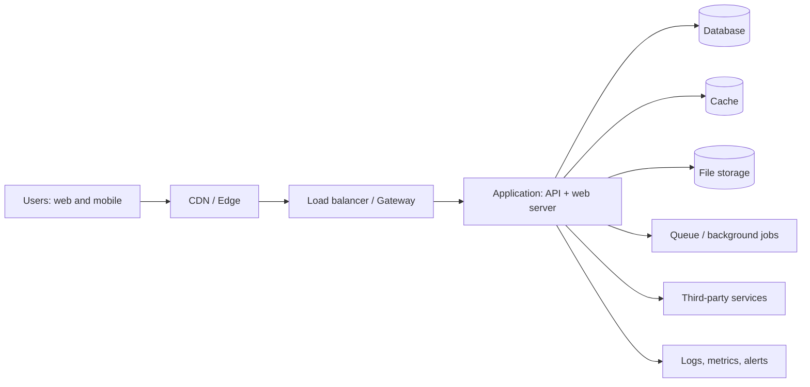

# How to fill this document

> **What is this file?** It is the single place that describes *where your product lives on the internet and how it keeps running* — from the first line of code until your **first 500 customers** are happily using it.
> **Who can fill it?** Anyone. If you can tick a box and write a short sentence, you can do this.

## The 7 simple steps

1. **Copy this file** into your project at `docs/deployment-and-production-operations/Infrastructure_Architecture.md`. Keep the name exactly.
2. **Fill the "Project Snapshot" first** (Section 0). Everything else depends on it.
3. **Small project?** Do the **⚡ Quick Start** (15 questions) first. **Big project?** Go top to bottom and answer every question. Do not skip.
4. **Tick a box** by changing `[ ]` to `[x]`. Pick only what is true for *your* project.
5. **Don't know the answer?** Tick **"Not sure → use the recommended default"**. The default is always the safe choice. Later, someone can change it.
6. **Write short answers.** One sentence is enough. Write numbers when you can ("200 users", not "a lot").
7. **Finish with the Completeness Checklist** (Appendix C). If your score is **90% or more**, the document is ready.

## Symbols you will see

| Symbol | Meaning |
|---|---|
| `[ ]` / `[x]` | Empty box / ticked box |
| `____` | A blank. Write your answer here |
| ⭐ | Recommended default (safe choice) |
| 🔴 | **Must answer** before launch |
| 🟡 | Should answer before launch |
| 🟢 | Nice to have |
| 💡 | "What does this mean?" explanation in simple words |
| 🤖 | Optional box for AI agents. Humans can skip it |
| `IA-05-Q03` | Question ID (Infrastructure Architecture, Section 05, Question 03). Use it when talking about an answer |

## Example of one answered question

> **IA-05-Q01 🔴 Which cloud will host the product?**
> - [ ] AWS  - [x] Google Cloud  - [ ] Azure  - [ ] Vercel / Netlify  - [ ] Other: ____  - [ ] Not sure → use the recommended default ⭐
> **Answer:** `Google Cloud`
> **Why (one sentence):** `Our team already knows it and we have free credits.`

## Rules for good answers

- **No guessing.** If you guessed, write `(guess)` next to it.
- **Name a person.** Every "Owner" must be a real person or role, never "the team".
- **Use numbers + units.** "99.9% uptime", "$500/month", "4 hours".
- **Never paste passwords, keys, or tokens in this file.** Write *where* they are stored instead (for example "in the secrets manager").
- **Wrong answer is OK. Empty answer is not.**

---

## ⚡ Quick Start Path (for small projects)

💡 *Small project = 1–3 builders, one product, fewer than about 100 customers expected. Answer only these 15 questions first. For everything else, tick **"Not sure → use the recommended default ⭐"**. Come back and fill the full sections when you reach **50 customers** or before you launch, whichever is sooner.*

| # | Question | Full question lives in | Your answer |
|---|---|---|---|
| 1 | What does the product do (one sentence)? | IA-00-Q01 | ____ |
| 2 | Web, mobile, or both? | IA-00-Q03 | ____ |
| 3 | Launch date? | IA-00-Q06 | ____ |
| 4 | Monthly infrastructure budget? | IA-19-Q01 | $____ |
| 5 | Which cloud / hosting platform? | IA-05-Q01 | ____ |
| 6 | One app (monolith) or many small services? | IA-04-Q01 | ____ |
| 7 | Which database, and is it managed by the provider? | IA-09-Q01 / Q02 | ____ |
| 8 | Which environments exist (local, staging, production)? | Section 6 | ____ |
| 9 | Where is the code and what runs the automatic tests and deploys? | IA-12-Q01 / Q02 | ____ |
| 10 | How do we go back to the last good version if a release breaks? | IA-12-Q07 | ____ |
| 11 | Where are passwords and keys stored? | IA-13-Q03 | ____ |
| 12 | Who is alerted when the product is down, and how? | IA-15-Q07 | ____ |
| 13 | How often are backups made, and when was the last restore test? | IA-17-Q02 / Q06 | ____ |
| 14 | Who answers the alarm at night or weekends? | IA-16-Q01 | ____ |
| 15 | Do we store personal data (names, emails, payments)? | IA-09-Q10 | ____ |

**You may stop after the Quick Start only if all are true:** [ ] fewer than 100 customers expected  [ ] no health or financial data  [ ] a rollback was tested once  [ ] a restore was tested once.
**Otherwise, continue with every 🔴 question below.**

---

# Infrastructure Architecture

## Document Control

| Field | Answer |
|---|---|
| Product name | ____ |
| Document version | 0.1 |
| Status | [ ] Draft  [ ] In review  [ ] Approved  [ ] Outdated |
| Document owner (one person) | ____ |
| Last updated (YYYY-MM-DD) | ____ |
| Next review date | ____ |
| Related documents (links) | ____ |

---

## 0. Project Snapshot 🔴

💡 *A one-minute summary so any reader understands the project at a glance.*

| # | Question | Answer |
|---|---|---|
| IA-00-Q01 | In one sentence, what does the product do? | ____ |
| IA-00-Q02 | Who are the users? (e.g. "small shop owners") | ____ |
| IA-00-Q03 | Product type (tick all) | [ ] Website  [ ] Web app / SaaS  [ ] iOS app  [ ] Android app  [ ] API  [ ] Admin dashboard  [ ] Other: ____ |
| IA-00-Q04 | Does it use AI / LLMs? | [ ] No  [ ] Yes, it calls a hosted AI model  [ ] Yes, we host our own model |
| IA-00-Q05 | Who is paying / who pays for infrastructure? | ____ |
| IA-00-Q06 | Target launch date | ____ |
| IA-00-Q07 | Target date to reach 500 customers | ____ |
| IA-00-Q08 | Team size building and running it | ____ people |
| IA-00-Q09 | Does the team have a dedicated DevOps / infra person? | [ ] Yes: ____  [ ] No ⭐ (then prefer **managed services**, see Section 5) |

---

## 1. Goals and Success Definition 🔴

💡 *Infrastructure exists to serve the business. Write what "working well" means.*

| # | Question | Answer |
|---|---|---|
| IA-01-Q01 | Main goal of this infrastructure (pick one) | [ ] Launch fast  [ ] Keep costs very low  [ ] Be very reliable  [ ] Be very secure  [ ] Scale quickly |
| IA-01-Q02 | What does "success at 500 customers" mean in numbers? | Paying customers: ____  Active users: ____  Requests/day: ____ |
| IA-01-Q03 | What must NEVER happen? (e.g. lose customer data) | ____ |
| IA-01-Q04 | Out of scope (what this document does NOT cover) | ____ |

### Service targets

| Target | Recommended default ⭐ | Your answer |
|---|---|---|
| Uptime (availability) | 99.5% before launch, 99.9% after 100 customers | ____ |
| Page / screen load time (95% of users) | under 3 seconds | ____ |
| API response time (95% of calls) | under 500 ms | ____ |
| Max data loss allowed (RPO) | 24 hours at launch, 1 hour by 500 customers | ____ |
| Max downtime to recover (RTO) | 4 hours at launch, 1 hour by 500 customers | ____ |

- [ ] Not sure → use the recommended defaults ⭐

---

## 2. Lifecycle Stages: From First Code to 500 Customers 🔴

💡 *You do not need big infrastructure on day one. You grow it in stages. This section says what is needed at each stage.*

| Stage | Name | What happens | Infra goal |
|---|---|---|---|
| S1 | **Build** | Developers write code on laptops and a shared dev environment | Fast, cheap, disposable |
| S2 | **Test / Staging** | QA, load tests, security checks on a copy of production | Same shape as production |
| S3 | **Launch day** | Product goes live | Safe release and easy rollback |
| S4 | **Customers 1–50** | Early adopters, lots of fixes | Learn fast, watch everything |
| S5 | **Customers 51–200** | Word spreads, traffic grows | Remove first bottlenecks |
| S6 | **Customers 201–500** | Stable growth | Reliability, cost control, support |

### Fill the plan for each stage

| Stage | Expected users | Expected monthly infra budget | Hosting size / plan | Owner |
|---|---|---|---|---|
| S1 Build | ____ | $____ | ____ | ____ |
| S2 Staging | ____ | $____ | ____ | ____ |
| S3 Launch | ____ | $____ | ____ | ____ |
| S4 1–50 | ____ | $____ | ____ | ____ |
| S5 51–200 | ____ | $____ | ____ | ____ |
| S6 201–500 | ____ | $____ | ____ | ____ |

### Stage gates (can we move to the next stage?)

| Gate | Must be true | Done? |
|---|---|---|
| S1 → S2 | Code builds automatically; dev environment works for all developers | [ ] |
| S2 → S3 | Load test passed; security checks passed; backup restore tested; rollback tested | [ ] |
| S3 → S4 | Launch checklist (Section 20) fully ticked; monitoring alerts working | [ ] |
| S4 → S5 | No critical incidents for 14 days; cost per customer known | [ ] |
| S5 → S6 | Scaling triggers (Section 18) reviewed; disaster recovery drill done | [ ] |

---

## 3. Requirements and Constraints 🔴

| # | Question | Answer |
|---|---|---|
| IA-03-Q01 | Peak users at the same time at 500 customers | ____ |
| IA-03-Q02 | Peak requests per second (if unknown, multiply peak users by 2) | ____ |
| IA-03-Q03 | Amount of data stored at 500 customers (GB) | ____ |
| IA-03-Q04 | Files users upload? | [ ] No  [ ] Yes: types ____ max size ____ MB |
| IA-03-Q05 | Countries of users (affects hosting location and laws) | ____ |
| IA-03-Q06 | Hours of use | [ ] 24/7  [ ] Business hours only: ____ timezone ____ |
| IA-03-Q07 | Are there hard limits? | [ ] Budget: $____/month  [ ] Must use specific cloud: ____  [ ] Must keep data in a region: ____  [ ] None |
| IA-03-Q08 | Biggest technical constraint today | ____ |

---

## 4. Architecture Overview 🔴

💡 *A drawing of the pieces and how they talk to each other. A rough picture is better than none.*

### 4.1 Diagram

Paste a link or image to the diagram, **and** add a simple text version below.

- Diagram link/file: ____
- Tool used: [ ] Mermaid (inside this file) ⭐  [ ] Draw.io  [ ] Figma / FigJam  [ ] Whiteboard photo



> Edit the diagram above so it matches your real system. Delete boxes you do not use.

### 4.2 Architecture style

| # | Question | Answer |
|---|---|---|
| IA-04-Q01 | Style 🔴 | [ ] Single app (monolith) ⭐ for < 500 customers  [ ] Modular monolith  [ ] Microservices  [ ] Serverless functions  [ ] Mix: ____ |
| IA-04-Q02 | Why this style? (one sentence) | ____ |
| IA-04-Q03 | Where does the frontend run? | [ ] Static hosting / CDN  [ ] Server-rendered  [ ] Inside mobile app only |
| IA-04-Q04 | Which regions / locations? | Primary: ____  Backup: ____ |

### 4.3 Component list

| ID | Component | What it does | Technology | Managed by (us / provider) | Owner |
|---|---|---|---|---|---|
| C01 | Web frontend | ____ | ____ | ____ | ____ |
| C02 | Backend / API | ____ | ____ | ____ | ____ |
| C03 | Database | ____ | ____ | ____ | ____ |
| C04 | File storage | ____ | ____ | ____ | ____ |
| C05 | Cache | ____ | ____ | ____ | ____ |
| C06 | Background jobs / queue | ____ | ____ | ____ | ____ |
| C07 | Authentication | ____ | ____ | ____ | ____ |
| C08 | Email / SMS / push | ____ | ____ | ____ | ____ |
| C09 | Payments | ____ | ____ | ____ | ____ |
| C10 | AI / LLM service | ____ | ____ | ____ | ____ |
| C11 | ____ | ____ | ____ | ____ | ____ |

🤖 <details><summary>AI agent prompt for this section (optional)</summary>

```text
Read Section 4 of Infrastructure_Architecture.md. List every component that has no owner, no technology, or is missing from the diagram. Check that every arrow in the diagram has a matching component row. Output a list of gaps as IDs (e.g. C05) with a suggested fix. Do not invent answers; mark unknowns as "NEEDS HUMAN".
```
</details>

---

## 5. Hosting and Cloud Choices 🔴

💡 *"Cloud" means renting computers from a company instead of buying your own.*

| # | Question | Answer |
|---|---|---|
| IA-05-Q01 | Main provider | [ ] AWS  [ ] Google Cloud  [ ] Azure  [ ] Vercel / Netlify / Render / Railway / Fly.io  [ ] DigitalOcean / Hetzner  [ ] Other: ____  [ ] Not sure → managed platform ⭐ |
| IA-05-Q02 | Why this provider? | [ ] Team knows it  [ ] Free credits  [ ] Cheapest  [ ] Needed feature: ____  [ ] Client requirement |
| IA-05-Q03 | Will we use more than one provider? | [ ] No ⭐  [ ] Yes: ____ |
| IA-05-Q04 | How much do we manage ourselves? | [ ] Fully managed platform (PaaS) ⭐  [ ] Containers on a managed service  [ ] Kubernetes  [ ] Virtual machines  [ ] Serverless |
| IA-05-Q05 | How hard is it to leave this provider? | [ ] Easy  [ ] Medium  [ ] Hard. What locks us in: ____ |
| IA-05-Q06 | Account setup | [ ] Company-owned account (not a personal one)  [ ] Two admins minimum  [ ] Billing alerts on |

> ⭐ **Default rule:** if you have no dedicated DevOps person, choose *managed services* (managed database, managed hosting). Do not choose Kubernetes for fewer than 500 customers unless you have a strong reason: ____

---

## 6. Environments 🔴

💡 *An "environment" is a separate copy of your product. You test in one and customers use another.*

| Environment | Needed? | Who uses it | Same as production? | Data | URL | Auto-deployed from |
|---|---|---|---|---|---|---|
| Local (laptop) | [x] | Developers | No | Fake | localhost | n/a |
| Dev (shared) | [ ] | Developers | Smaller | Fake | ____ | branch: ____ |
| Staging / Test | [ ] 🔴 | QA, testers | **Yes, same shape** ⭐ | Fake or masked | ____ | branch: ____ |
| Production | [x] | Customers | n/a | Real | ____ | branch: ____ |
| Preview per pull request | [ ] 🟢 | Reviewers | Smaller | Fake | auto | each PR |

| # | Question | Answer |
|---|---|---|
| IA-06-Q01 | How does a new developer get a working setup? | [ ] One command  [ ] Written steps (link: ____)  [ ] Nobody knows yet |
| IA-06-Q02 | Time for a new developer to be running locally | ____ minutes |
| IA-06-Q03 | Is real customer data ever copied to non-production? | [ ] Never ⭐  [ ] Yes, but masked  [ ] Yes, raw (**must justify**: ____) |
| IA-06-Q04 | Who can change production? | ____ |

---

## 7. Networking, Domains and Delivery 🔴

💡 *In plain words: how do people find your product (the web address), how does the connection stay private (the padlock), and who is allowed in (the doors and locks)?*

> **Example:** Domain `plantpal.app` at Cloudflare; HTTPS renews itself; database has no public door; each user can make 60 requests a minute.

| # | Question | Answer |
|---|---|---|
| IA-07-Q01 | Domain name(s) | ____ |
| IA-07-Q02 | Where is DNS managed? | ____ |
| IA-07-Q03 | Who owns the domain account? | ____ |
| IA-07-Q04 | HTTPS / TLS certificates | [ ] Auto-renewed ⭐  [ ] Manual (renewal date ____) |
| IA-07-Q05 | CDN (makes things faster worldwide) | [ ] Yes: ____ ⭐  [ ] No |
| IA-07-Q06 | Load balancer / API gateway | [ ] Provided by platform ⭐  [ ] Self-managed: ____  [ ] None yet |
| IA-07-Q07 | Is the database reachable from the public internet? | [ ] No ⭐  [ ] Yes (**explain why**: ____) |
| IA-07-Q08 | Firewall / allowed traffic | [ ] Only needed ports open ⭐  [ ] Not set yet |
| IA-07-Q09 | DDoS / bot protection | [ ] Yes: ____  [ ] No |
| IA-07-Q10 | Rate limiting on public APIs | [ ] Yes: ____ per minute  [ ] No |

---

## 8. Compute and Runtime 🔴

💡 *In plain words: "compute" is the engine that runs your code. Here you decide how big the engine is and how it grows.*

> **Example:** One container, 1 CPU, 2 GB memory, 2 copies running. No auto-scaling at launch. Health check at `/health`.

| # | Question | Answer |
|---|---|---|
| IA-08-Q01 | Languages / frameworks | Backend: ____  Frontend: ____  Mobile: ____ |
| IA-08-Q02 | How is the app packaged? | [ ] Containers (Docker) ⭐  [ ] Serverless functions  [ ] Plain deploy to platform  [ ] Virtual machine image |
| IA-08-Q03 | Server size at launch | CPU ____  Memory ____ GB  Instances ____ |
| IA-08-Q04 | Auto-scaling | [ ] No (fixed size) ⭐ at launch  [ ] Yes: min ____ max ____ |
| IA-08-Q05 | Health check URL | ____ |
| IA-08-Q06 | Zero-downtime deploys? | [ ] Yes (rolling / blue-green)  [ ] No, short downtime accepted: ____ min |
| IA-08-Q07 | Scheduled jobs (cron) | ____ |
| IA-08-Q08 | App follows "12-factor" basics (config in env vars, logs to stdout, stateless)? | [ ] Yes  [ ] Partly  [ ] No |

---

## 9. Data: Database, Storage, Cache, Queues 🔴

💡 *Data is the most valuable thing you have. Treat it with the most care.*

### 9.1 Database

| # | Question | Answer |
|---|---|---|
| IA-09-Q01 | Database type | [ ] PostgreSQL ⭐  [ ] MySQL  [ ] MongoDB  [ ] SQLite  [ ] Firebase / Supabase  [ ] Other: ____ |
| IA-09-Q02 | Managed by provider? | [ ] Yes ⭐  [ ] No (who patches it? ____) |
| IA-09-Q03 | Size at launch → at 500 customers | ____ GB → ____ GB |
| IA-09-Q04 | High availability (standby copy)? | [ ] No at launch  [ ] Yes by customer #____ |
| IA-09-Q05 | How are database changes (migrations) applied? | [ ] Automatic in pipeline ⭐  [ ] Manual by: ____ |
| IA-09-Q06 | Connection limits understood? | [ ] Yes (pool size ____)  [ ] No |

### 9.2 File storage, cache, queue

| Item | Needed? | Technology | Notes |
|---|---|---|---|
| Object / file storage | [ ] | ____ | Public or private? ____ |
| Cache (Redis, etc.) | [ ] | ____ | What is cached? ____ |
| Queue / message broker | [ ] | ____ | Which jobs? ____ |
| Search engine | [ ] | ____ | ____ |
| Vector database (AI) | [ ] | ____ | ____ |

### 9.3 Data rules

| # | Question | Answer |
|---|---|---|
| IA-09-Q10 | Personal data stored? | [ ] No  [ ] Yes: ____ (name, email, phone, location, payments, health, other) |
| IA-09-Q11 | Data encrypted when stored? | [ ] Yes ⭐  [ ] No |
| IA-09-Q12 | How long do we keep data? | ____ |
| IA-09-Q13 | Can a customer ask us to delete their data? How? | ____ |

---

## 10. Mobile App Infrastructure 🟡

*Skip this section if you have no mobile app. Write "Not applicable" here: ____*

| # | Question | Answer |
|---|---|---|
| IA-10-Q01 | Platforms | [ ] iOS  [ ] Android |
| IA-10-Q02 | Developer accounts (Apple / Google) owned by | ____ |
| IA-10-Q03 | Build and signing | [ ] Automated in CI  [ ] Manual. Where are signing keys kept? ____ |
| IA-10-Q04 | Push notifications service | ____ |
| IA-10-Q05 | How do old app versions keep working after the API changes? | [ ] Versioned API ⭐  [ ] Force update screen  [ ] Not planned |
| IA-10-Q06 | Over-the-air updates | [ ] Yes: ____  [ ] No |
| IA-10-Q07 | App store review time planned for | ____ days (allow 2–7) |
| IA-10-Q08 | Crash reporting tool | ____ |
| IA-10-Q09 | Beta testing channel | [ ] TestFlight  [ ] Google Play testing  [ ] Other: ____ |
| IA-10-Q10 | Remote kill-switch / feature flags | [ ] Yes: ____  [ ] No |

---

## 11. Third-Party Services and Dependencies 🟡

| Service | What for | Plan / cost | Limit that could break us | What happens if it is down? | Owner |
|---|---|---|---|---|---|
| Authentication | ____ | ____ | ____ | ____ | ____ |
| Payments | ____ | ____ | ____ | ____ | ____ |
| Email | ____ | ____ | ____ | ____ | ____ |
| SMS / push | ____ | ____ | ____ | ____ | ____ |
| Analytics | ____ | ____ | ____ | ____ | ____ |
| AI / LLM provider | ____ | ____ | rate limit ____ | ____ | ____ |
| ____ | ____ | ____ | ____ | ____ | ____ |

- [ ] Every service has an account owned by the company, not a person.
- [ ] We know each service's rate limits and price jumps.

---

## 12. CI/CD and Release Process 🔴

💡 *CI/CD is a robot that tests and ships your code automatically. In plain words: "Does the new version work? If yes, put it online. If it breaks, put the old one back."*

> **Example:** GitHub Actions runs tests on every change → deploys to staging automatically → production needs one approval → rollback is one button and takes 5 minutes.

| # | Question | Answer |
|---|---|---|
| IA-12-Q01 | Code stored in | [ ] GitHub  [ ] GitLab  [ ] Bitbucket  [ ] Other: ____ |
| IA-12-Q02 | Pipeline tool | [ ] GitHub Actions  [ ] GitLab CI  [ ] CircleCI  [ ] Other: ____ |
| IA-12-Q03 | Steps run on every change | [ ] Build  [ ] Unit tests  [ ] Lint  [ ] Security scan  [ ] Dependency check  [ ] Deploy to staging |
| IA-12-Q04 | How does code reach production? | [ ] Automatic after approval ⭐  [ ] Manual button  [ ] Manual commands |
| IA-12-Q05 | Who approves a production release? | ____ |
| IA-12-Q06 | Release strategy | [ ] Rolling  [ ] Blue-green  [ ] Canary (small % first)  [ ] Feature flags  [ ] All at once |
| IA-12-Q07 | How do we roll back? 🔴 | Steps: ____ Time needed: ____ min |
| IA-12-Q08 | Release frequency | [ ] Many per day  [ ] Weekly  [ ] Monthly |
| IA-12-Q09 | Release freeze periods (e.g. holidays, launch week) | ____ |
| IA-12-Q10 | Branch protection (no direct push to main) | [ ] Yes ⭐  [ ] No |

---

## 13. Infrastructure as Code, Configuration and Secrets 🔴

💡 *In plain words: write your setup down as a recipe a computer can follow, so you can rebuild everything if it is lost. Keep passwords in a locked safe, never in the code.*

> **Example:** Terraform files in `/infra`; secrets in the cloud secrets manager; production secrets readable by 2 people only; rotated every 90 days.

| # | Question | Answer |
|---|---|---|
| IA-13-Q01 | Is infrastructure created by code (so it can be rebuilt)? | [ ] Yes, with: [ ] Terraform / OpenTofu  [ ] Pulumi  [ ] CloudFormation  [ ] Bicep  [ ] Other: ____  [ ] No, clicked by hand (**risky**, list steps in Section 13 notes) |
| IA-13-Q02 | Where is the IaC code? | ____ |
| IA-13-Q03 | Where are secrets stored (passwords, API keys)? | [ ] Secrets manager ⭐  [ ] CI secrets  [ ] `.env` files  [ ] Other: ____ |
| IA-13-Q04 | Are secrets ever in the code repository? | [ ] Never ⭐  [ ] Yes (**fix before launch**) |
| IA-13-Q05 | How often are secrets rotated? | ____ |
| IA-13-Q06 | Who can read production secrets? | ____ |
| IA-13-Q07 | Where is non-secret configuration kept? | ____ |
| IA-13-Q08 | Can the whole system be rebuilt from scratch? How long? | ____ hours |

---

## 14. Security and Compliance 🔴

### 14.1 Access

| # | Question | Answer |
|---|---|---|
| IA-14-Q01 | Two-factor login on all admin accounts | [ ] Yes ⭐  [ ] No |
| IA-14-Q02 | Least access (people get only what they need) | [ ] Yes  [ ] No |
| IA-14-Q03 | Who has admin access to production? | ____ |
| IA-14-Q04 | What happens when someone leaves the team? | Steps: ____ |
| IA-14-Q05 | Are access logs kept? | [ ] Yes, for ____ days |

### 14.2 Protection

| # | Question | Answer |
|---|---|---|
| IA-14-Q10 | Data encrypted in transit (HTTPS everywhere) | [ ] Yes ⭐  [ ] No |
| IA-14-Q11 | Dependency and container vulnerability scanning | [ ] Yes: ____  [ ] No |
| IA-14-Q12 | Security test before launch | [ ] Internal checklist  [ ] External penetration test  [ ] None |
| IA-14-Q13 | Web protections (OWASP Top 10 reviewed) | [ ] Yes  [ ] No |
| IA-14-Q14 | Operating system / runtime patching | [ ] Provider handles  [ ] We do it every ____ |
| IA-14-Q15 | Who is told first if a security problem is found? | ____ |

### 14.3 Rules and laws

| Rule | Applies to us? | Status |
|---|---|---|
| GDPR (EU users) | [ ] Yes  [ ] No  [ ] Not sure | ____ |
| CCPA / CPRA (California) | [ ] Yes  [ ] No  [ ] Not sure | ____ |
| PCI-DSS (card payments, usually handled by payment provider) | [ ] Yes  [ ] No  [ ] Not sure | ____ |
| HIPAA (health data, US) | [ ] Yes  [ ] No  [ ] Not sure | ____ |
| SOC 2 (customers may ask) | [ ] Yes  [ ] No  [ ] Later | ____ |
| App store policies | [ ] Yes  [ ] No | ____ |
| Other: ____ | ____ | ____ |

- [ ] Privacy policy and terms are published before launch.
- [ ] A lawyer or compliance person has reviewed this section. Name: ____

---

## 15. Monitoring, Logging and Alerts 🔴

💡 *You cannot fix what you cannot see. Monitoring is your product's dashboard and alarm.*

| # | Question | Answer |
|---|---|---|
| IA-15-Q01 | Monitoring tool(s) | [ ] Provider built-in  [ ] Datadog  [ ] Grafana / Prometheus  [ ] New Relic  [ ] Sentry  [ ] Other: ____ |
| IA-15-Q02 | Where do logs go and for how long? | ____ , ____ days |
| IA-15-Q03 | Are personal data and secrets kept out of logs? | [ ] Yes  [ ] Not checked |
| IA-15-Q04 | Uptime check from outside | [ ] Yes: ____  [ ] No |
| IA-15-Q05 | Error tracking for web and mobile | [ ] Yes: ____  [ ] No |
| IA-15-Q06 | Status page for customers | [ ] Yes: ____  [ ] No |
| IA-15-Q07 | Where do alerts go? | [ ] Email  [ ] Slack/Teams  [ ] SMS / phone call  [ ] Pager tool: ____ |

### What we watch (minimum set ⭐)

| What | Alert when | Severity | Who is notified |
|---|---|---|---|
| Site/API is down | fails 2 checks in a row | Critical | ____ |
| Error rate | above ____% for 5 min | High | ____ |
| Slow responses | 95th percentile above ____ ms | Medium | ____ |
| CPU / memory | above 80% for 10 min | Medium | ____ |
| Database disk space | above 80% | High | ____ |
| Database connections | above 80% of limit | High | ____ |
| Queue backlog | grows for 15 min | Medium | ____ |
| Failed payments / logins spike | above ____ | High | ____ |
| Certificate expiry | under 14 days | Medium | ____ |
| Cloud cost | above ____% of budget | Medium | ____ |

---

## 16. Incident Response and On-Call 🔴

💡 *An incident is when something breaks for customers. This section says who does what.*

| # | Question | Answer |
|---|---|---|
| IA-16-Q01 | Who is on call? | [ ] Rotation: ____  [ ] One person: ____  [ ] Nobody (**state business-hours only**) |
| IA-16-Q02 | How fast must someone respond? | Critical: ____ min  High: ____ min |
| IA-16-Q03 | Where do we chat during an incident? | ____ |
| IA-16-Q04 | Who talks to customers? | ____ |
| IA-16-Q05 | Do we write a review after each incident (no blame)? | [ ] Yes ⭐  [ ] No |

### Severity levels

| Level | Meaning | Example | Response |
|---|---|---|---|
| SEV1 | Everything is down or data at risk | Site down, data leak | Immediately, all hands |
| SEV2 | Major feature broken | Payments fail | Within 30 min |
| SEV3 | Minor problem | One page slow | Next business day |

### Runbooks (step-by-step fix guides)

| Problem | Runbook link | Exists? |
|---|---|---|
| Site is down | ____ | [ ] |
| Database is full or slow | ____ | [ ] |
| Bad release → roll back | ____ | [ ] |
| Third-party service is down | ____ | [ ] |
| Security incident / leaked secret | ____ | [ ] |

---

## 17. Backup and Disaster Recovery 🔴

💡 *A backup you have never restored is just a hope. In plain words: "If everything disappears tonight, how do we get it back, and how much do we lose?"*

> **Example:** Database backed up every night, kept 30 days, stored in a second region. Restore tested on 2026-09-30, took 25 minutes. Accepted data loss: up to 24 hours.

| # | Question | Answer |
|---|---|---|
| IA-17-Q01 | What is backed up? | [ ] Database  [ ] Files  [ ] Configuration  [ ] Secrets  [ ] Code |
| IA-17-Q02 | How often? | ____ (⭐ daily at launch, hourly or continuous by 500 customers) |
| IA-17-Q03 | How long are backups kept? | ____ days (⭐ 30) |
| IA-17-Q04 | Stored in a different place from the original? | [ ] Yes, ____  [ ] No |
| IA-17-Q05 | Are backups encrypted? | [ ] Yes  [ ] No |
| IA-17-Q06 | Date of the last successful restore test | ____ |
| IA-17-Q07 | Time the restore took | ____ minutes |
| IA-17-Q08 | If the whole region fails, what do we do? | [ ] Failover to: ____  [ ] Rebuild from IaC in ____ hours  [ ] Accept downtime |
| IA-17-Q09 | Disaster recovery drill | [ ] Done on ____  [ ] Planned for ____ |

---

## 18. Scalability and Performance 🟡

💡 *In plain words: what happens when 10× more people show up? Decide in advance which warning sign means "make it bigger".*

> **Example:** If database CPU stays above 70% for a day, upgrade the database size. If response time (p95) goes above 800 ms, add a cache before adding servers.

| # | Question | Answer |
|---|---|---|
| IA-18-Q01 | Load test done? | [ ] Yes: tool ____ result ____ users  [ ] No (**required before launch**) |
| IA-18-Q02 | Known slowest part | ____ |
| IA-18-Q03 | Single point of failure (one thing whose failure stops everything) | ____ |
| IA-18-Q04 | Scale up (bigger machine) or out (more machines)? | ____ |

### Scaling triggers: "When X happens, we do Y"

| Trigger (measure) | Threshold | Action | Owner |
|---|---|---|---|
| CPU average | above 70% for 1 day | add instance / upgrade size | ____ |
| Database CPU / connections | above 70% | upgrade, add read replica, add pooling | ____ |
| Response time (p95) | above ____ ms | profile, cache, scale | ____ |
| Storage | above 70% | expand / archive | ____ |
| Customers reach 50 / 200 / 400 | count | review this document and costs | ____ |
| Third-party limit | above 70% of quota | raise plan | ____ |

---

## 19. Cost Control (FinOps) 🟡

| # | Question | Answer |
|---|---|---|
| IA-19-Q01 | Monthly budget at launch → at 500 customers | $____ → $____ |
| IA-19-Q02 | Who approves spending above budget? | ____ |
| IA-19-Q03 | Budget alerts | [ ] 50%  [ ] 80%  [ ] 100%  Sent to: ____ |
| IA-19-Q04 | Resources tagged by project / environment | [ ] Yes  [ ] No |
| IA-19-Q05 | Do we know the infra cost per customer? | $____ per customer per month |
| IA-19-Q06 | Non-production shut down at night/weekends | [ ] Yes  [ ] No |
| IA-19-Q07 | Free credits / discounts and expiry date | ____ |
| IA-19-Q08 | Biggest cost driver | ____ |
| IA-19-Q09 | AI / LLM spend cap per day | $____ |

### Cost forecast

| Stage | Hosting | Database | Storage | Third-party | AI | Monitoring | Total |
|---|---|---|---|---|---|---|---|
| S3 Launch | $ | $ | $ | $ | $ | $ | $ |
| S4 1–50 | $ | $ | $ | $ | $ | $ | $ |
| S5 51–200 | $ | $ | $ | $ | $ | $ | $ |
| S6 201–500 | $ | $ | $ | $ | $ | $ | $ |

---

## 20. Launch Day Plan 🔴

💡 *Launch day should be boring. Boring means you prepared well.*

### 20.1 Go / No-Go checklist (all must be ticked)

- [ ] Production environment built and matches staging
- [ ] Load test passed at expected peak ×2
- [ ] Backup restore tested
- [ ] Rollback tested on staging
- [ ] Monitoring and alerts firing correctly (test alert sent)
- [ ] On-call person named and reachable
- [ ] Domain, HTTPS, DNS verified
- [ ] Secrets in secrets manager; none in code
- [ ] Security checks done (Section 14)
- [ ] Privacy policy, terms published
- [ ] Payments tested with real small transaction
- [ ] Mobile apps approved in stores (if applicable)
- [ ] Support email / chat ready
- [ ] Status page ready
- [ ] Spending limits and budget alerts on
- [ ] Customers' data deletion/export process known

### 20.2 Launch timeline

| Time | Action | Owner | Done |
|---|---|---|---|
| T–7 days | Freeze risky changes | ____ | [ ] |
| T–1 day | Final staging test, Go/No-Go meeting | ____ | [ ] |
| T–1 hour | Verify monitoring and on-call | ____ | [ ] |
| T-0 | Release to production | ____ | [ ] |
| T+15 min | Smoke test (login, main action, payment) | ____ | [ ] |
| T+2 hours | Check errors, speed, cost | ____ | [ ] |
| T+24 hours | Review and write what we learned | ____ | [ ] |

### 20.3 Rollback decision

| # | Question | Answer |
|---|---|---|
| IA-20-Q01 | We roll back if (examples: error rate above __%, payments failing, data issue) | ____ |
| IA-20-Q02 | Who can decide to roll back? | ____ |
| IA-20-Q03 | Soft launch first (small group)? | [ ] Yes, ____ users  [ ] No |

---

## 21. Growth Playbook: Customers 1 to 500 🔴

💡 *What to do and check as the customer count grows.*

| Milestone | What to check | Typical changes | Owner | Done on |
|---|---|---|---|---|
| First customer | Signup, payment, email all work end-to-end | Fix surprises | ____ | ____ |
| 10 customers | Error log review, real usage vs. forecast | Tune alerts | ____ | ____ |
| 50 customers | Cost per customer, backups verified, slowest queries | Add indexes, cache | ____ | ____ |
| 100 customers | Update this document; run restore drill | Add standby DB? Bigger plan? | ____ | ____ |
| 200 customers | Load test again at 2× | Autoscaling, queue for heavy jobs | ____ | ____ |
| 350 customers | Security review, access cleanup | Pen test, rotate secrets | ____ | ____ |
| 500 customers | Full architecture review | Decide next architecture (Section 24) | ____ | ____ |

### Weekly / monthly habits

| When | Task | Owner |
|---|---|---|
| Weekly | Review alerts, errors, cost, open incidents | ____ |
| Monthly | Restore test of one backup; patch review; access review | ____ |
| Quarterly | Disaster recovery drill; update this document; dependency upgrades | ____ |

---

## 22. Ownership, Support and Maintenance 🟡

| Area | Owner (person) | Backup person | Contact |
|---|---|---|---|
| Overall architecture | ____ | ____ | ____ |
| Cloud account / billing | ____ | ____ | ____ |
| Database | ____ | ____ | ____ |
| CI/CD | ____ | ____ | ____ |
| Security | ____ | ____ | ____ |
| Monitoring / on-call | ____ | ____ | ____ |
| Mobile releases | ____ | ____ | ____ |
| Customer support | ____ | ____ | ____ |

| # | Question | Answer |
|---|---|---|
| IA-22-Q01 | What happens if the key person is unavailable for 2 weeks? | ____ |
| IA-22-Q02 | Where is this documentation kept (link)? | ____ |
| IA-22-Q03 | Planned end-of-life / upgrade dates (runtimes, databases) | ____ |

---

## 23. AI Agent Rules 🤖 (optional, humans may skip)

*Fill this if AI agents help build, deploy, or operate the product.*

| # | Question | Answer |
|---|---|---|
| IA-23-Q01 | Do AI agents touch infrastructure? | [ ] No (skip rest)  [ ] Read-only  [ ] Can change dev/staging  [ ] Can change production |
| IA-23-Q02 | Which actions need a human to approve first? | [ ] Deploy to production  [ ] Change database  [ ] Delete anything  [ ] Spend money  [ ] Change access / permissions  [ ] Change secrets  [ ] Other: ____ |
| IA-23-Q03 | What can an agent NEVER do? | ⭐ Never see or print secrets; never delete backups; never disable monitoring; never push directly to production |
| IA-23-Q04 | Agent identity & permissions | Account name: ____ Permission level: least needed ⭐ |
| IA-23-Q05 | Are agent actions logged and reviewable? | [ ] Yes, where: ____  [ ] No |
| IA-23-Q06 | Maximum spend / actions per run | $____ / ____ actions |
| IA-23-Q07 | Who is responsible for what an agent does? | ____ |

### Agent tasks by lifecycle stage

| Stage | Agent MAY help with | Agent must NOT do alone | Human approver | Proof the agent must attach |
|---|---|---|---|---|
| S1 Build | Draft infrastructure code, Dockerfiles, CI config, local setup scripts | Merge to main, create paid resources | Tech lead | Code diff + dry-run/plan output |
| S2 Test / Staging | Run tests, load tests, security scans; summarize results | Copy real customer data into staging | QA lead | Test and scan reports |
| S3 Launch | Check the Go/No-Go list against evidence, run smoke tests, draft runbooks | Deploy to production, change DNS, change payments settings | Product owner + Tech lead | Checklist with evidence links |
| S4–S6 Customers 1–500 | Triage alerts, report weekly cost and errors, draft incident summaries, propose scaling changes | Scale beyond budget, restore into production, rotate secrets, delete anything | On-call lead / DevOps | Metrics screenshot or query, proposed change, rollback plan |

### Agent approval gates

| Gate | Trigger | Approver | Max wait | If nobody answers |
|---|---|---|---|---|
| G1 Create or change paid resource | Any cost above $____ per month | ____ | ____ hours | Do nothing, ask again |
| G2 Production change | Any deploy, config, or database change | ____ | ____ min | Do nothing, page on-call |
| G3 Data deletion or restore | Any delete, truncate, restore | ____ | ____ min | Do nothing |
| G4 Access or secret change | Any permission or key change | ____ | ____ min | Do nothing |
| G5 Emergency (SEV1) | Customers affected now | On-call lead | ____ min | Follow runbook; log everything |

### Agent run log (one row per agent action)

| Date/time | Agent name | Task | Stage | Gate used | Approved by | Result | Link to evidence |
|---|---|---|---|---|---|---|---|
| ____ | ____ | ____ | ____ | ____ | ____ | ____ | ____ |

### Agent-readable rules

```yaml
agent_rules:
  read_only_environments: [production]
  require_human_approval: [deploy_production, database_change, delete_resource, access_change, spend_over_budget]
  forbidden: [print_secrets, delete_backups, disable_alerts, force_push_main]
  on_unknown_answer: "Mark NEEDS HUMAN. Do not guess."
  source_of_truth: "This file, section IDs IA-XX-QYY"
```

<details><summary>🤖 Master AI review prompt (optional)</summary>

```text
You are an infrastructure reviewer. Read Infrastructure_Architecture.md fully.
1. List every question with no answer (by ID, e.g. IA-09-Q04), grouped by 🔴, 🟡, 🟢.
2. Find contradictions (e.g. "no database public" but a public port listed).
3. Check every stage gate in Section 2 against the answers.
4. Flag guesses, missing owners, missing numbers or units.
5. Calculate the Completeness Score in Appendix C.
Never invent answers. Mark unknowns as NEEDS HUMAN. Output a table: ID | Problem | Suggested fix | Severity.
```
</details>

---

## 24. Risks, Assumptions and Open Questions 🟡

### Risks

| ID | Risk (what could go wrong) | Chance (L/M/H) | Impact (L/M/H) | Plan to reduce | Owner |
|---|---|---|---|---|---|
| R01 | ____ | | | ____ | ____ |
| R02 | ____ | | | ____ | ____ |
| R03 | ____ | | | ____ | ____ |

### Assumptions (things we believe but have not proven)

| ID | Assumption | How to check | By when |
|---|---|---|---|
| A01 | ____ | ____ | ____ |

### Open questions

| ID | Question | Who can answer | Due |
|---|---|---|---|
| Q01 | ____ | ____ | ____ |

### What comes after 500 customers?

- Next big change we expect (e.g. split database, add region, move to containers orchestration): ____
- Signal that tells us it is time: ____

---

## 25. Decision Log 🟢

💡 *Write down why you chose something so future people do not have to guess.*

| ID | Date | Decision | Options considered | Why we chose it | Who decided | Status |
|---|---|---|---|---|---|---|
| D01 | ____ | ____ | ____ | ____ | ____ | [ ] Active  [ ] Replaced |
| D02 | ____ | ____ | ____ | ____ | ____ | [ ] Active  [ ] Replaced |

---

## 26. Accessibility, Languages and Regional Delivery 🟡

💡 *In plain words: can everyone, in every country and with every ability, use the product quickly?*

| # | Question | Answer |
|---|---|---|
| IA-26-Q01 | Languages at launch → at 500 customers | ____ → ____ |
| IA-26-Q02 | Right-to-left languages (Arabic, Hebrew) needed? | [ ] No  [ ] Yes |
| IA-26-Q03 | Where are most users located? | ____ |
| IA-26-Q04 | Is the CDN close to those users? | [ ] Yes ⭐  [ ] No  [ ] Not sure |
| IA-26-Q05 | Must data stay inside a country or region? | [ ] No  [ ] Yes: ____ |
| IA-26-Q06 | Time zones, currencies, date formats handled in one place? | [ ] Yes  [ ] No |
| IA-26-Q07 | Accessibility target | [ ] WCAG 2.2 AA ⭐  [ ] Other: ____  [ ] None yet |
| IA-26-Q08 | Works on slow phone networks? Tested? | [ ] Yes  [ ] No |
| IA-26-Q09 | Where are translations stored and how are they released? | ____ |
| IA-26-Q10 | Are error pages and the status page accessible and translated? | [ ] Yes  [ ] No |

> **Default ⭐:** serve static files from a CDN, keep all translation text in files (not in code), and test with a keyboard and a screen reader before launch.

---

## 27. Customer Data Privacy and Support Tooling 🔴

💡 *In plain words: customers may ask "what do you know about me?" or "please delete me". And when something breaks they need someone to talk to. Plan both.*

| # | Question | Answer |
|---|---|---|
| IA-27-Q01 | Support tool | [ ] Email only  [ ] Help desk (Zendesk, Intercom, Help Scout, other: ____)  [ ] In-app chat |
| IA-27-Q02 | Support hours and first-reply target | ____ , ____ hours ⭐ (24 h at launch) |
| IA-27-Q03 | Who in support can see customer data? | ____ |
| IA-27-Q04 | Are support views of customer data logged? | [ ] Yes ⭐  [ ] No |
| IA-27-Q05 | Customer data export: how does a customer ask, and how long do we take? | ____ , ____ days ⭐ (30) |
| IA-27-Q06 | Customer data deletion: how, how long, and what about backups? | ____ , ____ days ⭐ (30; backups expire by schedule) |
| IA-27-Q07 | Consent (cookies, marketing) is recorded with date and version? | [ ] Yes  [ ] No  [ ] Not needed |
| IA-27-Q08 | Data breach plan: who decides, who informs customers and authorities? | ____ ⭐ (inform within 72 hours where GDPR applies) |
| IA-27-Q09 | Contracts with vendors that touch customer data (data processing agreements) | [ ] Signed  [ ] Pending  [ ] Not needed |
| IA-27-Q10 | Outage messages: template ready? Channel? | [ ] Yes: ____  [ ] No |
| IA-27-Q11 | Where does support report bugs so engineers see them? | ____ |

---

## 28. Vendor Exit and Migration Plan 🟡

💡 *In plain words: if your cloud or an important service becomes too expensive, unreliable, or disappears, how do you leave without losing customers?*

| # | Question | Answer |
|---|---|---|
| IA-28-Q01 | What would make us leave a vendor? | [ ] Price rise above ____%  [ ] ____ outages in 90 days  [ ] Policy or legal change  [ ] Service shut down  [ ] Other: ____ |
| IA-28-Q02 | Can we export all our data in a standard format? Tested? | [ ] Yes, tested on ____  [ ] Yes, not tested  [ ] No |
| IA-28-Q03 | Do we use proprietary features that are hard to replace? | [ ] No ⭐  [ ] Yes: ____ |
| IA-28-Q04 | Is a copy of code, infrastructure code, and configuration stored outside the main provider? | [ ] Yes: ____  [ ] No |
| IA-28-Q05 | Estimated time and cost to move everything | ____ weeks, $____ |
| IA-28-Q06 | Contract notice period and minimum term | ____ |

### Critical vendor exit table

| Vendor | What we would lose | How we export | Replacement option | Time to switch | Last exit test |
|---|---|---|---|---|---|
| Main cloud | ____ | ____ | ____ | ____ | ____ |
| Database | ____ | ____ | ____ | ____ | ____ |
| Authentication | ____ | ____ | ____ | ____ | ____ |
| Payments | ____ | ____ | ____ | ____ | ____ |
| AI / LLM provider | ____ | ____ | ____ | ____ | ____ |
| ____ | ____ | ____ | ____ | ____ | ____ |

---

## 29. Sustainability and Efficiency 🟢

💡 *In plain words: using fewer computer resources is good for the planet and also lowers the bill.*

| # | Question | Answer |
|---|---|---|
| IA-29-Q01 | Did we consider the cloud region's energy mix when choosing the region? | [ ] Yes  [ ] No  [ ] Not applicable (region fixed by law) |
| IA-29-Q02 | Non-production shut down when not in use? | [ ] Yes ⭐  [ ] No (ties to IA-19-Q06) |
| IA-29-Q03 | How often do we right-size servers and databases? | [ ] Monthly ⭐  [ ] Quarterly  [ ] Never |
| IA-29-Q04 | Do we delete or archive old data and unused resources on a schedule? | [ ] Yes ⭐  [ ] No |
| IA-29-Q05 | Are images, videos, and files compressed and cached? | [ ] Yes ⭐  [ ] No |
| IA-29-Q06 | Are heavy AI jobs batched or cached to avoid repeat work? | [ ] Yes  [ ] No  [ ] No AI |
| IA-29-Q07 | Does our provider publish sustainability reports? | [ ] Yes  [ ] No  [ ] Not checked |

---

# Appendices

## Appendix A: Glossary (plain words)

| Word | Simple meaning |
|---|---|
| Infrastructure | The computers, networks and services your product runs on, like the roads and power lines of a city |
| Cloud | Renting computers from a company instead of owning them |
| Server | A computer that answers requests from users |
| Environment | A separate copy of your product (dev, staging, production) |
| Production | The real version customers use |
| Staging | A practice copy of production for testing |
| Deploy | Put a new version of the product online |
| Rollback | Go back to the last good version |
| CI/CD | A robot that tests and ships code automatically |
| Container (Docker) | A sealed lunch box holding your app and everything it needs, so it runs the same anywhere |
| Kubernetes | A manager for lots of containers; powerful but complicated |
| Serverless | You give code to the cloud and it runs only when needed |
| Managed service | The provider looks after it (updates, backups) for you |
| Load balancer | A traffic officer that spreads visitors across servers |
| CDN | Copies of your files kept close to users so pages load fast |
| DNS | The internet's phone book that turns a name into an address |
| TLS / HTTPS | The padlock that scrambles data so nobody can spy on it |
| Database | An organized filing cabinet for your data |
| Cache | A shortcut memory that keeps popular answers handy |
| Queue | A waiting line for jobs to be done in the background |
| IaC (Infrastructure as Code) | Describing your servers in a file so they can be rebuilt automatically |
| Secret | A password or key that must never be shared |
| Backup | A saved copy you can use to get data back |
| RPO | How much data you can afford to lose (measured in time) |
| RTO | How long you can afford to be down |
| SLO / SLA | A promise about quality, such as "up 99.9% of the time" |
| Uptime | The share of time your product works |
| p95 | "95 of every 100 users are at least this fast" |
| Monitoring | Watching your product's health on dashboards |
| Alert | An alarm that tells a person something is wrong |
| Runbook | A step-by-step guide to fix a known problem |
| Incident | A problem that affects customers |
| On-call | The person who answers alarms right now |
| Autoscaling | Adding or removing servers automatically as traffic changes |
| Load test | Pretending lots of users arrive to see if the product holds |
| Single point of failure | One thing that, if it breaks, stops everything |
| FinOps | Keeping cloud spending under control |
| Feature flag | A switch that turns a feature on or off without a new release |
| Canary release | Giving a new version to a few users first |
| Blue-green | Two copies of production; switch traffic from old to new |
| ADR / Decision log | A diary of important choices and the reasons |
| WCAG | International rules that make websites usable for people with disabilities |
| Data residency | The rule that data must stay inside a country or region |
| Data processing agreement | A contract with a vendor that handles your customers' data |
| Vendor lock-in | Being so tied to one provider that leaving is very hard |
| Right-sizing | Choosing servers that fit the real need, not bigger |
| Agent approval gate | A "ask a human first" checkpoint for AI agents |
| Quick Start | The short 15-question path for small projects |

## Appendix B: Filled Mini-Example (fake project "PlantPal")

> This shows what "good" looks like. Delete this appendix in your real project.

| Question | Example answer |
|---|---|
| IA-00-Q01 | PlantPal reminds people to water their plants and identifies diseases from photos. |
| IA-00-Q03 | [x] Web app  [x] iOS app  [x] Android app |
| IA-01-Q02 | 500 paying customers, 3,000 monthly active users, 40,000 requests per day |
| IA-05-Q01 | [x] Google Cloud. Reason: free credits and team knows it |
| IA-05-Q04 | [x] Containers on a managed service (Cloud Run) |
| IA-04-Q01 | [x] Modular monolith. One backend, easy to run for a team of 3 |
| IA-09-Q01 | [x] PostgreSQL, managed, 20 GB now, 100 GB at 500 customers |
| IA-12-Q04 | Automatic to staging; production needs approval from Dana (tech lead) |
| IA-12-Q07 | Re-deploy previous image via pipeline button, takes 5 minutes |
| IA-15-Q07 | Slack #alerts for High; phone call to on-call for Critical |
| IA-17-Q02 | Daily backups at launch, continuous by 200 customers. Last restore test: 2026-09-30, took 25 min |
| IA-19-Q01 | $150/month at launch → $900/month at 500 customers |
| IA-19-Q05 | About $1.80 per customer per month |
| IA-21 | At 100 customers: restore drill and add a standby database |

## Appendix C: Completeness Checklist and Score

Count each line you can honestly tick. Mark 🔴 items ×3, 🟡 ×2, 🟢 ×1.

| # | Check | Weight | Ticked |
|---|---|---|---|
| 1 | Project Snapshot fully filled (S0) | 3 | [ ] |
| 2 | Goals and numeric targets set (S1) | 3 | [ ] |
| 3 | Stage plan and gates filled (S2) | 3 | [ ] |
| 4 | Requirements in numbers (S3) | 3 | [ ] |
| 5 | Diagram + component list match (S4) | 3 | [ ] |
| 6 | Provider and managed-vs-self choices made (S5) | 3 | [ ] |
| 7 | Environments defined (S6) | 3 | [ ] |
| 8 | Networking, domains, HTTPS (S7) | 3 | [ ] |
| 9 | Compute and runtime (S8) | 3 | [ ] |
| 10 | Data, backups of data defined (S9) | 3 | [ ] |
| 11 | Mobile section done or marked N/A (S10) | 2 | [ ] |
| 12 | Third-party services listed (S11) | 2 | [ ] |
| 13 | CI/CD and rollback defined (S12) | 3 | [ ] |
| 14 | IaC and secrets defined (S13) | 3 | [ ] |
| 15 | Security and compliance reviewed (S14) | 3 | [ ] |
| 16 | Monitoring and alerts defined (S15) | 3 | [ ] |
| 17 | Incident process and runbooks (S16) | 3 | [ ] |
| 18 | Backup tested; DR plan (S17) | 3 | [ ] |
| 19 | Scaling triggers defined (S18) | 2 | [ ] |
| 20 | Cost budget and forecast (S19) | 2 | [ ] |
| 21 | Launch checklist complete (S20) | 3 | [ ] |
| 22 | Growth playbook (S21) | 3 | [ ] |
| 23 | Owners named for all areas (S22) | 2 | [ ] |
| 24 | AI agent rules filled or marked N/A (S23) | 1 | [ ] |
| 25 | Risks and open questions listed (S24) | 2 | [ ] |
| 26 | Decisions logged (S25) | 1 | [ ] |
| 27 | Accessibility, languages, regions (S26) | 1 | [ ] |
| 28 | Privacy and support tooling (S27) | 3 | [ ] |
| 29 | Vendor exit plan (S28) | 1 | [ ] |
| 30 | Sustainability and efficiency (S29) | 1 | [ ] |
| 31 | No passwords, keys or tokens written in this file | 3 | [ ] |
| 32 | No "____" left, or each left blank is marked "Not sure → default" | 3 | [ ] |

**Total possible weight = 79.**
**Score = (sum of weights of ticked rows ÷ 79) × 100 = ____%**

> Used the Quick Start only? Your score is not needed. Use the "You may stop after the Quick Start only if…" box instead.

| Score | Meaning |
|---|---|
| 90–100% | ✅ Ready |
| 70–89% | 🟡 Almost. Fix 🔴 items first |
| Below 70% | 🔴 Not ready. Do not launch |

## Appendix D: Sign-off

| Role | Name | Decision | Date | Signature |
|---|---|---|---|---|
| Product owner | ____ | [ ] Approve  [ ] Changes needed | ____ | ____ |
| Tech lead / Architect | ____ | [ ] Approve  [ ] Changes needed | ____ | ____ |
| DevOps / Infra | ____ | [ ] Approve  [ ] Changes needed | ____ | ____ |
| Security | ____ | [ ] Approve  [ ] Changes needed | ____ | ____ |
| QA | ____ | [ ] Approve  [ ] Changes needed | ____ | ____ |
| Project manager | ____ | [ ] Approve  [ ] Changes needed | ____ | ____ |

## Appendix E: Change Log

| Version | Date | Author | What changed | Why |
|---|---|---|---|---|
| 0.1 | ____ | ____ | First draft | ____ |
| 0.2 | ____ | ____ | Added Quick Start, examples, agent stage tasks and gates, Sections 26–29 | ____ |
| | | | | |
